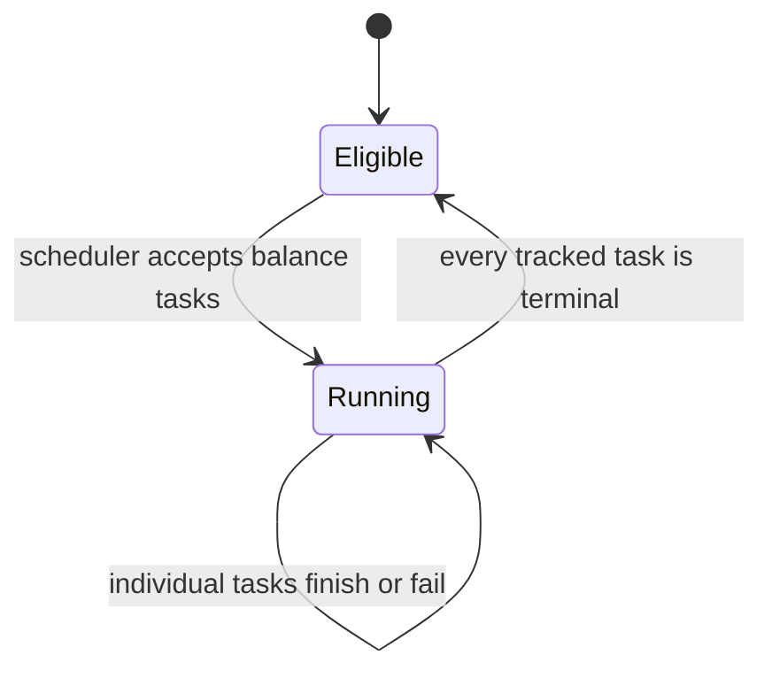

# MEP: QueryCoord balance epochs and shared recovery admission

- **Created:** 2026-10-13
- **Author(s):** @xiaofan-luan
- **Status:** Draft
- **Component:** Coordinator, QueryNode
- **Related Issues:** [milvus-io/milvus#51244](https://github.com/milvus-io/milvus/issues/51244)
- **Released:** Not released

## Summary

Group automatically admitted balance tasks into an in-memory epoch per resource
group (RG). Wait for that epoch's tasks to reach their individual terminal states
before admitting the next balance epoch for the RG. Do not cancel an entire
epoch when one task fails or when a newer plan becomes attractive.

Use one projected admission ledger for each serialized planning invocation,
shared across source nodes, replicas, collections, and shards. Missing-segment
recovery uses largest-first placement against predicted rows normalized by node
capacity, with a finite per-target outstanding-load cap. QueryNode reports its
in-progress loads so a restarted QueryCoord can reconstruct resource occupancy
before planning.

This is a planning and admission change. An epoch is not a remote transaction,
and it is not restored from a durable task manifest after coordinator restart.
The implementation is under review and testing; this MEP does not claim that
the change has been merged, deployed, or validated in an incident workload.

## Motivation

Independent source or shard assignment calls can each observe the same empty
worker and select it before any distribution update arrives. Recovery based on
segment-count round robin also ignores segment sizes and accepted loads. A new
empty node can receive a large cold-load burst while other eligible machines
remain available.

Continuously planning new balance moves while earlier moves are still running
adds overlapping cold loads and can generate plans from transient distribution.
After coordinator restart, its local scheduler contains no previous tasks;
loaded distribution alone therefore cannot distinguish an empty worker from
one still preparing or cleaning up a load accepted by the previous coordinator.

## Public Interfaces

Extend `GetDataDistributionResponse` additively:

```protobuf
QueryNodeLoadResourceReport load_resource_report = 14;
bool load_resource_report_supported = 15;

message QueryNodeLoadResourceReport {
  uint64 memory_usage_bytes = 1;
  uint64 disk_usage_bytes = 2;
  uint64 loading_memory_bytes = 3;
  uint64 loading_disk_bytes = 4;
  repeated LoadingSegmentInfo loading_segments = 5;
  bool tiered_eviction_enabled = 6;
}

message LoadingSegmentInfo {
  int64 segment_id = 1;
  int64 collection_id = 2;
  int64 num_rows = 3;
  uint64 estimated_memory_bytes = 4;
  uint64 estimated_disk_bytes = 5;
}
```

The capability flag remains true when a supporting node cannot produce a valid
snapshot. A missing report from a supporting node means unknown resource state,
including on its first response. It must not be interpreted as an idle node.

New configuration:

| Parameter | Proposed default | Meaning |
|---|---:|---|
| `queryCoord.balanceMaxPendingLoads` | 8 | Maximum known outstanding sealed loads per target during recovery/balance planning; values below one use one slot |
| `queryCoord.loadReportSyncTimeout` | 10000 ms | Bounded coordinator startup wait for initial node distribution/resource reports |

No new minimum-hold or debounce interval is introduced. Existing automatic
balance intervals, benefit checks, task priorities, and execution timeout
parameters retain their roles.

## Design Details

### Balance epoch scope and completion

An epoch contains tasks successfully accepted from one BalanceChecker planning
invocation. Normal balance and stopping-node balance use the same per-RG gate.
A rejection by the scheduler does not become epoch work. Succeeded, failed, or
individually canceled tasks are terminal; remaining siblings continue naturally.



An execution step reuses the existing task deadline armed at real executor
dispatch. Queue waiting is bounded separately, so a task that never obtains an
executor cannot permanently pin a balance epoch. An individual timeout does not
prove remote cleanup has finished: reported QN loading occupancy still consumes
admission after the local task becomes terminal.

Urgent missing-segment recovery is an explicit exception to the balance epoch
gate. It can consume remaining admission capacity while an older balance epoch
exists, to restore availability promptly. It neither cancels that epoch nor
pretends to be part of a remote transaction. Required recovery precedes optional
rebalance; within recovery, preserve load-priority classes before applying
largest-first placement. This proposal does not persist or replay old Move
action chains.

### Shared projected ledger

Construct the snapshot lazily when planning first needs it. Cached checks and
balance interval/epoch gates need not build an additional full-distribution
ledger. Release its snapshot and factory at the end of the checker invocation;
slow task contexts retain only a small released holder. Channel plans are fixed
before returning to the controller, whose planning lock covers all subsequent
acceptance, so their ledger need not remain alive during execution.

Serialize checker planning and scheduler acceptance, so subsequent invocations
observe accepted work. Freeze the baseline once per invocation and retain
successful provisional reservations for that invocation; do not refresh the
baseline with newly accepted scheduler deltas and count those plans again.

The baseline combines actual sealed/growing distribution, accepted local Grow
tasks, and QN-reported loads. Merge the same `(node, collection, segment)` using
maximum available estimates, rather than adding duplicate local and remote
reports. A reported segment already present in distribution does not add its
rows twice, but its cleanup-stage loading entry still consumes a load slot.

Every provisional destination immediately changes projected rows and slot use.
Successful scheduler acceptance commits that reservation; a rejected or trimmed
plan releases it. Projected source row reductions affect desired final placement,
but never grant physical memory headroom before actual release. Partially
accepted batches retain only the accepted work as epoch members.

The ledger covers the automatic sealed recovery and balance paths. This MEP does
not claim that every administrative API or reopen operation participates in the
same Grow reservation contract. ChannelChecker and balance channel plans share
projected channel/row accounting and readiness, while the eight-slot limit applies
to segment Grow admission, not an exact byte budget for channel subscription.
Queued Grow actions and QN-reported loading entries occupy these slots. Reopen
and update tasks not yet dispatched retain the existing executor/native admission
controls; they are not new Grow reservations. Dispatch-time readiness and bounded
initial queue waiting nevertheless apply to those tasks too.
Streaming channel/WAL ownership and growing-segment lifecycle remain governed
by their existing policies.

The existing stopping-first order remains: accepting stopping work skips normal
balance for that checker invocation. A blocked old epoch need not prevent normal
work in another RG on a later invocation. This change does not claim to eliminate
all cross-RG starvation under sustained stopping work.

### Recovery allocation

Preserve replica/RG membership, channel-exclusive RW node sets, subscribed shard
leader checks, node Normal state, fresh report readiness, and resource penalties.
Merge shards with identical eligible RW sets within a replica. Keep different
exclusive sets separate, while their shared physical targets consume one ledger.

Sort required segments by priority class, then descending row count. For each
segment, choose a feasible target minimizing projected post-placement rows divided
by reported memory capacity; use stable tie breaking. If valid capacity is missing,
use a consistent equal-capacity fallback for that candidate group. This is a
discrete capacity-weighted LPT heuristic, not optimal bin packing or an exact
execution-time estimator.

The default eight-slot envelope includes queued local Grow actions, observed QN
loads, and provisional work. A Move's destination Grow also occupies a slot.
Prefer an empty worker until its budget fills, then use other feasible workers;
defer the remainder if none are feasible. The cap limits concentration but does
not require every worker to receive work in a small batch. Recovery does not
use round-robin placement merely to spread segment counts.

If capacity or eligibility defers missing segments, do not mark the collection's
target/distribution version as synchronized. Otherwise the unchanged-version
fast path could suppress retries after admission becomes available without a
distribution change.

### QueryNode report lifecycle

The real segment loader implements an optional reporting interface without
changing the existing Loader/mock contract. Register Load/Reopen entries during
prepare. Estimation updates only the request that owns that entry. Notify of
successful loading does not remove the entry: failure cleanup, resource release,
and final unregister must occur first. Report getters return independent data.

Return resource reports on full, delta, and unchanged-distribution heartbeats.
Physical memory usage uses the existing hardware usage sampler. Disk usage uses
the existing periodically refreshed local-directory measurement, rather than a
recursive directory scan on every heartbeat; it is not an instantaneous disk
sample. Sampling failure produces no resource report and preserves the capability
flag. The fetcher tracks successful sampling separately: before its first success,
including while the scan is still running, a resource report is unknown rather
than a measured zero. A successful scan of an empty directory is a valid zero;
the existing disk-usage getter retains its previous behavior for other callers.

Prepared Load/Reopen entries supply the per-segment list. Aggregate committed
loading reservations also include other existing loader resource requests, such
as delta-log loading. The report is resource telemetry, not a durable catalogue
of every accepted distributed operation.

### Coordinator restart and node readiness

Start with planning and scheduling closed while collecting initial full
distribution and supported resource reports. Associate readiness and reports
with the NodeInfo session, not a reused address. After the bounded startup wait,
permit synchronized nodes to make progress and keep unknown or stale nodes
excluded. Newly joining nodes follow the same readiness rule.

Serialize startup and periodic fetch-and-apply for each node so an older response
cannot overwrite a newer loading report. Apply distribution before marking its
initial snapshot ready. This ordering is local to the current coordinator.

Rebuild the ledger from distribution plus reported loading and plan against
current targets; do not restore the previous coordinator's task list or infer
that a timeout means a remote operation completed. Target readiness must also
be checked at real Grow dispatch, because it can change after planning.

There is no new leader-term fencing protocol. A request already in transit from
the previous coordinator can arrive after an initial report, and a canceled RPC
may continue remote cleanup. Until the next report, short-lived overlap is
possible. Consequently the coordinator's slot cap bounds known admission, not
a strict cross-restart count of all remote operations. Worker-side resource
admission and fresh subsequent reports remain necessary.

### Resource estimate boundary

Coordinator candidate costs use available compact segment/binlog metadata.
QueryNode per-segment costs reuse its loader estimator, and aggregate loading
bytes report full committed reservations. Neither is an exact additional-RSS
prediction for vector-array expansion, index construction, caching, or temporary
native allocations.

The current coordinator memory envelope is conservative:

```
reported physical memory
  + max(reported aggregate loading memory, merged per-segment loading estimates)
  + provisional destination estimates
  + candidate estimate
```

Physical usage may already contain part of a loading reservation, so this can
reject useful work conservatively. Source reductions do not subtract from this
envelope. Compact metadata can also omit peak costs; the envelope therefore is
not proof that a native load fits. The QN loader's existing resource checks and
native reservation remain authoritative. Disk telemetry and estimates are
reported, but this initial planner does not introduce a complete disk-headroom
admission contract.

Tiered QNs report their effective `tiered_eviction_enabled` setting. In this mode,
physical usage includes reclaimable cache; applying the coordinator's RSS-fit
test as a hard gate can stall recovery even when native eviction can make room.
Keep projected rows, capacities, estimated bytes and the finite Grow-slot cap,
but defer the physical fit decision to the QN's eviction-aware native admission.
Capacity still normalizes recovery placement.

For a non-tiered node, a compact raw-binlog estimate can also exceed true
mmap/index residency. If a node has no known outstanding segment-load entries
and has measured physical headroom, permit one advisory oversized-segment
attempt even when that estimate exceeds
the envelope. Retain the entire estimate in the ledger so a second Grow cannot
reuse the same headroom. A full node or one with known segment loads cannot use
this fallback; rejection by the scheduler rolls it back. Worker admission can still reject the
attempt. This bounded fallback avoids making an approximate estimate a permanent
load prohibition; it does not promise that the segment will fit or load faster.

## Compatibility, Deprecation, and Migration Plan

The protobuf fields are additive. Legacy nodes without resource reporting can
establish distribution readiness through their initial full report; they provide
less resource evidence and retain the legacy compatibility fallback, without a
physical-headroom guarantee. A new supporting
node with an absent report is excluded, rather than treated as legacy or empty.

No durable task manifest, new WAL message, public collection schema, or remote
epoch/term protocol is introduced. Existing worker load behavior and execution
deadlines remain in place. Rollout testing must include mixed-version QNs and a
coordinator restart during an active cold load.

## Test Plan

- Restart QueryCoord while several QNs are preparing, loading, and cleaning up
  loads; confirm initial gating and reconstruction, including a delayed old RPC.
- Keep one node silent or resource-unknown; verify bounded startup progress on
  synchronized workers and no new Grow dispatch to the unknown worker.
- Admit a balance epoch containing successful, failing, queued, and slow tasks;
  verify individual terminal handling, finite queue waiting, and no sibling or
  whole-epoch cancellation.
- Recover multiple failed nodes across many shards, including identical and
  overlapping RW sets, heterogeneous capacities, loaded old workers, and new
  empty workers; verify shared predictions, finite eight-slot admission and
  priority ordering without round robin.
- Exercise scheduler rejection, batch trimming, duplicate local/QN reports,
  loaded-but-cleaning-up entries, and transitions from pending to distribution;
  verify reservations and row projections are counted once.
- Defer all loads using resource pressure with unchanged target/distribution
  versions, then restore admission; verify recovery retries rather than being
  hidden by the synchronized-version cache.
- Validate first-report failures, stale reports, capability absence on legacy
  nodes, zero-version full reports, and resource-only unchanged heartbeats.
- Read a real empty local directory, then add a file and sample it; verify that
  unknown-before-first-success differs from a measured zero and that sampling
  failure does not reuse stale disk data as a valid resource report. Exercise
  both effective tiered settings, eviction-aware admission and the single
  oversized-segment fallback without bypassing slot or readiness constraints.
- Measure recovery time, per-node concurrent loading, cold-read volume and peak
  worker memory against the previous allocator; unit tests alone do not establish
  improved incident recovery time.

### Local validation status

Implementation commit: `09cc0817d1` (based on `601fd4249f`). A matching native
build on an isolated development host ran the complete assign, session, dist,
task, balance, and checkers Go packages. QN report/disk and protobuf tests and
focused Go race checks passed. Tests used `-tags dynamic,test`,
`-gcflags="all=-N -l"`, and `-count=1`.

This does not establish whole-QN/C++ suite coverage, production deployment,
strict cross-restart fencing, or measured recovery performance. The system test
plan above remains necessary for workload-level rollout validation.

## Rejected Alternatives

- **Cancel every old epoch on replan:** discards useful cold-load progress and
  violates the requirement that admitted siblings finish naturally.
- **Round robin by segment count:** ignores size, capacity and accepted loads.
- **Unbounded least-loaded assignment:** repeatedly concentrates cold loads on
  new empty nodes before distribution catches up.
- **Persistent task manifests and leader-term remote fencing:** significantly
  enlarge the protocol and recovery state machine; outside this planning gate.
- **Exact native byte admission from compact row/binlog metadata:** current
  telemetry and estimates do not establish that contract.

## References

- Implementation baseline: Milvus `601fd4249f3936ba86723ecc68c398f94aed5649`.
- Relevant paths: `internal/querycoordv2/checkers`, `assign`, `session`, `task`,
  `internal/querynodev2/segments/segment_loader.go`, and `pkg/proto/query_coord.proto`.
- Streaming-system agent guides and source were cross-checked; this proposal
  preserves channel/WAL ownership and the existing load-config/RG callbacks.
