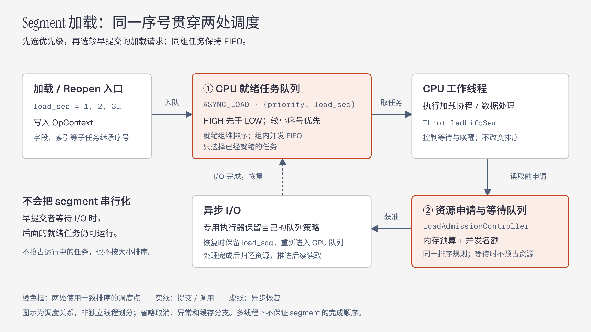

# Milvus 异步加载顺序调度：实现与性能测试报告

测试日期：2026-11-19。测试对象为当前 async-load-sequence worktree。本文记录可控 segment 加载模拟及专项队列验证，供方案讨论和阶段性汇报使用；不作为完整 Milvus 或生产存储性能验收。

后续 CPU 三级调度实验见 [32:8:1 加权调度实验](async-load-weighted-performance.md)，不同提交比例与突发竞争见 [补测报告](async-load-priority-ratio-performance.md)。本文保留统一替换信号量时的历史结果；飞书文档第 8 节已补充最新数据。

## 1. 测试目的与结论

目标是在多个 segment 并发加载时，让先提交的 segment 更早完成，同时使整批完成时间基本不变或改善。调度依据是加载请求的提交顺序，不是 segment 大小；同优先级下不会主动挑选小 segment。

最终统一替换版本在“CPU 较重，等大小”场景中，整批耗时中位数由 2232.6 ms 变为 2219.5 ms（-0.6%）；单 segment 响应时间 P50 由 2222.4 ms 变为 1168.0 ms。

最终统一替换版本在“CPU / I/O 混合，等大小”场景中，整批耗时中位数由 524.7 ms 变为 488.9 ms（-6.8%）；单 segment 响应时间 P50 由 521.9 ms 变为 286.2 ms。

最终统一替换版本在“I/O 较重，等大小”场景中，整批耗时中位数由 1227.5 ms 变为 1117.6 ms（-9.0%）；单 segment 响应时间 P50 由 1218.5 ms 变为 571.2 ms。

最终统一替换版本在“仅一个 segment”场景中，整批耗时中位数由 313.9 ms 变为 319.0 ms（+1.6%）；单 segment 响应时间 P50 由 313.9 ms 变为 319.0 ms。

这些结果是本机共享环境下的模拟测量，不承诺每个 segment 都变快。大小差异较大时，优先推进早提交的大 segment 会让后提交的小 segment 等待更久。实际 segment 大小分布尚未核实。

## 2. 基本实现

[可编辑图源（HTML）](diagrams/async-load-sequence.html)

AsyncSegmentLoad 和 AsyncReopenSegment 在提交加载任务之前分配进程内递增的 load_seq，写入 OpContext。一次加载及其字段读取、索引加载、JSON stats 和后续协程任务继承同一序号。序号不是 segment ID，也不写入持久化元数据。

ASYNC_LOAD 保留 Folly CPUThreadPoolExecutor，将任务按 (priority, load_seq) 分组。每组拥有并发 FIFO，就绪组通过堆排序：HIGH 优先于 LOW，同优先级下较小 load_seq 优先，同组保持入队顺序。未指定序号的任务排在同优先级有序号任务后面。组已就绪时，生产者可以绕过全局调度锁入队；消费者在锁内选组、预留任务，在锁外从组内 FIFO 取任务。

LoadAdmissionController 同样按 priority、load_seq 和同键入队顺序分配临时内存预算与并发名额，使 CPU 调度和资源等待采用一致的顺序。等待者不提前占用资源。协程跨执行器或从 I/O 回调恢复时，执行器适配器保留序号；专用 I/O 执行器仍采用自己的队列策略。

优先级只影响已经就绪的待执行任务，不抢占运行中的工作，也不保证多线程下的完成顺序。早提交的 segment 等待 I/O、没有就绪任务时，后面的 segment 仍能执行。因此这不是把整批 segment 串行化。

本轮最终修改仅将 ASYNC_LOAD 分组队列的唤醒信号量从 folly::LifoSem 统一换为 folly::ThrottledLifoSem，使用默认构造参数；分组、排序和资源分配逻辑不变。没有给每种场景单独配置开关，也没有修改其他线程池的信号量。

## 3. 测试方法与统计口径

| 项目 | 设置 |
| --- | --- |
| 版本 A：基线 | HEAD a8ac0aaac739b3bd236b6f658594415298b06b76，默认 Folly 优先级队列及旧资源等待队列 |
| 版本 B：顺序调度初版 | 分组队列 + load_seq 资源排序 + LifoSem |
| 版本 C：本轮最终版本 | 版本 B 的队列信号量统一替换为 ThrottledLifoSem |
| 常规负载 | 64 个 segment；每个 4 个字段；每字段 64 个读取 window |
| 工作线程与资源 | 16 个加载 worker；64 个并发名额；64 MiB 记账预算 |
| CPU / I/O 参数 | CPU 场景：0 ms / 800000 次运算；混合：1 ms / 100000 次；I/O 场景：4 ms / 10000 次 |
| 大小差异与到达模式 | 前或后 1/4 segment 的 window 数为 4 倍；另测每 2 ms 提交一个 segment |
| 单 segment | 1 个 segment、4 字段、每字段 2048 个 window，混合 CPU / I/O |
| 机器与构建 | Xeon Gold 6338；同一 NUMA 的 16 个物理核；GCC 12 / C++20 / O3；worker nice 19；共享主机 |
| 最终对照次数 | 8 场景 × 3 版本 × 5 次，随机交错，共 120 次 |
| 工作一致性 | 检查 window 完成数、前后 checksum、时间戳顺序与全部资源归还 |

本实验直接编译两版真实执行器和资源限流器，使用真实 Folly 协程和排队指标。每个 window 申请 1 MiB 的资源预算，独立线程在指定延迟后完成模拟 I/O，加载线程再执行固定次数的数据处理运算。字段使用逐 window 申请资源、AsyncScope 并发执行的结构。

1 MiB 是预算记账值，未实际读取或分配对应数据。没有调用真实 Segment::Load，没有执行 Arrow 解码、真实磁盘/对象存储访问、索引加载或缓存物化。缓存预算策略联动在各版本中一致禁用。因此这些结果用于判断调度行为及回归，不可作为实际存储吞吐数字。

整批耗时从第一批提交开始，到最后一个 segment 完成；单 segment 响应时间从其提交开始，到完成，包含排队。另记录首次执行至完成的 active 时间，但不把它作为主要收益指标，以免只是延后开始计时而显得更快。表中的 P50/P95 先在每批 segment 内计算，再取 5 轮结果的中位数。百分比由各版本中位数计算，不与此前不同轮次的数字拼表。

## 4. 最终版本性能结果

| 场景 | 整批 A → C（ms） | 整批变化 | 响应 P50 A → C（ms） | 响应 P95 A → C（ms） |
| --- | --- | --- | --- | --- |
| CPU 较重，等大小 | 2232.6 → 2219.5 | -0.6% | 2222.4 → 1168.0 | 2231.3 → 2120.2 |
| CPU / I/O 混合，等大小 | 524.7 → 488.9 | -6.8% | 521.9 → 286.2 | 524.5 → 464.4 |
| I/O 较重，等大小 | 1227.5 → 1117.6 | -9.0% | 1218.5 → 571.2 | 1227.4 → 1072.9 |
| 前 1/4 segment 为 4 倍大小 | 856.8 → 795.7 | -7.1% | 532.7 → 600.8 | 856.6 → 778.4 |
| 后 1/4 segment 为 4 倍大小 | 845.9 → 800.0 | -5.4% | 534.6 → 303.1 | 845.4 → 733.1 |
| 每 2 ms 提交一个 segment | 514.8 → 489.4 | -4.9% | 446.7 → 250.1 | 484.6 → 353.2 |
| 仅一个 segment | 313.9 → 319.0 | +1.6% | 313.9 → 319.0 | 313.9 → 319.0 |
| 无模拟业务工作 | 103.6 → 51.8 | -49.9% | 36.6 → 27.4 | 56.0 → 41.6 |

CPU 较重的等大小负载主要体现完成顺序变化：先提交的 segment 逐个完成，而不是大量 segment 接近整批结束时一起完成。混合和 I/O 场景的整体时间变化还受到 I/O 与计算衔接、调度和主机负载影响；没有把整批收益精确归因到某个单一机制。

| 场景 | 顺序调度初版 B 整批（ms） | 统一替换版本 C 整批（ms） | C 相对 B |
| --- | --- | --- | --- |
| CPU 较重，等大小 | 2228.6 | 2219.5 | -0.4% |
| CPU / I/O 混合，等大小 | 478.9 | 488.9 | +2.1% |
| I/O 较重，等大小 | 1083.7 | 1117.6 | +3.1% |
| 前 1/4 segment 为 4 倍大小 | 747.0 | 795.7 | +6.5% |
| 后 1/4 segment 为 4 倍大小 | 760.5 | 800.0 | +5.2% |
| 每 2 ms 提交一个 segment | 486.2 | 489.4 | +0.6% |
| 仅一个 segment | 402.6 | 319.0 | -20.8% |
| 无模拟业务工作 | 38.0 | 51.8 | +36.6% |

信号量替换的目的在于减轻单 segment 的回归，而不是保证所有负载都比顺序调度初版快。表中保留所有场景，包括无额外业务工作的 tiny 场景；tiny 对线程调度和主机抖动非常敏感，不宜将其百分比直接外推到真实加载。

## 5. 单 segment 回归与 perf 分析

此前独立复测三组各 20 次：旧版 322.7 ms，顺序调度初版 390.2 ms，旧执行器 + 新资源限流器 323.9 ms。20 对前后样本均为初版更慢，因此不能仅用随机抖动解释当时约 21% 的差异；这一步将主要调查范围缩小到执行器。

perf record 使用 cycles:u、199 Hz、DWARF 调用栈，前后交替各两次；为延长采样，将单字段 window 数扩大 16 倍。两版约 92%–93% 的用户态周期落在相同的模拟处理循环，约 4.5% 来自依赖库 BLAS 线程。用户态指令与周期数接近，没有出现占比足以解释 21% 回归的新增锁或上下文分配热点。采样覆盖启动、退出和依赖线程，不是纯加载区间；用户态 CPU 栈不包含 off-CPU 等待时间。

perf stat 的一组长负载中，旧版约 93.64 billion 周期、161.90 billion 指令；新版约 93.68 billion 周期、162.20 billion 指令。累计 CPU 时间则不同，输出的有效 GHz 约为 2.423 与 1.757。主机采用 intel_pstate / powersave，因此频率管理与调度方式的交互仍是疑点，尚未验证因果。独立 time 统计没有显示明显增加的系统时间或上下文切换次数，不能将差异简单解释成系统调用开销。

进一步只替换信号量，保留分组和其他逻辑，交错各 10 次：旧版 310.7 ms，顺序调度初版 387.4 ms，临时替换信号量后 324.8 ms。该实验支持优先调整等待/唤醒机制。本轮已将这一替换应用到当前生产源码，并用第 4 节的同轮三组对照重新验证。不能把此前单变量对照的数值与本轮最终结果混为同一批实验。

## 6. 正确性检查与验证边界

最终生产源码重新编译后，8 项 AsyncLoadExecutorTest 随机顺序重复 10 轮，80 次测试全部通过。覆盖优先级和序号排序、同键 FIFO、协程恢复和执行器切换、线程池缩容、非法配置、并发提交与空组重新激活、独立适配器复用以及序号递增。

独立队列基准在 16 个线程、深度 64 和 4096 下通过内置排序与生命周期检查，包括未执行任务销毁、组回收、过期/跨队列上下文和空队列超时。最终 120 次性能运行均退出 0，跨版本工作量和 checksum 一致。测试报告和原始数据保存在仓库中，生产变更尚未提交。

先前额外复测中曾有一个旧版 tiny 进程写完全部 segment 结果后 90 秒不退出。该样本未计入正常性能统计；GDB 未捕获同一现场，根因未确定。最终这轮没有复现，但不宣称该退出问题已经解决。

尚未完成真实 segment load/reopen、后台 warmup 的端到端验证，也未对最终信号量替换运行完整 sanitizer 或 ThreadSanitizer。milvus-common 的 OpContext / CacheSlot 配套变更仍需通过一致的依赖构建完成集成；本次独立构建不等于完整 Milvus 构建成功。

## 7. 复现与原始记录

基准和原始数据目录：docs/design-docs/benchmarks/async-load-segment-20261119/。初轮结果为 runs.csv、summary.json、results/；20 轮单 segment 复测为 single-recheck/；perf 报告和单变量实验为 perf/；最终统一替换后的 120 次结果、测试日志、源码快照与校验和为 throttled-validation/。这些文件当前在本地 worktree，尚未作为已发布仓库链接。

最终构建和运行脚本为 throttled-validation/build.py 与 run.py；它们保留本机 Conan、生成头文件和 /tmp 构建路径，复现前需具备相同依赖环境。原始 perf.data 约 300 MiB，位于 /tmp/async-load-segment-perf/，未写入仓库。

后续建议在一致依赖构建上使用真实数据，重复单 segment 和多 segment 加载，并测量实际 segment 大小分布、资源利用率与尾延迟。当前可以汇报“顺序调度的模拟收益及信号量回归改善已得到定向验证”，不应汇报为生产端到端收益已经验收。
