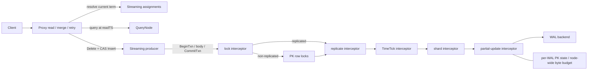
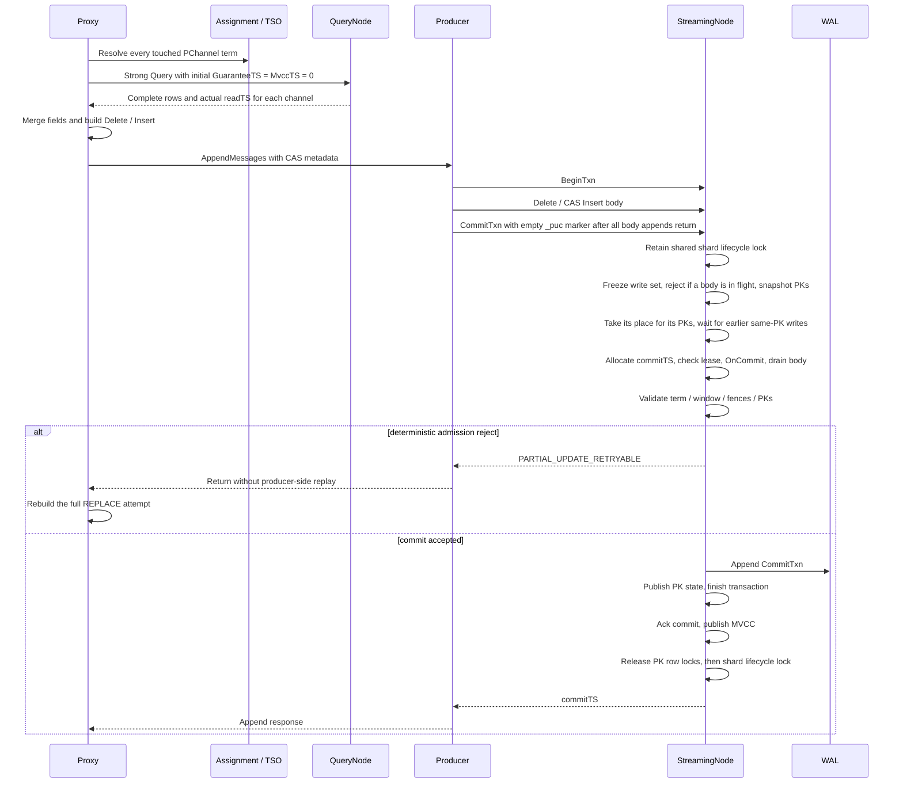

# MEP: Optimistic CAS for Partial Updates

- **Created:** 2026-06-01
- **Feature DRI:** @weiliu1031
- **Primary Approver:** @chyezh
- **Independent Approver:** @liliu-z
- **Design Review:** 2026-08-07
- **Component:** Proxy / StreamingNode / Streaming
- **Related Issues:** [#49980](https://github.com/milvus-io/milvus/issues/49980)
- **Released:** N/A

## Summary

The Strong-read extension at the end of this document replaces the first
fixed-snapshot reads with Strong reads for both initial attempts and CAS
retries. It assumes every participating component is upgraded and adds actual
query snapshot reporting and a WAL lifecycle history floor. The extension is
pending review; the review metadata above applies to the original CAS design.

Milvus partial update currently uses a read-merge-write flow. Proxy reads the
current row, merges the user-provided fields into a complete row, and writes a
standard Delete/Insert transaction. Two concurrent requests can read the same
snapshot and silently overwrite each other's changes because commit does not
validate the snapshot used by the merge.

This proposal keeps query and merge in Proxy and adds optimistic commit
admission at StreamingNode. Every attempt follows this order:

```text
resolve all touched PChannel terms
  -> Strong query and collect actual per-channel readTS
  -> merge
  -> commit(term, readTS)
```

StreamingNode maintains an in-memory, per-WAL-term index of recent primary-key
writes. Before TimeTick allocates the write timestamp, the lock interceptor takes
exact PK row locks in a per-vchannel table: ordinary writes take shared locks on
their PKs, and a local CAS takes exclusive locks on its PKs. StreamingNode
enforces the transaction ordering contract: BeginTxn takes effect before any
body, and every body takes effect before CommitTxn. A CommitTxn freezes the body
PK union when it arrives, so later bodies are rejected; it is itself rejected
while a body is still in flight, and otherwise locks the union. CAS validates
the term, read snapshot, and exact PK versions before persisting CommitTxn.
Locks remain held through version publication, transaction completion,
acknowledgement, and MVCC publication. Different vchannels use separate
tables. A write takes its place in line for its PKs and waits directly only
for earlier writes that share a PK with it, so writes are served in arrival
order without retries. The existing lifecycle locks continue to serialize
exclusive DDL.

The design does not add a public RPC, SDK field, configuration option,
partial-update-specific WAL message type, or persistent row-version store.
Downstream consumers continue to receive standard Delete/Insert transactions.

## Motivation

Consider a row with two independently updated fields:

```text
initial row:       {pk: 1, name: "old", score: 10}
request A updates: {pk: 1, name: "new"}
request B updates: {pk: 1, score: 20}
```

Without commit validation, both requests can read the initial row. Request A
writes `{name: "new", score: 10}` and request B writes
`{name: "old", score: 20}`. Whichever commits last destroys the other update.

Proxy already owns the complete partial-update semantics, including nullable
and default values, dynamic fields, generated function output, relative array
operations, partition-key validation, and row merge. Moving query and merge to
StreamingNode would duplicate these responsibilities and add QueryCoord and
QueryNode dependencies to the WAL owner.

StreamingNode already owns the WAL ordering point. Commit-side optimistic
validation therefore provides the required lost-update protection while
preserving the existing read and merge path.

### Goals

- Prevent lost updates when concurrent partial updates modify the same PK.
- Keep query routing, schema handling, function generation, and merge in Proxy.
- Keep the persisted data path as standard Delete/Insert WAL transactions.
- Reject stale attempts after a PChannel term change.
- Preserve correctness across WAL recovery and transaction replay without
  rebuilding historical row-level state.
- Bound the memory used for recent PK versions and fail closed when the retained
  history is incomplete.
- Retry only operations that can safely rebuild the complete request.

### Non-Goals

- Cross-vchannel or cross-collection atomicity.
- Strict serializability.
- A persistent row-version store.
- Transaction-level exactly-once semantics or an idempotency token.
- Automatic replay of relative `ARRAY_APPEND` or `ARRAY_REMOVE` operations
  after a deterministic CAS conflict.
- Correctness when partial update runs concurrently with Import,
  RestoreSnapshot, or backfill visibility changes.
- A feature flag or runtime activation gate.

## Public Interfaces

### Public API and SDK behavior

No public RPC or SDK request field is added. Existing partial-update requests
continue to use the current Upsert API.

The observable behavior changes are:

- A conflicting replacement update is rebuilt and retried by Proxy.
- A conflicting relative update returns
  `ErrCollectionPartialUpdateConflict` with `Retriable=false`.
- A replacement update that exhausts its retry budget returns
  `ErrServiceUnavailable` with `Retriable=true`.
- AutoID partial update preserves existing PKs. Missing rows receive new AutoIDs
  and use insert semantics; the mutation result returns the destination PKs in
  request order.

Ordinary non-partial AutoID Upsert follows
[Preserve Primary Keys in Full AutoID Upsert](20260803-autoid-upsert-primary-key-preservation.md):
it preserves an existing PK and inserts with a newly generated AutoID when the
lookup PK is missing. That behavior is independent of
the Partial Upsert CAS protocol described here.

### Internal protocol

The internal message proto adds attempt-scoped commit-admission proof:

```proto
message PartialUpdateCAS {
    uint64 read_ts = 1;
    int64 observed_pchannel_term = 2;
}
```

`read_ts` and `observed_pchannel_term` cannot be derived by StreamingNode
and therefore come from Proxy. Collection and PK identity are not duplicated
in the proof: StreamingNode reads `collection_id` and `schema_version`
from the Insert header, then resolves the authoritative PK descriptor from
ShardManager.

The internal streaming error enum adds:

```proto
STREAMING_CODE_PARTIAL_UPDATE_RETRYABLE = 17;
```

The metadata is encoded in the Insert body's
`MsgBase.Properties["_puc"]`. The outer message property uses the same key
with an empty value as a control marker. The outer marker contains no PK,
`readTS`, term, or other user data.

### Configuration and metrics

The proposal uses three internal StreamingNode configuration parameters. The
remaining values are internal constants:

| Parameter or constant | Default | Purpose |
|---|---|---|
| `defaultVersionIndexTTL` | 30 seconds | Limits how long each vchannel retains recent PK-write versions and also bounds the valid window from `readTS` to `commitTS` for one partial-update attempt. When the window is exceeded, StreamingNode returns a retryable CAS rejection; Proxy automatically retries only replacement updates that can be rebuilt safely. |
| `streaming.partialUpdate.enableCAS` | `true` | Hidden switch added by #54248. When it is `false`, the partial-update interceptor installs no row-lock hook, skips write-set recovery, and passes every write through without CAS validation, so concurrent updates based on stale rows may overwrite each other. Shard lifecycle and structural DDL locks are unchanged. Each interceptor reads it once when the WAL opens. |
| `streaming.partialUpdate.versionIndexMaxBytes` | 640,000,000 bytes, approximately 610 MiB | Caps the estimated memory used by all PK-version indexes on one StreamingNode. When the shared budget is unavailable, ordinary writes continue, but CAS on the affected vchannel fails closed until the omitted write leaves the valid read window. |
| `streaming.partialUpdate.recoveryDecodeTimeout` | `5s` | Total time budget, per WAL open, for rebuilding pending transaction write sets. A transaction whose bodies are not decoded within it is marked incomplete, and its commit is rejected and replayed. The budget is checked before each body decode, so `0` or a negative value marks every pending transaction with an insert or delete body incomplete. Larger values can delay WAL open when decoding stalls. |
| `partialUpdateCASMaxRetryAttempts` | 5 attempts, including the first attempt | Limits the total number of Proxy attempts used to rebuild a complete replacement update after a deterministic CAS conflict. Requests containing relative field operations do not use this automatic retry. |
| `partialUpdateCASRetryBackoff` | Starts at 10 ms with exponential backoff; each sleep is capped at 40 ms | Controls the delay between Proxy CAS attempts and reduces sustained contention caused by immediately retrying concurrent conflicts. The 40 ms cap is calculated as `4 * partialUpdateCASRetryBackoff`. |

The PK-index budget is an estimate, not a hard process-RSS limit. Each Int64 PK
entry is charged 128 bytes; each VarChar PK entry is charged
`128 + PK byte length`. StreamingNode exports node-level used-byte,
configured-limit, and missed-write metrics for this shared budget.

### Durable format

The proposal adds no new WAL message type. BeginTxn, Delete, Insert, and
CommitTxn keep their existing formats and transaction semantics. CAS metadata
uses an existing properties map inside the Insert body, and the commit marker
uses the existing outer properties map.

No persistent PK index or schema migration is introduced. Pending PK write sets
are reconstructed from existing recovery bodies before accepting writes.

## Design Details

### Correctness invariants

The design depends on seven invariants:

1. **Attempt proof:** a term snapshot and `readTS` belong to the same attempt,
   and terms are resolved before the Strong query starts.
2. **Exact query snapshot:** every CAS `readTS` is the nonzero snapshot
   reported by that channel's successful Strong query.
3. **Atomic admission boundary:** local CAS validation, CommitTxn append, write
   publication, transaction transition, acknowledgement, and MVCC publication
   retain the same exclusive PK locks. Every ordinary local Insert and Delete
   participates through shared locks on its PK keys. Replicated writes
   take no row lock: the replicate interceptor serializes and deduplicates
   them, and local CAS is rejected on a secondary. With CAS enabled (the
   default), no Insert is exempt: one whose collection schema is missing
   fails before the WAL append.
4. **Complete write coverage:** every supported WAL write that changes logical
   row data updates either exact PK versions or a conservative fence.
5. **Fail closed:** missing history, malformed proof, or incomplete local CAS
   recovery never degrades to an unchecked ordinary commit.
6. **Authoritative write identity:** a CAS Insert derives its collection and
   schema version from the Insert header and its PK field from ShardManager;
   attempt proof never supplies a competing collection or PK identity. Every
   Insert takes its PK field from the collection's current schema without
   comparing schema versions, because the PK field cannot be altered.
7. **Timestamp order:** writers acquire their row locks before TimeTick
   allocates their single visibility timestamp, so a later row-lock holder
   always receives a later timestamp. A CommitTxn locks its complete PK write
   set: admission freezes the set when the commit arrives, rejects later
   bodies, and rejects the commit itself while a body is still in flight, so
   the set it snapshots and locks is final. A session that expires during the
   row-lock wait fails before WAL append.

### Architecture and state ownership



| State | Owner | Lifetime | Persistence |
|---|---|---|---|
| Original partial payload, attempt `readTS`, and vchannel term snapshot | Proxy `upsertTask` | One client request; rebuilt per retry | None |
| Local transaction packaging and empty `_puc` commit marker | Producer | One vchannel message group | Standard WAL properties |
| PChannel global lock and keyed vchannel RW locks | Lock interceptor | One WAL instance | None |
| Exact PK row locks per vchannel: registered ordinary writes and the latest local CAS of each PK | StreamingNode process-wide row-lock manager, acquired by the lock interceptor through `InterceptorBuildParam.RowLock` | Entries live until their last acquiring or registered operation releases them | None |
| `pendingTxn` (write set, in-flight body count, commit freeze), PK versions, and collection fences | Partial-update interceptor | One PChannel WAL term | None |
| PK-version byte budget and aggregate used/limit/missed-write metrics | Partial-update interceptor builder | One StreamingNode process | None |
| Live and recovered transaction sessions | TxnManager | Transaction and WAL recovery lifecycle | Existing TxnBuffer recovery |
| Collection schema and immutable PK descriptor | ShardManager | Collection lifecycle in one WAL | Existing recovery snapshot |

Each WAL open creates independent PK, fence, and transaction state, while all
WALs in the StreamingNode process share one row-lock manager and one byte budget.
The row-lock manager maps each active vchannel to a small table that holds only
the in-flight writes: the registered ordinary writes and, for each PK, the
latest local CAS in line for it. It is allocated on demand and costs one small
entry per in-flight ordinary write plus, per active CAS, a sorted copy of its
PKs and one map entry per PK. Go maps do not shrink: an emptied map is
dropped, but while CAS commits stay in line in the vchannel, the map keeps the
buckets of the largest recent CAS. Each acquiring operation pins the table
before waiting and releases its reference when it releases or gives up its
place in line. The last release removes the vchannel entry. A holder or
waiter therefore prevents a different table from being installed for the same
vchannel, including across WAL lifecycles.
Closing a WAL or dropping a collection does not reset active tables. Proof
state and the exact PK version index remain per WAL; pending write sets are
reconstructed from the existing transaction recovery snapshot.

### End-to-end flow



Proxy fans the request out with the existing PK hash or namespace-sharding
rules. Each vchannel group is an independent transaction. The design does not
make a multi-vchannel request atomic.

Transaction-body append records the union of durable Insert and Delete PKs,
including duplicates, without publishing committed versions or acquiring PK
locks. Commit admission freezes this union when the commit arrives, so that
later bodies are rejected, rejects the commit while a body is still in flight,
and otherwise snapshots it. Once rejected this way, every later CommitTxn of
the transaction is rejected too, so a resent copy cannot commit it after the
stale body returns. A single local CAS Insert still uses this transaction
path. After CommitTxn is durable, normal consumer transaction assembly delivers the complete
Delete/Insert transaction to downstream consumers; QueryNode visibility
continues to follow the existing commit and TimeTick contract.

On deterministic admission rejection, StreamingNode rejects the transaction
without appending CommitTxn or publishing its writes, acknowledges the commit
timestamp if one was allocated, and releases its row locks. Proxy rebuilds a
replacement attempt with a new Strong query and newly reported per-channel
snapshots. Relative operations and unknown append outcomes retain the no-replay
rules described below.

### Proxy attempt construction

Proxy builds the first attempt and every eligible retry in the same order:

```text
clone original user fields and overlay previously allocated AutoIDs by row
  -> generate function output
  -> resolve and record terms for all candidate write channels
     (all collection shards for AutoID, or the fixed namespace channel)
  -> enqueue a new Strong Query with GuaranteeTimestamp = MvccTimestamp = 0
  -> collect actual nonzero readTS from each candidate write channel's successful response
  -> classify existing and missing rows
  -> normalize fields, validate row alignment and insert fields for missing rows
  -> if an unconverted AutoID PK is missing: allocate
     its destination PK, record the row-to-ID mapping, update the working PK column
  -> select final write channels from this query's captured terms and read timestamps
  -> merge without querying freshly allocated IDs
  -> attach that channel's term and readTS to every CAS Insert chunk
```

The outer task ID and `BeginTs` remain stable across retries. Each Strong query
receives its own BeginTs from normal query scheduling; Proxy does not allocate
a separate CAS read timestamp. Strong optimization may use the current WAL MVCC
barrier, and QueryNode reports the snapshot actually used for the returned rows.
Every retry discards prior proofs and query results before rebuilding. WAL
lifecycle floor validation ensures a snapshot cannot precede the history covered
by the current owner's index, even if the PChannel term did not change.

### Query and merge semantics

`queryPreExecute` shares Strong retrieval, row classification, and Existing-row
Delete preparation with Full AutoID Upsert. Only Partial collects the executed
channel snapshots for CAS. Full requests only PKs and returns before
merge or CAS preparation. Partial still queries and merges before
`insertPreExecute` validates the complete payload, so sharing classification
does not change omitted-field semantics, read consistency, or CAS retries.

Proxy retains the existing merge implementation, including:

- nullable and default values;
- dynamic fields;
- generated function output;
- relative array operations;
- compact nullable-vector representation;
- partition-key immutability validation.

For AutoID collections, a PK present in the query snapshot keeps its identity.
A missing PK selects insert semantics and receives a fresh AutoID. This decision
uses the source row's query snapshot; a later insert of the supplied source PK
does not redirect the newly allocated entity back to that source PK. Required
insert fields must be supplied, while nullable/default fields use the ordinary
partial-update insert merge rules.

If a required field is missing, Proxy returns a non-retriable parameter error
identifying the first missing PK, explaining
that the PK was absent from the query scope and insert fallback needs the named
field. For example: `partial update: primary key 100 does not exist
in the query scope; cannot insert a new entity: missing required field "vector"`.
The query scope includes the requested partition and namespace; absence here
must not be interpreted as absence from every partition in the collection.

Proxy keeps the original user fields immutable and stores allocated AutoIDs in
a separate map keyed by the original request row offset. Initial preparation
and CAS retries share `prepareUpsert`: clone the original fields, overlay
allocated IDs, generate function output, prepare CAS terms, query, and merge.
`checkUpsertPrimaryFieldData` centralizes PK validation, conversion,
replacement, collision checking, and ID parsing. It reuses the existing
primary-field generation and field-update helpers and publishes a replaced
column only after all checks pass. The task owns allocation and retry state;
the PK helper does not access the allocator or WAL. The PK payload type and row count are
validated before allocating IDs. Primary keys are not supported as function
inputs; allocating AutoIDs retains the existing function outputs.
Field normalization and alignment validation follow row classification and
precede allocation. Allocation replaces only the working PK column; it does not restore
the original payload or discard normalized values.
Each attempt executes one Strong query. Freshly allocated AutoIDs take insert
semantics without another existence query. Before reading, Proxy captures terms
for every possible destination channel (all collection shards for AutoID, unless
namespace routing fixes one channel), then binds the actual query snapshots.
After allocation it retains only the final write channels and their original
proofs; missing proofs fail closed. Terms and timestamps are not resampled after
allocation. This relies on the normal AutoID allocator's uniqueness guarantee.
AutoID and non-AutoID collections share row classification, required-field
validation, and merge. Allocation consumes the missing-row offsets, and merge
uses the same classification.
Full AutoID Upsert shares `prepareUpsert`, classification, and the
`allocateMissingAutoIDs` batch allocator, but does not restore Partial retry
state, merge old fields, or prepare CAS proofs. Only Partial saves allocated
IDs and request-order results for retries; its CAS protocol is unchanged.
The original input is never overwritten by allocated IDs or merged values.
After each successful allocation, Proxy saves the complete destination IDs in
request order. Message packing continues to use merge order; `PostExecute`
publishes the saved IDs without looking up or parsing the PK column again.

Allocated IDs remain stable throughout the request's internal CAS retries,
even when still absent. If another vchannel already committed a generated row,
the next read sees that destination row and rebuilds an update at the same PK.
This retains the existing REPLACE retry behavior without allocating duplicate
entities. Relative operations still do not retry automatically, and unknown
append outcomes still stop retries. This is not cross-request deduplication:
a new client request has a new allocation lifecycle.

A missing source PK produces no Delete. An insert under its new AutoID therefore
writes only the destination vchannel; if later retried as an update, its Delete
and Insert both use that same AutoID. A batch can still span multiple vchannels,
whose transactions commit independently; there is no cross-vchannel atomicity.
After successful execution, Proxy returns destination IDs in input-row order,
while message packing continues to use the merged row order.

### CAS metadata and encryption

Proxy derives the final write vchannels from the current request PKs, including
allocated destination AutoIDs. It selects their proofs from those captured by
the single query; the missing source PK is not included in Delete or final CAS
solely because it was used for the initial lookup. CAS metadata contains only the attempt `readTS` and observed PChannel term; it does not
duplicate the collection ID, schema version, PK field ID, or PK list.

For every CAS Insert, StreamingNode:

1. reads `collection_id` and `schema_version` from the Insert header;
2. requires `schema_version` to be explicitly present;
3. resolves the PK descriptor of the collection's current schema through
   ShardManager, without comparing schema versions;
4. decodes the complete Insert body with the generated protobuf codec and
   extracts the descriptor's PK field and CAS metadata;
5. verifies that all CAS chunks in the transaction use the same proof,
   collection, and schema version.

An ordinary Insert may omit `schema_version`; its PKs come from the same
descriptor. Only CAS Insert requires an explicit version. Milvus cannot alter
the primary key field, so every schema version of a collection has the same
PK descriptor; the shard interceptor, not PK extraction, rejects a schema
version mismatch on a live append. A recovered transaction body is not
re-validated: an exclusive schema change fails the open transactions of its
vchannel only in memory, so a transaction it crossed before a WAL reopen is
recovered as live and can still commit its stale-version body. This gap
predates partial-update CAS and belongs to transaction recovery, whose replay
should roll such a transaction back as `FailTxnAtVChannel` does live; it is
left to a transaction-layer follow-up.

The message builder writes metadata into the Insert body before encryption and
before `BuildMutable()`. When cluster encryption is enabled, the proof is
inside the same encrypted boundary as the DML payload.

Insert and Delete tracking decode complete DML bodies and keep extracted PKs in
typed Int64/VarChar slices. This intentionally accepts the CPU, allocation, GC,
and append-latency cost of decoding unrelated fields, including vectors, to
keep protobuf wire compatibility owned by generated code instead of a custom
parser. If an encrypted payload cannot be decrypted, the current append returns
an error; the StreamingNode process does not panic.

The empty outer `_puc` marker only selects the transaction and lock paths.
After packing, Proxy verifies that:

- every prepared vchannel produced at least one CAS Insert;
- every CAS Insert carries the marker;
- every Insert vchannel belongs to the attempt snapshot;
- no final message exceeds the transport limit.

Missing metadata or a missing marker is an internal invariant violation. Proxy
does not rewrite an already constructed or encrypted body.

### Final-envelope packing

The existing entity-size packer does not include the later streaming header,
schema version, CAS metadata, outer properties, or encrypted envelope. An
entity-only-valid chunk can therefore exceed `pulsar.maxMessageSize` after final
construction.

CAS Insert uses two-stage packing:

1. Run the existing entity packer and retain the original row offsets for each
   chunk.
2. Add the streaming header, CAS metadata, and cipher through the message
   builder.
3. Check `EstimateSize()` on the final message.
4. If a multi-row message is oversized, bisect its contiguous row-offset range
   and rebuild both halves.
5. If a single-row message is still oversized, return
   `ErrParameterTooLarge` before WAL append.
6. Treat any oversized message that escapes this packer as an internal
   invariant violation.

Using contiguous original row-offset ranges preserves row order, field
alignment, partition, vchannel, and attempt metadata. Ordinary non-CAS Insert
keeps the existing packing path.

### Producer transaction packaging

`AppendMessages` groups DML by vchannel. A local group containing a CAS Insert
always uses a transaction, even if it contains only one Insert:

```text
BeginTxn
  -> transaction body
  -> CommitTxn with empty _puc marker
```

The producer does not rewrap a message that already has a `TxnContext` or
`ReplicateHeader`. Replicated messages preserve the source transaction
boundary.

The resumable producer immediately returns
`STREAMING_CODE_PARTIAL_UPDATE_RETRYABLE` to Proxy. It must not retry a
transaction that carries stale merged rows. If a local CAS transaction expires
before commit, the producer converts `TxnExpired` into the same CAS retry signal
so Proxy can rebuild the complete attempt.

Other transport failures keep the existing resumable-producer behavior.
BeginTxn, body, or CommitTxn can be retried after a stream failure, and the
final client outcome may be ambiguous. This proposal does not add
transaction-level idempotency.

### Interceptor ordering and row locks

The append chain is:

```text
[idempotency ->] redo -> lock -> replicate -> timetick -> shard -> partialupdate -> WAL
```

The bracketed idempotency interceptor exists only on master. The lock
interceptor retains the existing outer lifecycle boundary:

| Message | Lock |
|---|---|
| Ordinary DML, transaction body, ordinary or local CAS CommitTxn | `glock.RLock + vchannel.RLock` |
| Vchannel-exclusive DDL | `glock.RLock + vchannel.Lock` |
| PChannel-exclusive DDL | `glock.Lock` |

All non-PChannel-exclusive paths acquire the PChannel lock first and then the
vchannel lock. They release in reverse order.

Under that lifecycle lock, the lock interceptor calls
`InterceptorBuildParam.RowLock.Acquire` for every message without a
`ReplicateHeader`, before TimeTick allocates the single write timestamp. It
releases the row locks after the downstream append returns, that is, after CAS
validation, WAL append, PK/fence publication, transaction completion
(`CommitDone` or `RejectCommit`), acknowledgement, and MVCC update, and before
it releases the lifecycle lock.

Replicated messages skip the row-lock hook entirely. The replicate interceptor
already serializes and deduplicates them, and local CAS is rejected on a
secondary. A replicated commit is also exempt from the write-set completeness
check in `validateCommit`; see Replication.

A local CAS commit uses the same shared lifecycle locks as ordinary writes.
It does not call `FailTxnAtVChannel`; that cleanup remains associated with the
existing exclusive-DDL path.

The process-wide row-lock manager owns an exact PK row-lock table for each
active vchannel. A short manager mutex protects references only; no row-lock
wait or WAL I/O holds it or any table mutex. There is no vchannel admission
lock.

| Logical write | PK locks |
|---|---|
| Ordinary nontransactional Insert/Delete with exact PKs | Shared locks on the write set |
| Ordinary CommitTxn with reconstructed write set | Shared locks on the prefix and suffix PK union |
| Local CAS CommitTxn with complete runtime proof | Exclusive locks on the complete PK union |
| Replicated message (`ReplicateHeader` set) | None; the replicate interceptor serializes it |
| TruncateCollection and exclusive DDL | Existing outer lifecycle lock only |
| Transaction body | None; counted as in flight until its append returns |
| BeginTxn, RollbackTxn | None |

With CAS enabled (`streaming.partialUpdate.enableCAS`, the default), every
Insert, with or without `schema_version`, locks the PKs of its collection's
schema. If ShardManager has no schema, or no collection, for an
Insert, PK extraction fails closed with `STREAMING_CODE_UNRECOVERABLE` and
the shard interceptor's messages for a versioned Insert: "collection N schema
not provided by create collection message" or "collection N not found". The
write is rejected before the WAL append, takes no row lock, and publishes
nothing. During recovery such a body marks its transaction incomplete like any
other PK extraction failure, and the commit is rejected. There is no
schema-less exemption and no collection fence for Inserts. With
`enableCAS=false` the partial-update interceptor passes writes through, so the
pre-CAS acceptance of a version-less Insert is unchanged. The path is
unreachable on supported deployments: CreateCollection carries the schema and
vchannel recovery meta records it; every vchannel meta persisted since 2.6.0
has a schema (#43500), including vchannels upgraded from 2.5, whose schema is
fetched from the coordinator at bootstrap; and master recovery refuses a
vchannel without one. DDL retains its existing transaction cleanup.

#### Transaction ordering contract

StreamingNode enforces two ordering rules for local transactions:

- **C1, BeginTxn before every body.** BeginTxn takes effect before any body of
  its transaction. The producer learns the TxnID only from the BeginTxn
  response. A body or CommitTxn without a live session finds no `pendingTxn`
  record, so admission does nothing and creates no record, and the TimeTick
  session lookup rejects it with `TRANSACTION_EXPIRED` before the WAL append.
- **C2, every body before CommitTxn.** Every body takes effect before its
  CommitTxn, no body is accepted once the CommitTxn has arrived, and a
  CommitTxn that arrives while a body is still in flight is rejected.

When `streaming.partialUpdate.enableCAS` is false, no row-lock hook runs and
only the existing TimeTick checks apply: a body is rejected once its session
has left InFlight.

C2 is enforced in the lock interceptor, before row locks and before TimeTick:

- `admitTxnBody` counts a body in `inFlightBodies` from admission until its
  append returns. The count is released by the lock interceptor after the
  downstream append returns on every outcome, success or error, and before the
  lifecycle locks are released.
- When a CommitTxn arrives, `admitTxnCommit` sets `commitArrived` at once.
  From then on `admitTxnBody` rejects every body of the transaction with
  `TRANSACTION_EXPIRED`, which reports a broken contract.
- If a body admitted before the commit is still in flight, `admitTxnCommit`
  rejects the commit with `TRANSACTION_EXPIRED`. The commit takes no row lock
  and never reaches TimeTick, so the session stays InFlight until its lease
  ends, and the frozen record keeps rejecting bodies until session cleanup
  removes it.
- Otherwise the commit snapshots the PK union, which no body can extend any
  more, and takes its place in the row-lock queue: exclusive PK locks for
  local CAS, shared PK locks for ordinary commits. A commit with no record
  takes no row lock (see below).

Admission never blocks: it holds `txnMu` only for the check, and the commit
holds no row lock and no timestamp acker while it is admitted.

The stock producer sends CommitTxn only after every body append has returned:
`ProduceGuard` waits for all body appends before it sends CommitTxn, so its
commit normally finds no body in flight. After a produce stream breaks,
however, the resumable producer resends a body whose first attempt keeps
running in the WAL, because the WAL detaches the append from the client. When
the resent copy returns, the producer sends CommitTxn while the first attempt
may still be in flight. Such stale first attempts are the only bodies that can
be in flight when a commit from the stock producer arrives, and that commit is
rejected. A stale attempt that arrives after the commit is rejected too, and
its response goes to the broken stream.

Apart from that check, admission does not judge the commit. A commit with no
record, for example a CommitTxn resent after its transaction committed and its
record was deleted, takes no row lock, and TimeTick answers it from the
session state as before.
An incomplete write set, including a recovered local CAS, is rejected by
`validateCommit` before the WAL append, and TimeTick rolls the session back.

Rejecting instead of waiting is an accepted trade-off. The rejection is a
false conflict only in the rare stream-break case above, and the producer
handles it like any other `TRANSACTION_EXPIRED` commit: it replays an ordinary
transaction in full, and returns `PartialUpdateRetryable` for local CAS, which
Proxy retries automatically for `REPLACE` and projects to a non-retriable
conflict for the relative updates `ARRAY_APPEND`, `ARRAY_REMOVE` and
`PATH_REPLACE`. In exchange, admission has no wait that WAL close, rollback or
lease expiry must end, and nothing to wake when a body returns or a record is
removed.

Row locks compare exact PK values, so writes contend only on a common PK. Each
vchannel table holds:

- the latest local CAS of each PK: maps from Int64 PK and from VarChar PK to
  the CAS commit that most recently took its place in line for the PK, guarded
  by a table RWMutex `keys`. Int64 and VarChar PKs use separate maps, so
  equal-looking values of different types never alias;
- the registered ordinary writes still in flight, a list guarded by a table
  mutex `ordMu`. Each entry references the write's PK set without copying it.
  A CAS may still be scanning a set after its write has released, so a caller
  must never modify a set once it has passed it to the manager.
  Nontransactional writes extract the set from a body decoded for this append
  alone, and CommitTxn locks a frozen copy of the transaction's PK union;
  neither is modified afterwards.

Each write takes its place in line under `keys` and then waits only for the
earlier writes that share a PK with it. Nothing is retried:

- an ordinary write (shared mode) collects the latest CAS of each of its PKs
  and registers itself in the ordinary list, both under `keys.RLock`, then
  waits for the collected CAS commits. Ordinary writes never wait for each
  other, including writes to the same PK;
- a local CAS (exclusive mode) sorts and deduplicates a copy of its PKs; an
  upsert commonly deletes and inserts the same PK. Under `keys.Lock` it becomes
  the latest CAS of each of its PKs, remembering the CAS commits it replaces,
  and snapshots the ordinary list. After unlocking, it waits for the CAS
  commits it replaced, then compares its PKs exactly with each snapshotted
  write that is still in flight and waits for every overlapping one. On
  release it removes the map entries that still point to it, keeping those of
  later CAS commits, and wakes its waiters.

Correctness follows from the two critical sections: ordinary
collect-and-register runs entirely under `keys.RLock`, and CAS
replace-and-snapshot runs entirely under `keys.Lock`. `keys.Lock` excludes
every other section, so each CAS section is ordered against the section of
every other write. Of two writes with a common PK of which at least one is a
CAS, the one that takes its place later sees the earlier one. A later CAS
finds an earlier ordinary write in its snapshot and waits until the write has
appended and published its versions.
A later write finds an earlier CAS on the common PK either as the latest CAS
of that PK or behind it: each CAS waits for the CAS commits it replaced and
releases, or gives up its place, only after they have done so, so waiting for
the latest CAS of a PK waits for every earlier CAS of that PK. Two ordinary
writes do not exclude each other, so they need no order. Releases happen
after the downstream append returns, and every wait happens before the
waiter's timestamp is allocated. The later holder of a PK therefore always
receives a later timestamp, and a CAS always validates against the published
versions of earlier same-PK writes.

Every wait points to a write that took its place earlier, so waits cannot
form a cycle or deadlock, and CAS commits need no lock order. Writes are
served in the order they take their place: a newer CAS never overtakes an
older write, and no write retries or starves; it runs once the finitely many
earlier writes it overlaps have finished. Waits are not limited to direct
overlaps, though. A write waits directly only for earlier writes it overlaps,
but such a write may itself wait for a still earlier write it overlaps, so a
chain of overlapping writes can delay a write behind a write it shares no PK
with. For example, a large ordinary batch L waiting for a CAS C1 on PK `a`
makes a later CAS C3 on PK `b` of L wait until C1 and then L have finished,
while a CAS on a PK outside L proceeds at once. A write never waits merely
because its PKs hash alike; every link in a chain is a real PK overlap.

Strict order has a throughput cost on hot PKs. A waiting write keeps its place
on all of its PKs, so later overlapping writes wait for it although it holds
nothing yet, and waiting CAS commits form chains. For CAS commits of `d` PKs
that arrive at rate `λ` on a hot set of `n` PKs and hold their PKs for `h`, a
new CAS overlaps about `λ·T·d²/n` commits still in line, where `T` is the time
a commit spends waiting plus `h`. Once `λ·h·d²/n` grows past roughly 0.6,
chains grow faster than they drain and waits grow without bound. This is a
cliff rather than a slope: in a simulation with `n` = 1,000, `d` = 10 and
`h` = 20 ms, median CAS waits stayed in the tens of milliseconds up to about
300 CAS/s, passed 0.3 s at 320 CAS/s and diverged by 340 CAS/s; with
`h` = 3 ms the knee lies between 2,000 and 3,000 CAS/s. Single-PK CAS commits
are not affected. A large ordinary write on the hot set adds to this: the
commits that arrive while it waits queue behind it and then run in order, and
small ordinary writes on the hot set inherit the chains.

Lock disciplines that let waiters be overtaken tolerate more traffic in this
regime and were considered:

- an ordered lock table, with PKs hashed to a fixed array of RWMutex stripes
  acquired in sorted order with blocking waits (an unmerged earlier revision of
  this change). A waiter blocks only the stripes it has already acquired, so on
  hot sets well below the stripe count it sustained roughly 1.3 to 1.8 times
  the CAS rate at which strict order diverges before its tail latency
  collapsed. Unrelated PKs share stripes, though: a large ordinary batch
  waiting behind one CAS holds a prefix of its stripes and blocks writes on
  unrelated PKs, every ordinary write hashes each of its PKs even without CAS,
  and with 100-PK CAS commits drawn from a large key space (`d` = 100,
  `n` = 100,000) the table diverged already at 100 CAS/s;
- admission that retries instead of queueing saturates several times later
  than strict order, near `λ·h·d/n` ≈ 0.5 in a model, but needs extra
  machinery, such as escalation or reservations, to keep large writes from
  starving.

This design accepts the ceiling for a simple mechanism in which every wait is
finite and no write starves; below the ceiling, waits stay short. In that
band each CAS overlaps more than half a concurrent commit on average, so
optimistic validation would already reject a large share of CAS commits; the
design treats it as outside the target workload. Multi-PK CAS traffic on a
small hot set should keep `λ·h·d²/n` well below one half.

Every row-lock wait ends when its context is canceled. In production that
context is the WAL append context, which the WAL detaches from the client:
client cancellation does not reach a row-lock wait, which ends when the
earlier writes it waits for release or when the WAL closes or is fenced.
Those earlier writes always release, because every wait points to an earlier
write. A canceled ordinary write leaves the
ordinary list at once, wakes the CAS commits waiting for it, and unpins the
table: only CAS commits wait for an ordinary write, and each of them waits
itself for every earlier write it overlaps, so none relies on what the
canceled write would have waited for. A canceled CAS returns the cancellation
at once but keeps its place in line until the CAS commits it replaced have
released. A later write that found it waits only for it, not for the CAS
commits before it, and would otherwise run while one of those still holds the
PK. A goroutine waits for those CAS commits, which always finish, then removes
the canceled CAS from the maps, wakes its waiters and unpins the table. Until
then the canceled CAS delays later writes on all of its PKs, like a CAS with
an empty append. A CAS canceled while it waits for ordinary writes has no
earlier CAS left and gives up its place at once; a later CAS waits itself for
the snapshotted writes that are still in flight. A request canceled during a
wait fails even if its blocker releases at the same moment. The short `keys`,
`ordMu` and manager mutex sections are not cancellable. Waiting can still
consume the transaction lease: a commit whose session is cleaned up while it
waits fails in TimeTick before the WAL append. Reference counts include
holders, waiters and canceled CAS commits that keep their place. The vchannel
entry is removed only when the last reference is released, when the table
holds no CAS and no ordinary write. Releasing the same lock twice panics
rather than corrupting the table. Close/Drop never reset active tables.

While no CAS is in line in the vchannel, both maps are empty and an ordinary
write costs a constant number of operations regardless of batch size: it
neither hashes nor inspects its PKs. While a CAS is in line, an ordinary write
looks up each of its PKs in the maps under `keys.RLock`; a 100,000-PK batch
takes about 0.2 ms. `keys` is a writer-preferring RWMutex, so while such a
scan delays a CAS waiting for `keys.Lock`, every new ordinary write and every
CAS release in the vchannel waits behind that CAS. A CAS costs a sorted copy
of its PKs, one map entry per PK, a walk of the in-flight ordinary list, and
an exact comparison with each snapshotted write that is still in flight. It
inserts its map entries and walks the list under `keys.Lock`, and deletes the
entries under `keys.Lock` on release, so while a large CAS takes its place and
again while it releases, every write in the vchannel waits: about 3 to 5 ms at
100,000 PKs and about 70 ms at 1,000,000 PKs. The exact comparison runs
outside the mutexes but scans every PK of each snapshotted batch, about 0.2 ms
per 100,000-PK batch, so the cost of a CAS, even a single-PK one, grows with
the total size of the ordinary batches in flight. It rechecks every 4096 PKs
whether a write has released and stops scanning it once it has.

The append chain keeps shard validation ahead of write tracking. During WAL
construction, `partialupdate.Build` installs its `MessageRowLock` hook on the
shared `InterceptorBuildParam.RowLock`. The lock builder runs earlier in chain
order, so the lock interceptor retains the shared parameter and reads this
field when an append executes, after all builders have completed. It therefore
takes row locks before timestamp allocation without moving the partial-update
append interceptor ahead of shard validation. `Acquire` caches nontransactional
write extraction in the returned context so the tracking interceptor can reuse
it after shard validation; ordinary DML does not need to decode its payload
twice.

The local CAS critical region is:

```text
acquire glock.RLock + vchannel.RLock
  -> admit commit: set commitArrived, so later bodies are rejected
  -> reject the commit if a body admitted earlier is still in flight
  -> snapshot the complete PK union
  -> take its place for the deduplicated PKs and wait for earlier same-PK writes
  -> replicate validation
  -> allocate commitTS, respecting any timestamp barrier
  -> RequestCommitAndWait: lease check, OnCommit, drain body
  -> validate marker and runtime state
  -> validate term, read window, fences, and PK versions
  -> append CommitTxn
  -> publish PK state
  -> CommitDone or RejectCommit
  -> acknowledge commit message
  -> publish successful MVCC advancement
  -> release PK locks
release vchannel.RLock + glock.RUnlock
```

Row-lock waits happen before any timestamp is allocated, so a waiting write
or commit holds no acker and does not hold back the PChannel confirmation
watermark. Each write receives exactly
one timestamp and one acknowledgement. TimeTick then runs its existing commit
flow unchanged: it allocates the commit timestamp, and `handleCommit` calls
`RequestCommitAndWait`, which performs the existing lease and expiry check,
moves the session to OnCommit, and drains in-flight bodies.

If TimeTick cleanup removes the InFlight session while the commit waits for
row locks, `handleCommit` fails with `TRANSACTION_EXPIRED`; the producer
replays the transaction, or returns the CAS retry signal to Proxy for local
CAS. If cleanup removes the session and its partial-update state before
admission, the commit takes no row lock and `handleCommit` fails with
`TRANSACTION_EXPIRED` in the same way. A TSO failure happens before
`handleCommit`, so the session stays InFlight and the client can retry the
same CommitTxn. Ambiguous WAL append failures retain their existing
transaction outcome handling.

Ordinary nontransactional writes acquire shared locks for their exact PK set
before the write timestamp is allocated and retain them through WAL append and
PK version publication. Ordinary transaction commits acquire shared locks for the
frozen body PK union before commitTS is allocated. Local CAS commits acquire
exclusive locks for that union. Replicated writes take no row locks, and
replicated CAS skips local proof revalidation; both still follow the
partial-update publication path. Therefore:

- a same-PK ordinary write registered first completes publication before CAS
  obtains its exclusive locks and checks the snapshot;
- a later same-PK write waits for CAS publication and receives its visibility
  timestamp after CAS releases its locks;
- local CAS commits with a common PK serialize. A CAS with no overlapping
  write ahead of it in line proceeds at once, but a waiting write it overlaps
  can delay it behind writes it shares no PK with (see the chains above);
- ordinary writes to the same PK proceed concurrently while no CAS is in line
  for it, because they hold shared PK locks; writes to a CAS's PKs that arrive
  after it wait until it completes, and a waiting write keeps its place, so
  CAS commits on its PKs that arrive later wait for it in turn;
- recovered ordinary transactions lock the durable prefix plus runtime suffix;
  an unreconstructable write set requests existing transaction replay;
- different vchannels remain independent.

Acquiring PK locks only around `validateCommit -> WAL append -> publishCommit`
would be too late: TimeTick allocates commitTS before the partial-update
interceptor runs. A write could receive an earlier timestamp, wait behind a
later CAS, and escape that CAS's version check. Taking row locks in the lock
interceptor, before TimeTick allocates the timestamp, prevents this inversion.

Proxy query and merge and transaction-body append remain outside PK exclusion.
Body messages stage writes and acquire no PK locks; only their complete commit
does, so a CAS waiter never blocks its own body. Row locks remain held through
publication, transaction transition, acknowledgement, and successful MVCC
advancement, and are released before the shard lifecycle lock.

### Transaction state and atomic publication

The partial-update interceptor maintains `pendingTxn` in two phases for each
body message:

- before the inner append, it extracts and validates the attempt proof, derives
  collection and schema identity from the Insert header, resolves the PK
  descriptor from ShardManager, and registers the proof and derived scope. If
  any CAS chunk in the same transaction differs in proof, collection, or
  schema version, that body is rejected before it reaches the WAL backend;
- only after the inner append succeeds does it record whether the current
  interceptor lifecycle observed BeginTxn and the exact PK write set extracted
  from Insert and Delete. A transaction carries no collection fence: its
  bodies are Insert and Delete, and the only fence source, TruncateCollection,
  is nontransactional exclusive DDL that fails every transaction on its
  vchannel.

Transaction bodies may append concurrently, so `pendingTxn` is protected by a
mutex. It also holds `inFlightBodies`, which counts bodies from the lock
interceptor until their append returns, and `commitArrived`. Commit admission
rejects the commit while a counted body is in flight, so it snapshots the write
set only after every counted body has returned, and `RequestCommitAndWait`
still drains bodies before commit validation.

Marker validation is fail closed:

- runtime CAS metadata without a local commit marker is unrecoverable;
- a marker with an observed BeginTxn but no valid proof, derived collection and
  schema scope, or PK write set is unrecoverable;
- a recovered local CAS that lacks a complete runtime proof is retryable and
  never reaches the WAL backend.

Commit admission uses the collection ID stored in `pendingTxn`, never a
collection ID supplied by CAS metadata, for collection-fence validation.

CAS validation runs before the inner CommitTxn append. A deterministic
admission reject is marked separately from a WAL append error:

- admission reject calls `RejectCommit()` and does not publish a write set;
- successful append publishes with the CommitTxn time tick before unlock;
- WAL append error does not publish, but `TxnSession` keeps the existing
  `CommitDone()` transition because the error cannot prove that the commit was
  not persisted.

This distinction changes only the in-process transaction transition. It does
not provide an exactly-once client outcome. Only the in-flight check rejects
a commit before TimeTick handles it; that commit, and one that fails because
the WAL closes during its row-lock wait, leave the session InFlight until its
lease ends. A missing or incomplete write set reaches TimeTick and
`validateCommit`, so a live local session is rolled back by `RejectCommit()`.

A CommitTxn resent after TimeTick has removed its committed session, which
happens at the next TimeTick message, or after the WAL moves to another
StreamingNode, receives `TRANSACTION_EXPIRED`, and the producer replays the
transaction. This existing at-least-once behavior of transaction retries is
outside the scope of this design.

### Per-term PK version index

Each PChannel WAL term owns an independent registry, split by vchannel:

```text
registry[vchannel].pkLastWriteTS[pk] = lastCommitTS
```

The conflict rule is:

```text
conflict iff pkLastWriteTS[vchannel, pk] > readTS
```

The index supports Int64 and VarChar PKs. A newer write to an existing PK
updates the entry in place. The index never reuses state from an earlier WAL
term.

### Retention and memory bound

The PK index has a fixed 30-second TTL. All WAL terms on one StreamingNode
share the configured estimated-byte budget, while each WAL keeps independent
vchannel maps, expiration heaps, retention watermarks, and incomplete-history
markers.

An entry is charged conservatively:

```text
estimated bytes = 128 + VarChar PK bytes
```

The default 640,000,000-byte node budget is approximately five million Int64
entries across all WALs hosted by the StreamingNode.

`Update`, `Verify`, and TimeTick advancement incrementally evict expired
entries. Validation fails closed when:

- `readTS < retainedSinceTS`;
- physical read-to-commit age exceeds the TTL;
- `commitTS < readTS`, which is an unrecoverable internal invariant violation;
- the byte budget previously caused a committed write to be omitted.

If a new distinct PK cannot reserve its estimated bytes, ordinary writes remain
available, but the affected vchannel records `lastMissedWriteTS`. CAS on that
vchannel remains unavailable until the last missed write exits every valid
read window. Other vchannels are not directly failed by this state.

TimeTick advances retention even when no DML arrives, allowing idle channels to
release entries and recover from an incomplete window.

### Recovery and term changes

A newly opened WAL lifecycle starts with empty partial-update indexes and no
warm-up period. Admission requires readTS >= historyStartTs as well as a matching
term. A term change or a snapshot older than the new lifecycle floor rejects
the attempt; only eligible replacement updates are automatically retried.

TxnManager preserves existing TxnID, transaction recovery, and keepalive
behavior. During construction, partialupdate reads InitialRecoverSnapshot.TxnBuffer
and reconstructs the PKs of every durable transaction body. Later appends extend
this prefix. Commit admission freezes the write set when the commit arrives,
rejects the commit while a body is still in flight, and otherwise locks the
union.

| Recovered path | Commit behavior |
|---|---|
| Ordinary transaction with reconstructable prefix | Continue old TxnID and lease; lock its PKs and publish versions |
| Local transaction whose write set cannot be reconstructed | New: `validateCommit` rejects the commit with TransactionExpired before WAL append and the producer replays the transaction; no publication |
| Local CAS from an older WAL lifecycle | PartialUpdateRetryable; Proxy rebuilds the attempt |
| Replicated transaction with reconstructed prefix/proof | Preserve source-proof bypass; no row locks; publish versions |
| Replicated transaction whose write set cannot be reconstructed | Unchanged: commit admitted; vchannel incomplete-transaction fence instead of PK versions |
| Already committed transaction | Preserve committed recovery and existing duplicate-result behavior |

The local row is a behavior change. Before row locks, `validateCommit` accepted
an ordinary commit whose write set was missing or incomplete and published a
vchannel-wide incomplete-transaction fence instead of PK versions. Row locks
cannot lock an unknown write set, so an incomplete local ordinary commit is now
rejected before the WAL append and replayed by the producer, as a local CAS
commit already was. An ordinary transaction pending at WAL reopen whose prefix
cannot be decoded, for example during a KMS outage, is therefore replayed under
a new TxnID instead of committed with the fence. Replicated commits keep the
fence (see Replication).

Recovered pending state registers cleanup at the original last durable activity
TS. Recovery does not renew the lease, acquire or restore locks, change
recoveredSessions/RecoverDone, rebuild historical PK versions, or append body
messages again. Immutable messages use matching typed decoders. PK reconstruction
uses the WAL-open context with a deadline set by
`streaming.partialUpdate.recoveryDecodeTimeout` (default `5s`, read at each WAL
open); a failed decode marks only that transaction incomplete, preserving
durable data and WAL startup. The master keyed-transaction path keeps its existing TransactionExpired fallback when its
buffered insert result is unavailable; this change adds no result-buffer restore.

### Replication

The primary already validated CAS. Replicated Commit does not revalidate source
term/readTS and is not subject to the local write-set admission: the source
cluster already committed the transaction, and replicated messages take no row
locks, because the replicate interceptor already serializes and deduplicates
them and local CAS is rejected on a secondary. When the write set is known, from
the reconstructed durable prefix and the later bodies, the commit publishes PK
versions. When it is not, the commit is still admitted, as before row locks, and
advances the vchannel-wide incomplete-transaction fence instead, so a later
local CAS on that vchannel whose read timestamp precedes the commit is rejected
as retryable.

Replication retry and persistence correctness are handled separately in #54380
and are unchanged here: a TSO allocation failure after the replicate interceptor
has forgotten the in-progress transaction, backend context errors while the WAL
is still live, a commit that finds no transaction in progress, and the lifetime
of replicated sessions.

A full CDC replay can reuse the source TxnID of an earlier attempt. Begin on the
new session installs a fresh pending record before registering cleanup: old
PKs, CAS proof, recovery flags, and cleanup registration cannot survive into
this replay. Cleanup callbacks capture the record identity, so a late callback
from the superseded session cannot remove the new record. Successful Begin
marks this new record observed; failed Begin remains incomplete. Ordinary
resume without a new Begin preserves the recovered prefix and lease.

Promotion creates a new term and a new empty per-term version index.

### Error and retry semantics

| Origin | Internal classification | Proxy or client result |
|---|---|---|
| Term mismatch, PK conflict, collection fence, TTL expiry, or budget-incomplete history | `STREAMING_CODE_PARTIAL_UPDATE_RETRYABLE` | Rebuild `REPLACE`; project relative update to non-retriable conflict |
| Recovered local CAS without complete proof | `STREAMING_CODE_PARTIAL_UPDATE_RETRYABLE` | Same as above |
| Transaction body that arrives after its CommitTxn | `STREAMING_CODE_TRANSACTION_EXPIRED` | Producer contract violation; with the stock producer only a stale first attempt after a stream break, whose response is dropped with the broken stream |
| Local CommitTxn that arrives while a body of its transaction is still in flight | `STREAMING_CODE_TRANSACTION_EXPIRED` from `admitTxnCommit`, before TimeTick | Producer replays an ordinary transaction and converts local CAS to `STREAMING_CODE_PARTIAL_UPDATE_RETRYABLE`; with the stock producer only after a stream break |
| Local ordinary commit whose write set is missing or incomplete | `STREAMING_CODE_TRANSACTION_EXPIRED` from `validateCommit` | Producer replays the transaction |
| CommitTxn resent after its transaction committed, while TimeTick still holds the committed session | `STREAMING_CODE_INVALID_TRANSACTION_STATE` from TimeTick | Producer returns the error and does not replay the transaction |
| Local CAS transaction expires before commit | Producer converts to `STREAMING_CODE_PARTIAL_UPDATE_RETRYABLE` | Same as above |
| Malformed marker, proof, Insert schema scope, PK write set, missing collection schema, or internal invariant | `STREAMING_CODE_UNRECOVERABLE` | Fail without CAS retry |
| Shard schema version mismatch | `STREAMING_CODE_SCHEMA_VERSION_MISMATCH` | `ErrCollectionSchemaMismatch` |
| Timeout, disconnect, or unknown append result | Original transport or streaming error | Do not classify as deterministic CAS abort |

Proxy automatically retries only when every partial-update field operation is
`REPLACE`. Each retry:

1. restores the original partial field values, retaining any destination AutoIDs
   already allocated for this request;
2. regenerates function output;
3. determines all possible write channels;
4. resolves their terms before reading;
5. runs one Strong query and binds its actual per-channel snapshots; any
   newly missing original AutoID row receives a fresh ID without another read;
6. re-merges the original user payload with the new query results;
7. rebuilds Insert/Delete preprocessing and MutationResult counts;
8. accumulates storage cost from the new query;
9. creates new per-vchannel transactions.

The retry loop allows at most five attempts. Rebuilding the attempt with a
non-CAS error terminates the loop immediately.

Multi-vchannel responses are reduced as follows:

| Vchannel outcomes | Replacement update | Relative update |
|---|---|---|
| All success | Success | Success |
| Some success, remaining outcomes are deterministic CAS rejects | Rebuild and replay the complete request | Return non-retriable conflict |
| CAS reject mixed with timeout, unknown, or another non-CAS error | Return the non-CAS error; do not retry the request | Same |
| Only CAS rejects and retry budget is exhausted | Retriable service-unavailable | Non-retriable conflict |

Replaying a replacement is safe for already committed vchannels because it
reapplies absolute values after reading a newer snapshot. Relative operations
cannot use this rule because another vchannel may already have applied the
incremental change.

This response reduction does not create request-level atomicity. A client can
receive an error after one or more vchannel transactions have committed.

### Performance and capacity

The design adds the following costs:

- one query per partial-update attempt;
- complete protobuf decoding, PK extraction, and recent-version publication
  for ordinary Insert/Delete;
- an expiration-heap update for tracked PKs;
- exact PK row locks: a constant cost for an ordinary write while no CAS is in
  line in its vchannel and one lookup per PK while one is; for a local CAS, a
  sorted copy of its PKs, one map entry per PK inserted and later deleted
  under the vchannel's exclusive `keys` lock, and an exact comparison with
  each ordinary write in flight when it takes its place, proportional to their
  total PK count;
- waiting on exact PK conflicts, including chains of overlapping writes;
- PK locks retained across WAL I/O and acknowledgement/MVCC publication;
- in-flight accounting for each transaction body and a PK-union snapshot at
  each CommitTxn admission; after a stream break, a commit that finds a stale
  body attempt still in its WAL append is rejected and its transaction
  retried;
- decoding the durable prefix of pending transactions during WAL recovery;
- a final-envelope size check and possible CAS Insert repacking.

Writes with disjoint PK sets do not wait for each other directly within a
vchannel; only a chain of overlapping writes in line between them can order
them. Different vchannels use independent tables. Ordinary writes use shared
PK locks and remain concurrent with each other, including writes to the same
PK while no CAS is in line for it. Query, merge, and transaction-body append
hold no PK locks. A slow WAL
commit blocks overlapping CAS/ordinary writes. No write takes a whole-vchannel
admission barrier. The existing shared shard
lifecycle lock remains held throughout append, so existing exclusive DDL
continues to wait for active writes. A DML waiting for a row lock still holds
the glock and vchannel read locks, so a queued PChannel-exclusive message (Go's
RWMutex is writer-preferring) can delay later appends, including TimeTick
messages, until the appends admitted before it finish; this already happened
when CAS held the vchannel lock exclusively.

Writes and commits waiting for row locks have not allocated a timestamp and
hold no acker. Unrelated acknowledged writes can advance the PChannel
confirmation watermark during that wait. An actual in-flight WAL append still
holds its acker and can delay confirmation and consumer visibility across the
PChannel. Benchmarks should distinguish lock-queue delay from this WAL
persistence delay and measure both alongside write throughput and tail latency.

The required PK-index budget is approximately:

```text
required bytes ~= sum(128 + VarChar PK bytes)
                 for distinct PKs written within the TTL
```

With the proposal's budget and Int64 PKs, the index can retain about five
million distinct entries, equivalent to roughly 166,000 distinct PK writes per
second over a 30-second window.

Exceeding the budget reduces CAS availability for the affected vchannel but
does not reject ordinary writes.

Production-scale benchmarks are still required for:

- low-conflict CAS traffic;
- many disjoint PKs in one vchannel, including ordinary-write tail latency;
- high-conflict traffic on one PK or overlapping multi-PK batches;
- slow WAL append with disjoint and overlapping PK sets;
- row-lock queueing before timestamp allocation, including its effect on
  queued PChannel-exclusive messages and TimeTick appends;
- row locks of ordinary writes without CAS and while CAS commits are in line
  (large batches then look up each PK), plus FIFO waiting under mixed
  ordinary/CAS traffic, on hot PKs and with large batches;
- recovered ordinary transactions during ordinary/CAS load;
- high distinct-PK churn and long VarChar PKs;
- large batches near the transport message-size limit.

### Concurrency validation

Focused tests must verify ordering and observable concurrency, including:

- two disjoint PK sets in the same vchannel can both enter WAL append
  while one remains blocked; an overlapping CAS waits, then observes
  the first commit's published PK version;
- a same-PK ordinary Insert/Delete or complete ordinary transaction excludes
  local CAS during its append/publication, while disjoint PKs proceed;
- ordinary writes hold shared PK locks and retain concurrent WAL append even
  for overlapping PKs; CAS waits for every earlier overlapping shared holder but
  not for earlier disjoint writes of any size, and a CAS blocks later shared
  holders of its keys;
- writes are served in the order they take their place: overlapping CAS
  commits run in that order and disjoint ones concurrently; a large ordinary
  write waiting behind a CAS delays only later CAS commits on its own PKs and
  runs before them; a 10,000-PK ordinary write or CAS gets in promptly under a
  steady stream of small CAS commits on random PKs; duplicate PKs in one CAS do
  not deadlock it;
- a CAS waits for every earlier CAS it replaced, not only one of them;
- cancellation interrupts every wait and, once earlier writes finish, leaves no
  CAS entry, registration or table behind; a canceled CAS keeps its place until
  all the CAS commits before it release, so a write queued behind it never runs
  while an earlier CAS holds the PK; a canceled ordinary write wakes the CAS
  commits waiting for it; releasing a lock twice panics; a
  randomized race test with random cancellation checks that no ordinary write
  or other CAS holds a PK while a CAS holds it;
- a writer waiting behind a same-PK CAS is allocated its timestamp only after
  acquiring its row locks, so it receives a later timestamp than the CAS;
- CommitTxn lock selection uses the frozen Insert/Delete union and tolerates
  duplicate PKs and overlapping multi-PK requests with different input orders;
- a body sent before BeginTxn is rejected by TimeTick and creates no record;
  a CommitTxn that arrives while a body is in flight, including the first
  attempt of a body resent after a stream break, is rejected with
  `TRANSACTION_EXPIRED` for local CAS and ordinary transactions, never
  reaches the WAL, takes no row lock even on a PK an earlier CAS holds,
  leaves the session InFlight, and makes every later body of the transaction
  fail; on master the idempotency interceptor fails the key of such a keyed
  commit instead of caching it, so the full replay owns the key, commits and
  stores the complete record; a body arriving while the commit waits in the
  row-lock queue is rejected with `TRANSACTION_EXPIRED` and never published;
- a counted body whose WAL append fails releases its count like one that
  succeeds, so a commit sent after it is admitted and commits; the WAL
  adaptor keeps client cancellation away from the interceptor chain and
  cancels it when the WAL becomes unavailable;
- Int64 and VarChar keys with equal-looking values never alias, and a mixed
  write set waits for the CAS commits of both types;
- recovered transactions lock prefix plus suffix without renewing the lease;
  an Insert without `schema_version` or with a stale one locks the PKs of
  the current schema, the shard interceptor still rejects the stale one on a
  live append, and an Insert whose collection schema is missing is rejected
  before the WAL append without a lock or publication, also when recovered;
- a replicated message skips the row-lock hook and retains the source-proof
  bypass; a replicated commit whose write set is incomplete is admitted and
  advances the vchannel incomplete-transaction fence, which rejects an earlier
  local CAS read, and DropCollection removes that fence; a Begin that reuses a
  TxnID with a new session starts an empty record that only the new session's
  cleanup removes;
- commits queued on row locks at depths 1, 8, and 32 hold no timestamp and do
  not block confirmation of a disjoint acknowledged write once the active WAL
  append has completed;
- TimeTick cleanup can expire a session while its commit waits for row locks;
  `handleCommit` rejects it with `TRANSACTION_EXPIRED` before WAL append and
  its row locks are released; cleanup before admission leaves the commit
  without row locks and `handleCommit` rejects it the same way; a TSO failure
  leaves the session InFlight so the same CommitTxn can be retried;
- a CommitTxn resent after its transaction committed, for ordinary and local
  CAS transactions, takes no row lock, receives `INVALID_TRANSACTION_STATE`
  from TimeTick, and never reaches the WAL, so the producer does not replay it;
  a recovered local CAS or another incomplete local write set is rejected by
  `validateCommit` after TimeTick and its session is rolled back;
- a commit whose admission or row-lock wait is canceled returns before
  timestamp allocation and leaves the session InFlight; row-lock release
  occurs only after transaction transition, acknowledgement, and MVCC
  publication, and before the shard lifecycle lock is released; ambiguous WAL
  errors keep their existing classification;
- exclusive DDL still excludes writes and performs its existing transaction
  cleanup, while local CAS never calls that cleanup path.

These checks establish synchronization behavior. They do not establish an
end-to-end throughput gain; production-scale benchmarks remain necessary.

## Open Questions

- Is the 30-second TTL sufficient for production query and commit latency?
- Is the proposal's five-million-entry budget sufficient for high-cardinality
  workloads and long VarChar PKs?
- How should Import, RestoreSnapshot, and backfill coordinate with partial
  update?
- Should Streaming transactions add a persistent request token to provide an
  exactly-once client outcome?


## Strong-read extension (2026-09-09, pending review)

### Read and commit contract

Every initial attempt and eligible retry uses the following Strong-read flow:

```text
resolve terms for all candidate write channels
  -> enqueue a Strong Query (GuaranteeTimestamp=0, MvccTimestamp=0)
  -> Query receives its own BeginTs from TSO
  -> each delegator waits for its guarantee and fixes its actual snapshot S[c]
  -> successful channel response reports S[c], including empty results
  -> Proxy validates all candidate write channels have nonzero S[c]
  -> allocate new PKs for missing AutoID rows without another query
  -> retain captured proofs for the final destination channels
  -> merge, then commit(term[c], readTS=S[c])
```

The outer Upsert BeginTs is not reused. This lets the existing Strong-read
optimization use the WAL MVCC barrier without waiting for a separately allocated
fixed read timestamp. QueryNode reports the request's executed MVCC snapshot,
not a later sample of tSafe. Internal `RetrieveResults.mvcc_timestamp` (field 20)
is an additive response field. Proxy's per-channel read timestamp map is separate from
query input overrides and is populated only by successful channel responses.
Different channels may use different snapshots; cross-channel atomicity is not
provided.

### WAL lifecycle history floor

Each partial-update interceptor records immutable `historyStartTs = F` from
`InterceptorBuildParam.LastTimeTickMessage.TimeTick()`. The WAL adaptor creates
this message by synchronizing TSO and durably appending the first TimeTick before
making the WAL available. The floor belongs to a WAL open lifecycle, even when a
WAL is reopened with the same PChannel term. It is not the recovered checkpoint
or a timestamp sampled at commit.

After the existing replication bypass and term validation, local CAS admission
requires `F != 0` and `readTS >= F`. An unavailable floor fails closed as an
internal unrecoverable error. A snapshot older than F returns the existing typed
partial-update retryable error before appending CommitTxn. The existing PK
conflict index, retention window, missed-write fence, and collection fence checks
still apply under the exclusive PK row locks and existing shared lifecycle
locks described above.

For example, B committed at 80 in the old lifecycle, and the new lifecycle starts
at F=90. Its index may not contain B. A read at S=70 is rejected even if its term
matches. A read at S>=90 includes B under the normal WAL visibility contract;
subsequent conflicting commits are covered by the current lifecycle's index.
Uncommitted ordinary transactions reconstruct their PKs and retain their
original session and lease. Recovered local CAS remains retryable.
Import, restore, and backfill remain subject to the original non-goals.

### Missing proofs and retries

A missing or zero read timestamp means a channel response cannot support CAS proof.
Proxy rejects the attempt before merge or any DML. Query errors propagate.
No compatibility fallback or feature flag is provided for old QueryNodes.

After a deterministic CAS rejection, existing eligible replacement updates
restore the original user fields and rebuild using a new Strong query.
Relative array operations keep their existing no-replay rule. Unknown commit
outcomes and mixed CAS/non-CAS failures do not become automatic retries.

Both first reads and retries start with zero internal MVCC and guarantee
placeholders, then let normal Strong query scheduling and execution determine
snapshots. No partial-update-specific read timestamp allocator or read-mode
switch remains. Ordinary non-partial query and Search requery timestamp
handling retain their existing contracts.

Strong snapshots remain subject to the existing 30-second CAS history window.
If a read is too old or the history index is incomplete, admission rejects it;
repeated rejections can exhaust the existing bounded retry budget. This design
does not force snapshot advancement with a fixed-timestamp fallback.

### Deployment assumption

All participating Proxies, QueryNodes, and StreamingNodes must run this protocol.
Every possible WAL owner must enforce the history floor, and every QueryNode
must report the executed snapshot. Mixed-version rollout and downgrade are
outside this design's scope; there is no capability negotiation or runtime
switch. QueryNode snapshot reporting alone does not prove WAL floor enforcement.
Reopens and frequent conflicts can increase Strong-query retries. Performance
improvement requires measurement and is not established by unit tests.
