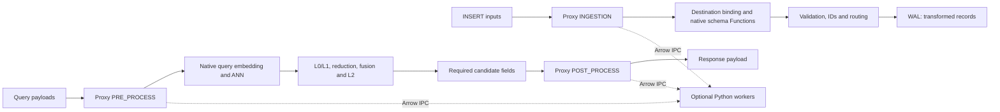

# MEP: Function Chain Transformations for INSERT and Search

- **Created:** 2026-10-10
- **Updated:** 2026-10-11
- **Status:** Draft; implemented and verified locally, not a released capability
- **Component:** Protocol / SDK / Proxy / Function Chain / Streaming
- **Related issues:** [#46565](https://github.com/milvus-io/milvus/issues/46565), [#52319](https://github.com/milvus-io/milvus/issues/52319)
- **Server baseline:** `fb7d370050305d9ff473a029e4a68977571b2d60`
- **Protocol baseline:** `7891054798706bf850d6b1874ade288dda21c24b`

## Summary

> [POST TABLE](20261011-function-chain-post-tables.md) extends this design with
> cross-NQ/ANN concatenation, native aggregation, UDF reduction and independent
> Arrow result schemas, including Query. The row-preserving POST contract below
> describes the default HITS mode; TABLE is an explicit separate result mode.

Function Chains now execute at three additional boundaries: collection-bound
INSERT transformation, request-bound query preparation, and final search
payload transformation. The local implementation includes endpoint adapters,
metadata persistence, native operators, Python workers, generated protocol APIs,
SDK binding and response parsing. It reuses `Ingestion`, `PreProcess` and
`PostProcess` wire stages. `PRE_INSERT` is an SDK alias for `INGESTION`.

The new operators are `select`, `explode` and `flat_map`. INSERT can filter or
expand rows; PRE and POST HITS preserve count and position. Existing L0/L1/L2
rerank policies remain. General `aggregate` and `reduce` require POST TABLE.

The [running guide](https://github.com/milvus-io/milvus/blob/master/docs/user-guides/function-chain-transform.md)
describes the matching SDK, runtime and deterministic wheel. The worker extends
the [PyUDF design](https://github.com/milvus-io/milvus/blob/master/docs/design-docs/design_docs/20260722-pyudf-function-chain.md)
from PR #52001 at `1d12e9190afab61d62769afd16a1be2635cecb1e`.

## Motivation

Chunking needs one document to produce multiple stored rows. Translation,
embedding and tagging need generated fields before storage. Query preparation
must precede ANN search, while highlights and enriched payloads need complete
candidate fields after ranking and fusion. A rerank-only adapter cannot provide
these boundaries or their different cardinality contracts.

Reusing FunctionChain gives one operator engine, one Arrow/Python protocol and
explicit endpoint-specific binding. Unsupported attachment points reject the
request instead of accepting a plan that never executes.

## Public interfaces and scope

| Stage | Attachment | V1 operators | Cardinality and identity |
|---|---|---|---|
| `INGESTION` / `PRE_INSERT` | One named chain in `CollectionSchema.function_chains` | `map`, `filter`, `select`, `explode`, `flat_map` | Single-parent subsets/expansion in original parent order |
| `PRE_PROCESS` | Ordinary Search or each HybridSearch ANN sub-request | `map`, `select` | One output query per input query, in the same position |
| `POST_PROCESS` HITS | Ordinary Search or top-level HybridSearch | `map`, `select` | Same candidate count, order, IDs, scores and element identity per query |
| `POST_PROCESS` TABLE | Search, top-level HybridSearch or Query | See POST TABLE extension | Independent result schema/cardinality with source lineage |

PRE/POST may coexist with legacy FunctionScore and HybridSearch rankers. Only
actual rerank-stage chains trigger rerank conflicts. Hybrid PRE belongs to each
sub-request; top-level PRE and sub-request POST are rejected. Hybrid POST runs
after fusion and the configured reranker.

Query supports the POST TABLE extension; HITS-mode Query and Search Iterator
have no transformation adapter. Search by IDs rejects
PRE/POST before ID lookup, including the all-null early-return path. PRE rejects
embedding-list placeholders. POST rejects `search_aggregation`. Ingestion-bound
collections reject Upsert, partial update and Import; DataCoord checks
authoritative metadata as well as the Proxy guard. REST requests carrying new
stages/bindings and REST INSERT into a bound collection are rejected. V1's
public transformation path is the matching SDK over gRPC.

Binding is created with the collection and survives metadata copy,
serialization and DescribeCollection. There is no v1 ALTER API to attach or
replace it. External collections cannot have an ingestion binding.

### Protocol additions

```proto
message CollectionSchema {
  // Existing fields unchanged.
  repeated FunctionChain function_chains = 17;
}

message FunctionChainRowMapping {
  repeated uint64 source_offsets = 1;
  repeated uint32 source_row_indexes = 2;
}

message IngestionFunctionChainResult {
  uint32 input_rows = 1;
  uint32 output_rows = 2;
  FunctionChainRowMapping output_sources = 3;
  bool outcome_unknown = 4;
}

message MutationResult {
  // Existing fields unchanged.
  IngestionFunctionChainResult ingestion_result = 10;
}
```

Field 17 leaves field 16 available for the parallel `dropped_fields` draft;
allocation must be checked again before merging the protocol change. Search,
SubSearchRequest and HybridSearchRequest already have `function_chains`. The
operator name is already a string, so no separate operator protobuf is needed.
Generated APIs are included in the local integration; releases must consume
the matching protocol revision. Source `.proto` changes alone do not enable
an older server.

## Design details

### Ownership and ordering



The native engine owns operators, dependencies, Arrow ownership and lineage.
Adapters own protocol conversion, input availability, destination binding and
response projection. Python workers belong to processes hosting Proxy; these
stages do not run user Python in QueryNode, DataNode or WAL replay.

### INSERT binding and outcomes

`InsertTask.applyIngestion` executes before `genFunctionFields`, row-ID allocation
and channel routing. The result supplies stored values and the final row count.
Binding uses destination names, types, dimensions and FieldIDs; a renamed
source cannot reuse its old FieldID for a different destination. Existing
field, UTF-8, size, partition, namespace and RLS checks run on transformed rows.

The SDK derives generated destinations from the persisted plan. Callers omit
those values and supply required original inputs. An in-place
`map("text", udf(col("text")))` still requires input `text`. Undeclared temporary
scalar/vector inputs require `col(name, data_type=...)`; final select removes
them from storage. Temporary nested inputs need schema declarations.

AutoID allocates IDs for generated rows. Explicit-key expansion requires
distinct child keys; repeating a parent's key across children is rejected.
A chain can generate text consumed by a native schema TextEmbedding Function.
If it generates that Function's vector output itself, the existing
`collection.function.allowInsertNonBM25FunctionOutputs` policy controls whether
the supplied output is accepted and the native call skipped. A plain vector
field for PyUDF embeddings avoids overlapping generation policies.

WAL persists materialized records. Recovery and CDC consume them without
executing the transformation model. External model calls are not exactly once.
V1 rejects ingestion INSERT idempotency keys before transform execution or WAL
append; it does not cache transformed output for later requests.

Returned metadata describes confirmed writes:

- `output_rows == insert_cnt == len(returned IDs)`.
- Output row `i` has sources in
  `source_row_indexes[source_offsets[i]:source_offsets[i + 1]]`.
- CSR has one entry per returned ID and `output_rows + 1` offsets. Each v1
  inserted child has one source. `[0]` describes zero confirmed rows.
- `succ_index`/`err_index` describe original inputs. An error wins when children
  of one source have different append outcomes. Filtered inputs may succeed
  without an inserted child.
- Partial channel/WAL outcomes return only confirmed IDs and their mapping.
  `outcome_unknown=true` means other generated rows may also have been written.

Write provenance distinguishes a guard that never attempted append from an
attempt with an uncertain response. An atomic phase transition settles the
cancellation/append race: cancellation before append prevents a later append;
after append starts, a failure snapshot cannot claim zero writes. There is no
request-wide transaction across channels.

PyMilvus exposes mapping on MutationResult and `MilvusClient.insert`.
`IngestionFunctionChainError` retains a returned MutationResult and
`unknown_outcome`. A lost response may have no MutationResult. The SDK does not
automatically replay ingestion failures. After a local MutationFuture wait
timeout, callers can await the same outstanding RPC; this sends no new INSERT.

### PRE_PROCESS binding

PRE's synthetic payload column is `query`. All NQ queries form one logical
request group, enabling batched translation/embedding. Temporary columns may
be generated; only the final non-null `query` column binds back to placeholders.
Count and lineage positions match original queries, and the placeholder tag
is retained.

Text and supported single-vector encodings are accepted. Text output enters
native query embedding/BM25. Float32/Float64 vectors become FloatVector
placeholders; target FP16/BF16 conversion uses the native converter. Generated
vector type/dimension mismatches and non-finite FloatVector components fail
before native search. Embedding-list inputs are unsupported.

The task clones the request before changing placeholders. A retry starts from
original client data, and one task does not preprocess twice. This preserves
input semantics without promising one external model call across all retries.

### POST_PROCESS binding

POST executes after reduction/fusion/rerank, required field retrieval and
configured highlighting. Each original query is one candidate group, including
zero-hit groups. A PyUDF POST invocation receives all these groups together,
plus every original/prepared query. Physical Arrow batches do not define query
boundaries or separate POST invocations.

Stored fields and typed JSON paths resolve before execution. Scalar arrays,
scalar StructArray parents/children and supported single-vector fields can be
consumed. ArrayOfVector sources are rejected; unreferenced original
ArrayOfVector payloads pass through unchanged. Only declared sources and
protected columns enter Arrow, avoiding copies of untouched large vectors.

`$id`, `$score` and `$element_indices` remain protected. `$id` comes from
dedicated candidate IDs, not a fetched primary-key payload. POST cannot filter,
expand, reorder or rewrite identity. Score comparison preserves NaN and
signed-zero bits during validation; existing response `round_decimal` still
runs afterward.

Without select, payload contains original requested fields plus generated
outputs. Hidden sources and dynamic/StructArray children are not exposed. With
select, remaining visible columns define payload and order; candidate identity
stays in dedicated response fields. Generated/renamed/overwritten fields have
names, runtime types and `field_id=0`; unchanged stored fields retain metadata
and wire representation.

Generated top-level Arrow Struct becomes a JSON object per candidate, with
nested structs/lists, child nulls and empty lists. Null parents become null JSON
fields; typed zero-row outputs retain JSON type. List<Struct> uses ArrayOfStruct
by default; explicit JSON destinations can encode lists as JSON arrays.
Timestamp, decimal and dictionary children in generic Struct JSON are not
supported. Invalid UTF-8, malformed raw JSON and non-finite JSON numbers fail
serialization. Endpoint binding is narrower than Arrow IPC transport support.

### Operators and dependencies

`select(inputs, outputs=None)` keeps visible columns in order and optionally
renames them. Calculations belong in map. Runtime Struct paths such as
`chunk.text` resolve against produced Arrow fields; null parents yield typed
null children. Selected-away inputs are unavailable to later operations.
Identity and lineage survive payload projection.

`explode(source, output, outer=False, position=None)` expands one List/LargeList
and repeats parent columns. Parent/element order is stable. Optional position
is Int64, starting at zero within each parent list; it is not a global row index.

| List value | Default | `outer=true` |
|---|---|---|
| Nonempty | One row per element | Same |
| Empty/null | Zero rows | One null element and null position |
| Null element inside a nonempty list | One null row at its actual position | Same |

List<Struct> yields a Struct column for select. Successive explodes have
Cartesian semantics; zipped expansion is not implicit.

`flat_map(output, expression, outer=False, position=None)` runs a row-preserving
List expression and then explodes it. The UDF returns exactly one List column,
one outer list per input row. Two protobuf outputs mean `[element, position]`;
the UDF still returns one column. Unmapped arbitrary flat rows are rejected.
FlatMap lowers to native Map + Explode. Every expression checks stage
compatibility, including the lowered Map. Nested parents use Arrow take rather
than scalar-only dispatch. Registering the operator does not enable row
expansion for rerank or PRE/POST stages.

A terminal select defines the complete output payload and enables automatic
column pruning in the transform executor. Reverse dependency analysis retains
columns needed by later operators. Within FlatMap, the mapped frame is pruned
to those live columns plus the intermediate List before Explode repeats parent
values. A later map reading `document` or `tenant` keeps those inputs alive;
system identity columns and lineage survive the projection. Without a terminal
select, the executor preserves the complete parent payload. An intermediate
select alone does not enable this automatic optimization.

### Executor, lineage and Python

`chain.NewTransformExecutor` implements the transform Executor contract.
Inputs are borrowed; outputs are owned and released by adapters. Plans and
results are validated, and partial allocations are released on failure.
Ingestion has one logical group per INSERT; PRE one query-row group per
request/sub-request; POST one candidate group per query. Multiple physical
batches can back a group without changing semantics.

Out-of-band lineage composes back to original `(group, row)` inputs through
selection, filtering and successive expansions. PRE/POST require singleton
identity lineage; ingestion allows single-parent subsets/expansion in parent
order. Multi-source lineage is representable but not executable in v1.

Wheel factories use the `milvus.pyudf` entry point and receive initialization
context. Runtime 0.2 adds a separate, immutable `PyUDFCallContext` for each
invocation. It is never stored in the cached factory context or user parameters.
Instances implement exactly one callable:

| Stage | Callable | Invocation unit |
|---|---|---|
| INGESTION | `transform(params, columns)` | One INSERT batch |
| PRE | `transform_query(params, columns, context=...)` | All NQ query rows of one ANN input |
| L0/L1/L2 contract | `transform_query(params, columns, context=...)` | One query's candidates; `context.query_index` selects that query |
| POST | `transform_batch(params, batches, context=...)` | All NQ candidate groups in one call; `context.query_index` is `None` |

The rerank grouping/index contract is common to L0/L1/L2. This implementation
enables PyUDF execution at the existing Proxy L2 boundary; QueryNode L0/L1 still
reject PyUDF and have no Python supervisor integration. Worker-level tests for
the three rerank stage names verify the common contract, not QueryNode execution.

`context.original_queries` and `context.queries` each contain one input per ANN
subrequest (one for ordinary Search). `values[i]` belongs to query index `i`.
Original values are captured before PRE; prepared values are captured after
PRE and before native query embedding/conversion. VarChar values become Python
strings. Vector values retain their original bytes with the PlaceholderType
name in `data_type`. Hybrid inputs remain separate; the runtime never chooses
the first ANN input as an implicit canonical query.
PRE itself sees its stage-entry snapshot in context; intermediate query values
are read from its input columns.

For rerank, each group receives its zero-based `query_index`, even if an earlier
query has zero hits. For POST, `batches[i]` is the tuple of selected Arrow input
columns for query `i`, including typed empty arrays. `result_offsets` describes
the same groups as cumulative row counts. This representation avoids copying
all candidate arrays into a concatenated buffer. POST returns one sequence of
output arrays per input group, preserving group/row counts and identity. Merely
receiving all groups does not enable aggregate/reduce output cardinality.

Existing two-argument INGESTION/PRE/L2 methods remain callable; a method that
accepts the `context` keyword receives it. Signature selection precedes the
user call, so a TypeError in its body never causes a second invocation. POST
wheels must implement `transform_batch` for the new execution contract.
Arrays retain one outer value per input row; native FlatMap owns expansion.

The internal worker request uses execution version 2 and includes query
metadata outside user-controlled params. A successful response must acknowledge
version 2; an old worker cannot silently return legacy per-query POST output.
New workers retain the execution-version-0 path for old clients. Query metadata
count/type failures are internal contract errors at the worker; malformed
original client query payloads are rejected as input errors by Proxy first.
This metadata transports query snapshots only; it does not export arbitrary
temporary PRE/L2 columns to another stage.

The supervisor uses installed `python3 -I -m milvus_pyudf_runtime.supervisor`.
`function.pyUDF.enabled` defaults to false; Proxy FileResource mode must be
`sync`. UDF instances may be reused concurrently, so UDF authors own thread
safety and external API deadlines. RPC timeout does not forcibly stop Python
or undo external effects. Message/destination limits do not provide a Python
sandbox or a dedicated expansion-ratio limit.

### Multi-row aggregation

The default HITS contract has no aggregate/reduce. Its merge fuses recall paths
for candidate identities, and rerank group_by retains member hits. The
[POST TABLE extension](20261011-function-chain-post-tables.md) adds native
aggregate and UDF reduce with multi-source lineage and independent output
schemas. Cross-request aggregation with state, windows and checkpoints remains
outside these finite-request pipelines.

## Compatibility and rollout

No-chain requests retain existing behavior. New SDKs require
`GetVersion.status.extra_info["function_chain_transform_version"] == "1"`
before sending bindings/new stages. New Proxies check coordinator capability
before creating ingestion-bound collections. Capability does not establish
that optional Python workers are enabled or ready.

Upgrade every write Proxy before enabling ingestion binding. An old Proxy may
ignore the unknown schema field and execute an ordinary INSERT without the
chain. The SDK's current-connection check and the coordinator gate do not prove
every writer behind a load balancer supports ingestion. Safe activation in a
mixed-version writer fleet is not claimed.

Collection metadata retains resource references and execution holds resource
snapshots. In-process wheel replacement and ALTER binding replacement are not
new APIs in this change. Unsupported scopes reject explicitly; rerank conflicts
apply only to actual rerank stages.

Publication requires coordinated dependency updates:

1. Publish the protocol revision containing collection binding, mutation
   lineage and outcome metadata, and regenerate its Go/Python APIs.
2. Pin that revision in the Milvus modules that consume `go-api/v3`, update the
   SDK's protocol source/submodule and regenerate its bundled gRPC definitions.
   A local `go.work` replacement is a development aid, not a release dependency.
3. Verify builds/tests against the published dependency pins and ship the
   matching server/SDK capability contract before activating collection bindings.

The local dependency snapshot is now pinned to protocol commit
`7cf29167c3d71b21be220c4f2af09db51f291d76`: all three Milvus Go modules require
`v3.0.0-20261011152020-7cf29167c3d7`, and the SDK submodule uses that same commit.
It has not been published remotely. Local checks with `GOWORK=off` resolve the
versioned module, and a fresh module-cache download from the delivery package's
file proxy matches the recorded checksums. See the Milvus
[dependency delivery guide](https://github.com/milvus-io/milvus/blob/master/docs/dev/function_chain_delivery.md)
for publication order and verification without workspace replacements.

## Test plan and recorded local verification

Tests cover serialization, typed empty/nested data, aliases and dropped
dependencies, repeated-parent lineage, destination dimensions, generated
payload, protected identity and legacy rankers. Failure cases include UDF
exceptions/shape errors, cancellation, runtime unavailability, malformed server
data, partial WAL outcomes and uncertain append responses. Typed errors survive
Scheduler.Notify, TaskCondition and Proxy status projection; inconsistent
requery keeps its retry classification.

Focused Go checks used `-tags dynamic,test -gcflags="all=-N -l" -count=1` and
core built from the matching server baseline. Supplemental official commands
retained their original race/coverage/fail-fast flags and per-command count
options. These are local results, not CI for a pushed commit or release
certification.

| Verification | Recorded result | Local evidence |
|---|---|---|
| Query-context runtime 0.2 Python suite, including installed-wheel execution | Passed, 85 tests and 61 subtests | `/tmp/milvus-function-chain-query-context-python-installed.log` |
| Query-context chain, DQL, DML and PyUDF Go suites with race detector | Passed; client fixtures acknowledge execution version 2 in the final client rerun | `/tmp/milvus-function-chain-query-context-go-tests.log`, `/tmp/milvus-function-chain-query-context-go-client-rerun.log` |
| Complete real INSERT → PRE → L2 → POST example | Passed; same candidates rank differently for each query; POST sees all six hits | `/tmp/milvus-function-chain-query-context-e2e/sdk-running.log` |
| Real Hybrid and zero-hit POST grouping | Passed; both ANN inputs retained, one POST call per request for group counts `[3,3]`, `[2,0]`, `[0,0]` | `/tmp/milvus-function-chain-query-context-e2e/hybrid-probe-final.log` |
| Server build with pinned protocol and `GOWORK=off`, module requirements read-only | Passed; binary metadata confirms the pinned protocol version/checksum | `/tmp/milvus-function-chain-pinned-build.log` |
| Complete chain/DML/DQL suites against the pinned module with `GOWORK=off` and race detector | Passed | `/tmp/milvus-function-chain-pinned-regression.log` |
| SDK chain/ingestion-future/hybrid/async regressions after protocol pinning | Passed, 222 tests | `/tmp/milvus-function-chain-pinned-sdk-tests.log` |
| SDK generated products after pinning, using corrected checker | Passed; modified/staged/untracked generated products fail the checker, including type stubs | `/tmp/milvus-function-chain-pinned-sdk-proto-check-fixed.log`, `/tmp/milvus-function-chain-proto-check-adversarial.log` |
| Full native chain/expr/transform/types packages | Passed | `/tmp/milvus-function-chain-operators-tests.log` |
| Complete chain/DML/DQL/ingestion/transformio suites after pruning, with race detector | Passed | `/tmp/milvus-function-chain-flatmap-pruning-regression.log` |
| FlatMap pruning and retention regressions, with race detector | Passed, 2.515s | `/tmp/milvus-function-chain-flatmap-pruning-tests.log` |
| Full DQL package; DQL vet | Passed; DQL tests 34.007s | `/tmp/milvus-function-chain-dql-full-tests.log`, `/tmp/milvus-function-chain-dql-vet.log` |
| Full DML package | Passed | `/tmp/milvus-function-chain-dml-tests.log` |
| DML cancellation/unknown-outcome settlement and partial/malformed WAL outcomes, with race detector | Passed, 4.603s | `/tmp/milvus-function-chain-ingestion-race-tests.log` |
| Streaming source/producer contracts | Passed | `/tmp/milvus-function-chain-streaming-tests.log` |
| Full distributed Streaming producer/accessor packages, with race detector | Passed | `/tmp/milvus-function-chain-all-official-go-logs/040_streaming.log` |
| HTTP new-stage guards | Passed | `/tmp/milvus-function-chain-http-transform-tests.log` |
| Capability fail-closed guards and GetVersion marker | Passed, including coordinator rejection | `/tmp/milvus-function-chain-version-capability-tests.log`, `/tmp/milvus-function-chain-coordinator-capability-tests.log` |
| FieldData/Arrow and generic Struct JSON | Passed | `/tmp/milvus-function-chain-transformio-tests.log` |
| Python runtime | 79 passed, 1 skipped; 55 subtests passed | `/tmp/milvus-function-chain-python-runtime-test.log` |
| Python transformation-stage tests | 6 passed | `/tmp/milvus-function-chain-python-stages-test.log` |
| Makefile `build-pyudf-runtime-wheel` target | Passed; produced `milvus_pyudf_runtime-0.1.0-py3-none-any.whl` | `/tmp/milvus-function-chain-runtime-wheel-build.log` |
| Full PyMilvus unit suite | 5327 passed, 3 skipped | `/tmp/milvus-function-chain-sdk-full-tests.log` |
| Public protocol Go API full suite | Passed | `/tmp/milvus-function-chain-public-proto-tests.log` |
| merr guard tests | Passed | `/tmp/milvus-function-chain-merr-guards-tests.log` |
| Coordinator, distributed mixcoord and CDC commands, with race detector | Passed | `/tmp/milvus-function-chain-all-official-go-logs/042_mixcoord.log`, `043_mixcoord.log`, `044_cdc.log` |
| Full Storage command after restoring fixtures, with official flags | Passed, 144.343s; coverage 76.9% | `/tmp/milvus-function-chain-official-storage-fixtures-rerun.log` |
| Real SDK → server `19570` → Python → WAL → search, after pruning fix | Passed; original Struct-output wheel preserved | `/tmp/milvus-function-chain-e2e/sdk-pruned.log` |
| Restarted server: existing collection metadata/rows | Observed persistent binding and 3 transformed rows with vectors/tags | Local restart/query observation |
| Repository-wide `make test-go` target | Did not pass; supplemental driver recorded 44 commands: 34 passed, 9 failed, 1 duplicate stopped | `/tmp/milvus-function-chain-all-official-go-status.tsv`, `/tmp/milvus-function-chain-all-official-go-logs/` |

`TestFlatMapProjectionReducesActualArrowPeak` expands one 4 KiB document into
256 tiny chunks and projects only the chunk text. Its checked Arrow allocator
peak decreased from 1,068,800 bytes to 16,064 bytes with pruning enabled.
Companion tests retain inputs needed by a later map, preserve identity/lineage,
cover empty output and verify that no terminal select preserves parent payload.
These are controlled Arrow allocation measurements, not total process RSS,
Python/model memory or an INSERT throughput result.

The real demonstration inserted 2 documents as 3 chunks with vectors/tags and
CSR sources `[0,0,1]`. PRE translated `hello/world` to `你好/世界`, then embedded
both queries with unchanged NQ. POST returned Arrow Struct highlights encoded
as JSON and selected only highlight payload, retaining IDs/scores. Empty input
produced zero rows and offsets `[0]`; a deliberate UDF exception returned code
2400 with its MutationResult and `unknown_outcome=false`, leaving 3 stored rows.
The example exited successfully. It uses deterministic vectors/dictionary
translation, with no paid external model API.

The local runtime wheel target was exercised. Docker images were not built.

SIGTERM cleanup stopped Proxy/Python workers and embedded etcd and released
ports, but the existing `kv.CloseEtcdClient` path panicked with `context canceled`
from `roles.Run`. Both source files are unchanged against the baseline. This
is not a successful graceful-shutdown verification; the recorded evidence is
`/tmp/milvus-function-chain-e2e/server-pruned.log`.

### Repository-wide checks and local blockers

The official Go target, invoked as `make -o build-cpp-with-unittest test-go`
to reuse the matching native core prerequisite, never passed. A supplemental
driver continued the official commands, recording 34 passed, 9 failed and 1
stopped command out of 44. These are command records, not package counts;
commands can cover multiple packages. Fail-fast failures leave cases unexecuted.
The separate Storage and cmd/tools reruns below do not change the historical
driver counts or establish a full-target pass. The consolidated local report
is `/tmp/milvus-function-chain-go-validation-report.md`.

| Observed failure | Verified cause and follow-up | Local evidence |
|---|---|---|
| Proxy full-target setup, QueryNodeV2 and DataNode native initialization | AWS allocator initialization abort. A standalone `InitRemoteChunkManagerSingleton` C API call, with no FunctionChain Go, reproduces exit 134 at `allocator.c:202`; relevant storage/core initialization source is unchanged against the baseline. | `002_querynode.log`, `004_datanode.log` under the driver log directory; `/tmp/milvus-function-chain-native-aws-repro.cpp`; consolidated validation report |
| DataCoord DISKANN size assertion | The macOS native build has DISKANN disabled, so the DISKANN disk flag is absent; expected 200 MiB is calculated as 100 MiB. | `/tmp/milvus-function-chain-all-official-go-logs/008_datacoord.log` |
| initcore, pkg/util and cmd/tools | Tests using `SkipEnv(true)` ignore the local-storage environment override and fail creating `/var/lib/milvus`. cmd/tools generated-file setup was restored using the official generator; its complete rerun still failed on permissions. Migration cases after its fail-fast config failure were not shown as completed. | `022_util.log`, `032_pkg.log`, `035_cmd.log` under the driver log directory; `/tmp/milvus-function-chain-official-cmd-tools-generated-rerun.log` |
| Existing StreamingNode BM25 materialization test | The native loon FFI writer cannot create `/var/lib/milvus` and returns permission-denied code 13. Relevant test/pack-writer source is unchanged. | `/tmp/milvus-function-chain-all-official-go-logs/038_streaming.log` |
| pkg/streaming Woodpecker test timeout | Real disk used ratio 0.9097 exceeded the 0.9 hard watermark. The final TimeTick append was rejected with `ErrLogStoreDiskPressure`; the reader waited and timed out. The traced append path does not enter the added producer/accessor code. | `/tmp/milvus-function-chain-all-official-go-logs/033_pkg.log` |
| Initial Storage fixture failure | The GCS fixture on port 4443 was missing. After restoring fixtures, the full command with original flags passed in 144.343s with 76.9% coverage. | `011_storage.log` under the driver log directory; `/tmp/milvus-function-chain-official-storage-fixtures-rerun.log` |
| Duplicate pkg/streaming invocation 041 | Stopped explicitly to avoid repeating the unchanged 033 scope; exit 143. It was not completed again and is not counted as passed. | `/tmp/milvus-function-chain-all-official-go-logs/041_streaming.log`; original result remains in `033_pkg.log` |

These local platform/fixture failures do not establish a production storage,
recovery or complete repository-wide verification result. The feature package
checks and real demonstration recorded above passed within their stated scope.

Descriptor comparison against `7891054798` checked 1,915 existing fields for
unchanged numbers/types/options. New fields round-tripped through the baseline
parser with unknown fields retained. This is wire-format evidence, not proof
of old-writer execution. External Gemini/rerank/video services, multi-Proxy
rollout, fault-injected CDC and all recovery scenarios remain unverified by
these local tests. Restart observation covers the demonstrated metadata/rows.

## Source references

Links name actual Milvus repository paths. New paths belong to the local change
and become upstream links when the change is merged.

- [Function Chain API](https://github.com/milvus-io/milvus/blob/master/docs/design-docs/design_docs/20260624-function-chain-api.md)
- [Plan builders](https://github.com/milvus-io/milvus/blob/master/internal/util/function/chain/transform/plan.go), [lineage validation](https://github.com/milvus-io/milvus/blob/master/internal/util/function/chain/transform/executor.go), [native executor](https://github.com/milvus-io/milvus/blob/master/internal/util/function/chain/transform_executor.go)
- [Representation](https://github.com/milvus-io/milvus/blob/master/internal/util/function/chain/repr.go), [projection-aware input planning](https://github.com/milvus-io/milvus/blob/master/internal/util/function/chain/input_plan.go)
- [Select](https://github.com/milvus-io/milvus/blob/master/internal/util/function/chain/operator_select.go), [Explode](https://github.com/milvus-io/milvus/blob/master/internal/util/function/chain/operator_explode.go), [FlatMap](https://github.com/milvus-io/milvus/blob/master/internal/util/function/chain/operator_flat_map.go)
- [Dependency liveness](https://github.com/milvus-io/milvus/blob/master/internal/util/function/chain/optimization_plan.go), [column pruning](https://github.com/milvus-io/milvus/blob/master/internal/util/function/chain/pruning.go), [FlatMap allocation/retention regressions](https://github.com/milvus-io/milvus/blob/master/internal/util/function/chain/operator_flat_map_pruning_test.go)
- [FieldData/Arrow and JSON conversion](https://github.com/milvus-io/milvus/blob/master/internal/util/function/transformio/converter.go)
- [Collection validation/resources](https://github.com/milvus-io/milvus/blob/master/internal/util/function/ingestion/schema.go), [metadata](https://github.com/milvus-io/milvus/blob/master/internal/metastore/model/collection.go)
- [INSERT adapter/outcomes](https://github.com/milvus-io/milvus/blob/master/internal/proxy/dml/function_chain_ingestion.go), [INSERT preparation](https://github.com/milvus-io/milvus/blob/master/internal/proxy/dml/task_insert.go), [native schema Functions](https://github.com/milvus-io/milvus/blob/master/internal/proxy/dml/util_dml.go)
- [Streaming producer provenance](https://github.com/milvus-io/milvus/blob/master/internal/distributed/streaming/internal/producer/producer_task.go)
- [PRE/POST adapters](https://github.com/milvus-io/milvus/blob/master/internal/proxy/dql/function_chain_transform.go), [stage classification](https://github.com/milvus-io/milvus/blob/master/internal/proxy/dql/function_chain_validator.go), [pipeline](https://github.com/milvus-io/milvus/blob/master/internal/proxy/dql/search_pipeline.go)
- [PyUDF expression](https://github.com/milvus-io/milvus/blob/master/internal/util/function/chain/expr/pyudf_expr.go), [Python instance contract](https://github.com/milvus-io/milvus/blob/master/internal/util/function/pyudf/python/milvus_pyudf_runtime/instance.py)
- [Query snapshots](https://github.com/milvus-io/milvus/blob/master/internal/proxy/dql/function_chain_query_context.go), [call context](https://github.com/milvus-io/milvus/blob/master/internal/util/function/pyudf/python/milvus_pyudf_runtime/context.py), [worker invocation modes](https://github.com/milvus-io/milvus/blob/master/internal/util/function/pyudf/python/milvus_pyudf_runtime/worker.py)
- [Demonstration wheel](https://github.com/milvus-io/milvus/blob/master/internal/util/function/pyudf/python/examples/transform_demo/milvus_transform_demo.py)
- [REST guards](https://github.com/milvus-io/milvus/blob/master/internal/distributed/proxy/httpserver/function_chain_transform.go), [WAL/CDC architecture](https://github.com/milvus-io/milvus/blob/master/docs/agent_guides/streaming-system/streaming-system.md)
