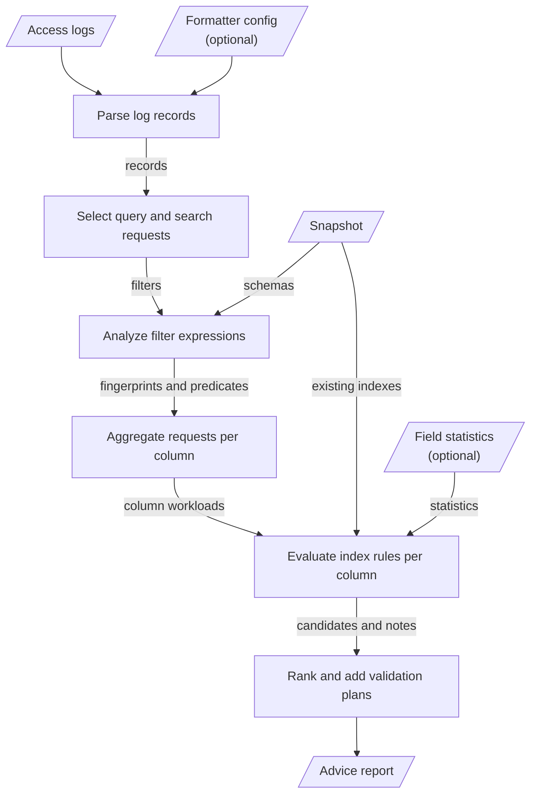

# MEP: Workload-Driven Scalar Index Advisor

- **Created:** 2026-10-16
- **Author(s):** @Lluczel
- **Status:** Draft
- **Component:** Other (offline tool, `cmd/tools/index-advisor`)
- **Related Issues:** [#53828](https://github.com/milvus-io/milvus/issues/53828)
- **Released:** TBD

## Summary

Add `index-advisor`, an offline command-line tool that reads proxy access logs,
a snapshot of collection schemas and existing indexes, and optionally a file of
per-field statistics. It writes a JSON report that lists, for each filtered
column, the scalar index candidates worth validating, the evidence behind each
candidate, and a before/after validation plan.

The tool is advisory only. It never creates, alters or drops an index, and the
report does not promise a speedup. AUTOINDEX is the baseline candidate wherever
Milvus accepts it. A specific index type is listed only when the access log or
the statistics give evidence for it.

## Motivation

Choosing scalar indexes today means reading filter expressions by hand. To
learn which fields are filtered, how often and with which operators, an
operator has to grep access logs, normalize literals mentally, and cross-check
the schema and the existing indexes. Missing statistics such as per-field
cardinality are easy to overlook, and an existing index is easily mistaken for
one that queries use.

The proxy already records the needed signal. With the default formatters, the
access-log records of queries, searches and deletes, gRPC or RESTful, carry the
filter expression (`$method_expr`) and the latency (`$time_cost`). This tool turns that signal
into a reproducible list of candidates, so that the expensive step, building
an index and measuring it, is spent on the right fields.

Non-goals:

- Changing indexes automatically.
- Estimating speedups or building a cost-based optimizer. The tool picks
  candidates to measure, and the measurement decides.
- Changing Milvus server code, protos or configuration.

## Public Interfaces

A new standalone command. It reads only the files it is given and never
connects to Milvus.

```
index-advisor --access-log FILE [--access-log FILE ...] --snapshot FILE
              [--field-stats FILE] [--milvus-config FILE] [--output FILE]
```

| Input | Content | Source |
|---|---|---|
| `--access-log` | Proxy access log files, repeatable for rotated files | `proxy.accessLog`, with the default or a custom formatter |
| `--snapshot` | Each collection's fields (name, data type, element type, primary key), dynamic field, aliases and existing indexes | Prepared by the user from `DescribeCollection` and `DescribeIndex`. The README documents the format and suggests a pymilvus script |
| `--field-stats` (optional) | Row count and per-field `distinct_count` and `null_fraction`, with the required provenance `source`, `collected_at` and `scope` | Supplied by the operator. Milvus does not expose per-field cardinality |
| `--milvus-config` (optional) | `proxy.accessLog.formatters` that override the defaults | The deployment's `milvus.yaml` or `user.yaml` |

The JSON inputs and the output carry `format_version: 1`. Snapshot keys follow
the field names of `schemapb.FieldSchema`. Data type names are matched without
case or underscores, so the proto names (`VarChar`) and the pymilvus names
(`VARCHAR`) are both accepted.

The output is deterministic for a given input:

- `inputs`: log file base names, record counts, skipped records by reason, and
  the provenance of the field statistics.
- `fingerprints`: each normalized filter shape with its request count, methods
  and logged latency.
- `recommendations`: one per column, ranked. Each has an `action`
  (`validate_candidates`, `review_existing` or `no_action`), the observed
  operators, the existing indexes, the `candidates` with their evidence,
  `statistics` (numbers or `"unknown"`), `notes` and a `validation_plan`.
- `notes`: fixed statements of what the report does not claim.

## Design Details

### Data flow



The first three stages count every record they drop under one skip reason
(see [Which records are analyzed](#which-records-are-analyzed)), and the report
lists these counts. Every record is therefore either analyzed or counted.

| Stage | Files |
|---|---|
| Parse log records | `log_parser.go`, `log_formatter.go` |
| Select requests, aggregate per column | `workload.go` |
| Analyze filter expressions | `expr_analyzer.go` |
| Load the snapshot and statistics | `snapshot.go`, `stats.go`, `json_input.go` |
| Evaluate index rules | `advise.go` (field contexts), `engine.go`, `rules.go`, `index_support.go` |
| Rank and add validation plans | `report.go`, `plan.go` |
| Command line | `main.go` |

### Reading access logs

A record starts at the `[$time_now] [ACCESS] ` prefix that every default
formatter begins with, and custom formats must keep this prefix. A record can
span several lines, because Milvus writes newlines inside an expression
unescaped. Lines end with LF or CRLF.
Each record is aggregated as it is read and not kept. The aggregates hold the
logged latency of every analyzed request.

Each formatter compiles to an anchored regular expression built from the
placeholders in `internal/proxy/accesslog/info`. A record is matched against
the formatter that owns its method, with `base` as the fallback, as in the
proxy. A RESTful method is logged as the URL path followed by any query string,
and is routed and counted by the path alone, as the proxy picks its formatter. The default formatters are copied from `configs/milvus.yaml`.
`--milvus-config` overlays a deployment's formatters key by key, as Milvus
merges `user.yaml`.

### Which records are analyzed

| Skip reason | Records |
|---|---|
| `orphan_line` | Text before the first record header |
| `unmatched_format` | Records that match no formatter |
| `not_a_filter_request` | Records whose formatter logs no expression, such as Insert |
| `hybrid_search_unsupported` | HybridSearch requests. Their sub-request filters are logged as one list without escaping and cannot be split reliably |
| `method_out_of_scope` | Requests that log an expression but are not a query or search, such as Delete |
| `request_failed` | Requests whose logged status is not `Successful`. A formatter without `$method_status` leaves the status unknown, and such requests are analyzed |
| `no_filter` | Queries and searches with an empty filter |
| `unknown_collection` | Requests on a collection that is not in the snapshot, by name or alias |
| `expression_parse_error` | Filters that Milvus's parser rejects |

### Loading the snapshot

The snapshot is turned into a `schemapb.CollectionSchema` for the expression
parser. `DescribeCollection` does not list the dynamic `$meta` field, so
`enable_dynamic_field` adds it. VARCHAR fields are marked as match-enabled, so
that `text_match` filters parse. Whether a request succeeded is taken from its
logged status. Each existing index is resolved with the parser to the column it
covers, from its `json_path` param when it has one and from its field name
otherwise. Existing indexes and predicates therefore refer to the same columns.
An index with `json_cast_type` `JSON` also serves the paths beneath its own,
except across an array position, as segcore selects it. The access log records
the name a request used, so each alias leads to its collection.

Struct array fields cannot be described in the snapshot, so filters on them
are not analyzed reliably.

### Expression analysis and fingerprints

Expressions are parsed with Milvus's own parser,
`planparserv2.ParseExprTemplate`, against the collection schema. Field
resolution, JSON paths, dynamic fields and template variables therefore behave
as in Milvus. The template variant returns the tree before the rewriter merges
or reorders predicates.

Each expression yields:

- A **fingerprint**, the only form of an expression the report carries. Every
  literal and template variable becomes `?`, operands of AND and OR are
  sorted, and LIKE keeps only its shape (`?%`, `%?`, `%?%`).
- **Predicates**, one per column condition, with the operator class (such as
  `eq`, `range`, `in`, `like_infix` or `text_match`), the literal's type, and
  the length of the shortest fixed part of a LIKE pattern. A comparison on one
  element of an ARRAY field counts for the field, as an operator no index
  serves. `json_contains` with elements of several types gives no cast type,
  because Milvus evaluates it on the raw data.

### Field contexts

The rules see one context per column. It holds the column (field, JSON path,
data type, primary key or dynamic key), its workload, the inferred
`json_cast_type` for a JSON path, the field statistics, and the existing
indexes. The workload counts each request once, however many predicates it
has on the column, and records requests per operator class, literal types,
the shortest fixed LIKE part, top fingerprints and latencies.

Contexts are built for every filtered column and for every indexed scalar
column that no analyzed request filters on, so an index with no observed use
is reported. An index with `json_cast_type` `JSON` that serves a filtered path
beneath it is reviewed with that path.

### Rule engine

Each rule handles one concern behind one interface:

```go
type rule interface {
	apply(fc *fieldContext, adv *advice) verdict // proceed or stop
}
```

A rule may add candidates or notes to the column's advice. The engine runs the
rules in order and ends the chain at the first rule that returns `stop`, so a
later rule never proposes a candidate for a column that an earlier rule ruled
out. Every stopping rule adds a note that says why.

| # | Rule | Effect |
|---|---|---|
| 1 | `primaryKeyRule` | **Stops** at the primary key, whose `==`, `in` and range filters segcore serves with its built-in primary-key lookup |
| 2 | `unfilteredColumnRule` | **Stops** at an indexed column that no analyzed request filters on |
| 3 | `jsonCastTypeRule` | **Stops** at a JSON path whose literals give no single `json_cast_type` |
| 4 | `indexableOperatorRule` | **Stops** when no single-column scalar index serves any operator on the column, as with field-to-field comparisons, arithmetic, comparisons on one array element and `text_match` |
| 5 | `baselineAutoIndexRule` | Proposes AUTOINDEX, or notes that Milvus does not accept it on the column |
| 6 | `bitmapRule` | Proposes BITMAP when its evidence check passes |
| 7 | `ngramRule` | Proposes NGRAM when its evidence check passes |
| 8 | `jsonArrayRule` | Proposes INVERTED with an array `json_cast_type` when its evidence check passes |
| 9 | `existingIndexRule` | Drops candidates the column already has, including AUTOINDEX when it would build the existing type. On a JSON path, an index with another `json_cast_type` does not count |
| 10 | `jsonShreddingRule` | Notes, on a JSON path with candidates or existing indexes and no array position, that JSON shredding is evaluated before JSON path indexes |

The action is `review_existing` for any column with an existing index.
Otherwise it is `validate_candidates` when the column has a candidate, and
`no_action` when it has none. Recommendations are ranked by action, then by the
number of requests filtering on the column, then by name.

A new alternative index type is one new rule with its evidence check, placed
in the engine's list. The engine is passed to the command, so a different rule
list can be run without changing the pipeline.

**Index target.** A candidate names the `field_name` and params to pass to
`create_index`. A path in a JSON field is indexed under that field, with
`json_path` set to the path. A path in the dynamic field is indexed under its
top-level key, with `json_path` written as `$meta["key"]...`, a form that
parses for any key. Every JSON path also gets the inferred `json_cast_type`.

**Baseline.** The AUTOINDEX evidence states how many requests filter on the
column and which type AUTOINDEX builds under the default
`scalarAutoIndex.params.build`. On a JSON path, AUTOINDEX builds HYBRID only
when the cluster's scalar index engine version is at least 4
(`common.MinScalarIndexVersionForJsonPathMultiType`), and INVERTED otherwise.
The snapshot does not carry that version, so the evidence states both
outcomes.

**Alternatives.** A specific index type is proposed only when its evidence
check passes. The operator alone is never enough.

| Alternative | Evidence required | Source |
|---|---|---|
| BITMAP | `distinct_count` below 500 on an integer, VARCHAR or array column filtered by `==`, `in` or `array_contains`. The evidence notes that HYBRID already uses a bitmap below `bitmap_cardinality_limit` (default 100), so the two should be compared. Not proposed where AUTOINDEX already builds BITMAP | https://milvus.io/docs/bitmap.md |
| NGRAM (`min_gram=2`, `max_gram=3`) | Infix, suffix or pattern LIKE on the column, with every fixed part of every observed LIKE filter at least `min_gram` long, which NGRAM requires to serve a pattern | https://milvus.io/docs/ngram.md |
| INVERTED with `ARRAY_VARCHAR`, `ARRAY_DOUBLE` or `ARRAY_BOOL` | `json_contains` on a JSON path that holds an array. A JSON path index serves `json_contains` only with an array `json_cast_type`, and INVERTED is the only index type that accepts one. The cast follows the element type of the literals | https://milvus.io/docs/json-indexing.md |

An alternative the column already has, with the same `json_cast_type` on a
JSON path, is neither proposed nor noted. When an alternative cannot be
evaluated, for example because `distinct_count` is unknown or a LIKE literal is
a template variable, a note says so.

Every candidate must be an index type that Milvus accepts on the column. The
tool checks this against a mirror of the type and `json_cast_type` rules in
`internal/util/indexparamcheck`, which links the C++ core and cannot be
imported by a pure-Go tool. Because clusters below the version above reject an
explicit BITMAP, HYBRID or STL_SORT on a JSON path, no alternative proposes
those types on a JSON path.

### Validation plan

Every `validate_candidates` recommendation carries a before/after plan:

1. **Before:** on a non-production copy with production-like data, replay the
   top fingerprints with representative values and record p50 and p95 latency
   without an index on the column. The logged latency is for reference only.
2. **After, per candidate:** on a copy with no other index on the column,
   create the candidate, wait for the build to finish, replay the same
   requests, and record latency, build time, memory, disk use and insert
   latency.
3. Keep the candidate with the clearest measured improvement, or no index if
   none improves.

A `review_existing` plan compares latency on copies with and without the
existing index, then on a copy with each candidate as the column's only index,
and compares these measurements with those of the existing index. When no
analyzed request filters on the column, the plan states that the logs may be a
sample of the workload.

### Redaction

Raw expressions never reach the report, only fingerprints. User names, client
addresses, trace IDs, SDK versions and error messages are parsed but never
written, and log files appear by base name only. The report still names
databases, collections, fields and JSON keys, and carries the provenance text
of the field statistics. The committed fixture is a synthetic workload
with generated literals and placeholder addresses and trace IDs.

### Failure handling

- An unreadable file fails the run with an I/O error that names the file.
- An invalid snapshot, statistics file or formatter config fails the run with
  an input error that names the collection, field or key. A missing required
  key or an invalid value is an error. A missing optional value is reported as
  `unknown`.
- A key that the snapshot or statistics format does not define is ignored, and
  a warning on stderr names its path. Extra data does not fail the run, and a
  misnamed key stays visible.
- A malformed or unsupported log record never fails the run. It is counted
  under its skip reason.
- A warning on stderr names each log file in which no line starts a record,
  each file with records that match no formatter, and each query or search
  formatter without `$method_expr` or `$collection_name`.

## Compatibility, Deprecation, and Migration Plan

The tool is new and standalone. Nothing in Milvus depends on it, and it adds no
module dependencies. A breaking change to an input or output format bumps its
`format_version`. A test keeps the copied default formatters in sync with
`configs/milvus.yaml`, so a change to the defaults in a future release fails
the test and the copy is updated. Deployments with custom formatters pass
their config with `--milvus-config`.

## Test Plan

Unit tests in `cmd/tools/index-advisor`:

- **Reproducibility:** golden tests compare the CLI output on the fixture,
  with and without `--field-stats`, byte for byte with
  `testdata/advice.json` and `testdata/advice_with_stats.json`. Shuffling the
  records does not change the output.
- **Acceptance invariants** on the golden output: AUTOINDEX comes first and
  every alternative has evidence. Missing statistics appear as `"unknown"`
  and block BITMAP. The indexed `city` is `review_existing` and is still
  compared with AUTOINDEX. An index that no request filters on is
  `review_existing` with no candidate. The primary key gets `no_action`.
- **Rules and engine:** each rule is tested on its own for when it proceeds or
  stops and for the exact candidates, evidence and notes it adds. The engine
  test covers the order of the chain, the action, and the absence of
  re-proposed existing index types.
- **Inputs:** every skip reason, multi-line records, orphan lines, custom
  formatter configs, every rejected snapshot and statistics file, and the
  warnings for unknown keys, unsupported log formats and incomplete
  formatters.
- **Redaction:** no literal, client address, trace ID or local path reaches
  the report.
- **Mirrors:** tests pin the index acceptance mirror and the AUTOINDEX
  mapping to values copied from `internal/util/indexparamcheck` and
  `pkg/util/paramtable`. A change in Milvus is mirrored by hand in the code
  and in these tests.

After an intended change to the output, the golden files are regenerated with
`-update` and the diff is reviewed.

## Rejected Alternatives

- **A fixed operator-to-index-type table**, such as "range → STL_SORT". It
  recommends specific types without evidence and ignores that AUTOINDEX
  already chooses a type by data type.
- **An advisor inside the proxy or a coordinator.** It would see live traffic,
  but it adds server code, configuration and risk for an advisory feature.
- **Applying indexes automatically.** Index builds cost CPU, memory and disk,
  and the benefit must be measured first.
- **Estimating speedups with a cost model.** The issue excludes a cost-based
  optimizer, and without real statistics an estimate would be a guess.
- **A separate expression parser.** It would drift from Milvus's grammar.
- **Exporting the snapshot from a running Milvus.** The tool would have to
  connect to Milvus and handle addresses and credentials. A documented file
  keeps the tool offline and can be produced with any SDK, the RESTful API or
  by hand.
- **Milvus Snapshot metadata as the `--snapshot` input.** A Milvus Snapshot is
  a backup of collection data. Producing one keeps its segments from garbage
  collection until it is dropped, its metadata must be read from object
  storage, and its format is an internal proto.

## Future Work

- Analyze HybridSearch sub-requests once their filters are logged in a form
  that can be split.
- Derive the record start from the configured formatters, so that a custom
  format can begin with other fixed text or a time placeholder, and then with
  placeholders whose values have a fixed form, such as gRPC method names or
  `$method_status`.
- Accept the proxy slow-query log as a second input.
- Add more evidence-gated alternatives.
- Add an Agent Skill that prepares the inputs, runs this CLI and explains the
  evidence.

## References

- Issue: [#53828](https://github.com/milvus-io/milvus/issues/53828)
- Access log configuration: https://milvus.io/docs/configure_access_logs.md
- Scalar indexes: https://milvus.io/docs/index-scalar-fields.md,
  https://milvus.io/docs/bitmap.md, https://milvus.io/docs/ngram.md
- Code: `internal/proxy/accesslog/`, `internal/parser/planparserv2/`,
  `internal/util/indexparamcheck/`, `pkg/util/paramtable/autoindex_param.go`,
  `internal/proxy/ddl/task_index.go`
