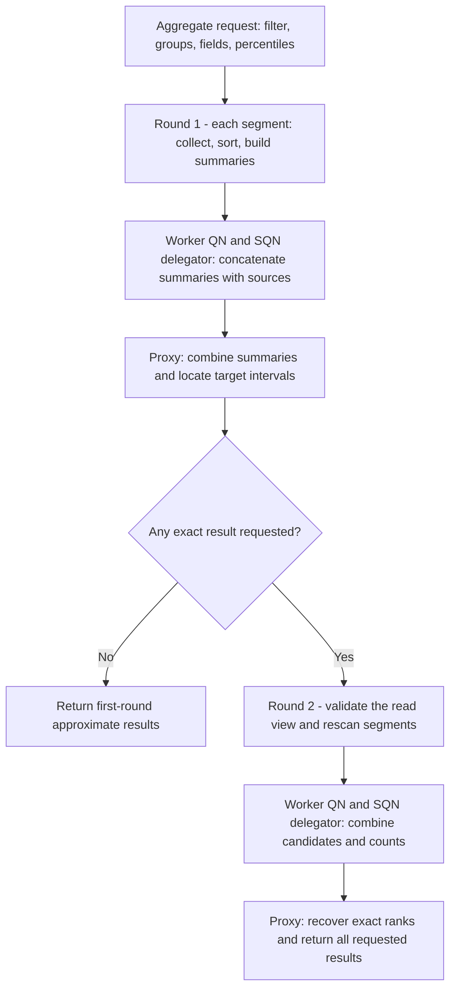

# MEP: Percentile Aggregation

- **Created:** 2026-10-29
- **Author(s):** @sijie-ni-0214
- **Status:** Draft
- **Component:** Proxy, QueryNode, segcore, SDK, REST
- **Related Issues:** N/A
- **Released:** TBD

## Summary

Add three aggregation expressions: `percentile_cont(field, p)`,
`percentile_disc(field, p)`, and `approx_percentile(field, p)`. They calculate
percentiles globally or per group and can be combined with count, sum, avg,
min, and max in one request.

The design uses a two-round protocol. Each segment sorts its matching values
and returns a small equal-depth summary in the first round. Proxy can return
an approximate observed value from those summaries. Exact requests use a
second scan of the same read view to retrieve candidate values and counts,
from which Proxy reconstructs the required global ranks.

This reduces the values collected by upstream reducers without retaining
complete sample arrays between RPCs. It does not eliminate the first round's
local collection and sorting memory.

## Motivation and scope

Percentiles describe the value at a position in a distribution. P50 is a
median; P95 and P99 help describe high latency, prices, or other tail values
that an average can hide. Server-side aggregation avoids transferring all
matching records to a client for this calculation.

Continuous versus discrete describes how a percentile is evaluated. Exact
versus approximate describes whether estimation error is allowed. These are
separate choices:

| Expression | Result for `[10, 20, 30, 40]` at P50 | Meaning |
|---|---|---|
| `percentile_cont` | `25.0` | Exact continuous percentile; interpolate when needed. |
| `percentile_disc` | `20` | Exact discrete percentile; select an observed value. |
| `approx_percentile` | Depends on the summaries | Estimate a discrete percentile from the first round; do not interpolate. |

For Query, the population is all visible records matching the filter, within
the requested partitions and groups. GROUP BY is optional. Search aggregation
must define its own population, such as ANN candidates or returned hits;
percentiles over those populations must not be presented as percentiles over
all records matching the scalar filter.

The input types covered here are direct Int8, Int16, Int32, Int64, Float, and
Double fields. More types and additional approximate algorithms are described
under Future work. This proposal does not add aggregation-result pagination
through Query iterator.

## Public interface and result contract

The proposed Query expressions use the existing `output_fields` aggregation
form. The following example describes the interface to be added:

```python
client.query(
    collection_name="requests",
    filter="latency_ms >= 0",
    group_by_fields=["service"],
    output_fields=[
        "service",
        "percentile_cont(latency_ms, 0.95)",
        "percentile_disc(latency_ms, 0.95)",
        "approx_percentile(latency_ms, 0.95)",
    ],
)
```

Omitting `group_by_fields` requests a global aggregate. SDK and REST Query
entry points will expose the same expressions, grouping semantics, and result types.
Each expression accepts one finite numeric constant `p` in `[0, 1]`. Multiple
expressions can request different percentiles of the same field; arrays of
percentiles and arbitrary input expressions are outside this interface.

For `N > 0`, let `x[1] <= ... <= x[N]` be the valid samples in one group,
including duplicates. All ranks below are one-based.

| Expression | Definition | Return type |
|---|---|---|
| `percentile_cont(field, p)` | R-7: `h = 1 + p * (N - 1)`, `i = floor(h)`, `j = ceil(h)`, `f = h - i`; return `(1 - f) * x[i] + f * x[j]`. | Double |
| `percentile_disc(field, p)` | Return `x[max(1, ceil(p * N))]`. | Input numeric type |
| `approx_percentile(field, p)` | Use the discrete target rank and return the first-round estimate defined below. | Input numeric type |

The result rules are:

1. Skip NULL values, and preserve the multiplicity of duplicate values.
2. Return NULL for an empty global population or for a present group whose
   target field contains no valid samples. A group must not disappear solely
   because its percentile input is all NULL.
3. At `p = 0` and `p = 1`, use the exact minimum and maximum from the first
   round. With one valid sample, all three expressions return that value,
   converted to Double for `percentile_cont`.
4. Preserve integer values for sorting, summary boundaries, and candidates.
   Only the continuous result is converted to Double. All integers in
   `[-2^53, 2^53]` are exactly representable as Double; larger integers can
   round, for example `2^53 + 1` becomes `2^53`.
5. Preserve Milvus's finite-number constraint: NaN and positive or negative
   infinity cause an error, rather than being silently skipped.
6. ORDER BY in an aggregate query can reference grouping columns, not
   percentile or other aggregate expressions. Required contributions to a
   returned group must be merged before producing its percentile.
7. Invalid fields, types, or percentiles return an explicit error. A failed
   request returns neither partial answers nor a fabricated zero, and exact
   requests never fall back automatically to approximate results.

## Two-round algorithm

In streaming mode, Worker QueryNodes execute sealed segments. The QueryNode
embedded in a StreamingNode, referred to here as SQN, handles growing segments
and hosts the delegator. The SN WAL/flusher side is not an aggregation
execution stage. SQN delegators combine Worker QN and local growing-segment
results; Proxy combines shards and evaluates the final percentile.



### Round 1: equal-depth summaries

The unit of calculation is one **group and input field**. For this unit,
segment `i` has `n_i` valid samples, `N = sum(n_i)`, and `M` is the number of
nonempty segment summaries. `M` is not the number of QueryNodes. The server
selects a positive bucket count `B` for the request.

Each segment sorts its valid samples, then divides them by sorted position
using cuts `e_j = ceil(j * n_i / B)`, for `j = 0, ..., B`. Each nonempty
bucket contains at most `ceil(n_i / B)` values. Its summary is:

- `b`: the maximum observed value in the bucket;
- `s`: the number of samples in the bucket.

Return these pairs in bucket order, along with the valid sample count,
minimum, maximum, and the read-view identity. Group existence is preserved
even when the target field has no valid samples.

Intermediate reducers concatenate summaries and retain their source identity;
they do not recompress them or merge locally finalized percentile values.
All requested percentiles of the same input field share a summary. Other
aggregate states can accompany the first round and are not counted again
during the second scan.

### Proxy: locate a candidate interval

For each bucket, let `prev` be the preceding nonempty bucket's maximum in the
same segment, or negative infinity for the first bucket. Every sample in the
bucket lies between `prev` and `b`, inclusive. From the summaries, define:

```text
L(v) = sum(s for buckets with b <= v)
U(v) = sum(s for buckets with prev <= v)
```

Thus `L(v) <= count(x <= v) <= U(v)`. If `C` is the sorted set of distinct
bucket maxima, `L` and `U` are constant between consecutive members of `C`.
Define:

```text
Delta = sum(ceil(n_i / B))
U(v) - L(v) <= Delta <= N / B + M
```

An exact discrete percentile requires rank `k = max(1, ceil(p * N))`.
A continuous percentile requires ranks `i` and `j` from the R-7 definition.
Let `k_low` and `k_high` be the smallest and largest required ranks for one
percentile; they are equal or adjacent. Choose:

```text
alpha = smallest v in {negative infinity} union C with U(v) >= k_low
omega = smallest v in C with L(v) >= k_high
```

Then `alpha <= x[k_low] <= x[k_high] <= omega`. Handle `N = 0` and the
minimum/maximum shortcuts before requesting a second round.

### Approximate result

For `approx_percentile`, locate `alpha` using the discrete target rank
`k = max(1, ceil(p * N))`. Return `alpha`, or the global minimum if `alpha`
is negative infinity. The result is an observed value, with no interpolation.

For finite `alpha`, `alpha <= x[k]`, and there exists a rank
`r` in `[max(1, k - Delta), k]` for which `alpha = x[r]`. Equivalently, the distance
from `k` to the duplicate-value rank interval of the returned value is at
most `Delta`. The normalized bound is:

```text
rank_error / N <= Delta / N <= 1 / B + M / N
```

The same worst-case bound applies to every `p`; actual errors can differ.
Relating the integer target rank back to the nominal discrete proportion `p` adds
at most `1 / N` for rounding. This is a deterministic discrete-rank guarantee,
not a relative numeric-value error guarantee or an approximation contract for
R-7 interpolation. The estimate can undershoot the exact discrete value; it
can also equal it.

Approximate-only requests finish after the first round. If a request also
contains exact percentiles, keep its approximate results and return the whole
response after the exact branch completes.

### Round 2: recover exact ranks

Proxy sends the interval endpoints and the original read-view identity to
each source. Rescan the same visible population and return:

- `a`: the number of valid samples strictly below `alpha`;
- `e`: the number equal to `alpha`;
- `R`: the original values strictly inside `(alpha, omega)`;
- `f`: the number equal to `omega`;
- the valid sample count for comparison with the first round.

Endpoint duplicates are represented by counts, not repeated values in `R`.
For negative-infinity `alpha`, `a = e = 0`. If `alpha = omega`, count that
endpoint once and recover the required values directly.

Worker QNs and SQN delegators combine the candidate arrays and sum the counts.
Proxy sorts or selects from the combined candidates. With global counts
`A = sum(a)`, `E = sum(e)` and candidate multiset `R`, recover each required
rank `r` as follows:

```text
if r <= A + E:             x[r] = alpha
else if r <= A + E + |R|: x[r] = R[r - A - E]  # one-based, sorted R
else:                     x[r] = omega
```

For a single percentile's original interval, `|R| <= 2 * Delta`. Multiple
percentiles require multiple intervals. Merge intervals that overlap or share
an endpoint before the second scan, so each candidate and endpoint is counted
once. A former endpoint inside a merged interval is an interior candidate,
not an additional endpoint count. The single-interval bound does not become a
`2 * Delta` bound for the union of all requested percentiles.

### Worked example: P50 across two segments

Use one group, `N = 16`, and `B = 4`. The small bucket count is for hand
calculation, not a proposed production default.

| Source | Sorted values, with bucket boundaries | Summary `(b, s)` |
|---|---|---|
| A: Worker QN, sealed | `10, 20` / `25, 25` / `50, 60` / `70, 80` | `(20,2), (25,2), (60,2), (80,2)` |
| B: SQN, growing | `15, 25` / `35, 45` / `55, 65` / `75, 85` | `(25,2), (45,2), (65,2), (85,2)` |

Discrete P50 needs rank 8. Continuous P50 has `h = 8.5`, so it needs ranks
8 and 9. For their combined interval:

| Boundary `v` | `L(v)` | `U(v)` |
|---|---:|---:|
| 20 | 2 | 6 |
| 25 | 6 | 10 |
| 45 | 8 | 12 |
| 60 | 10 | 14 |

The first boundary where `U` reaches rank 8 is 25; the first where `L`
reaches rank 9 is 60. Hence `alpha = 25`, `omega = 60`, and
`Delta = ceil(8/4) + ceil(8/4) = 4`.

The approximate branch returns 25. In the original data, 25 occupies ranks
4 through 6, so its distance from target rank 8 is 2, within the bound of 4.
The exact branch rescans and returns:

| Source | Below 25 | Equal to 25 | Inside `(25,60)` | Equal to 60 |
|---|---:|---:|---|---:|
| A | 2 | 2 | `[50]` | 1 |
| B | 1 | 1 | `[35,45,55]` | 0 |
| Combined | 3 | 3 | `[35,45,50,55]` | 1 |

Three values precede 25 and three equal it. The candidate array therefore
occupies global ranks 7 through 10. Rank 8 is 45 and rank 9 is 50, giving:

```text
percentile_disc(..., 0.5) = 45
percentile_cont(..., 0.5) = 47.5
approx_percentile(..., 0.5) = 25
```

## Read consistency and failure behavior

Both rounds must use the same MVCC visibility, filter, partitions, grouping,
input fields, and TTL evaluation time. The read-view contract has three owners:

1. **SQN delegator:** in round 1, capture the shard's selected segment set,
   source node instances, and read-relevant segment/distribution versions.
   Return an identity for this view with the summaries. In round 2, validate
   the requested identity and segment membership against the original view
   and pin the validated view for that scan's duration.
2. **Proxy:** retain each shard's view identity and expected sources for one
   attempt. Send round 2 to the same owning delegator instance, and require
   exactly one contribution from each expected source. A changed owner or
   missing/duplicate source invalidates the entire attempt.
3. **Worker QN and local growing-segment executor:** before scanning, verify
   the requested segment instance and read-relevant version against that
   view. A missing, replaced, or changed segment fails validation; it is not
   silently replaced by another replica or segment within the attempt.

Together these checks must ensure that each visible record contributes
exactly once. The view identity is an execution contract, not merely a sample
count or an opaque label with no validation requirements.

The same MVCC timestamp alone is insufficient to establish that both scans
read the same population. The two-round execution contract must carry and
validate the view identity; it must not assume an ordinary single-RPC pin
remains held after the first response.

If handoff, compaction, node switching, or another change invalidates a view,
discard the complete attempt and restart from the first round within the
request's retry policy and original deadline. Never combine results from
different attempts. Second-round sample counts are an auxiliary consistency
check: equal counts do not prove that the values are unchanged. Exhausted
retries, cancellation, timeout, and output overflow fail the request without
partial or approximate fallback answers.

Complete sample arrays and sorting scratch space are released after building
the first-round summaries. The second round rescans instead of relying on
cross-RPC retention or affinity to an in-memory sample buffer.

## Resource boundaries

For one group and one 8-byte numeric field, a summary pair contains an
8-byte boundary and an 8-byte count. With at most `B` pairs per source:

```text
first-round summary body <= 16 * M * B bytes
second-round candidate body <= 2 * Delta * 8 bytes  # one percentile
full sample body = N * 8 bytes
```

For `N = 100,000,000`, `M = 10`, and `B = 1024`, the first-round body is at
most 160 KiB, compared with about 763 MiB of original values. The candidates
for one original interval occupy at most about 1.5 MiB. These are data-body
estimates, not measured process memory, and exclude group keys, endpoint
counts, read-view metadata, serialization, and RPC overhead. Account for all
groups, fields, and requested intervals; many small groups can eliminate the
summary's size advantage.

Use the existing `quotaAndLimits.limits.maxOutputSize` threshold, whose
default is 100 MiB, as an **output post-check**. Include summaries, candidates,
and counts in each layer's intermediate output accounting. Construct the
output, check its size, and fail the request explicitly on overflow.

The threshold is not an execution-memory budget. It does not prevent the
segment from allocating complete matching samples and sorting scratch space
before that check. The protocol reduces upstream collection and cross-RPC
retained state, but adds a second scan for exact results and does not promise
a bounded first-round memory peak.

## Alternatives and future work

Full sample collection has a simple exact evaluation path, but sends all
matching values through upstream reducers. Finalizing percentiles per segment
and merging those scalars is incorrect in general. Equal-depth summaries
provide both a deterministic first-round rank bound and candidate intervals
for exact reconstruction.

The following extensions remain separate decisions:

1. **Additional approximate algorithms.** Evaluate t-digest and KLL alongside
   each other. Both can update a compact state during scanning and merge
   states across nodes, avoiding full local sample collection and sorting for
   approximate-only requests. Compare accuracy, runtime memory, and
   distributed merge cost at comparable state-size budgets. t-digest
   emphasizes tail resolution; KLL offers a probabilistic rank-error
   contract. Also evaluate whether to expose an optional precision parameter.
   These sketches do not directly replace the exact branch's bounding
   summaries.
2. **More input types.** Consider VarChar, TIMESTAMPTZ, Bool, and scalar values
   extracted from arrays or JSON. Define ordering, statistical meaning,
   return type, and actual-byte memory/transfer costs for each function before
   adding support. TIMESTAMPTZ compares UTC microseconds as Int64 and retains
   its type; the rounding of sub-microsecond continuous interpolation remains
   to be decided. Whole-array/object percentiles and element/subfield
   percentiles are different populations and require separate definitions.

## References

- [Search embedded aggregation](20260413-search_embedded_agg.md)
- [Query ORDER BY](20260203-query-orderby.md)
- [t-digest](https://github.com/tdunning/t-digest)
- [Apache DataSketches KLL accuracy and size](https://datasketches.apache.org/docs/KLL/KLLAccuracyAndSize.html)
