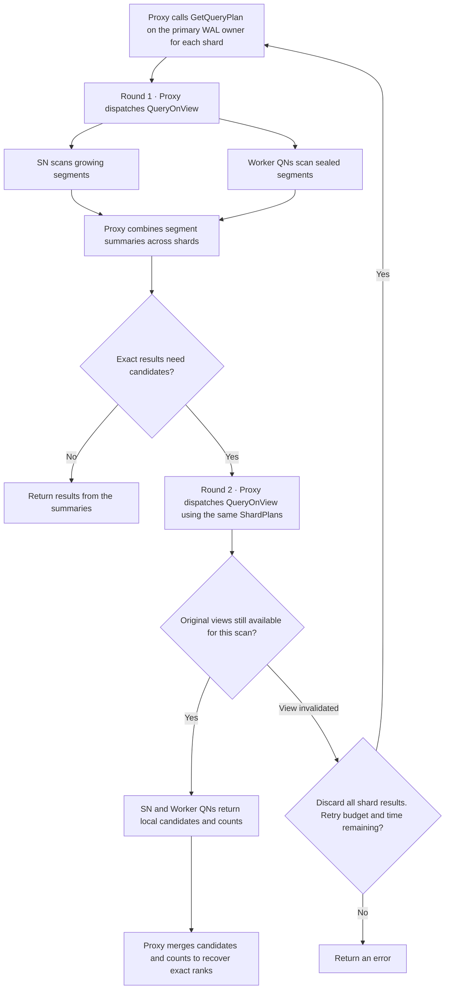

# MEP: Percentile Aggregation

- **Created:** 2026-10-29
- **Author(s):** @sijie-ni-0214
- **Status:** Draft
- **Component:** Proxy, StreamingNode, QueryNode, segcore, SDK, REST
- **Related Issues:** N/A
- **Released:** TBD

## Summary

Add three aggregation expressions: `percentile_cont(field, p)`,
`percentile_disc(field, p)`, and `approx_percentile(field, p)`. They calculate
percentiles globally or per group and can be combined with count, sum, avg,
min, and max in one request.

Proxy obtains a QueryView plan for each shard. In the first scan, each
segment sorts its matching values and builds an equal-depth summary.
Proxy can return an approximate observed value from those summaries. When
an exact result needs more values, Proxy reuses the same shard plans for a
second scan and reconstructs the required ranks from candidates and counts.

This reduces the values collected by upstream reducers without retaining
complete sample arrays between RPCs. It does not eliminate the first round's
local collection and sorting memory.

## Motivation and scope

Percentiles describe the value at a position in a distribution. P50 is a
median; P95 and P99 help describe high latency, prices, or other tail values
that an average can hide. Server-side aggregation avoids transferring all
matching records to a client for this calculation.

Continuous versus discrete describes how a percentile is evaluated. Exact
versus approximate describes whether estimation error is allowed. These are
separate choices:

| Expression | Result for `[10, 20, 30, 40]` at P50 | Meaning |
|---|---|---|
| `percentile_cont` | `25.0` | Exact continuous percentile; interpolate when needed. |
| `percentile_disc` | `20` | Exact discrete percentile; select an observed value. |
| `approx_percentile` | Depends on the summaries | Estimate a discrete percentile from the first round; do not interpolate. |

For Query, the population is all visible records matching the filter, within
the requested partitions and groups. GROUP BY is optional. Search aggregation
must define its own population, such as ANN candidates or returned hits;
percentiles over those populations must not be presented as percentiles over
all records matching the scalar filter.

The input types covered here are direct Int8, Int16, Int32, Int64, Float, and
Double fields. This proposal does not add aggregation-result pagination through
Query iterator.

## Public interface and result contract

The proposed Query expressions use the existing `output_fields` aggregation
form. The following example describes the interface to be added:

```python
client.query(
    collection_name="requests",
    filter="latency_ms >= 0",
    group_by_fields=["service"],
    output_fields=[
        "service",
        "percentile_cont(latency_ms, 0.95)",
        "percentile_disc(latency_ms, 0.95)",
        "approx_percentile(latency_ms, 0.95)",
    ],
)
```

Omitting `group_by_fields` requests a global aggregate. SDK and REST Query
entry points will expose the same expressions, grouping semantics, and result types.
Each expression accepts one finite numeric constant `p` in `[0, 1]`. Multiple
expressions can request different percentiles of the same field; arrays of
percentiles and arbitrary input expressions are outside this interface.

If a request includes `percentile_cont` or `percentile_disc`, Proxy rejects
a filter containing `random_sample()` with a parameter error before execution.
This also applies when the request includes `approx_percentile`. Repeating
a random filter can select different rows even on the same QueryView.

For `N > 0`, let `x[1] <= ... <= x[N]` be the valid samples in one group,
including duplicates. All ranks below are one-based.

| Expression | Definition | Return type |
|---|---|---|
| `percentile_cont(field, p)` | R-7: `h = 1 + p * (N - 1)`, `i = floor(h)`, `j = ceil(h)`, `f = h - i`; return `(1 - f) * x[i] + f * x[j]`. | Double |
| `percentile_disc(field, p)` | Return `x[max(1, ceil(p * N))]`. | Input numeric type |
| `approx_percentile(field, p)` | Use the discrete target rank and return the first-round estimate defined below. | Input numeric type |

The result rules are:

1. Skip NULL values, and preserve the multiplicity of duplicate values.
2. Return NULL for an empty global population or for a present group whose
   target field contains no valid samples. A group must not disappear solely
   because its percentile input is all NULL.
3. At `p = 0` and `p = 1`, use the exact minimum and maximum from the first
   round. With one valid sample, all three expressions return that value,
   converted to Double for `percentile_cont`.
4. Preserve integer values for sorting, summary boundaries, and candidates.
   Only the continuous result is converted to Double. All integers in
   `[-2^53, 2^53]` are exactly representable as Double; larger integers can
   round, for example `2^53 + 1` becomes `2^53`.
5. Preserve Milvus's finite-number constraint: NaN and positive or negative
   infinity cause an error, rather than being silently skipped.
6. ORDER BY in an aggregate query can reference grouping columns, not
   percentile or other aggregate expressions. Required contributions to a
   returned group must be merged before producing its percentile.
7. Invalid fields, types, or percentiles return an explicit error. A failed
   request returns neither partial answers nor a fabricated zero, and exact
   requests never fall back automatically to approximate results.

## Two-round algorithm

Planning precedes both scans. For each shard, Proxy calls `GetQueryPlan` on the
StreamingNode (SN) that owns its primary WAL. It uses the plan to dispatch
`QueryOnView` directly to the SN query executor for growing segments and to
the assigned Worker QueryNodes (QNs) for sealed segments. Each executor
combines its local segment results and replies directly to Proxy.

Proxy collects the replies by shard, retains the successful `ShardPlan` for
each shard, and combines summaries across shards to find the bounds for each
group and input field. An approximate-only request ends here. An exact request
that needs candidates issues another `QueryOnView` using those retained plans.



### Round 1: equal-depth summaries

The unit of calculation is one **group and input field**. For this unit,
segment `i` has `n_i` valid samples, `N = sum(n_i)`, and `M` is the number of
nonempty segment summaries. `M` is not the number of QueryNodes. The server
selects a positive bucket count `B` for the request.

Each segment sorts its valid samples, then divides them by sorted position
using cuts `e_j = ceil(j * n_i / B)`, for `j = 0, ..., B`. Each nonempty
bucket contains at most `ceil(n_i / B)` values. Its summary is:

- `b`: the maximum observed value in the bucket;
- `s`: the number of samples in the bucket.

Return these pairs in bucket order, along with the valid sample count,
minimum, and maximum. Group existence is preserved even when the target
field has no valid samples.

SN and Worker QNs concatenate local summaries, preserving their segment
identity and bucket order. Proxy associates each reply with its shard plan.
The bounds use the original segment summaries without recompression.
All requested percentiles of the same input field share a summary. Other
aggregate states can accompany the first round and are not counted again
during the second scan.

### Proxy: locate a candidate interval

For each bucket, let `prev` be the preceding nonempty bucket's maximum in the
same segment, or negative infinity for the first bucket. Every sample in the
bucket lies between `prev` and `b`, inclusive. From the summaries, define:

```text
L(v) = sum(s for buckets with b <= v)
U(v) = sum(s for buckets with prev <= v)
```

Thus `L(v) <= count(x <= v) <= U(v)`. If `C` is the sorted set of distinct
bucket maxima, `L` and `U` are constant between consecutive members of `C`.
Define:

```text
Delta = sum(ceil(n_i / B))
U(v) - L(v) <= Delta <= N / B + M
```

An exact discrete percentile requires rank `k = max(1, ceil(p * N))`.
A continuous percentile requires ranks `i` and `j` from the R-7 definition.
Let `k_low` and `k_high` be the smallest and largest required ranks for one
percentile; they are equal or adjacent. Choose:

```text
alpha = smallest v in {negative infinity} union C with U(v) >= k_low
omega = smallest v in C with L(v) >= k_high
```

Then `alpha <= x[k_low] <= x[k_high] <= omega`. Handle `N = 0` and the
minimum/maximum shortcuts before requesting a second round.

### Approximate result

For `approx_percentile`, locate `alpha` using the discrete target rank
`k = max(1, ceil(p * N))`. Return `alpha`, or the global minimum if `alpha`
is negative infinity. The result is an observed value, with no interpolation.

For finite `alpha`, `alpha <= x[k]`, and there exists a rank
`r` in `[max(1, k - Delta), k]` for which `alpha = x[r]`. Equivalently, the distance
from `k` to the duplicate-value rank interval of the returned value is at
most `Delta`. The normalized bound is:

```text
rank_error / N <= Delta / N <= 1 / B + M / N
```

The same worst-case bound applies to every `p`; actual errors can differ.
Relating the integer target rank back to the nominal discrete proportion `p` adds
at most `1 / N` for rounding. This is a deterministic discrete-rank guarantee,
not a relative numeric-value error guarantee or an approximation contract for
R-7 interpolation. The estimate can undershoot the exact discrete value; it
can also equal it.

Approximate-only requests finish after the first round. If a request also
contains exact percentiles, keep its approximate results and return the whole
response after the exact branch completes.

### Round 2: recover exact ranks

Proxy sends the per-group interval endpoints to the executors in each retained
`ShardPlan`. They rescan the original filtered population and return:

- `a`: the number of valid samples strictly below `alpha`;
- `e`: the number equal to `alpha`;
- `R`: the original values strictly inside `(alpha, omega)`;
- `f`: the number equal to `omega`;
- the valid sample count for comparison with the first round.

Endpoint duplicates are represented by counts, not repeated values in `R`.
For negative-infinity `alpha`, `a = e = 0`. If `alpha = omega`, count that
endpoint once and recover the required values directly.

Each SN or Worker QN concatenates its local candidates, sums its counts,
and returns them directly to Proxy. Proxy combines the shard results and
sorts or selects from the combined candidates. With global counts
`A = sum(a)`, `E = sum(e)` and candidate multiset `R`, recover each required
rank `r` as follows:

```text
if r <= A + E:             x[r] = alpha
else if r <= A + E + |R|: x[r] = R[r - A - E]  # one-based, sorted R
else:                     x[r] = omega
```

For a single percentile's original interval, `|R| <= 2 * Delta`. Multiple
percentiles require multiple intervals. Merge intervals that overlap or share
an endpoint before the second scan, so each candidate and endpoint is counted
once. A former endpoint inside a merged interval is an interior candidate,
not an additional endpoint count. The single-interval bound does not become a
`2 * Delta` bound for the union of all requested percentiles.

### Worked example: P50 across two segments

Take two segments in the same shard, with one group, `N = 16`, and `B = 4`.
The small bucket count keeps the example easy to calculate by hand.

| Source | Sorted values, with bucket boundaries | Summary `(b, s)` |
|---|---|---|
| A: Worker QN, sealed | `10, 20` / `25, 25` / `50, 60` / `70, 80` | `(20,2), (25,2), (60,2), (80,2)` |
| B: SN, growing | `15, 25` / `35, 45` / `55, 65` / `75, 85` | `(25,2), (45,2), (65,2), (85,2)` |

Using the shard's plan, Proxy receives A's four summary pairs from its
Worker QN and B's four pairs from the SN. Discrete P50 needs rank 8.
Continuous P50 has `h = 8.5`, so it needs ranks
8 and 9. For their combined interval:

| Boundary `v` | `L(v)` | `U(v)` |
|---|---:|---:|
| 20 | 2 | 6 |
| 25 | 6 | 10 |
| 45 | 8 | 12 |
| 60 | 10 | 14 |

The first boundary where `U` reaches rank 8 is 25; the first where `L`
reaches rank 9 is 60. Hence `alpha = 25`, `omega = 60`, and
`Delta = ceil(8/4) + ceil(8/4) = 4`.

The approximate branch returns 25. In the original data, 25 occupies ranks
4 through 6, so its distance from target rank 8 is 2, within the bound of 4.
For the exact branch, Proxy sends `[25, 60]` back to those two executors
with the original `ShardPlan`. Their replies give the following counts and values:

| Source | Below 25 | Equal to 25 | Inside `(25,60)` | Equal to 60 |
|---|---:|---:|---|---:|
| A | 2 | 2 | `[50]` | 1 |
| B | 1 | 1 | `[35,45,55]` | 0 |
| Combined | 3 | 3 | `[35,45,50,55]` | 1 |

Three values precede 25 and three equal it. The candidate array therefore
occupies global ranks 7 through 10. Rank 8 is 45 and rank 9 is 50, giving:

```text
percentile_disc(..., 0.5) = 45
percentile_cont(..., 0.5) = 47.5
approx_percentile(..., 0.5) = 25
```

## Read consistency and failure behavior

**Keep one successful plan per shard.** Proxy retains the shard identity
(vchannel and replica), `QueryViewVersion`, both growing and transform
timestamps in `QueryPlanMVCC`, and the original work nodes and their segment
selections. Alongside the plans, it keeps the read schema, resolved partitions,
filter, grouping and input fields, and the collection and entity TTL cutoffs
used for the first scan. Recomputing a cutoff could expire a row between scans.

**Rescan on the retained plans.** Round 2 follows the same dispatch pattern
as QueryView requery. Proxy calls `QueryOnView` for the original work nodes with
the same view version, MVCC and selection. The request adds the candidate
intervals for each group. Worker QNs apply the original selection within the
view's sealed segments and partition scope. The SN acquires growing segments
using that view's data version and the same partitions. Each RPC acquires and
releases its own segment handles. Local samples and sorting scratch space
can be released as soon as the first-round summaries are built.

**Retry at the scope of the result already computed.** Before Proxy has
computed global bounds, the query client can discard a failed shard's partial
results and replan that shard on a retryable error. Once the bounds exist,
publishing a newer view does not interrupt round 2 while the original version
remains servable. If any shard's retained view is missing or invalidated
during round 2, Proxy cancels the attempt and discards every shard's summaries,
the global bounds, and any candidates already received. It replans all shards
and restarts round 1 within the original deadline and retry budget. Replanning
just the failed shard could combine values from a new population with old bounds.

The second-round sample counts supply an additional consistency check.
Different rows can have identical counts. A worker or transport failure that
prevents the rescan also aborts the attempt. Any retry follows the existing
query error policy. Non-retryable failures, cancellation, timeout, exhausted
retries and output overflow return an error to the caller.

## Resource boundaries

For one group and one 8-byte numeric field, a summary pair contains an
8-byte boundary and an 8-byte count. With at most `B` pairs per source:

```text
first-round summary body <= 16 * M * B bytes
second-round candidate body <= 2 * Delta * 8 bytes  # one percentile
full sample body = N * 8 bytes
```

For `N = 100,000,000`, `M = 10`, and `B = 1024`, the first-round body is at
most 160 KiB, compared with about 763 MiB of original values. The candidates
for one original interval occupy at most about 1.5 MiB. These are data-body
estimates, not measured process memory, and exclude group keys, endpoint
counts, read-view metadata, serialization, and RPC overhead. Account for all
groups, fields, and requested intervals; many small groups can eliminate the
summary's size advantage.

Use the existing `quotaAndLimits.limits.maxOutputSize` threshold, whose
default is 100 MiB, as an **output post-check**. The SN, Worker QNs and Proxy
include summaries, candidates and counts when sizing their respective outputs.
Construct the output, check its size, and fail the request explicitly on overflow.

The threshold is not an execution-memory budget. It does not prevent the
segment from allocating complete matching samples and sorting scratch space
before that check. The protocol reduces upstream collection and cross-RPC
retained state, but adds a second scan for exact results and does not promise
a bounded first-round memory peak.

## References

- [QueryView query client and retained requery](qviews/query/query_client.md)
- [QueryView node-side execution and segment handles](qviews/query/query_execution.md)
- [Search embedded aggregation](20260413-search_embedded_agg.md)
- [Query ORDER BY](20260203-query-orderby.md)
