# Predicate delete 与 PK inplace-update

Phase 1 设计 · 2026-11-05 · 设计稿，尚未实现

## 1. 功能定义

本设计为 Milvus 引入 predicate delete 和 PK inplace-update。以下用 SQL 示意：

```sql
-- Predicate delete
DELETE FROM t WHERE age == 18 AND checked == false;

-- PK inplace-update
UPDATE t SET checked = true, name = 'reviewed' WHERE pk == 100;

-- Batch PK inplace-update
UPDATE t SET checked = true, name = 'reviewed' WHERE pk IN [100, 200, 300];
```

## 2. 解决的问题与收益

### 2.1 Predicate delete：省去前置 Query 与大批量 PK 搬运

当前非 PK delete-by-expr 先 Query 出命中 PK，再将 PK 列表写入 WAL。一条很短的表达式，可能展开成数千万个 PK，在查询侧、Proxy 和 StreamingNode 之间传输、缓冲。


既有压测中，1 亿行、12 CU、并发 Search／Insert 下，删除 2,000 万行耗时 **129.6 秒**；Proxy memory working set 从 **0.53 GiB** 升至 **1.41 GiB**，StreamingNode 从 **4.70 GiB** 升至 **9.51 GiB**。[实验报告](https://github.com/MrPresent-Han/milvus/blob/9b546b25ae4e0490af7fca78095f1c5de8cd7db7/docs/design-docs/experiments/20261016-bulk-delete/report.md)

predicate delete 的预期收益是：**省去前置 Query 和大批量 PK 传输，降低前台查询、网络与缓冲成本。**

### 2.2 PK inplace-update：避免未修改 raw data 的额外 cache 驻留

当前 partial-upsert 为补齐完整新行，需要 Query 旧行。即使只修改 `checked`，也可能读取未修改的 vector、VARCHAR；随机 PK 分散在不同 CacheCells 中，又会将这些行所在的整块 raw data 载入 cache。**代价不止发生在请求执行期间：请求结束后，这些未修改数据仍可能占用内存。**


[旧行 Query／partial-upsert 实验](https://github.com/MrPresent-Han/milvus/blob/9b546b25ae4e0490af7fca78095f1c5de8cd7db7/docs/design-docs/20261030-partial-upsert-query-memory-experiment-zh.md)使用 100 万行、768 维 vector、1 KiB VARCHAR、raw local format。随机读取 **1% 的行**，触及全部 **971 个 raw-vector CacheCells**；Query-only 冷读停止 **120 秒后**，对照调整后的 RSS 仍增加 **2.894–2.904 GiB**。真实 partial-upsert 首次增加 **3.027 GiB**。

PK inplace-update 的预期收益是：**不再为修改小字段读取完整旧行，避免由此拉入未修改宽列的额外工作集。**

### 2.3 PK inplace-update：减少整行重写及额外 vector 维护

当前 partial-upsert 还会将补齐后的完整行作为新版本 Insert，并 Delete 旧版本。只改一个 scalar 字段，也会重复写入未修改的 vector 和宽列，并增加后续 compaction、index build 的处理量。

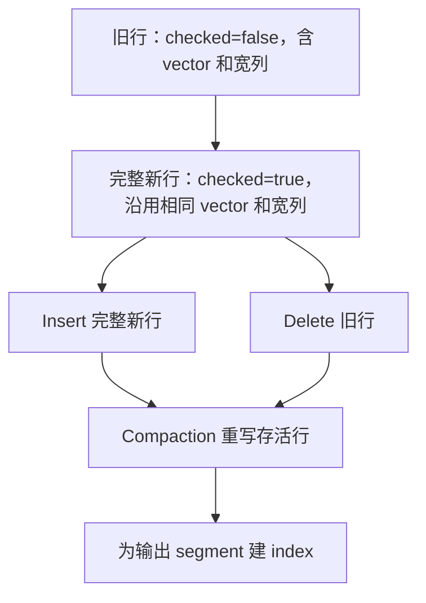

PK inplace-update 的预期收益是：**避免 scalar 变更生成完整新行，减少未修改字段的重复写入，以及由此额外引入的 compaction 和 vector indexing 工作。**

## 3. 顶层设计：一条逻辑时间线，两条消费路径

客户端的 predicate delete 和 PK inplace-update 经 Proxy 写入 WAL。同一份操作随后进入两条链路：持久化链路保存变更并在后台形成新 segment，在线链路更新正在服务的数据。

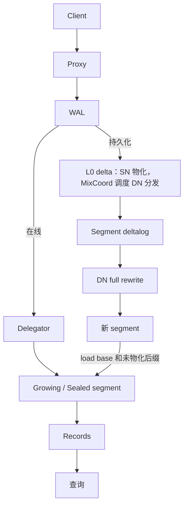

### 3.1 持久化链路：从操作到新 segment

L0 delta 模块中，SN Materializer 将 WAL 中的操作保存为 L0 delta files，MixCoord 接收输出并调度 DN，将变更分发到相关 segments。随后 DN 在 full rewrite compaction 中将变更写入新 segment。

### 3.2 在线链路：从操作到查询结果

Delegator 从 WAL 接收操作，分别交给 StreamingNode 本地的 Growing segments 和 QN worker 上的 Sealed segments。两者将更新或删除应用到所持有的数据，使后续查询看到字段变化和删除结果。

查询侧加载新 segment 后，接入在线链路并继续接收后续操作。两条链路由此衔接：同一份操作既影响当前查询，也进入后续加载使用的数据。

## 4. 功能约束与模块职责

### 4.1 功能约束

predicate delete 与 PK inplace-update 均允许对 unloaded collection 提交。loaded 时，在线消费者同步 apply 到适用 segments；unloaded 时，后续由 persistence、compaction 和 load replay 执行。API 在 WAL append 成功后返回；需要看到该操作的查询，必须等到相关 apply 完成，不要求返回时所有 replicas 已完成。

| 能力 | Phase 1 语义 |
| --- | --- |
| Predicate delete | 支持 `AND / OR / NOT / > / < / >= / <= / != / == / IN` 的受限 typed expression，可比较 DOUBLE 字段（如 `score > 0.75`）。整棵表达式、字段类型、常量和 NULL 语义均须通过校验 |
| PK inplace-update | 选行支持 `pk == constant` 和 `pk IN [constants...]`；所有目标 PK 应用同一组 assignments，可同时修改多个字段；对每个 PK 更新全部满足 scope、时间和存活条件的物理行，即 update-all-matches |
| 可更新字段 | INT8／16／32／64、BOOL、TIMESTAMPTZ、VARCHAR、普通标量 ARRAY；支持 nullable 字段的显式 SET NULL |
| 赋值方式 | 整 cell 常量 SET；ARRAY 也是提交整个新数组。不同字段的赋值互不覆盖 |
| 不支持 | 通用 UPDATE WHERE、算术赋值、读取旧值的 RHS、ARRAY append/remove 或元素 patch；JSON、VECTOR、TEXT、独立 FLOAT／DOUBLE 字段更新及嵌套／VECTOR／STRUCT 数组 |
| 特殊字段 | 不更新 PK、分区键、聚簇键、函数依赖／生成字段及 TTL 时间字段 |
| 无匹配行 | 不插入、不复活，操作对该 segment 无效果 |
| 请求边界 | 一次请求提交一个 UPDATE 或 DELETE，可包含多个 PK；不新增用户可组合事务，内部沿用现有 VChannel transaction 机制。既有 Upsert 内部事务保持原语义 |
| 物化方式 | 普通 full rewrite compaction；Phase 1 不做数据侧或 QN-local Consolidation |

例如 `SET values=[1,2,3,4]` 表达完整的新数组，而不是“在旧数组上追加 4”。`SET count=100` 受支持，`count=count+1` 不受支持。Proxy 可以保留直接化为 literal SET 的语法便利，但不能隐含查询旧值或新增 read-modify-write 语义。

复用现有 Delete API，合法表达式按以下路径分流：

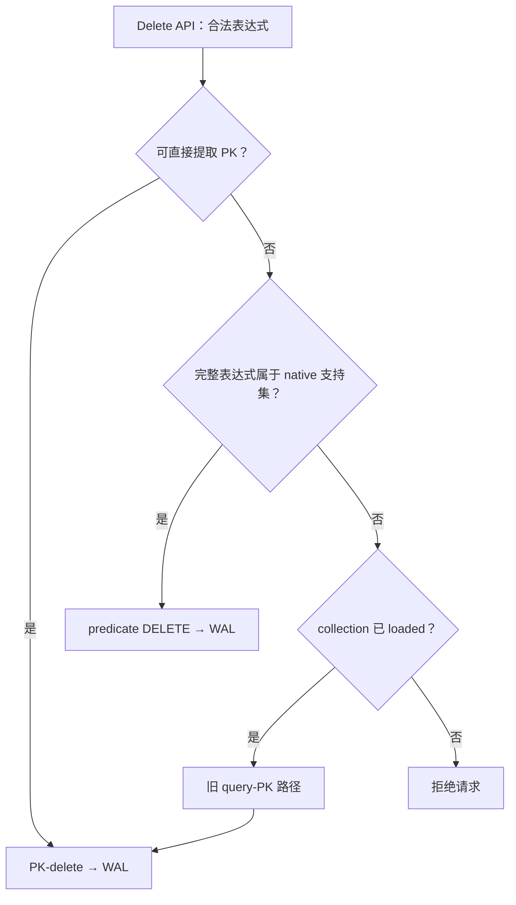

路径在写入前选定，native append 开始后不因超时或 apply 失败回退到 query-PK。

native predicate 在 WAL ACK 时不知道实际命中数。`delete_count` 的 unknown 返回表达是尚需处理的接口兼容项；不为恢复计数增加前台查询，也不能将默认 0 宣称为实际删除数。

### 4.2 模块职责与协作

| 模块 | 输入与输出 | 模块职责 |
| --- | --- | --- |
| Proxy / WAL | API 请求 → WAL 消息 | 校验请求，提交逻辑 mutation |
| L0 delta／MixCoord 调度 | WAL 消息、delta 统计 → segment deltalogs／compaction plan | 生产并分发 L0，结合 delta 统计调度 full rewrite |
| DN full rewrite | base＋deltalogs → 新 segment | 合并 base 与 deltas，写出替代 segment |
| Delegator | WAL／L0／buffer → segment | 在线 mutation 分发与 segment load 补齐 |
| Segment | base/index＋mutations → 查询结果 | 执行更新与删除，提供 overlay 读取 |

下图展示一个 delta 从 Proxy 进入后，如何经各模块分别作用于在线查询和 compaction 输出。

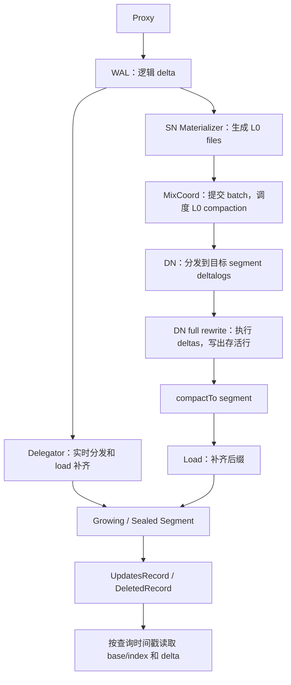

### 4.3 时间与进度的含义

| 记号 | 含义 | 维护位置 |
| --- | --- | --- |
| `row_ts` | 物理行的有效诞生时间，UPDATE 不改变它 | 行数据；导入沿用现有 commit-time 处理 |
| `mutation_ts` | mutation 的有效 WAL TimeTick；transaction 内取 CommitTxn TimeTick | WAL 和 delta record |
| `M` | VChannel 级 delta 持久化发布水位，即三类 delta 已完整持久化并提交的连续前缀的结束时间戳 | 持久化到 etcd，由 MixCoord 在 batch 提交事务中推进 |
| `C` | VChannel 级 delta 分发完成水位，即已完整分发至全部适用目标且分发结果已持久化的连续前缀的结束时间戳，`C≤M` | 持久化到 etcd，由 compaction 完成侧推进 |
| `H` | Query side 本次 load 的历史异步回放范围终点，即输入交接结束时间戳；所需历史 deltas 已完整入队，交接后固定 | Delegator／segment 加载期内存状态，不持久化 |
| `A` | Query side 历史异步 apply 的完成水位；`ts≤A` 的本次所需历史 deltas 均已执行完成 | segment 加载期内存状态，不持久化 |
| `TSafe / Q_TS` | TSafe 证明 channel 的实时可读进度；Q_TS 是查询实际使用的 MVCC timestamp | 查询准入与执行 |

DeleteCP 指定 deleteBuffer 可安全回收的前缀边界。当前实现根据 VChannel 加载范围内的有效 L0 集合[计算](https://github.com/milvus-io/milvus/blob/601fd4249f3936ba86723ecc68c398f94aed5649/internal/datacoord/handler.go)：

```text
DeleteCP = L0 非空 ? min(L0.StartPosition) : VChannel.seekPosition
```

Phase 1 复用 DeleteCP 字段，改由 Delegator 当前已采用 QueryTarget 携带的 C 给出，不再独立推导分发完成边界。M 对应的输入 ready 后，通过 M handoff 回收 streaming 副本，交接见 §5.4。M／C 均不是 query apply 进度；Recovery CP 管理 WAL 恢复。任一 record 的最大 timestamp 都不能单独证明前缀完整。

## 5. 模块详细设计与实现改造

### 5.1 Proxy / WAL：提交可重放的逻辑操作

Proxy 将用户请求转换为逻辑 mutation；WAL 保存操作并确定消费者使用的逻辑时间。

#### 5.1.1 请求到 WAL 消息

请求在 WAL append 前完成权限、schema、scope 和表达式支持集校验，并选定执行路径：

**Delete API。** 按 §4.1 的规则分流，支持集判断针对最终完整表达式。以下用 SQL 示意：

```sql
-- 支持：直接提取 PK，走 PK-delete
DELETE FROM t WHERE pk IN [100, 200];

-- 支持：完整表达式属于 native predicate 支持集
DELETE FROM t WHERE age >= 18 AND checked == false;

-- 超出 native 支持集：整条表达式尝试旧 query-PK 路径，依赖 collection 已 loaded
DELETE FROM t WHERE age >= 18 AND (name LIKE '%review%' OR name LIKE '%urgent%');
DELETE FROM t WHERE PHRASE_MATCH(description, 'vector database', 1);
```

Phase 1 将 native predicate DELETE 的 predicate 上限设为 **10 KiB**，因为 Delegator 需要向 scope 内所有适用 segments 转发完整 predicate。Proxy 在 WAL append 前检查编译后的 `proto.Size(predicate) <= 10_240`，超限直接 reject，不拆分表达式。

**Point UPDATE。** 使用独立入口，接受 PK 等值或 PK IN 常量列表与 literal assignments：

```sql
-- 支持：单个 PK 或 PK 列表，赋值为常量
UPDATE t SET checked = true WHERE pk == 100;
UPDATE t SET checked = true, name = 'reviewed' WHERE pk IN [100, 200];

-- 不支持，直接 reject：按非 PK 条件选行，或在 PK 条件外附加业务字段条件
UPDATE t SET checked = true WHERE age >= 18;
UPDATE t SET checked = true WHERE pk IN [100, 200] AND age >= 18;
```

Proxy 直接提取 UPDATE 的 PK 数组，复用 PK-delete 的 VChannel 路由和批量打包方式，无需前置 Query。写入前分别校验赋值：

- 窄整数检查越界。
- VARCHAR 检查 `max_length`。
- ARRAY 检查 `element_type / max_capacity` 及元素有效性。
- TIMESTAMPTZ 沿用 UTC Unix microseconds 归一化。

消息构造按操作类型区分目标表达：predicate delete 将字段名绑定为 field ID 和类型，构造 typed predicate；point UPDATE 直接携带 PK 数组与 typed assignments，不把 PK 等值／IN 条件编码为 expression AST。PK、predicate 和赋值内容均放在 body，结构见 §5.1.2。

消息按 VChannel 打包并 append WAL，复用 VChannel-level transaction 机制：

- predicate DELETE：一次 API 调用携带一个完整 predicate，每个目标 VChannel 写一条逻辑消息，走单消息 autocommit。
- PK IN UPDATE：先按 VChannel 路由，再按包含 assignments 的完整消息大小切分 PK 列表；同一 VChannel 的多条 UPDATE 消息在一个 transaction 中提交，有效 mutation_ts 见 §5.1.3。

#### 5.1.2 WAL 消息格式

WAL 消息包含逻辑操作及其解释上下文：

- predicate delete 携带 typed predicate，point UPDATE 携带 PK 数组与 assignments。
- 每次提交明确 collection、VChannel、partition scope、schema 身份、目标字段和 typed 值。
- 消费者不依赖 Proxy 查出的 offsets 或主集群特有的 segment 布局。

沿用现有 WAL envelope：

- Properties 保存通用属性。
- Header 保存 collection／schema 身份，编码在 `_h` property。
- Body 保存业务内容，以 Protobuf bytes 作为 payload，启用 cipher 时加密 payload。

以下为拟新增消息的解码后逻辑结构。

Predicate delete：`DELETE FROM t WHERE age == 18`，其中 age 的 field ID 为 102。

```text
Properties {
  message_type: PREDICATE_DELETE,
  vchannel: "v1", timetick: 100, txn_context: null
}
Header { collection_id: 10, schema_version: 7 }
Body {
  partition_scope: ALL_PARTITIONS
  predicate {
    unary_range_expr {
      column_info { field_id: 102, data_type: Int64 }
      op: Equal
      value { int64_val: 18 }
    }
  }
}
```

Point update：`UPDATE t SET checked = true, name = 'reviewed' WHERE pk IN [100, 200]`。primary_keys 直接使用现有 `schemapb.IDs` 表达 PK 数组，与 PK-delete 保持相同的字段组织；checked、name 的 field ID 分别为 103、104。

```text
Properties {
  message_type: UPDATE,
  vchannel: "v1", timetick: 110, txn_context: null
}
Header { collection_id: 10, schema_version: 7 }
Body {
  partition_scope: ALL_PARTITIONS
  primary_keys {
    int_id { data: [100, 200] }
  }
  assignments: [
    { field_id: 103, literal: { data_type: Bool, bool_value: true } },
    { field_id: 104, literal: { data_type: VarChar, string_value: "reviewed" } }
  ]
}
```

predicate delete 复用 [planpb.Expr](https://github.com/milvus-io/milvus/blob/601fd4249f3936ba86723ecc68c398f94aed5649/pkg/proto/plan.proto) 的受限节点。

- `UpdateBody` 的 `oneof target` 在 Phase 1 只接受 `primary_keys`，为后续 UPDATE WHERE 预留 `predicate`（`planpb.Expr`）。
- 单 PK 等值请求使用长度为 1 的 PK 数组。
- `literal` 使用 §5.2.4 的 TypedValue，nullable 字段通过显式 `null_value` 表达 SET NULL。

SET NULL：假设 name（field ID=104）是 nullable VARCHAR，`UPDATE t SET name = NULL WHERE pk == 100` 对应：

```text
Properties {
  message_type: UPDATE,
  vchannel: "v1", timetick: 120, txn_context: null
}
Header { collection_id: 10, schema_version: 7 }
Body {
  partition_scope: ALL_PARTITIONS
  primary_keys { int_id { data: [100] } }
  assignments: [
    {
      field_id: 104
      literal { data_type: VarChar, null_value: NULL_VALUE }
    }
  ]
}
```

| 消息内容 | oneof value 状态 | UPDATE 语义 |
| --- | --- | --- |
| `literal { data_type: VarChar, null_value: NULL_VALUE }` | 选中 null_value | SET NULL |
| `literal { data_type: VarChar, string_value: "" }` | 选中 string_value | 设置为空字符串 |
| `literal { data_type: VarChar }` | 未选中任何 value 分支 | 缺少赋值，reject |
| 没有该字段的 assignment | 不涉及该字段 | 不修改 |

校验与执行均检查 **oneof case**；assignment 存在但 value 未设置时，写入端在 WAL append 前 reject，消费端同样拒绝缺值。

#### 5.1.3 有效 TimeTick 与 transaction

在线 apply、L0 delta records 和 compaction 使用同一个 mutation_ts：

```text
mutation_ts = 非 transaction ? message.TimeTick() : CommitTxn.TimeTick()
delta.ts    = mutation_ts
```

例如同一次 UPDATE 请求在 v1 内被切成两条消息：

```text
物理 WAL：BeginTxn@90 → UPDATE@91 → UPDATE@92 → CommitTxn@100
消费与 L0：两条 UPDATE 的全部 delta records 均使用 mutation_ts=100
```

现有 [transaction assembly](https://github.com/milvus-io/milvus/blob/601fd4249f3936ba86723ecc68c398f94aed5649/pkg/streaming/util/message/builder.go) 在消费时将 transaction 及其 body messages 的 TimeTick 统一设为 CommitTxn.TimeTick()。这是 WAL 逻辑时间，不是客户端提交时间或 append 完成的 wall-clock 时间。

#### 5.1.4 CDC 复制

现有 [CDC 复制链路](../../agent_guides/streaming-system/replication/replicate.md)转发两类操作的逻辑 WAL message。主备分别消费消息，独立完成行定位、执行和物化。Proxy 的职责边界是：

- 不查询命中行或 offsets，也不感知目标 segment ID、物理文件。
- 不通过 WAL 之外的额外业务 RPC 指示 SN、DN 或 MixCoord 修改数据或 metadata。

若备集群 SN 不认识新增 MessageType，其 [RPC append 入口](https://github.com/milvus-io/milvus/blob/601fd4249f3936ba86723ecc68c398f94aed5649/internal/streamingnode/server/service/handler/producer/produce_server.go)会在调用 `wal.AppendAsync()` 前返回 `unsupported message type`。该消息不写入备集群 WAL，CDC 返回复制失败，复制 checkpoint 不越过该消息。

#### 5.1.5 当前实现与改造

可直接复用：

- [PK-delete 写入链路](https://github.com/milvus-io/milvus/blob/601fd4249f3936ba86723ecc68c398f94aed5649/internal/proxy/dml/task_delete_streaming.go)的 PK 数组路由、打包与 WAL 消息封装。
- [WAL 提交机制](https://github.com/milvus-io/milvus/blob/601fd4249f3936ba86723ecc68c398f94aed5649/internal/distributed/streaming/internal/producer/producer_task.go)的 VChannel 内部 transaction 和 append 成功返回语义。

需要增强：

- 新增 predicate DELETE 和 point UPDATE 的 WAL 消息，校验 typed 赋值和显式 NULL。
- 在 CDC 部署启用前，确认主备 SN 能接收这两种 MessageType，且两侧的查询和持久化消费者均能按相同语义执行。

### 5.2 L0 delta 与 MixCoord compaction 调度

本模块将连续 WAL 中的 mutations 持久化为 L0 delta files，原子发布并分发到目标 segment。MixCoord 结合 delta 统计选择 full rewrite 候选。

- SN 负责区间切分与文件准备。
- MixCoord 中的 DataCoord 负责 batch／进度 metadata 提交、L0 调度、target 隔离与 full rewrite 候选选择。
- DN 执行 L0 分发。

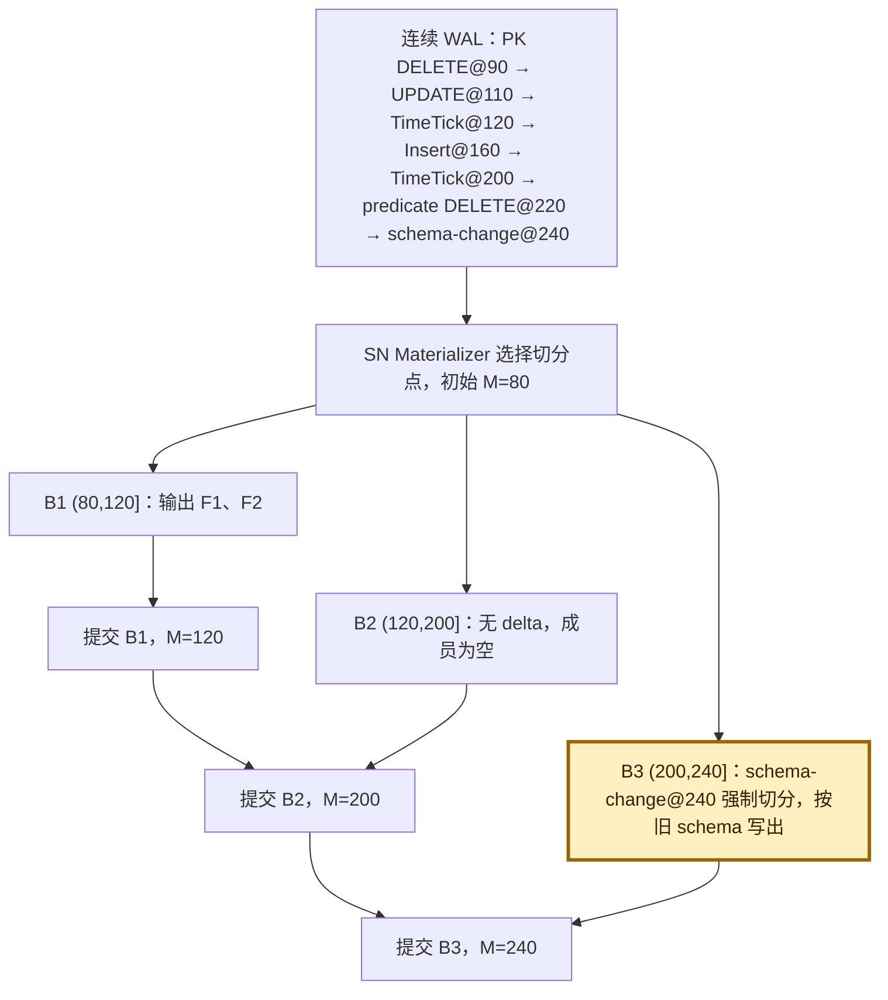

#### 5.2.1 生产侧：SN sync

Materializer 接收同一 VChannel 已确认、重排后的连续 WAL 消息流，由 SN 按 sync 策略切为首尾相接的 ranges，每个 range 生成一个 batch。其覆盖范围为 `(P,E]`：P 是前一批结束边界，E 是本批 WAL 输入的完整消费边界；区间内全部 partition scopes 的 PK DELETE、predicate DELETE、UPDATE 都必须收齐。文件内 delta records 的 min/max ts 仅作内容统计，不能证明 sync batch 已连续覆盖 WAL 区间 `(P,E]`。

文件按消息的 partition scope 组织：

- ALL_PARTITIONS 保留为一个 scope，不展开为具体 partition 列表。
- 每个 scope 按 rolling 策略生成一个或多个 L0。
- L0 文件保存原始指令，逐条保留 UPDATE。SN Materializer 的输入不含历史 Sealed segments 在 `mutation_ts` 的列值，因此 sync 时无法判断哪些行满足 predicate。

<strong>没有 delta 的区间生成空成员 batch，不写空文件。</strong>例如 `(120,200]` 内只有 Insert／TimeTick，提交该 batch 后 M 仍从 120 推进到 200。空 TimeTick 可合并进一个覆盖区间提交。

**Sync 触发。** 容量、等待时间、显式 Flush 等条件触发 sync。schema-change fence 是其中的强制 cut：切出旧 schema 的 delta buffer 并触发 sync，后续 delta 进入新 schema 的 buffer，保证单个文件不跨 schema_version。

SN 输出本批完整覆盖区间、L0 files 和成员 metadata，供 MixCoord 提交。

- Insert files 可独立 sync，保留前序 L1 注册依赖，不要求所有 L1 flush。

#### 5.2.2 原子发布：batch 与 M

MixCoord 以一个 batch 的全部成员为调度侧原子可见单位，采用 [atomic flush](https://github.com/meta/rocksdb/wiki/Atomic-flush) 的准备与提交分离原则。提交前，调度侧不得选取该 batch 的任何成员；提交后，调度侧可以采用该批完整输出。

同一 partition 的一个 batch 就可能产生两份 L0 文件，分别包含 `DELETE@90` 和 `UPDATE@110`。如果调度侧只看到第二份就开始分发，目标 segment 收到的 delta 前缀会缺少 `DELETE@90`。若再把这次分发当作整批完成，将 `C` 推进到 120，后续调度就会跳过这条 DELETE。

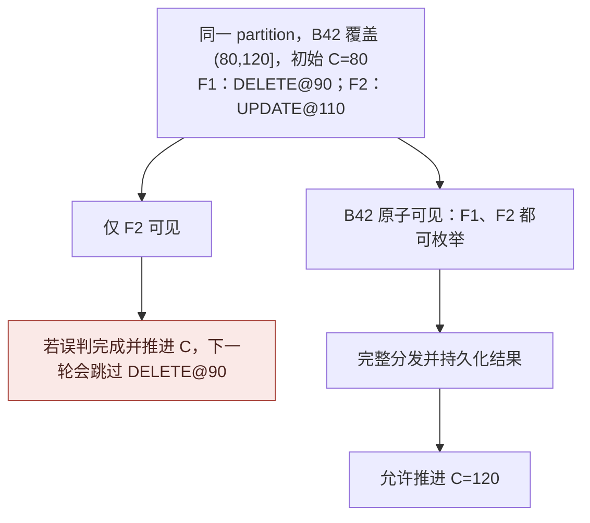

发布分三步：

1. 建立 PREPARING attempt，分批写 files、L0 metadata 和成员引用，尚不可消费。
2. 全部输出持久化、完整区间确认、成员固定后置为 PREPARED。
3. 一个 [etcd 条件事务](https://etcd.io/docs/v3.6/learning/api/#transaction)校验 batch／M revision 及 `batch.start==M`，同时持久化 `COMMITTED＋M=batch.end`。

文件可并行准备，batch 按覆盖区间顺序提交。

**Batch metadata。** VChannel 级 M／C 和 batch 使用以下布局：

```text
datacoord-meta/delta-channel/{collectionID}/{vchannel}/progress/M
datacoord-meta/delta-channel/{collectionID}/{vchannel}/progress/C
datacoord-meta/delta-channel/{collectionID}/{vchannel}/batches/B42
  → {
      coverage_start_exclusive: 80,
      coverage_end_inclusive: 120,
      state: PREPARING | PREPARED | COMMITTED | DROPPED,
      l0_segments: [
        {partition_id: 10, segment_id: 10001},
        {partition_id: 10, segment_id: 10002}
      ]
    }
```

B42 的 header 只用 `(partition_id, segment_id)` 引用成员。SN Materializer 生成的 L0 没有自己的 manifest。调度侧按 `segment_id` 取 `SegmentInfo.Deltalogs` 放入 compaction plan。每个文件的路径在 metadata 中以 `LogID` 表示，`LogPath` 为空。DN 执行 L0 compaction 时，用 storage root、collection ID、partition ID、segment ID 和 LogID 还原完整路径。

| B42 中的成员 | 该 segment 的 `Binlog.LogID` | DN 还原的文件路径（collection 7） |
| --- | --- | --- |
| `(10, 10001)` | `9001` | `<root>/delta_log/7/10/10001/9001`（F1） |
| `(10, 10002)` | `9002` | `<root>/delta_log/7/10/10002/9002`（F2） |

- M、C 使用两个 KV，由各自完成侧更新。
- `l0_segments` 存在 batch header 的一个 KV 中。SN 按预计 L0 成员数控制 batch 大小，在完整 TimeTick 边界切分。按每个成员约 22 B 估算，1 万个 L0 约占 215 KiB。发布时按包含 header、M 和 CAS 条件的整个事务校验字节数。[etcd 请求大小限制](https://etcd.io/docs/v3.6/dev-guide/limit/#request-size-limit)
- batch ID 标识一个稳定的持久化 attempt，废弃重建时使用新 ID。
- 消费者只枚举 COMMITTED 且结束边界不超过 M 的成员，不能仅凭文件存在或 `endTs≤M` 就采用。

**SN 重启后如何恢复发布。** 启动新的 materialization 前，先按 VChannel 串行核对 MixCoord 已持久化到 etcd 的 batch 状态、M 和 C。以 B42 的 `(80,120]` 为例：

| 恢复时读到的状态 | 处理 B42 的方式 |
| --- | --- |
| `PREPARING`，`M=80` | 输出可能只写完 F1。用 CAS 将 B42 标为 `DROPPED`，未发布产物交给 GC。SN 从 WAL 重读该区间，用新 batch ID 重做。 |
| `PREPARED`，`M=80` | F1、F2 和成员引用均已持久化。复用这些输出，只重试最终提交，由 MixCoord 原子写入 `B42=COMMITTED` 和 `M=120`。 |
| `COMMITTED`，`M≥120` | 即使 SN 没收到提交 ACK，也采用已发布结果，不再 sync B42。`C<120` 时由调度侧继续分发；`C≥120` 时将 B42 标为 `DROPPED`，交异步 GC。 |
| `DROPPED` | 继续 GC。 |

<strong>状态转换使用 CAS。</strong>若恢复线程准备丢弃 B42 时，在途请求已改变其状态，CAS 失败后重读 batch 和水位，按最新状态处理。若 M 已覆盖该区间，则沿用已发布结果，废弃同一区间残留的未提交 attempt。[etcd 提交语义](https://etcd.io/docs/v3.6/learning/api_guarantees/)

#### 5.2.3 消费侧：L0 compaction 分发

MixCoord 从 `(C,M]` 选择完整的 dispatch range `(C,E]`，确认其全部已提交 L0 成员，再调度 DN 分发逻辑指令，始终保持 `C≤E≤M`。

- PK DELETE／point UPDATE 可用 BF 筛选 targets。
- predicate DELETE 发至 scope 内全部适用 targets。
- L0 分发不执行 predicate／UPDATE。

**分发对 Mix 的原子可见性。** 同一个 dispatch range 可以分多个子任务写入 targets。<strong>只要还有 target 未完成，Mix 就不能从这一轮的任何 target 取输入。</strong>若此时执行 Mix compaction，就可能将已消化本轮 delta 的行和仍待回放的行写入同一个 compactTo segment。

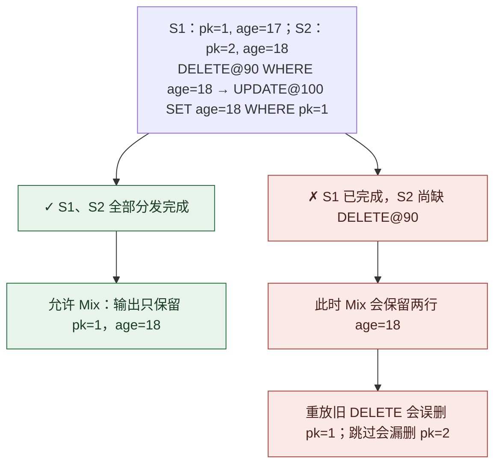

**Phase 1 采用 range 隔离＋C。** MixCoord 持有全部 targets 的占用，直到本轮分发结果全部持久化并推进 C。这样 DN 取得的每个 input 都有完整的适用前缀，无需记录 per-segment 分发水位。

1. **确定并占用 targets。** 在与 Mix 共用的准入临界区内，按 scope 和时间资格选齐、校验本轮全部 targets，原子检查并设置它们的 `isCompacting`。有冲突或 target 已被替换，则整轮延期、重新选择；不能跳过被占用的 target 后就宣布完成。
2. **在 range 占用下分发。** target 占用由 range 持有，覆盖其全部 L0 成员与分发子任务；不能等 BF 命中后才决定锁谁。子任务可分别完成并提交结果，但任何单个 L0／子任务的完成都不能提前释放 targets。这里采用 [compaction 输入隔离](https://github.com/apache/kudu/blob/1.18.1/src/kudu/tablet/tablet.cc#L1724)的原则，具体占用由本方案的 range／task 生命周期管理。
3. **完整提交后释放。** 全部适用分发结果持久化后，保存 `C=E`，再释放 range 的 target 占用。此后 Mix 才能原子取得自己的 input 占用，并将各 input 的已提交数据引用写入 compaction plan。

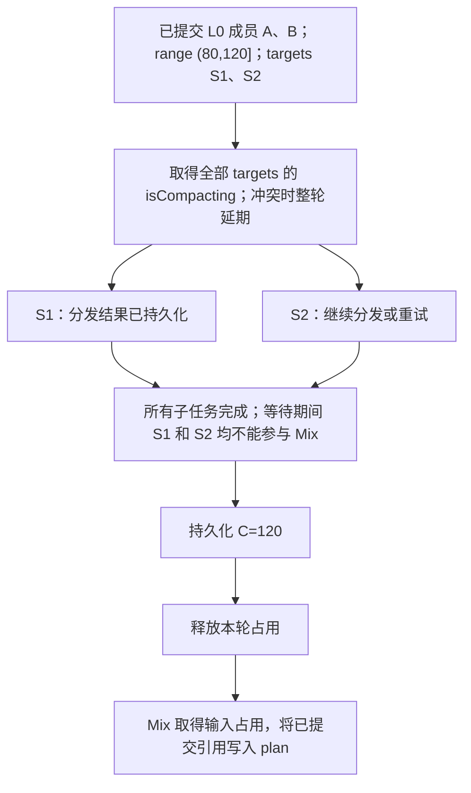

<strong>空 range、无适用 target 或 BF 无命中均由 range／task 完成记录确认覆盖，无须写空文件。</strong>

- C 持久化前保留 range／task 完成依据。
- Growing 的覆盖继续受既有 seal 与安全调度条件保护。
- target 被 Mix 替换后，<strong>尚未分发的后缀仍须覆盖 new compactTo segment。</strong>

分发完成后，目标 segment 的 deltalogs／manifest 引用与 M／C 进入 QueryTarget，供 Delegator 按 §5.4 接管输入。

| 路线 | 完整性与 Mix 准入 | 代价 |
| --- | --- | --- |
| Phase 1：range 隔离＋C | range 持有全部适用 targets 的 `isCompacting`；全部结果提交并推进 C 后放行 Mix | 任一子任务未完成，整个 target 集合继续等待；涉及 10,000 个 targets 时，它们的 Mix 都等待本轮完成 |
| ~~替代：per-segment 分发水位~~（Phase 1 未采用） | ~~每个 segment 持久化已完整收到的 delta 区间终点；零输出也推进，Mix 根据各 input 水位检查输入完整性~~ | ~~增加 progress KV 更新与恢复逻辑；有文件输出时可随现有 metadata 提交，稀疏 PK 操作涉及的零输出 targets 也须额外写进度~~ |

#### 5.2.4 L0 delta file 格式

使用 Parquet 外层列＋Protobuf payload，面向 load、forward 和 ordered replay：

- 每个文件属于一个 collection／VChannel／partition scope，共用一个 schema_version，scope 可为 ALL_PARTITIONS。
- <strong>旧文件通过 legacy reader adapter 读取，不要求升级时重写。</strong>
- **FileMetadata 是文件级 metadata**，只保存一次，供全部 records 共用。
- **DeltaRecord 是每行 delta 的逻辑格式**，`ts / op_type / pk / primary_keys / payload` 对应 Parquet 列，只有 payload 列保存 serialized Protobuf bytes。

以下为逻辑 schema，具体 wire 字段号在实现中确定。

```text
FileMetadata {
  delta_format_version, schema_version,
  collection_id, vchannel, partition_scope, pk_type
}

DeltaRecord {
  ts, op_type,
  pk: nullable PK,                 // INT64 或 STRING，由文件的 pk_type 决定
  primary_keys: nullable LIST<PK>,
  payload: nullable BYTE_ARRAY  // serialized Protobuf
}
```

| op_type | pk | primary_keys | payload |
| --- | --- | --- | --- |
| PK_DELETE | 单个 PK | 无 | 无 |
| PREDICATE_DELETE | 无 | 无 | `{ predicate: TypedExpr }` |
| POINT_UPDATE | 无 | 本分片的非空 PK 列表 | `{ assignments: Assignment[] }` |
| PREDICATE_UPDATE（**Phase 1 不支持**） | 无 | 无 | 仅预留格式 `{ predicate, assignments }` |

同一次 POINT_UPDATE 在同一 VChannel、partition scope 内按 PK 列表写入 L0，一个分片占一行，只保存一份 assignments。`pk == 100` 写为 `[100]`。长列表可拆成多行，各行保留原操作的 `mutation_ts`，只包含本分片的 PK。

```text
Assignment {
  field_id
  oneof rhs { literal: TypedValue; expression: TypedExpr /* reserved */ }
}
TypedValue {
  data_type
  oneof value {
    int64_value; bool_value; string_value;
    timestamp_us_value; array_value: TypedArrayValue;
    null_value: google.protobuf.NullValue
  }
}
TypedArrayValue { element_type; values; element_validity }
```

- `delta_format_version` 选择协议 reader，schema_version 绑定表达式解释上下文。
- INT8／16／32 即使用 int64 承载，也须保留原类型信息。
- 复用 typed messages 并补齐显式 NULL，保留 `false / 0 / "" / [] / NULL / 未赋值` 的 presence 区别。

**完整混写文件示例。** 以下三次操作写入同一个 L0 delta file，count 的 field ID 为 105：

```sql
UPDATE t SET count = 20 WHERE pk IN [101, 102, 103];  -- mutation_ts = 90
DELETE FROM t WHERE count == 20;         -- mutation_ts = 95
DELETE FROM t WHERE pk == 200;           -- mutation_ts = 100
```

`F1.parquet` 的解码后逻辑内容如下。示例将 payload bytes 展开为 Protobuf 字段，便于阅读；文件仍按 Parquet 列式存储。

```text
FileMetadata {
  delta_format_version: 1
  schema_version: 7
  collection_id: 10
  vchannel: "v1"
  partition_scope: ALL_PARTITIONS
  pk_type: Int64
}

Records [
  {
    ts: 90, op_type: POINT_UPDATE, pk: null, primary_keys: [101, 102, 103]
    payload: {
      assignments: [
        { field_id: 105, literal: { data_type: Int64, int64_value: 20 } }
      ]
    }
  },
  {
    ts: 95, op_type: PREDICATE_DELETE, pk: null, primary_keys: null
    payload: {
      predicate {
        unary_range_expr {
          column_info { field_id: 105, data_type: Int64 }
          op: Equal
          value { int64_val: 20 }
        }
      }
    }
  },
  { ts: 100, op_type: PK_DELETE, pk: 200, primary_keys: null, payload: null }
]
```

本例的三个 PK 路由到同一 VChannel，并写入同一分片。文件共三行，第一行的三个 PK 共用一份 `count = 20`。

- 外层 ts／op_type／PK 可直接读取，payload 保留为可重复转发的 Protobuf bytes，分发流程见 §5.4.1。
- predicate UPDATE 和 expression RHS 仅预留格式，Phase 1 收到这些分支时返回不支持，不能静默跳过。

#### 5.2.5 MixCoord 重启后如何恢复 L0 分发任务

恢复单位是**整个 dispatch range**。任务创建时固定本轮 range 的终点 `E`，并将它与 L0 成员、全部 targets 和子任务归属一起保存在 task metadata 中。重启后，MixCoord 从该 VChannel 的 `progress/C` 读取已提交的分发水位 `C`，判断它是否已覆盖本轮 range。

| 分发水位 `C` 是否已到达本轮终点 `E` | MixCoord 的恢复动作 |
| --- | --- |
| `C < E` | 先重建本轮全部 targets 的 `isCompacting` 占用，再开放 Mix 准入。复用已持久化的子任务结果，继续未完成的分发。全部结果持久化后，先提交 `C = E`，再释放本轮占用。 |
| `C ≥ E` | 将本轮视为已完成，跳过重新分发。按任务归属清理仍由本轮持有的占用。 |

成功 batch 的退出顺序是“<strong>分发结果持久化 → C 持久化 → batch 标 DROPPED → 异步 GC</strong>”。C 覆盖后，batch metadata 可退出，其成员 L0 files 仍按原生命周期、retention 和 pin 保护回收，不要求等物理文件全部删除。

废弃 attempt 按“files → L0 metadata → batch metadata”的顺序清理，或先持久化转交清理责任。任何一步失败，都须保留继续清理所需引用，避免先删成员清单后遗留文件。

- 废弃 attempt 不推进 M／C。
- 未登记、迟到文件的 orphan 回收接入现有 [GC](https://github.com/milvus-io/milvus/blob/601fd4249f3936ba86723ecc68c398f94aed5649/internal/datacoord/garbage_collector.go) 和 [storage path contract](../../agent_guides/storage/path_contract.md)。

**升级切换。** 先升级 MixCoord，再升级 SN。新版 MixCoord 接管时按 VChannel 持久化协议切换点，从接管起拒绝旧 SN 新增 legacy L0 登记。接管以旧 MixCoord 已失去 metadata 提交权为前提：切换前已提交的登记保留，在途请求不能在切换后补交。

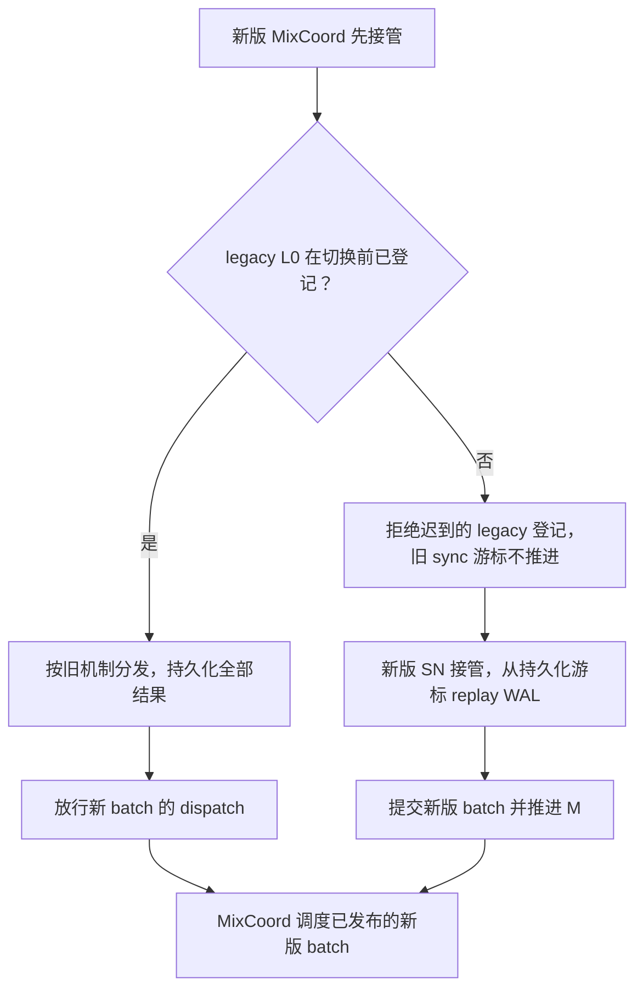

新版 SN 接管后，Proxy 可继续 append 新 delta，SN 可先发布新版 batch 并推进 `M`。该 VChannel 的 legacy L0 分发结果全部持久化后，MixCoord 持久化放行状态并开始调度新版 batch，文件 GC 可异步进行。

#### 5.2.6 基于 delta 的 full rewrite 调度

MixCoord 根据实际删除比例及 delta 文件数量、大小等信号选择 full rewrite 候选。一条 `DELETE WHERE age == 18` 可能删除 100 万行中的 80 万行，也可能没有命中。混写文件中的 `EntriesNum` 还包含 UPDATE records，不能继续用它计算删除比例。

**采集实际删除效果。** MixCoord 通过独立 segment-stats RPC 周期查询 QN，从 loaded sealed segments 的 `DeletedRecord` 获取累计实际删除行数，更新内存 stats cache。采集可复用 QueryCoord 的节点发现与连接，轮询独立于 `GetDataDistribution`，统计变化不推进 distribution version。利用删除统计驱动后台回收的做法可参考 PostgreSQL autovacuum。[PostgreSQL 17](https://www.postgresql.org/docs/17/routine-vacuuming.html#AUTOVACUUM)

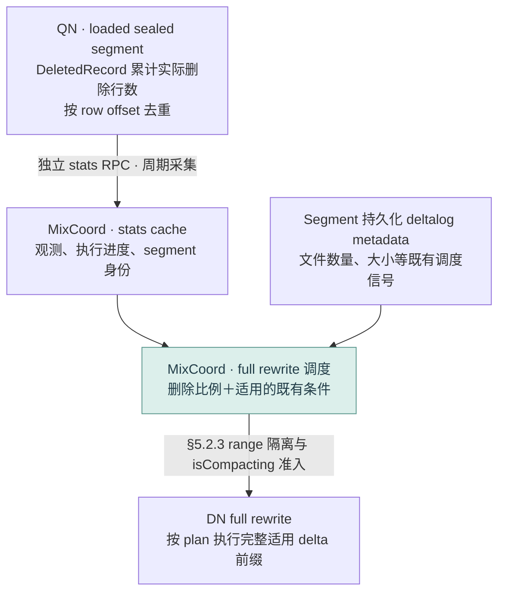

- 观测同时包含 segment／loaded instance 身份、对应的完整 apply 进度、物理总行数和累计删除行数，按 row offset 去重。计数与进度须对应同一个执行状态。
- 同一 segment 按完整 apply 进度选取较新的有效累计观测，替换旧观测；不同 replicas 的计数不累加，也不与 legacy deltalog 的估计删除数相加。
- stats cache 只保留有效的 loaded segment 观测，设定容量与过期边界；MixCoord 重启后重新采集，compactTo segment 独立获取统计。mutation 完成不等待统计采集。

**用于调度。** 对满足既有准入条件的 Flushed segment，按观测可用性选择信号。

| 候选的统计状态 | 调度行为 |
| --- | --- |
| 有效观测可用 | 用累计删除行数／同一 segment 的物理总行数计算删除比例，结合既有条件选出 full rewrite 候选 |
| Unloaded、尚无报告或观测失效 | 采用适用的文件数量、大小、小 segment 合并等既有条件；不为获取统计而加载 segment，也不将缺失统计当作删除数为零 |

候选仍须通过 §5.2.3 的 range 隔离与 `isCompacting` 准入。DN 按 compaction plan 执行完整适用前缀，实际删除结果以执行为准。

**保留积压信号。** Pending predicate 数量及 update 数据量描述后续 replay 的负担。例如 100 条 predicate 全部无命中，实际删除数为零，恢复时仍要执行这 100 条指令。统计按逻辑 mutation 去重，QN 在线 apply 完成后仍计入积压，直到 full rewrite 的输出提交后才清除对应输入的积压。

**待决项。** Phase 1 由 full rewrite 消化持久化 deltas；是否增加仅由 predicate／update 积压触发的 full rewrite，以及触发阈值和优先级，仍需明确。RPC 字段、统计与进度的一致采样、轮询周期和 cache 上限在实现设计中确定。

#### 5.2.7 当前实现与改造

可直接复用：

- [L0 Materializer](https://github.com/milvus-io/milvus/blob/601fd4249f3936ba86723ecc68c398f94aed5649/internal/streamingnode/server/wal/vchannel/l0materializer/wal.go) 的有序 buffer 与输出流程。
- [delta reader/writer](https://github.com/milvus-io/milvus/blob/601fd4249f3936ba86723ecc68c398f94aed5649/internal/storage/serde_delta.go) 的 Parquet／legacy reader。
- [L0 task](https://github.com/milvus-io/milvus/blob/601fd4249f3936ba86723ecc68c398f94aed5649/internal/datacoord/compaction_task_l0.go) 的目标筛选、结果提交与生命周期管理。
- 现有 full rewrite policy 的文件数量、大小和删除比例判断，以及 Segcore 的累计删除计数。[调度信号](https://github.com/milvus-io/milvus/blob/46f3354858e6e84a06105bd1a2302672b623708d/internal/datacoord/compaction/policy/helpers.go#L49-L86) · [删除计数](https://github.com/milvus-io/milvus/blob/46f3354858e6e84a06105bd1a2302672b623708d/internal/core/src/segcore/ChunkedSegmentSealedImpl.cpp#L4122-L4126)

现有 [compaction 调度](https://github.com/milvus-io/milvus/blob/601fd4249f3936ba86723ecc68c398f94aed5649/internal/datacoord/compaction_inspector.go)提供 input `isCompacting` 与 channel 级 L0／Mix 互斥，但 L0 的 input 标记仅覆盖输入 L0，尚不能提供完整 range 的 target 隔离。需要增强：

- 支持三类 delta 的完整区间 batch、batch／M 原子提交、空区间推进和 schema-change fence。
- 增加完整 range 的 target 占用与持久化任务归属，恢复后可重建占用。
- 在 C 提交后释放占用，Mix 取得 input 占用后再生成 plan。
- 增加 QN segment-stats RPC、独立轮询和 MixCoord 内存 cache，以有效观测修正删除比例；混写 `EntriesNum` 退出删除行数估计。[当前 EntriesNum 累加](https://github.com/milvus-io/milvus/blob/46f3354858e6e84a06105bd1a2302672b623708d/internal/storage/statistics.go#L565-L570)

### 5.3 DN full rewrite：按序物化并替换 segment

DN full rewrite 读取各 input segment 的 base 与适用 deltas，执行更新和删除，将存活行写入新的输出 segment。

#### 5.3.1 输入到重写输出

MixCoord 按 §5.2.3 取得 inputs 的 `isCompacting` 后，从各 input 的已提交 metadata 生成 [compaction plan](https://github.com/milvus-io/milvus/blob/601fd4249f3936ba86723ecc68c398f94aed5649/internal/datacoord/compaction_task_mix.go)。StorageV3 的 `Manifest` 引用具体 revision，plan 同时记录 input metadata 中的 binlog／deltalog 引用。DN 按本次 plan 读取数据。Mix 持有 input 占用直到 compactTo segment 的 metadata 提交，以阻止 L0 在 rewrite 期间向旧 inputs 追加 delta。

```text
完整 range 分发提交，C 已推进 → 释放 range 占用
  → Mix 取得 S1、S2 的 isCompacting，将输入引用写入 plan
  → S1：base₁ ＋ pending deltalogs₁ → 按序执行
    S2：base₂ ＋ pending deltalogs₂ → 按序执行
  → Mix compaction 写出 compactTo segment，提交输出 metadata 后释放占用
```

**DN 的执行契约。** 调度侧为每个 input 提供完整的适用 delta 前缀。DeltaExecutor 按 `mutation_ts` 从早到晚执行，predicate DELETE 用前序 UPDATE 生效后的字段值求值。DN 无需另行记录分发进度。

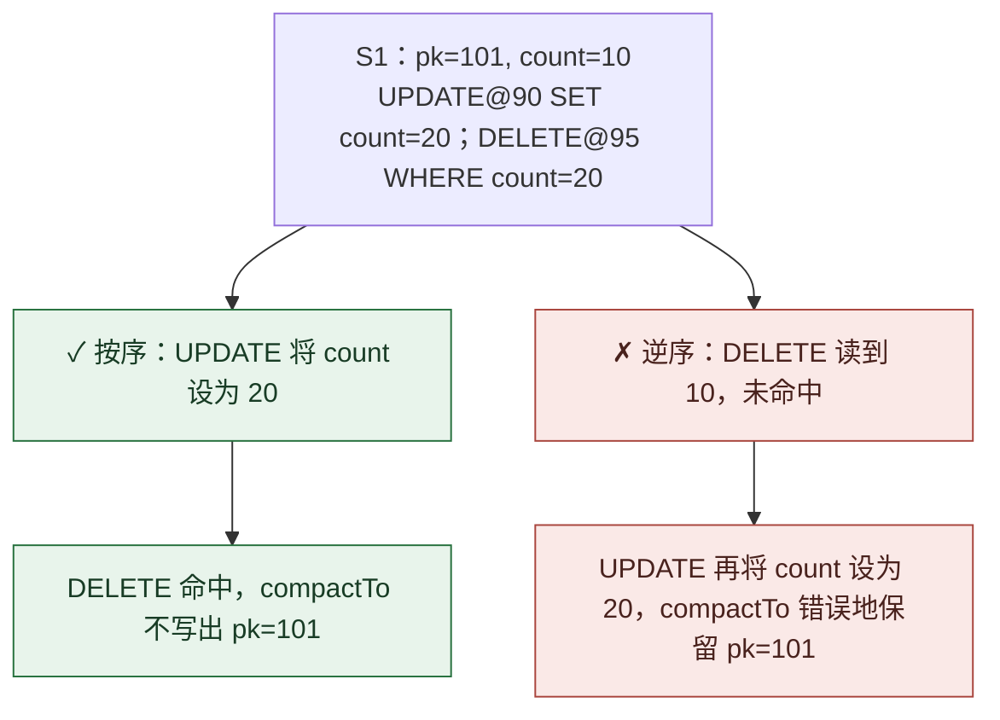

- 各 input 的 base、行时间范围与 pending records 可以不同，不要求 base 对齐。
- DeltaExecutor 以 input segment 为作用域，rows、offsets 与执行状态不跨 input 复用。
- mergeSplit 处理完 S1 后释放 executor₁，再为 S2 创建 executor₂。
- mergeSort 为各 input 保持独立 executor，随 reader 交错执行。

DeltaExecutor 复用既有类型与 compaction 数据访问能力，实现同一受限表达式、literal SET、NULL 和时间资格；predicate 仅 TRUE 时删除。

DN 将存活行更新后的字段值写入 compactTo，保留各行原有的 `row_ts`。compactTo 只回放已物化前缀之后的 delta。

#### 5.3.2 DROP FIELD：block-and-drain gate

**DDL 何时生效。** DROP FIELD 写入各业务 VChannel 的 WAL，以该 VChannel 的 TimeTick `x` 建立 fence。Proxy 和 SN 通过 schema version 校验阻止后续 mutation 引用旧字段，其他字段继续接受写入。

**最细粒度条件（按字段）。** <strong>只需等 fence 前引用被删字段的 delta：WAL、SN buffer 中的在途记录先 sync 到 L0，再与已有 L0 中的相关记录一起持久化分发到全部适用的 Sealed segments。</strong>

**Phase 1 按 VChannel 等待完整前缀。** MixCoord 直接检查该 collection 的每个业务 VChannel 是否达到 `C ≥ x`，其中 `x` 取该 VChannel 自己的 DROP TimeTick。这样会一并等待 fence 前的 PK DELETE、predicate DELETE 和 point UPDATE，无需判断每条 delta 引用了哪些字段。所有 VChannel 达标即可发布新 schema，无需等待 full rewrite。

```text
Phase 1 DDL：各 VChannel 建立 DROP fence → 各自的 C ≥ x → 新 schema 生效

S1 下次正常 compaction：读旧列 c → 按序执行历史 delta → 按新 schema 写出存活行
```

**DN 何时物理删列。** 当前 plan 携带目标 schema，没有逐字段的 DROP TimeTick。DN 能识别要移除的列，但仅凭本地 deltalogs 无法判断 `x` 前是否还有 delta 在途。<strong>若 full rewrite 先写出不含旧列的新 segment，这些 delta 后续到达时就无法执行。</strong>

- **DeltaExecutor 按 execution schema 读。** Phase 1 可以读取 input segment 的全部物理列，保留历史 delta 依赖的字段和类型，按 `mutation_ts` 执行。
- **Writer 按新 schema 写。** DeltaExecutor 处理完更新和删除后，writer 只写存活行，在输出时移除 dropped field。

例如，S1 中有一行 `pk=1, c=5`：

```sql
UPDATE t SET c = 15 WHERE pk == 1;         -- @110
DELETE FROM t WHERE c == 5;               -- @120
UPDATE t SET checked = true WHERE pk == 1; -- @125
ALTER TABLE t DROP COLUMN c;               -- @130，DROP fence：v7 → v8

-- fence 后，仍缓存 v7 的 Proxy 发来旧请求
UPDATE t SET c = 20 WHERE pk == 1;         -- schema_version=7，SN 在 WAL append 前拒绝
```

若在同一 VChannel 的 WAL 中看到这条旧请求以 `mutation_ts=140` 提交，就说明 SN 的 schema version 校验未能拦住它。`DELETE@120` 即使在 fence 后才分发到 S1，仍是合法的历史 delta。

Mix、Sort、clustering 和 [bump-schema rewrite](https://github.com/MrPresent-Han/milvus/blob/06c5fec04ae700d2e4c1693549e05fe8216da70e/internal/datanode/compactor/bump_schema_version_compactor.go) 在物理删列时都遵守这项读写契约。[ClickHouse](https://github.com/ClickHouse/ClickHouse/blob/master/src/Storages/MergeTree/MergeTreeData.cpp#L13296) 同样保护未完成 mutation 依赖的列。

#### 5.3.3 Backfill：逻辑等价物化与列值覆盖

**External backfill 与 predicate DELETE 的冲突。** L0 保存的是 predicate，DN 在 full rewrite 时还要对它求值一次。如果 backfill 改写了 predicate 读过的列，同一条 DELETE 在线执行和重放时就可能命中不同的行。

<pre><code class="language-text">S1 的所有行都是 age=20，且 row_ts &lt; 100
Query side 执行 <strong>DELETE@100 WHERE age == 18</strong> → 命中 0 行
External backfill 将 S1 整列 age 填为 18，保留各行原有的 row_ts
DN full rewrite 在新列值上回放 DELETE@100 → 命中 S1 的所有行，整段数据被误删
</code></pre>

这个例子的前提是 `age` 在 backfill 前已可读。如果新列直到 commit 后才允许被引用，历史 predicate 就不会依赖它。

**根因。** [Backfill commit](https://github.com/milvus-io/milvus/blob/601fd4249f3936ba86723ecc68c398f94aed5649/internal/datacoord/services_commit_backfill.go) 通过 CChannel 发布列文件引用，predicate DELETE 则按业务 VChannel 的 TimeTick 执行。两侧的 TimeTick 无法确定 backfill commit 与 DELETE 的相对顺序。DROP FIELD 的 fence 则与 DML 在同一业务 VChannel 上有序，旧列也保留到下次 rewrite，可供 fence 前的 predicate 求值。

**Block + drain + block。** 对可能改写已可见列值的 external backfill，本设计将 backfill 与同一 collection 的 native predicate DELETE 串行执行。

1. **Block**：在相关业务 VChannels 建立 fence，阻止新的 predicate DELETE 进入。
2. **Drain**：收齐 fence 前仍在 WAL、SN buffer、L0、在途 dispatch 和 segment deltalog 中的相关历史。<strong>DROP FIELD 等到完整分发即可生效。External backfill 必须先在旧 base 上按序执行前序 UPDATE 和历史 predicate DELETE，等 full rewrite 持久化执行结果后，再创建 backfill snapshot。</strong>
3. **保持 Block**：从 Spark prepare 到全部 backfill 结果发布，持续阻止新 predicate。待 query side 已切换到新状态或旧视图已退出服务后，再放行。未加载的 collection 后续从新状态加载。

**同一 cell 的 PK-update（待决）。** 如果 backfill 将某一行的 `age` 写为 18，PK-update 将它写为 21，两者缺少约定的执行顺序，最终值可能是 18 或 21。是否将这类 PK-update 纳入上述 predicate DELETE gate？

**Internal backfill。** 当前 [BumpSchemaVersionCompaction](https://github.com/MrPresent-Han/milvus/blob/06c5fec04ae700d2e4c1693549e05fe8216da70e/internal/datanode/compactor/bump_schema_version_compactor.go) 不只生成 function outputs，也会物化缺失普通列；移除旧列则走 full rewrite，并遵守 §5.3.2。

普通列的 NULL／default 物化，在同一 schema 下不改变逻辑值：

```text
物化前：age 没有物理列，reader 返回 default=18
物化后：age 物理列保存 18
```

逻辑等价物化不改变 predicate 的命中结果，无需额外作为 UPDATE 排入 delta 时间线；已有 updates／deletes 仍须保留。

- 当前 function-output 物化支持 BM25 的 SparseFloatVector 与 MinHash 的 BinaryVector，均不在 Phase 1 predicate／UPDATE 的支持范围内。

<strong>若将来 internal backfill 覆盖已可见的 scalar 值，也须遵守 external backfill 的 block + drain + block 约束。</strong>

#### 5.3.4 Mix compaction 后加载 compactTo segment 并释放旧 segment

新 segment 复用 §5.4 的交接流程补齐后缀：即使旧 QN 已执行到 @120，而本次 rewrite 只消化了截至 100 的完整输入，也须从自身 deltalog、适用 L0、buffer 和 catch-up 收齐 `>100`；所需操作不必仍留在内存 buffer 中。

- 初始 Records 可为空，加载后缀后会再次积累 histories／deletes。
- 新 base 不保留已折叠的更新历史，沿用 Milvus 的历史查询边界，不新增跨 rewrite 的 UNDO／time-travel。

旧 segment 与 Records 的释放遵守 §5.5.3 的生命周期契约。

#### 5.3.5 当前实现与改造

可直接复用 [Mix compactor](https://github.com/MrPresent-Han/milvus/blob/06c5fec04ae700d2e4c1693549e05fe8216da70e/internal/datanode/compactor/mix_compactor.go) 的读取、重写输出流程，以及 [EntityFilter](https://github.com/milvus-io/milvus/blob/601fd4249f3936ba86723ecc68c398f94aed5649/internal/compaction/entity_filter.go) 的 PK-delete／TTL 处理。需要增强：

- 增加受限 DeltaExecutor，使 Sort、Mix、clustering 和 schema rewrite 按序执行 predicate delete 与 UPDATE。
- 接通 range／Mix 准入互斥，保证重写期间输入稳定。
- 所有物理删列路径按 execution schema 回放历史 delta，再按 DDL 生效后发布的 write schema 写出。
- 接入 §5.3.3 的持续 gate，完成历史物化、backfill 发布及 query side 切换后才恢复 predicate 准入。

### 5.4 Delegator：在线分发与加载交接

Delegator 将在线 mutations 送到适用 segments，并在 segment load 时组装历史输入、完成与实时链路的交接。

#### 5.4.1 Delta 分发与 buffer 交接

三类 delta 的覆盖职责沿同一时间线交接。持久化数据与 Delegator buffer 分为两条逻辑线：前者按 M／C 划分各持久化表示负责的区间；后者在采用对应输入后，以相同边界划分当前取数范围。下半图另行展开三类操作的 dispatch 路径。

| mutation_ts | 持久化数据的逻辑覆盖 | 完成查询侧 handoff 后的取数位置 |
| --- | --- | --- |
| ≤ C | Segment base + deltalogs | 目标 segment 接管，Delegator 可回收已覆盖的 L0 buffer |
| (C, M] | 已发布的 L0 files | 可转发的 L0 buffer 接管 streaming 副本 |
| > M | WAL 后缀 | Streaming buffer |

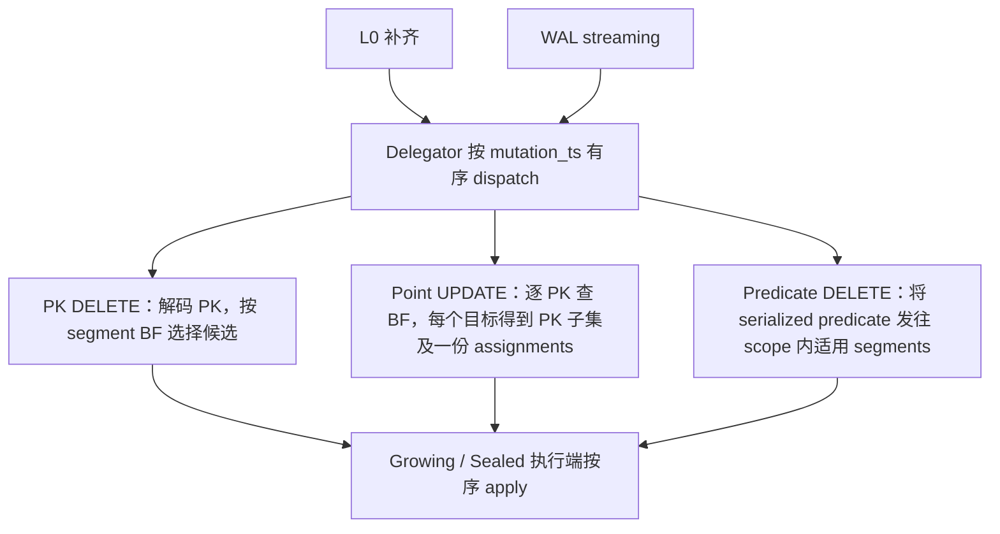

**持久化覆盖。** 各表示负责以下逻辑取数范围，旧 WAL／L0 文件仍按各自生命周期保留：

- `≤C`：目标 segment 的 base＋deltalogs。
- `(C,M]`：已提交 L0。
- `>M`：WAL suffix。

C 证明分发持久化，不表示 predicate 已被 full rewrite 求值、物化。

**Buffer 交接。** 本期必须实现 query side 的 M／C 两种本地交接，由 QueryTarget 携带 M／C、已提交 L0 集合与 segment manifest 引用驱动：

- M 交接：所需 L0 达到可转发状态后回收 streaming 前缀，同段历史仍留在 L0 buffer，消除的是重复占用，不缩短必需保留的 delta 范围。
- C 交接：采用包含分发结果的 target 后，以其 C 作为 DeleteCP 回收已覆盖的 L0 buffer，缩短必需保留的历史范围，释放对应缓存。

两种 handoff 都通常滞后于 etcd 中 M／C 的提交：target 传播、输入加载与本地采用需要时间。因此，<strong>清理依据是 query side 已完成交接的 target 状态，不能把最新 etcd 水位当作本地交接完成边界。</strong>

- 空区间依已提交 coverage 完成交接，不要求加载空文件。

<strong>完成交接后的取数视图为 L0 buffer `(C,M]` 和 streaming buffer `>M`</strong>，`≤C` 已由目标 segment 接管。Segment 处于 LOADING 时，Delegator 从 buffer 对加载期间新到的适用 delta 做 catchup，再将该 segment 接入实时分发。

**操作分发。** L0／streaming 中的三类操作进入同一个有序入口：

- PK DELETE 解码外层 PK 后做 BF，转发到候选 segments。
- 对 point UPDATE，Delegator 从 `primary_keys` 逐 PK 检查各 segment 的 BF。假设输入为 `[101, 102, 103]`，S1 的 BF 仅对 101 和 103 返回可能命中，则向 S1 转发 `[101, 103]`、一份原始 assignments bytes 和原 `mutation_ts`。候选列表为空时跳过该 segment。
- predicate DELETE 不在 Delegator 求值，序列化 payload 转发至 scope 内全部适用 segments。

Delegator 转发 serialized predicate／assignments，由 Growing／Sealed 执行端解析。转发缓存按 M／C handoff 和 load pin 回收，不随单个 segment 的执行完成而释放。

在线 apply 复用 PK-delete 的失败处理。假设 `UPDATE@120` 在 S1 上重试后仍失败。若 S1 继续服务，TSafe 推进到 120 后，`guaranteeTs=120` 的查询就可能读到旧值。Delegator 先将 S1 标记为 offline，等其余可读 segments 完成本批适用的 delta 后，pipeline 才将 TSafe 推进到批次结束时间。若可读 distribution 缺少 S1 的数据，需要完整结果的查询返回不可服务。

#### 5.4.2 历史回放与查询准入

Sealed segment load 时，Delegator 以本地已采用的 QueryTarget 中的 `C` 为界，衔接 segment manifest、L0 buffer 和 streaming buffer，通过 load pin 和 catchup 收齐截至 `H` 的所有适用 delta。各来源可并行读取，Delegator 按 `mutation_ts` 有序交付。这个完整性保证使 sealed segment 无需持久化独立的 delta 分发水位。

历史输入交接完成时，Delegator 固定 `H`，将 segment 加入 distribution。Segment 按 §5.5.1 的规则异步回放，用 `A` 跟踪本次 load 的历史执行进度。`A = H` 表示历史回放完成。`>H` 的适用 delta 由实时分发接管，在同一执行序列中接续。

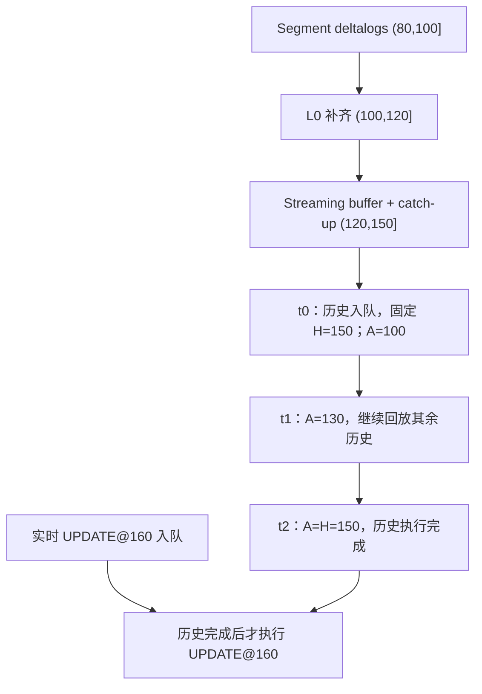

查询需要可读 distribution，并分别检查两个时间条件。

- **Channel** 要求 `TSafe ≥ guaranteeTs`，确认实时消费已达到请求要求的时间。
- **Segment** 要求 `A ≥ min(Q_TS, H)`，确认该 segment 已回放完本次 MVCC 快照所需的历史 delta。

例如，`TSafe=170` 已满足请求的 `guaranteeTs=130`。若 S1 的 `H=150`、`A=120`，且 `(150,170]` 内没有适用于 S1 的实时 delta，读取 `Q_TS=140` 仍要等到 `A=140`。当 `A=H=150` 时，历史回放完成。此时 S1 可读，channel TSafe 已覆盖 160，因此查询可以读取 `Q_TS=160`，无需向 S1 发送空 TimeTick 或将 `A` 推进到 160。

#### 5.4.3 当前实现与改造

可直接复用：

- [loadStreamDelete](https://github.com/milvus-io/milvus/blob/601fd4249f3936ba86723ecc68c398f94aed5649/internal/querynodev2/delegator/delegator_data.go) 的 L0／buffer 补齐、catch-up 和 distribution 交接。
- [delete pipeline](https://github.com/milvus-io/milvus/blob/601fd4249f3936ba86723ecc68c398f94aed5649/internal/querynodev2/pipeline/delete_node.go) 的 apply 完成后推进 TSafe。

需要增强：

- 将分发、缓存与 load 补齐扩展为三类 delta 的有序链路，保留完整前缀并跳过重复部分。
- 接通 QueryTarget 的 M／C 与输入引用交接，用已采用的 C 驱动 DeleteCP 清理，并实现 L0 ready 后的 M handoff 回收。
- 增加历史异步 apply 的查询等待，避免读取尚未执行完成的状态。

### 5.5 Segment：执行 mutations，并让查询读取 overlay

Growing／Sealed segment 执行收到的 mutations，并将字段版本和删除结果叠加到原 base/index，供查询读取。

#### 5.5.1 Mutation 执行与 UpdatesRecord

**为什么需要 UpdatesRecord。**

- **版本 history 支持 MVCC。** 为被更新的 cell 保留带 mutation_ts 的版本，让不同 Q_TS 的查询读取各自可见的值。
- **独立 overlay 适配既有 base/index。** Raw data 可能未独立 loaded，loaded scalar index 也缺少通用的原地更新接口，因此保留原 base/index，将更新存入独立 overlay，在读取时合并。

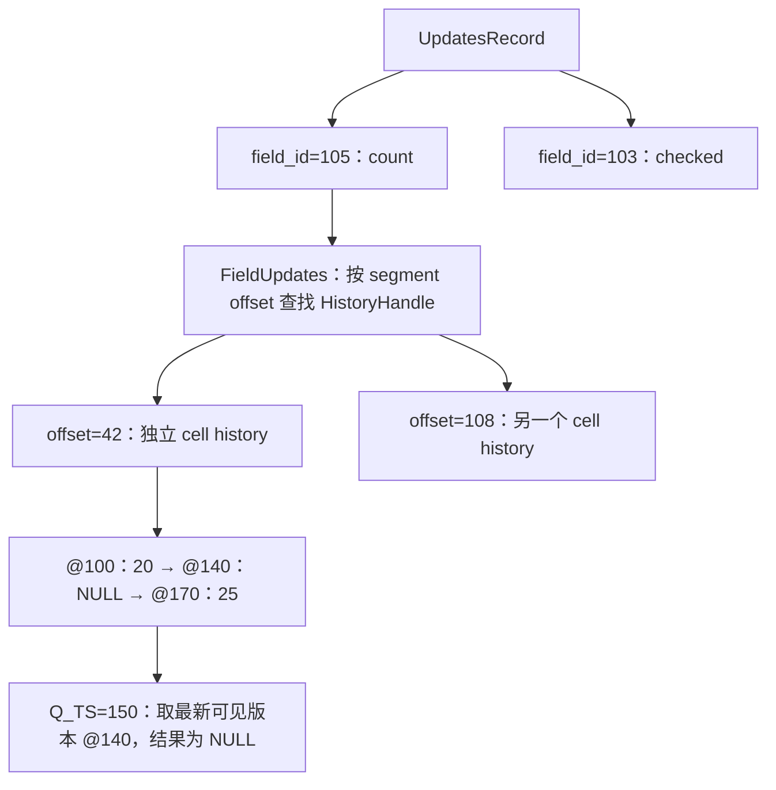

这三层结构分别服务于字段访问、行定位和版本选择，并控制 overlay 的访问与存储开销：

- `field_id → FieldUpdates`：查询只访问相关字段的 overlay，字段级 RW lock 将目录与 histories 的读写竞争限定在各自字段内。
- `absl::btree_map<offset, HistoryHandle>`：兼顾 offset 点查和有序窗口枚举，使批量过滤只遍历当前 row 范围内被更新的 cells；采用 [Abseil B-tree](https://abseil.io/about/design/btree) 的多 key 节点组织，改善目录遍历的 cache locality。
- `boost::container::deque<VersionEntry>`：按 mutation_ts 尾部追加版本，无须搬移已有 entries；[deque 的随机访问](https://www.boost.org/doc/libs/1_81_0/doc/html/boost/container/deque.html) 支持用 `upper_bound(Q_TS)` 二分选择最新 `ts≤Q_TS` 的版本，查找复杂度为 `O(log N)`，N 为该 cell 的版本数。
- History 仅为被更新的 cell 创建，减少稀疏更新时的目录与 history 开销，不复制未修改字段或整行。

每个 `VersionEntry` 保存 `(mutation_ts, is_null, value)`：

- INT／BOOL／TIMESTAMPTZ 的值内联保存，避免逐值分配 Buffer。
- VARCHAR／ARRAY 的同一 assignment 在一个 segment 内命中多行时，各行的 `VersionEntry` 共享一份不可变 Arrow Buffer。查询持有该 Buffer 直到读取完成。
- 显式 SET NULL 追加 `is_null=true` 的版本。空字符串和空数组各自是 `is_null=false` 的值。未赋值的字段不追加版本。

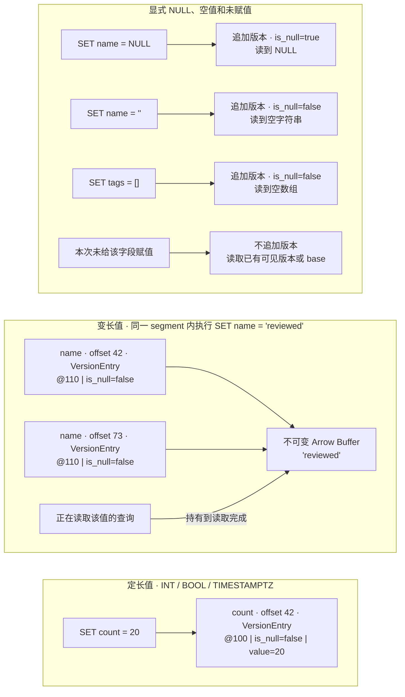

**Segment mutation pipeline。** Growing 和 Sealed segment 按 `mutation_ts` 执行，每条 mutation 按类型选择一条 plan。两种 plan 都只修改 `row_ts < mutation_ts` 且仍存活的行。两类写入都需要目标行，UPDATE 额外携带新值，因此共用拟新增的 `ApplyDeltaNode`。PostgreSQL 的 `ModifyTable` 同样接收目标行并按操作类型执行 DELETE 或 UPDATE。[PostgreSQL 17 源码](https://github.com/postgres/postgres/blob/REL_17_0/src/backend/executor/nodeModifyTable.c#L21-L25)

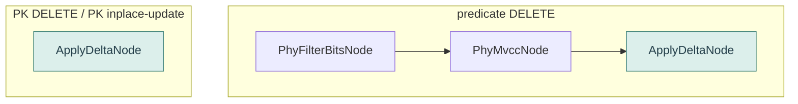

- **predicate DELETE** 先由 `PhyFilterBitsNode` 对 base/index 和前序 `UpdatesRecord` 中的可见值求值，选出 predicate 为 TRUE 的行。`PhyMvccNode` 用 `DeletedRecord` 排除已删除行。`ApplyDeltaNode` 从上游的 bitmap 取得目标 offsets，将 offset 和删除时间写入 `DeletedRecord`。
- **PK DELETE / PK inplace-update** 的消息已携带 `primary_keys`。`ApplyDeltaNode` 可直接调用 segment 的 PK lookup，定位全部匹配 offsets 并检查行时间与存活状态。DELETE 写入 `DeletedRecord`，UPDATE 按 assignments 向 `UpdatesRecord` 追加值或 NULL 版本，保留原 `row_ts`。Kudu 的存储层入口 `DiskRowSet::MutateRow` 同样在内部按 key 定位行，检查存活状态后写入 delta。[Kudu 1.18.1 源码](https://github.com/apache/kudu/blob/1.18.1/src/kudu/tablet/diskrowset.cc#L682-L714)

多字段 apply 通过查询进度保持完整性：需要 @100 的查询在所有字段完成前等待，旧 Q_TS 只读取可见旧版本。后续 mutation 同样不能越过这次未完成操作。

**有序回放。** Delegator 保证交付给该 Segment 的适用 delta 前缀完整，且按 `mutation_ts` 有序。Segment 按交付顺序 apply，只跳过已完整执行的重叠前缀。

`A` 记录本次 load 已完成的历史回放进度。同一 `mutation_ts` 的全部适用 records 执行完毕后，`A` 才能推进到该时间戳。已完整处理的区间即使无命中也推进 `A`。

#### 5.5.2 Overlay 过滤与取值

Raw 与 Vortex local format 均保持 base/index 的原表示，只描述原字段值。对每个数据访问节点和 Q_TS，先计算 base，再读取可见 delta 并修正结果，查询返回该 Q_TS 对应的 overlay 结果：

```text
B = base 的命中 offsets
U = 当前字段在 Q_TS 下存在可见 update 的 offsets
D = 对 U 的最新可见值重新求值后的命中 offsets

result = (B - U) ∪ D
```

例如 base `count=10`、update `count=20` 时，`count>15` 必须补入该行，反向更新则移除旧命中。<strong>旧 index 的空命中、min/max 或 all-null 可以剪掉 base 分支，仍须检查 delta</strong>，不能让更新后的命中提前丢失。

各类读取入口遵守同一 overlay 规则：

- 字段比较按可见更新修正布尔结果（`result`）及其是否已知（`validity`），再交给 `AND / OR / NOT`。例如 `SET age = NULL` 生效后，`age == 18` 为 `UNKNOWN`，所以 `WHERE NOT (age == 18)` 也不会选中该行。
- 多字段表达式对相关字段 updated offsets 的并集重算，并在同一 Q_TS 取齐值。
- SELECT 优先取可见 update，仅在无可见版本时回退 base，显式 NULL 不回退。
- <strong>GroupBy、排序、聚合、rerank、字符串／ARRAY 访问和 iterative filtering 等实际取值入口均须接入 overlay。</strong>

上述 overlay 规则可参考 [Kudu REDO deltas](https://github.com/apache/kudu/blob/1.18.1/docs/design-docs/tablet.md)；查询仍沿用 Milvus 现有的重复 PK 去重行为。

#### 5.5.3 Records 生命周期

- 普通 schema/index Reopen 不得清空 UpdatesRecord。
- L0 sync 或分发完成不释放 history，因为 base 尚未吸收更新。

两阶段 Retrieve 先按 `Q_TS` 选出 offsets，再从同一 segment 读取这些 offsets 在 `Q_TS` 可见的字段版本。请求持有 segment pin 直到取值完成。

#### 5.5.4 当前实现与改造

可直接复用：

- [InsertRecord](https://github.com/milvus-io/milvus/blob/601fd4249f3936ba86723ecc68c398f94aed5649/internal/core/src/segcore/InsertRecord.h) 的 PK 定位。
- [DeletedRecord](https://github.com/milvus-io/milvus/blob/601fd4249f3936ba86723ecc68c398f94aed5649/internal/core/src/segcore/DeletedRecord.h) 的删除记录与查询屏蔽。
- 既有 [三值逻辑](https://github.com/milvus-io/milvus/blob/601fd4249f3936ba86723ecc68c398f94aed5649/internal/core/src/common/ValueOp.h)。

需要增强：

- 增加 UpdatesRecord，保存按 Q_TS 读取的字段版本。
- 新增 `ApplyDeltaNode`，支持消费 predicate plan 的 bitmap，或在节点内按 PK 定位行并执行 mutation。
- 接入过滤与取值的 overlay 读取，返回 Q_TS 下可见的更新和删除。
- 提供 §5.2.6 的累计删除统计，保证计数与对应 apply 进度一致，并区分不同 loaded instances。

---

实现对照基于 [Milvus 代码快照](https://github.com/MrPresent-Han/milvus/tree/06c5fec04ae700d2e4c1693549e05fe8216da70e)，源码与实验报告链接均固定到引用版本。
