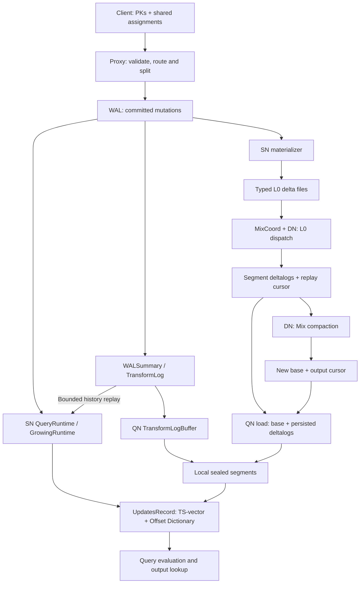
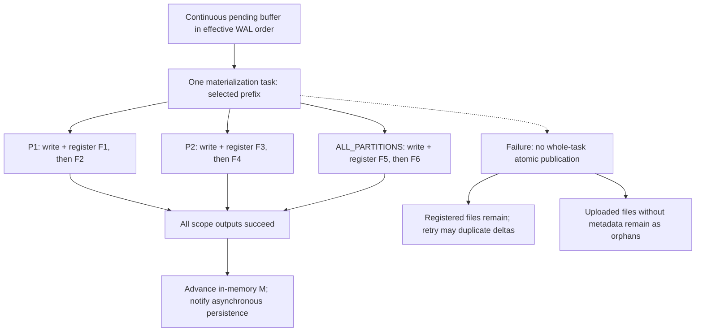
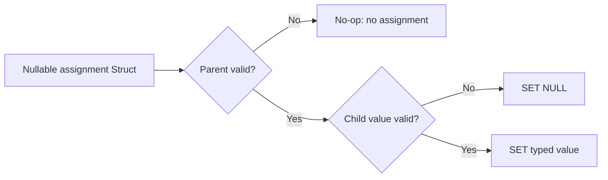
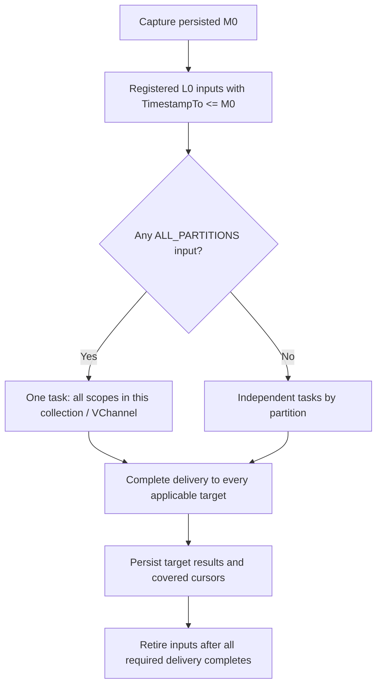

# PK Inplace-update

This design adds literal field assignment by primary key. Its request, storage and delivery contracts follow the [main design](https://zilliverse.feishu.cn/docx/O6vTdq9jcocv6mxI70ecWF2cn4f) (revision 2646), read on 2026-11-20. The [query structures and POC](https://zilliverse.feishu.cn/docx/KEGSdwHsaomghMxOPBFcZ3JhnLi) (revision 2875) provided earlier implementation context; the query-side design below adopts the subsequently selected TS-vector plus Offset Dictionary and [Draft PR #55699](https://github.com/milvus-io/milvus/pull/55699). The linked POC document has not been updated by this local revision. The [implementation plan](20261120-pk-inplace-update-implementation-plan.md) defines six implementation and acceptance stages within one Milvus feature PR.

## 1. Capability

PK inplace-update assigns the same set of literal values to existing rows selected by one PK or a PK list. The following SQL illustrates the proposed API semantics; it is not a new SQL endpoint:

```sql
UPDATE t SET age = 18, name = NULL WHERE pk IN (100, 200, 300);
```

The operation changes the selected fields without querying and rewriting each complete row. A missing PK neither inserts a row nor revives a deleted row. Existing PK-delete remains supported. Mutation targets are PKs, and assignment right-hand sides are literals; no expression payload or reserved expression branch is introduced.

## 2. Motivation

Updating a few scalar fields through upsert can require fetching the existing full row and writing a replacement row. For random updates, fetching vectors and wide fields can load many cache blocks. Rewriting unchanged vectors also adds storage, compaction and index-build work.

This design removes the full-row read and replacement insert from the update request. Query-side versions make the changed fields visible; ordinary Mix compaction later materializes them into a new base. Delta selection, query overlays and offset lookup consume memory and CPU, so lower write amplification does not imply a regression-free query path. The query POC and the storage-format measurements below evaluate separate parts of that tradeoff.

## 3. End-to-end data flow

One WAL mutation feeds persistence and query serving. Growing segments receive live WAL events; sealed segments receive TransformLog history and live entries. Persisted deltalogs provide the starting state for a later segment load.



## 4. Scope and module contracts

### 4.1 Phase 1 behavior

| Concern | Contract |
| --- | --- |
| Targets | PK equality or a PK list; update all physical rows satisfying scope, row-time and liveness requirements |
| Assignments | Shared literal assignments; multiple fields per operation; explicit SET NULL for nullable fields |
| Types | INT8/16/32/64, BOOL, TIMESTAMPTZ, VARCHAR and ordinary scalar ARRAY |
| ARRAY | Replace the whole array; no element patch, append or remove |
| Restricted fields | PK, partition key, clustering key, function-dependent/generated fields and TTL time fields |
| Excluded types | JSON, VECTOR, TEXT, standalone FLOAT/DOUBLE, and nested/VECTOR/STRUCT arrays |
| Collection state | Accept updates for loaded and unloaded collections |
| Admission | New public PK-update requests require a default-off configuration switch; existing accepted updates remain readable and replayable when it is off |
| Request bounds | Enforce a positive request-level PK-count cap and existing request byte limits before routing; fragment admitted requests by complete encoded WAL message size |
| Acknowledgement | WAL acknowledgement; query visibility additionally requires the relevant apply frontier |
| Atomicity | Reuse VChannel-local transactions; no cross-VChannel atomic transaction |
| Materialization | Ordinary full rewrite through Mix compaction; no separate query-local consolidation |

Schema changes and external-backfill conflict resolution remain a separate compatibility workstream. This feature PR does not introduce a backfill ordering protocol or a manifest-publication redesign. Compatibility must not be assumed merely because PK-update uses literal assignments.

### 4.2 Responsibilities

| Module | Input and output | Responsibility |
| --- | --- | --- |
| Proxy / WAL | Request to committed mutation | Validation, message sizing, routing, transaction and schema checks |
| Storage / SN materializer | WAL mutations to typed L0 files | Common delta codec, materialization and durable progress |
| MixCoord / DN | L0 files to segment deltalogs; base and deltas to new base | Complete dispatch, task publication and ordered materialization |
| QueryView / TransformLog | History and live input to local segments | Load, catchup, ordered delivery, apply waits and recovery |
| Segcore | Base/index and updates to query results | TS-vector, Offset Dictionary, expression correction, value lookup and version reclamation |

### 4.3 Time and progress

| Name | Meaning |
| --- | --- |
| `row_ts` | Row birth time; a PK-update does not replace it with the field's update timestamp |
| `mutation_ts` | Effective WAL TimeTick; transaction bodies use CommitTxn TimeTick |
| `M` | Persisted VChannel materialization frontier: mutations through this point have been durably materialized and registered |
| `M0` | A fixed persisted `M` captured for one L0 scheduling round |
| Segment replay cursor | `transform_start_after_timetick`, bound to the loaded base/deltalog version; TransformLog replay starts after it |
| `C` | Illustrative completed L0-dispatch progress; not a new persisted VChannel cursor |
| `D` | Illustrative largest timestamp in physical S3 files; file existence is not a completeness proof |
| `Q_TS` | Timestamp used by the query's readers to select visible field versions |
| `(G, T)` | QueryView's Growing and Transform read requirements; preserve their existing planning and apply-wait semantics |

Materialization, persistent segment coverage and online apply are different progress measures. Persisting a cursor does not prove that a particular QN has applied the corresponding operations.

## 5. Module design

### 5.1 Proxy and WAL

#### Request and message

Gate new public PK-update requests with a default-off configuration switch (proposed key: `proxy.pkUpdate.enabled`). Check it at request admission. Disabling admission leaves already accepted mutations, readers, replay, materialization and CDC consumption operational; it does not undo committed updates. Enable writes only after the complete deployed path is compatible and validated.

Proxy validates collection and field identity, permission, PK type, partition scope, supported assignment types and field constraints. Reject empty or over-limit PK lists before deduplication, routing or WAL append, counting the entire submitted list across VChannels. `proxy.pkUpdate.maxPkCount` defaults to 10,000 submitted PKs. Invalid or nonpositive configuration falls back to 10,000; operators can set a different positive limit. Preserve existing request/transport byte limits as an independent bound.

Route admitted PKs by VChannel, then split by complete encoded message size, including assignments. This fragmentation does not bypass the request-level count cap. Keep a shared assignment set intact in every fragment. Reject before append if even one PK plus that assignment set cannot fit.

Use the common WAL envelope and `schemapb.IDs`. Register UPDATE with the existing message generation machinery. The following is a logical example, not a declaration of finalized Protobuf field numbers:

```text
Properties
  message_type: UPDATE
  message_version: V2
  vchannel: collection_10_v0
  timetick: assigned by WAL
  txn_context: assigned when this is a transaction body

Header
  collection_id: 10
  schema_version: 7

Body
  partition_scope: ALL_PARTITIONS
  primary_keys: schemapb.IDs { int_id: [100, 200, 300] }
  assignments:
    - field_id: 105
      literal: { data_type: Int64, int64_value: 18 }
    - field_id: 106
      literal: { data_type: VarChar, null_value: NULL_VALUE }
```

All three PKs share one `age=18, name=NULL` assignment set. Explicit NULL remains distinct from an absent assignment, zero, false, an empty string or an empty array. Typed messages retain integer width, timestamp units and ARRAY element type.

#### Commit and replay

- Commit fragments for a VChannel through the existing transaction mechanism. Consumers preserve the transaction entry and use its effective CommitTxn TimeTick.
- SN append validates the collection schema version; reject a mismatch before the operation enters WAL.
- Extend message classification and CDC handling so PKs, assignments, schema identity and effective commit ordering survive transport and replay. A new type must not silently become a payload-free barrier or be dropped by a type switch.
- The protocol is additive, but enabling new writes requires compatible consumers across the active path. The implementation plan owns this activation check.

### 5.2 Storage and SN materialization

#### Materialization and failure

SN consumes committed PK-delete and PK-update deltas into an ordered pending buffer. A materialization task selects a continuous prefix and groups its outputs by partition scope. Within each scope, file output and registration proceed in order; a later file is not started before its predecessor completes registration. Preserve an indivisible effective-TimeTick group when cutting output files.



Reuse the existing single-task serialization and retry behavior. This design does not add failed-batch cleanup, a batch metadata state machine or physical exactly-once output. Registered duplicates can remain inputs; unregistered objects are not inputs. There is no immediate failure rollback of either class; existing background GC has its own coverage and retention rules.

After all required outputs succeed, advance in-memory `M` and notify RecoveryStorage. Notification does not wait for the etcd write. The scheduler therefore uses persisted `M`, not file existence or the producer's unpublished memory value.

For example, completed dispatch may be at `C=120`, durable `M=160`, while uploaded files already extend to `D=200`. Only durable `M` authorizes the next dispatch prefix. These values may also be equal; `D` is not an additional progress protocol.

#### Delta file format: typed Parquet and nullable Struct

L0 files and dispatched segment deltalogs share this format and use the existing milvus-storage FFI. It serves storage-side execution and QN loading of persisted deltalogs. WAL and TransformLog retain typed shared-assignments messages; changing the file codec does not change those envelopes.

```text
FileMetadata (Parquet footer key_value_metadata)
  delta_format_version, schema_version,
  collection_id, vchannel, partition_scope, pk_type

RecordBatch (one row per mutation fragment)
  mutation_ts: UInt64, non-null
  source_ordinal: UInt32, non-null          // original transaction body position; standalone = 0
  op_type: UInt8, non-null                  // PK_UPDATE or PK_DELETE
  primary_keys: List<PK>, non-null          // non-empty, non-null elements
  age: nullable Struct                     // stable field ID 105
    value: nullable Int64
  name: nullable Struct                    // stable field ID 106
    value: nullable Utf8
```

- A file has one collection, VChannel, scope and schema version. Its PK type is Int64 or Utf8.
- Identify update fields by stable field ID. Readable names above are labels. Keep each field's logical type, including integer width, timestamp units and ARRAY element type.
- Preserve the original transaction body position in `source_ordinal`, including positions occupied by insert bodies that are not written to delta files. Standalone mutations use zero. Within one VChannel, `(mutation_ts, source_ordinal)` orders operations; include PK when deduplicating re-cut fragments. Scope splitting, registration retry and compaction must not derive this order from file names or file iteration order. Reject an unrepresentable ordinal instead of truncating it. Legacy delete adapters may use zero because equal-timestamp legacy deletes commute.
- Every PK in a row shares its assignments. Both operations use `primary_keys`; a single PK is `[pk]`. Long-list fragments retain the original mutation timestamp and repeat assignments once per fragment.
- Omit fields never assigned anywhere in the file. A missing field is no-op. A partially assigned field is a nullable Struct column in the file's fixed schema.

The format adopts [Arrow Struct validity](https://arrow.apache.org/docs/format/Columnar.html#struct-layout). Mapping an absent parent to no-op is the update contract:



| Timestamp | Operation | PKs | age | name |
| --- | --- | --- | --- | --- |
| 100 | PK_UPDATE | [1, 2] | `{value: 21}` | NULL Struct: no-op |
| 110 | PK_UPDATE | [3, 4] | NULL Struct: no-op | `{value: "Alice"}` |
| 120 | PK_UPDATE | [5, 6] | `{value: NULL}`: SET NULL | `{value: "Bob"}` |
| 130 | PK_DELETE | [7, 8] | NULL Struct | NULL Struct |

Age-only and name-only updates coexist in one file. PK-delete has no field assignments. Empty strings and arrays remain values, distinct from SET NULL.

Each field maps to an optional Parquet group with an optional typed child. Standard [nested encoding](https://parquet.apache.org/docs/file-format/nestedencoding/) preserves the two validity levels:

```text
Parquet file
  Row group
    mutation_ts                        column chunk
    source_ordinal                     column chunk
    op_type                            column chunk
    primary_keys.list.element          column chunk
    age.value                          column chunk
      optional age { optional INT64 value }
      definition levels: [2, 0, 1, 0]
      actual values:     [21]
    name.value                         column chunk
      optional name { optional BYTE_ARRAY value (STRING) }
      definition levels: [0, 2, 2, 0]
      actual values:     ["Alice", "Bob"]
  Footer: schema, row-group metadata and FileMetadata
```

For these scalar fields, levels 0/1/2 encode no-op/SET NULL/SET value. No-op and NULL write no actual value payload; levels and metadata still cost space. ARRAY children add their own nested levels. Readers restore typed Struct arrays. Neither a separate presence column, DenseUnion nor a custom assignments-payload decoder is required.

#### Field projection and load memory

To load age updates, project `mutation_ts`, `source_ordinal`, `op_type`, `primary_keys` and `age`. The payload leaf is `age.value` with its levels. Do not decode or construct `name` arrays.

- At 100, apply age=21 to applicable rows of PKs 1 and 2.
- At 110, skip the absent age assignment; at 120, apply explicit NULL to applicable rows of PKs 5 and 6.
- At 130, retain the common PK-delete path. Field projection must not omit deletes or apply them once per loaded field.

Milvus still interprets the three states, resolves PKs and builds UpdatesRecord. The library supplies typed encoding and projection. Projection capability does not by itself implement query-driven lazy field loading.

Ordinary decoded Arrow arrays retain no-op slots: Int64 uses a value slot per row; Utf8 retains offsets; both have validity metadata. Load only actual assignments, including SET NULL, into sparse UpdatesRecord. Release consumed batches and reader references. A few surviving values must not pin an entire sparse batch; shared variable-length ownership should retain only the required payload buffers.

Bound the decoded working set through row-group/read-window sizing and reader concurrency. A small returned RecordBatch alone does not cap memory. The inspected scan reader's default 32 MiB budget uses estimated row-group memory, including slots and offsets when writer metadata is available. It is an estimate, not an RSS limit or a limit for every FFI reader API.

#### FFI evidence and limits

Local tests on 2026-11-19 round-tripped all three states. Age-only scans and chunk reads succeeded after deliberately corrupting name payload pages: name decoding was not required. This does not establish zero physical read-ahead of adjacent bytes.

| Dataset | Complete Parquet file |
| --- | --- |
| 1,000 mutations, age and name, two PKs per mutation | 18,354 B (17.924 KiB) |
| 10,000 mutations, 10 INT64 and 10 VARCHAR update fields, two PKs per mutation | 218,712 B (213.586 KiB) |

Both tests used ZSTD level 3 and dictionary encoding. The wide case assigned one field in half the mutations and two in the other half; VARCHAR values were 32 B. Of 200,000 field positions, 185,000 were no-op, 3,000 SET NULL and 12,000 SET value. There were 20 update fields plus three common columns.

| Wide-case projection | Returned Arrow buffers | Median peak RSS increment, three runs |
| --- | --- | --- |
| All update fields and common columns | 1,734,544 B (1.654 MiB) | 12.094 MiB |
| One INT64 field and common columns | 375,004 B (0.358 MiB) | 4.547 MiB |
| One VARCHAR field and common columns | 354,208 B (0.338 MiB) | 9.344 MiB |

Effective uncompressed payload was 490,000 B, counting shared assignments once and excluding format overhead. The file was 44.64% of that payload; full Arrow buffers were 7.93 times file size. No-op Int64 slots and Utf8 offsets alone occupied 1,110,000 B (1.059 MiB), excluding validity. This is temporary load overhead, not the intended UpdatesRecord residency.

Measurements used fresh local macOS processes, one reader with parallelism 1, and both row groups (6,143 and 3,857 rows) explicitly requested through the chunk-reader API. That API did not enforce the scan reader's 32 MiB budget. RSS includes initialization, decompression and allocator effects. The test was `test_nullable_struct_delta_ffi.py`, using local storage build `e6e1ab0817ab85a140f37ba7c920a5e6ebba0d71`. It did not measure a running QN, S3, UpdatesRecord residency or a hard memory cap; it was not a rebuild of the current Milvus dependency. The [source design](https://zilliverse.feishu.cn/docx/O6vTdq9jcocv6mxI70ecWF2cn4f) records these results.

#### Compatibility

Keep readers for legacy SN L0 deltalogs, V1/V2 segment deltalogs and V3 packed PK-delete deltas. Normalize their operations into the same logical delta reader contract. Materialization and dispatch use the typed writer for outputs containing UPDATE. Preserve the existing DELETE-only output format so upgrading a background writer does not force an old QueryNode to read a new format while public PK-update admission is disabled. A projection from an already typed file must retain any nonzero source ordinal, even when filtering leaves only DELETEs; use the typed writer for that projection. Legacy DELETEs adapted with ordinal zero can retain the old format. Upgrading does not require rewriting old files. Enable UPDATE admission only after all consumers support typed deltas; disabling admission afterward must not disable replay or loading of accepted UPDATE files. Apply the same M gate and complete-prefix rule to old and new inputs.

### 5.3 MixCoord and DN

#### L0 scheduling and publication

Capture persisted `M0`. Select all alive, registered L0 inputs through that bound for the task's coverage; input `TimestampTo` must not exceed `M0`. A threshold may decide when a round starts, but must not silently truncate its claimed prefix. Concurrent or already-owned inputs cannot be treated as completed inputs.



An ALL_PARTITIONS file is retired only after all applicable partitions are covered, including partitions with no partition-specific L0 input. Combining all eligible scopes in that case avoids a separate shared-file retirement mechanism.

Keep channel-level exclusion between L0 dispatch and Mix. A task owns its complete target set until its completion/recovery protocol releases it. This design does not introduce per-batch target unlocking or require Mix to trigger catchup.

For each covered target, persist the delivered deltalogs with its completed replay cursor. No BF hit requires no empty delta file, but does not remove the target's coverage obligation. Do not advance a cursor before its applicable delivery is durable. Do not regress an already later initialization cursor.

The completed data version has a precise boundary: all applicable deltas through the cursor are represented or proven irrelevant; deltas beyond it have not been folded into that version. Pending work, duplicate registration and restart must preserve that contract. A partially successful task is resumed idempotently; its inputs cannot be retired while another applicable target still lacks delivery.

An empty materialization interval does not by itself require scheduling a global segment-cursor sweep to make Mix inputs equal. Mix does not impose equality. Cursor-only updates for zero-output targets belong to completion of an actual dispatch round.

#### Mix execution and output

Each input applies its own complete deltalog set to its own base. Merge-sort the survivors after applying mutations. The execution contract is:


Preserve scope, row birth and liveness checks, including repeated physical PKs. Require `row_ts < mutation_ts`, matching existing DELETE/upsert row-time semantics; a row born at the same effective timestamp is not an update target. Equal-timestamp UPDATE bodies still apply in source-ordinal order to preexisting rows. Duplicate copies of a literal SET can be replayed at their original logical position; they must not re-enter after a newer SET. File order alone is not mutation order. Preserve any operation-order tie-break required within a committed transaction rather than inventing an order from file names.

Complete-prefix dispatch matters because rewriting an updated value does not also change `row_ts` into a per-cell update timestamp. If a newer assignment is folded into base before an older applicable assignment is delivered, later replay cannot safely compare those operations from base row time alone.

Mix retains normal eligibility checks and channel exclusion. **Inputs need not have equal replay cursors; the output inherits the minimum input cursor.** This rule relies on the complete-delivery and applicability guarantees above. It is not a repair for a mutation missed by one applicable input, and correctness must hold when Mix produces its output rather than depending on future replay to repair wrong values.

Use existing delta file-count, memory-size and delete-ratio scheduling signals. Include update bytes/files in delta backlog accounting, while counting deletes separately for the delete ratio. Do not count an updated row as a deleted row. No new update-specific trigger is required for this scope.

### 5.4 QueryView and TransformLog

Extend the existing query delivery paths rather than adding a new forwarding service:

- WALSummary and TransformLog preserve PK-update PK lists and shared assignments, including transaction commit timestamps and complete entry boundaries.
- Growing initialization restores the insert/base state and replays TransformLog entries through BaseTransformTimeTick. Extend the current `drainDeleteReplay()` and `applyTransformLogEntry()` to PK-update; subsequent QueryRuntime live events still arrive through the existing WAL-message dispatch. Recovery and live apply both populate the same UpdatesRecord.
- QN loads the matching base and persisted deltalogs, then registers the physical sealed segment at its replay cursor. TransformLogBuffer performs history catchup followed by live delivery.
- QN applies scope filtering and local PK BF filtering; exact PK, row-time and liveness checks remain with the segment apply path. Growing uses its existing local routing.
- PK-update participates in existing QueryMVCC classification. Publish the corresponding readable frontier only after the complete entry has applied. A failed registration must not remain queryable as if it had caught up.

QueryView resource ownership and apply waits are reused. They do not replace cell-version selection at `Q_TS`. Do not preload independent L0 segments to reconstruct query history, and do not use persisted `M` or an illustrative `C` as a QN buffer-reclamation boundary.

SN global segment pruning must account for updates. An old scalar range excluding an updated value cannot exclude the entire segment before QN evaluation. Until update-aware safe statistics exist, bypass unsafe pruning for mutable fields; retain pruning whose validity can be established.

### 5.5 Segcore query structures

#### Typed TS-vector and Offset Dictionary

Growing and sealed segments share the logical update contract. Their immutable/native base access and runtime ownership differ, but both need visible field versions, exact PK apply and query readers bound to the same timestamp.

One UpdatesRecord manages the fields of a physical segment. Each field has a typed TS-vector of actual assignments, a sparse Offset Dictionary and an updated-offset bitset. Append entries in effective mutation order. The dictionary stores ordered positions in the same vector; it does not own a second copy of the values. Unchanged cells have no entry, and initial values remain in the pinned native base.

```text
Physical segment
  Immutable/native base: age
    r10=18, r20=25, r30=18

  UpdatesRecord.age
    typed TS-vector
      [0] {ts:100, offset:r10, value:20, is_null:false}
      [1] {ts:120, offset:r20, value:40, is_null:false}
      [2] {ts:160, offset:r10, value:18, is_null:false}
    Offset Dictionary
      r10 -> [0, 2]
      r20 -> [1]
      r30 -> absent; use base
    updated_offsets: {r10, r20}
    updated_cells: 2
```

For r10, vector positions 0 and 2 imply intervals `[100,160)` and `[160,infinity)`. Before 100, read its base value. At `Q_TS=140`, age=18 matches r30, not r10; lookup of r10 returns 20. At 170, r10 again matches age=18. A stored `end_ts` or a copied base version is unnecessary. Existing row MVCC still controls row existence.

The representation adapts typed storage and shared ownership principles used in [columnar execution](https://duckdb.org/docs/2.0/internals/vector). Fixed-width payloads stay typed; variable-length payloads have explicit ownership and may be shared across rows assigned the same value. This does not prescribe Arrow storage or a value-oriented index. All-data/DeltaOnly TempIndex, SoA postings and membership-result caches are outside Phase 1.

PK apply resolves applicable offsets and appends their assigned fields to the vectors, dictionary lists and membership bitsets. Publish the mutation only when all affected fields and references are consistent. Preserve effective transaction order and replay identity; equal commit timestamps cannot be disambiguated by arbitrary file or arrival order. Growing inserts extend native base storage and membership capacity; unchanged rows still need no delta entry.

#### Expression evaluation and output lookup

Bind TS-vector correction and ValueReader to the same admitted query timestamp, physical segment and applied generation. Native indexes retain their existing supported operators; other expressions use the native evaluator.

| Existing access opportunity | Execution with updates |
| --- | --- |
| Existing scalar index | Original index bitmap plus TS-vector correction at visible updated offsets |
| Native raw scan | Native base batch plus private overlay at updated candidate offsets, then the existing evaluator |
| Output or other lookup by offset | Offset Dictionary selects a TS-vector entry; absent visible delta falls back to native base |

For index correction, binary-search the TS-vector's visible prefix and traverse backward. The first encountered entry for an offset supplies its value; mark it visited before predicate evaluation, including NULL and non-match values. If every retained offset appears only once, skip the visited bitmap. Otherwise stop only after selecting all distinct offsets represented by the pinned log, or after exhausting the visible prefix. An old snapshot need not reach the full-log distinct count.

Let `I` be native index hits, `U_Q` the offsets having a visible delta and `H_Q` their matches after evaluating the selected values. The corrected result is `(I - U_Q) union H_Q`. Correct predicate and validity together. Derive `U_Q` during the reverse traversal or directly overwrite only the selected offsets; no persistent per-timestamp bitmap is needed.

The field-level updated-offset bitset `B` is a conservative membership filter for retained deltas, not a visibility snapshot: bit 0 permits base fallback, while bit 1 requires version selection. For example, if r10 first changes at 100 and r20 at 200, `B={r10,r20}` but `U_140={r10}`. Using `I-B` at 140 would incorrectly remove r20's base hit. This adapts the conservative-summary principle used by PostgreSQL's [visibility map](https://www.postgresql.org/docs/18/storage-vm.html), not its page-level representation or bit semantics.

Keep membership, vector, dictionary and distinct counts consistent under a read lock or a protected publication generation. A newer membership superset can cause extra MVCC checks but cannot change results; a stale or prematurely cleared bit can lose an update. GC must preserve the same guarantee for protected readers. Phase 1 does not keep a bitmap snapshot for each timestamp.

Raw evaluation retains native batch reads and overlays only updated candidates, resolving their versions through the dictionary. Do not rescan the full TS-vector for each batch or probe the dictionary for every unchanged row. Apply this rule to ColumnExpr and field-to-field comparison as well. Overlays are request-private and never modify shared base buffers. Existing batch and all-at-once capabilities remain available where supported.

ValueReader looks up the requested offset, checks its last vector position first and otherwise binary-searches that offset's ordered positions by timestamp. No visible delta means base fallback; a visible SET NULL means NULL. Batch lookup preserves request order and uses membership to bypass unnecessary dictionary probes. Projection, output fill, GroupBy, sorting, aggregation, rerank and deferred output share this timestamp-bound contract. Batch ownership must keep variable-length values alive without unnecessary intermediate materialization.

Preserve SQL NULL and logical-operator semantics. Non-nullable fields can use all-valid results. Old-index empty results, min/max, all-null and global segment pruning cannot suppress updated matches. Shared expression caches require snapshot-safe keys/invalidation; bypass unsafe caching for mutable fields, with caches disabled explicitly in the comparison benchmark.

#### Version lifetime and GC

Go owns QueryView/snapshot protection, computes `R_G` and `R_T`, and selects the safe cutoff for each physical store's protected read paths. Pass that cutoff through a new Go segcore wrapper and C ABI to `SegmentInterface::GCUpdates()` and `UpdatesRecord::GC()`; proposed signatures and tests are listed in the implementation plan. Pin the physical segment for the call. C++ does not call back into Go.

The minimum protected snapshot requirement constrains GC. It is sufficient only when the snapshot-admission/lease mechanism also guarantees that no unprotected older read can subsequently enter. With no active snapshots, a latest published frontier is not automatically a safe reclamation frontier. Wiring this guarantee into the Go-to-Segcore interface is an implementation obligation.

After receiving a safe boundary, keep each offset's latest entry at or before it and all newer entries. Reclaim only superseded versions after protected readers release them. For the example above and `R_T=170`, r10's position 0 may be removed, but r20's position 1 remains its current value despite being older than the boundary. Therefore GC cannot simply erase a timestamp prefix. Keep base fallback for offsets without a preceding delta.

GC must preserve vector-position references. If reclaiming storage relocates entries, publish the rebuilt vector and dictionary together, update membership/count metadata consistently, and retain old storage while readers pin it. Runtime GC remains disabled until the admission and reference-lifetime contract is proven; the current TS-vector draft does not implement it.

## 6. Delivery and validation

Implementation ownership, stage dependencies, failure tests and activation criteria are defined once in the [single-PR implementation plan](20261120-pk-inplace-update-implementation-plan.md).

The storage UT supports the typed format and projection choice. Draft PR #55699 provides a static sealed-segment INT64/VARCHAR TS-vector/dictionary implementation, native expression correction and timestamp-bound output. Its POC hooks do not provide production delivery, Growing support, the full Phase 1 type set or GC. Neither local component evidence nor earlier index experiments substitute for validating the combined WAL, dispatch, compaction and QueryView recovery paths. The implementation plan defines the remaining work and controlled comparison against a final-value mirror.
