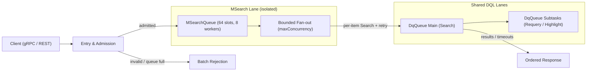

# MEP: MultiSearch

- **Created:** 2026-11-12
- **Author(s):** @XuanYang-cn
- **Status:** Under Review
- **Component:** Proxy, RESTful V2, gRPC
- **Related Issues:** #41791, #55710
- **Related PRs:** milvus-io/milvus#55472, milvus-io/milvus#55711, milvus-io/milvus-proto#697
- **Released:** Not released

## Summary

Add `MilvusService.MultiSearch` (gRPC) and `POST /v2/vectordb/entities/multi_search` (REST V2) to execute an ordered batch of independent ordinary `Search` requests inside one call. Each item can target any database and collection, carries its own search parameters and query vectors (`nq`), and returns either its complete native Search result or its own error in the original input position.

The Proxy orchestrates batches on a dedicated `MSearchQueue` (64 waiting slots, 8 workers) outside the DQL worker pool. A batch accepts up to 256 items and 64 MiB of uncompressed protobuf response data by default. Up to 16 items per batch can be active at once. Each item keeps ordinary Search authorization and quota checks, with retries for transient rate limits and main DQL queue saturation within a shared execution budget. `ListRunningRequests` and `CancelRequests` use one stable batch entry.

**Scope (v1):** Ordinary `Search` items only. `Query` and `HybridSearch` sub-requests, cross-item result union or reranking, same-collection execution-layer batching, a dedicated MultiSearch RBAC privilege, a Proxy-global retained response memory budget, and quota refunds on queue rejection are out of scope.

## Motivation

Retrieval applications frequently need several independent searches to answer a single user turn—for example, searching multiple collections across databases with different schemas, or running several filter variants against the same collection. Today clients must fan out those searches themselves, duplicating concurrency limiting, transient retry logic, error collection, and ordered result assembly across callers.

Moving batch orchestration into the Proxy reduces client round-trips and boilerplate while preserving ordinary Search authorization, rate-limiting, execution semantics, and result fidelity. Because MultiSearch runs on the shared Proxy and DQL resources, the design must isolate outer batch admission from DQL workers, bound per-batch DQL pressure, and keep per-item failures isolated so one failing search does not discard completed sibling results.

## Public Interfaces

### gRPC Protocol

Defined in [milvus-proto #697](https://github.com/milvus-io/milvus-proto/pull/697) (`b4d8319ce11217fc4c4d520f85d3bc8af9204d73`). `MultiSearchRequest` and `MultiSearchResponse` carry `SearchRequest` and `SearchResults` directly in flat repeated fields:

```protobuf
service MilvusService {
  // Execute a batch of independent Search requests.
  rpc MultiSearch(MultiSearchRequest) returns (MultiSearchResponse) {}
}

message MultiSearchRequest {
  common.MsgBase base = 1;
  // Non-empty list of Search requests in input order.
  repeated SearchRequest requests = 2;
  // Maximum concurrent subrequests. Zero uses the server default.
  uint32 max_concurrency = 3;
  // Non-negative shared execution budget in milliseconds, measured from batch receipt.
  // Unset omits the budget. Zero exhausts the budget immediately.
  optional int64 timeout_ms = 4;
}

message MultiSearchResponse {
  // Status of the batch. Each Search result carries its own status.
  common.Status status = 1;
  // One result per request in input order on batch success. Empty on batch failure.
  repeated SearchResults results = 2;
}
```

### REST V2 API

`POST /v2/vectordb/entities/multi_search` maps to the same Proxy orchestration path:

| Concept | gRPC | REST V2 |
| --- | --- | --- |
| Entry point | `MilvusService.MultiSearch` | `POST /v2/vectordb/entities/multi_search` |
| Search list | `requests[]` (`repeated SearchRequest`) | `requests[].search` (each wraps a V2 Search object) |
| Batch database fallback | `dbname` request metadata | Top-level `dbName`, then the `DB-Name` header |
| Requested in-flight concurrency | `max_concurrency` (`uint32`, 0 = default 4) | `maxConcurrency` (`uint32`, 0 = default 4) |
| Optional execution budget (ms) | `timeout_ms` (`optional int64`) | `timeoutMs` (`*int64`) |
| Transport deadline | Caller gRPC context deadline | `Request-Timeout` (integer seconds) when `timeoutMs` is also supplied |
| Batch status | `status` (`common.Status`) | `code` / `message` |
| Ordered item results | `results[]` (`repeated SearchResults`) | `data[].search` (native V2 Search response per item) |

Example REST request:

```json
{
  "dbName": "catalog",
  "requests": [
    {"search": {"collectionName": "papers", "data": [[1, 0], [0, 1]], "limit": 5}},
    {"search": {"dbName": "archive", "collectionName": "guidelines", "data": [[1, 0]], "limit": 3}}
  ],
  "maxConcurrency": 2,
  "timeoutMs": 5000
}
```

Example REST response on outer success (`HTTP 200`, `code == 0`):

```json
{
  "code": 0,
  "data": [
    {"search": {"code": 0, "data": [...], "topks": [5, 5]}},
    {"search": {"code": 0, "data": [...], "topks": [3]}}
  ]
}
```

Each item retains ordinary Search response rules, including multi-vector `nq` grouping (`topks`), `Accept-Type-Allow-Int64` formatting, and float-vector encoding headers. Zero hits and fewer hits than `limit` are successful outcomes. An outer success status means `results`/`data` has the same length and order as `requests`, even when some or all items failed or timed out.

### Proxy Configuration

| Key | Default | Refreshable | Description |
| --- | --- | --- | --- |
| `proxy.multiSearch.maxConcurrency` | `16` | Yes | Maximum number of active Search items per MultiSearch batch for both gRPC and REST. Values below `1` fall back to `1`. |
| `proxy.multiSearch.maxBatchSize` | `256` | Yes | Maximum number of Search items per batch. |
| `proxy.multiSearch.maxResultBytes` | `67108864` (64 MiB) | Yes | Maximum uncompressed protobuf response size per batch, including status. Applies to both transports. |

The item and byte limits require positive integers. Non-positive, malformed, and overflowing values use the corresponding defaults.

### Error Isolation Boundaries

| Stage | Trigger Examples | Scope & Response |
| --- | --- | --- |
| **Pre-decode admission (REST)** | `MSearchQueue` is full | Rejects the batch before body decoding with HTTP `429`, `Retry-After: 1`, and `ErrServiceTooManyRequests`; zero subrequests start. |
| **Batch validation & auth** | Invalid credentials, empty `requests`, invalid `timeoutMs`/`timeout_ms` (`< 0` or `> 9,223,372,036,854`), invalid `Request-Timeout` header, REST item without a single recognized `{"search": {...}}` object (e.g. `{}` or `{"query": {}}`), Proxy unhealthy, or `MSearchQueue` full at enqueue | Rejects the batch before any subrequest runs. Outer status is non-Success (`HTTP 401` on missing auth, `HTTP 429` on queue full, `HTTP 200` + error `code` on validation error; gRPC `Unauthenticated` / outer error `status`) and `results`/`data` is empty. |
| **Batch size or response budget** | More than `maxBatchSize` items or a response larger than `maxResultBytes` | Returns outer non-retriable `ErrParameterTooLarge` (`1102`). gRPC returns transport OK with empty `results`. REST returns HTTP 200 without `data`. The item limit rejects before preparation or enqueue. The byte limit stops dispatch and cancels in-flight items. |
| **Operator cancellation** | `CancelRequests` targeting the batch's `request_id` | Stops dispatch, cancels in-flight preparation/searches/retries, returns outer non-retriable `RequestCanceled` (`3002`) with cancel reason and empty `results`/`data`. |
| **Per-item preparation & execution** | Malformed Search fields, empty/nil gRPC `SearchRequest`, hybrid `sub_reqs`, NQ validation, missing collection, RBAC `PermissionDenied`, exhausted retries, or a panic in item preparation or execution | Returns a failed `SearchResults` at that item's index. A recovered panic returns `ErrServiceInternal` and leaves siblings eligible to finish. |
| **Execution budget expiry** | Batch execution deadline reached while the transport is open | The Proxy returns completed results and fills unfinished slots with `10001`, subject to the same response byte limit. |
| **Transport / delivery failure** | Client disconnect, parent gRPC deadline exceeded, or REST hard deadline exceeded | Ends delivery with a gRPC transport error, HTTP `408`, or an interrupted HTTP response after commitment. |

## Design Details

### Execution Flow and Queue Isolation



1. **Dedicated `MSearchQueue` (64 waiting slots, 8 workers):**
   The Proxy models each admitted batch as a `MultiSearchTask` on `TaskScheduler.MSearchQueue`, reusing `BaseTaskQueue`, `processTask`, and `TaskCondition` (allocating task IDs via `AllocID`, skipping TSO allocation).
   - Fixed workers pop a waiting batch only when free, keeping all unstarted batches inside the 64-slot admission bound—even if a timed-out batch still occupies its worker while slow child Searches unwind.
   - Batch admission checks only `MSearchQueue` (including REST's pre-decode probe). A full `DqQueue` never rejects the outer batch; child Searches hit `DqQueue` when dispatched and use per-item retry.
   - `TaskScheduler.Close()` cancels `sched.Context()` (propagating into every batch) and waits for MSearch workers to drain.

2. **Decoupled DQL subtask scheduling (`#55710` / `#55711`):**
   Ordinary Search tasks synchronously enqueue internal `requery` or lexical `highlight` subtasks while holding a main DQL worker. Splitting subtasks onto their own bounded queue (`proxy.maxTaskNum`), dispatch loop, and worker pool inside `DqTaskQueue` prevents the main DQL dispatcher from blocking on a full main pool ahead of the subtasks needed to free it. Because this also fixes a pre-existing deadlock path for ordinary Search and Query on `master`, `2.6`, and `3.0`, it has been extracted into standalone issue [#55710](https://github.com/milvus-io/milvus/issues/55710) and PR [#55711](https://github.com/milvus-io/milvus/pull/55711).

3. **Result ownership and completion:**
   `PreExecute` validates the execution context and computes effective concurrency. `Execute` waits for a slot with the batch context and recovers panics inside each item goroutine. It logs the item index, batch task ID, and stack, and publishes an internal error through `complete()`.
   A result's protobuf size is computed outside the mutex. Under the mutex, `complete()` adds the repeated field tag, length prefix, and full Search result, including failed results, to the initial size of the outer success Status. Equality is allowed. The first completion above the limit records `1102`, releases the retained result references, and cancels the batch context. `RunMultiSearch` reads the stored error before interpreting that internal cancellation.
   `finish()` takes ownership of the result slots under the same mutex. It includes the synthesized timeout statuses in the same byte budget and returns `1102` if the final response would exceed it. Late completions have no writable slots. A worker remains occupied until its in-flight items exit.

### Database Resolution, Authorization, and NQ / Quota Accounting

- **DB precedence and context isolation:** REST resolves each target from item `search.dbName`, top-level `dbName`, the `DB-Name` header, then `default`. gRPC uses item `db_name`, `dbname` metadata, then `default`. Schema, alias, privilege, and quota lookups run against the selected DB. When every item supplies a DB, only those DBs are checked. Each item carries its own DB metadata, RPC stats, access log information, and request metrics while preserving the caller identity and trace.
- **Per-item authorization:** Authentication runs once at batch entry. Every item then checks ordinary `Search` privileges via `PrivilegeInterceptorWithMetaCache` against its resolved DB and collection—including on schema cache hits—so items can be authorized by different roles held by the same user, and cross-DB same-name collections are checked independently. Unary gRPC `PermissionDenied` is translated into an item-level `ErrPrivilegeNotPermitted` status.
- **NQ validation & alignment with `#55744`:**
  - `NormalizeMultiSearchNQ` (`internal/proxy/dql/search_util.go`) validates every item before Search execution or quota checks: rejects hybrid `sub_reqs` and negative `nq`; for `SearchRequest_Ids`, validates at least one ID and `validateNQLimit` and sets `request.Nq` to the PK count so rate limiting charges IDs before `transformSearchByPK` resolves them; for `PlaceholderGroup`, shares `countPlaceholderGroupNQ` (wrapping `#55744`'s zero-allocation wire walker `funcutil.CountPlaceholderGroupValues` with `proto.Unmarshal` fallback for error diagnostics) and `validateDeclaredNq` with `resolveNq`, rejecting empty placeholder groups (even when `nq` is declared) and any `nq`/row-count mismatch with the same error semantics as `#55744`.
  - `GetMultiSearchQuotaInfo` uses `searchRequestNq(request)` (aligned with `GetRequestInfo`), resolves DB/collection/partition IDs (honoring `proxy.partitionNameRegexp` when enabled), and requires a valid quota scope when `quotaAndLimits.enabled` is true.
  - Ordinary `SearchTask.checkNq` continues calling `getNq(t.request)` (`resolveNq`) unconditionally, and `ListRunningRequests` / `milvus_proxy_received_nq` continue using `searchRequestNq` for ordinary Search and HybridSearch.

### Concurrency Control and Per-Item Retries

- **Effective concurrency:** When `max_concurrency` / `maxConcurrency` is omitted or `0`, the batch requests the default concurrency of `4`. Both gRPC and REST apply:
  ```text
  concurrency = min(requested, max(1, proxy.multiSearch.maxConcurrency), len(items))
  ```
  Requests asking for higher concurrency than `proxy.multiSearch.maxConcurrency` are accepted and scheduled under the cap, returning all items in input order. One active slot covers an item's full lifecycle—preparation (including REST schema lookup), quota check, DQL queueing, Search execution, and retry backoff—until it reaches a terminal result.
- **Proxy-wide DQL pressure bound:** With `8` MSearch workers and factory `proxy.multiSearch.maxConcurrency = 16`, all MultiSearch batches combined can hold at most **`8 × 16 = 128`** active Searches on a Proxy—`12.5%` of the default `proxy.maxTaskNum = 1024` DQL queue. Items beyond the sliding window stay as lightweight preparer closures and do not enter `DqQueue` until an active slot finishes.
- **Per-item retry policy:** Batch-level retry triggers only on `ErrServiceRateLimit` (`1807`) and `ErrServiceTooManyRequests` from main Proxy DQL admission. The main queue sets the attempt marker for both the Search task and the vector lookup Query used by Search-by-PK. Subtask queue saturation, downstream QueryNode `TooManyRequests`, `force-deny`, RBAC denials, and input errors terminate the item.
  - Up to `10` total attempts (1 initial + 9 retries), exponential backoff starting at `200 ms` and capping at `3 s` (`pkg/v3/util/retry` defaults, no jitter).
  - Each attempt clones a clean request (`copySearchRequestForAttempt`, preserving `RlsPrincipal`/`SkipRls`), re-runs authorization/hook/quota checks for the item's resolved target and NQ, and shares the batch execution deadline.
  - If the next backoff does not fit in the remaining budget while `executionCtx` is still live, the item stops retrying and preserves its last refusal status; once `executionCtx` expires, unfinished items finalize as timeout (`10001`).

### Execution Budget and Timeout Semantics

An explicit execution budget (`timeout_ms` / `timeoutMs`) accepts whole milliseconds in `[0, 9,223,372,036,854]` and is anchored at **batch receipt**—before REST authentication and body decoding (`dqlStreamState.receivedAt`, outside Gin Recovery) and at gRPC interceptor entry (`multiSearchReceivedAtKey`). Preparation, MSearch queueing, slot waits, DQL queueing, Search execution, and retries all consume this single deadline:

```text
execution_deadline = batch_received_at + execution_budget
```

| Transport | Body Budget (`timeout_ms` / `timeoutMs`) | Header or RPC Deadline | Effective Execution Budget | Behavior on Expiry |
| --- | --- | --- | --- | --- |
| **REST** | Omitted | Omitted | `proxy.http.requestTimeoutMs` (default `30,000 ms`) from batch receipt | Stops dispatch, cancels in-flight items, returns `HTTP 200` (`code: 0`) with completed items + `10001` for unfinished/unstarted items. |
| **REST** | `0` | Omitted | `0 ms` (expires at receipt) | Immediately returns `HTTP 200` (`code: 0`) with `10001` for every item. |
| **REST** | Explicit `T > 0` (including `> 30 s`) | Omitted | `T ms` from batch receipt (overrides default 30 s) | Returns `HTTP 200` (`code: 0`) with completed items + `10001` for remaining items when `T` elapses. |
| **REST** | Omitted | `Request-Timeout: H` (seconds) | `H s` from batch receipt | Returns `HTTP 200` with completed items and per-item `10001` for unfinished work. `H = 0` times out every item. |
| **REST** | Explicit `T` | `Request-Timeout: H` | `T ms` execution budget and `H s` hard transport deadline | The execution deadline can produce a partial response. The hard deadline applies through body reading, execution, JSON encoding, write, and flush. Expiry yields HTTP `408` before commitment or ends delivery after commitment. |
| **gRPC** | Omitted | Optional gRPC deadline | None (inherits parent gRPC deadline) | Runs until all items finish or parent deadline/cancel ends the RPC with gRPC transport error. |
| **gRPC** | Explicit `T >= 0` | Optional gRPC deadline | `T ms` from receipt | `T` expires while parent RPC is alive → outer `Success` with completed items + per-item `10001`. Parent deadline/cancel fires first → gRPC transport error (`DeadlineExceeded` / `Canceled`). |

`Request-Timeout` accepts whole seconds in `[0, 9,223,372,036]`. An invalid value returns `ErrParameterInvalid`. REST reads the body once to determine whether the header sets the execution budget or the transport deadline. When both values are supplied, a body that finishes reading after the hard deadline gets HTTP `408` before dispatch. When execution finishes within budget, the Proxy proceeds to response delivery immediately.

### List and cancel

- **Single stable registration:** Both transports register the admitted batch once as type `MultiSearch` in `Proxy.requests` before enqueuing onto `MSearchQueue`. The registration remains active across queueing, preparation, execution, and retry waits.
- **Child reuse:** Child `Proxy.Search` calls detect the parent `TypeMultiSearch` entry in `ctx` and reuse it; completing or retrying a child never finishes or unregisters the batch.
- **Listing:** Because a batch can span databases and collections, single-target fields (`db_name`, `collection_name`, `nq`, `topk`, `expr`) are left empty or zero. Operators list batches without DB/collection filters (optionally filtering by `user` or `min_elapsed_ms`), inspecting `request_id`, `state`, `elapsed_ms`, `queued_ms`, `trace_id`, and `task_ids`.
- **Cancellation:** `CancelRequests` stops further dispatch and cancels all active preparation, Searches, and retry waits. `RunMultiSearch` linearizes response finalization against `entry.Finish()` so an accepted operator cancel always wins over a racing last-item completion, returning outer non-retriable `RequestCanceled` (`3002`) with the cancel reason and empty `results`/`data`. Cancellation is asynchronous and does not guarantee immediate QueryNode resource release.

### Observability

Outer `Success` indicates a valid ordered response list rather than all items succeeding. MultiSearch separates entry, batch, subrequest, attempt, and retry signals:

| Metric Name | Type | Labels | Semantics |
| --- | --- | --- | --- |
| `milvus_proxy_multisearch_batches_total` | Counter | `node_id`, `result` (`all_success`, `partial_success`, `all_failed`, `batch_failed`) | Incremented once per `RunMultiSearch` call. Outer success classifies by item outcomes. Response budget exhaustion, queue rejection at enqueue, and operator cancellation record `batch_failed`. |
| `milvus_proxy_multisearch_subrequests_total` | Counter | `node_id`, `result` (`success`, `failed`, `timeout`, `cancelled`) | Incremented once when a completion is accepted or an unfinished slot is finalized within budget. |
| `milvus_proxy_multisearch_attempts_total` | Counter | `node_id` | Incremented every time a Search attempt starts (initial attempt + retries). Pre-initialized at Proxy startup. |
| `milvus_proxy_multisearch_retries_total` | Counter | `node_id`, `reason` (`rate_limit`, `queue_full`) | Incremented only when an additional retry attempt starts (not on initial attempts or terminal refusals that trigger no further retry). Pre-initialized at Proxy startup. |

- **Existing entry metrics:** `milvus_proxy_req_count` (`ProxyFunctionCall`) records outer `MultiSearch` with empty `database`, `collection`, and `resource_group` labels; each child Search attempt owns an isolated `RequestMetrics` scope recording `method="Search"` with its resolved `database`, `collection`, and hook-assigned `resource_group` (including refusals and retries) without leaking into the outer batch. gRPC `milvus_proxy_grpc_latency` (`function_name="MultiSearch"`) and REST `milvus_proxy_restful_api_req_count` / `milvus_proxy_restful_api_req_latency` (`path="/v2/vectordb/entities/multi_search"`) track entry volume and latency.
- **Access logs:** Each Search attempt writes its own entry on gRPC and REST when access logging is enabled. REST includes authorization, quota, and hook refusals. The Search formatter records the selected DB, collection, NQ, consistency level, status, and duration. The outer batch has its own entry.
- **Traces and debug logs:** The `Proxy-MultiSearch` span records the batch outcome, including `1102` for an oversized response. Each accepted completion or finalized slot emits one event with the item index, result, code, and duration. Rate-limited debug logs record refusals, retries, and completions.

## Compatibility, Deprecation, and Migration Plan

- **Wire & API compatibility:** Purely additive (`MilvusService.MultiSearch` gRPC RPC and `POST /v2/vectordb/entities/multi_search` REST route). No existing Search, HybridSearch, Query, or RBAC contract is changed.
- **Rolling upgrades:** Clients calling a Proxy that predates MultiSearch receive gRPC `Unimplemented` (or HTTP 404 on REST). No mixed-version partial execution can occur.
- **Configuration:** The three batch limits support hot refresh. New batches use the current configuration without a data migration.
- **Replication / CDC:** MultiSearch is a read-only DQL operation that produces no WAL writes or persistent metadata mutations, so no replication changes are required.

## Known Limits

- **Default split points:** Split requests at 256 items or when their combined response would exceed 64 MiB. If one Search alone exceeds 64 MiB, reduce its `nq`, `topK`, or `outputFields`.
- **Proxy memory and transport:** The byte limit applies to one batch's uncompressed protobuf response. Search allocates result data before it can be measured, REST JSON can be larger than protobuf, and concurrent and encoding batches consume additional memory. The gRPC message-size settings still apply at transport.
- **Per-attempt quota charging:** Rate-limit tokens are charged on each Search attempt (consistent with ordinary Search); a DQL queue-full rejection does not refund tokens already consumed by the rate limiter.
- **Asynchronous cancellation:** Returning `3002` (operator cancel) or `10001` (budget expiry) does not guarantee that every QueryNode has already finished unwinding; the MSearch worker stays occupied until in-flight child Searches exit so slow cancellation cannot create unbounded detached work.

## Test Plan

### Functional Correctness

- **Search parity and ordering:** Compare gRPC and REST MultiSearch against ordinary Search across single-collection, cross-collection, cross-database (including same-name collections), and multi-NQ queries; verify input-order preservation under out-of-order completion, valid empty hits, and mixed or all-item failures.
- **Error isolation and compatibility:** Verify whole-batch rejection before execution (invalid auth, empty batch, malformed REST items, full `MSearchQueue` pre-decode 429) versus per-item isolation (bad Search fields, NQ validation/mismatch, hybrid `sub_reqs`, missing targets), as well as `Unimplemented` handling against older Proxies.
- **Database, RBAC, and quota accounting:** Verify REST body and header precedence, unused DB fallback isolation, per-item Search RBAC, and per-attempt quota charging for vector and primary-key searches. Check the REST Search access log fields and refusals independently of the outer log.
- **Batch limits:** Check 256/257 items, exact response byte size and one byte over, failure and timeout slots, single-item guidance, and one Go client RPC for `1102`.

### Concurrency, Scheduling, and Lifecycle

- **Queue isolation and concurrency limits:** Verify `MSearchQueue` capacity and slot reclamation, vector and Search-by-PK retry after main queue saturation, separate subtask admission, and concurrency settings. Inject a panic into preparation and execution and check sibling results.
- **Execution budgets and cancellation:** Cover all REST and gRPC timeout combinations (including REST's default budget measured from receipt, explicit zero/longer budgets, and `Request-Timeout` precedence), partial-result finalization against late-finishing items, `ListRunningRequests`/`CancelRequests` across every lifecycle state, graceful scheduler shutdown, and single-count metrics/trace reporting under `-race`.

### Performance and Resource Validation

- **Client fan-out baseline:** Compare MultiSearch against matched client-side concurrent Search fan-out using identical query sets, effective concurrency, and timeout budgets, measuring batch throughput, p50/p95/p99 round latency, retry counts, and Proxy CPU/memory usage.
- **Mixed traffic and large-batch behavior:** Verify ordinary Search throughput, error rate, and tail latency under concurrent MultiSearch traffic, and validate large-batch execution under tight budgets (bounded DQL pressure, partial timeout delivery, and retained response memory).

## Rejected Alternatives

### Running outer MultiSearch on `DqQueue` or extending `IsSubTask` alone

Executing parent batches on the shared DQL worker pool lets saturated parent batches occupy all workers while waiting for their child Searches to run, causing deadlock. Extending `IsSubTask` alone without separating queues and dispatch loops still blocks a shared dispatcher on a full pool. Rejected in favor of a dedicated, bounded `MSearchQueue` outside the DQL pool (plus independent DQL subtask dispatch in `#55711`).

### Suspending and resuming parent tasks on the DQL worker pool

Releasing a DQL worker while a batch waits on child Searches and reacquiring one on completion complicates task lifecycle, cancellation, and retry recovery, and still requires separating child admission from parent admission to avoid mutual waiting. Rejected in favor of a simple 8-worker `MSearchQueue`.

### Bounding execution concurrency alone

Completed child results accumulate while later items run, and each response retains them through serialization. Two batches with the same concurrency can have very different item counts and payload sizes. The item and encoded byte limits cover these additional costs.

### Wrapping gRPC items in a `oneof` message (`MultiSearchSubRequest` / `MultiSearchSubResult`)

Wrapping `SearchRequest`/`SearchResults` in an extra `oneof` layer adds boilerplate for v1 when only `Search` is supported. Flattened `repeated SearchRequest` / `repeated SearchResults` keeps the gRPC API ergonomic and directly aligned with ordinary Search.

### Mapping client `timeout` directly to the RPC transport deadline

Setting the client's execution budget as the RPC deadline terminates the outer call on expiry and discards already-completed results. Separating the server-side execution budget (`timeout_ms`/`timeoutMs`) from the transport deadline lets the Proxy stop unfinished items on expiry and still deliver completed items alongside per-item `10001` statuses.

### Adding a dedicated MultiSearch RBAC privilege

A separate privilege would duplicate Search authorization and weaken per-collection and cross-database least-privilege boundaries. Reusing ordinary Search privileges per item keeps authorization identical to issuing the individual Searches separately.

## References

- Feature issue: [#41791](https://github.com/milvus-io/milvus/issues/41791)
- Wire protocol: [milvus-proto #697](https://github.com/milvus-io/milvus-proto/pull/697)
- Independent DQL subtask dispatch fix: [#55710](https://github.com/milvus-io/milvus/issues/55710) / [#55711](https://github.com/milvus-io/milvus/pull/55711)
- Pre-limiter NQ counting alignment: [#55744](https://github.com/milvus-io/milvus/pull/55744)
- Running request list & cancel design: [`20260916-running-request-list-and-cancel.md`](20260916-running-request-list-and-cancel.md)
- Earlier prototype: [#54940](https://github.com/milvus-io/milvus/pull/54940)
