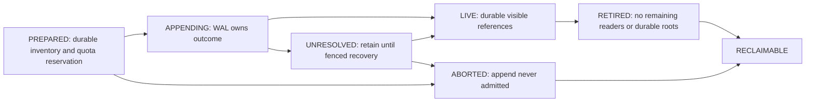

# MEP: Object-backed binary fields

- **Created:** 2026-11-17
- **Author(s):** @ZYZ666-RGB
- **Status:** Draft
- **Component:** Proxy, StreamingNode, DataNode, QueryNode, Coordinator, Storage, SDK
- **Related Issues:** [milvus#27578](https://github.com/milvus-io/milvus/issues/27578)
- **Released:** Not implemented; no release selected

## Summary

Propose a Milvus-managed object-storage representation for binary field values.
Clients send bytes through existing mutation RPCs. Proxy uploads the bytes to
operator-configured storage; WAL and segment data retain versioned references.
Search and query return bytes only for selected output fields, within explicit
response budgets. Binary fields have no filtering or indexing in this proposal.

This is a design discussion, not a proto or runtime implementation. The public
type and wire representation require agreement with the existing inline BLOB
work before implementation. The ownership protocol below is a proposed contract;
its metadata layout, WAL integration and performance still require review.

## Motivation

Issue #27578 asks to retain original binary content alongside searchable vectors
without loading every original into the vector database's hot data structures.
An object reference must survive retries, WAL replay, segment compaction and old
read snapshots. Uploading an object before insert, then deleting it on every RPC
error, is unsafe: an unanswered append can already be durable.

The newer [inline BLOB PR](https://github.com/milvus-io/milvus/pull/55556) addresses
bounded inline bytes and explicitly excludes external object hosting/lifecycle.
This proposal covers that external lifecycle rather than duplicating its schema
validation or reserving another enum value independently.

## Public Interfaces

### Decisions requested before proto changes

| Decision | Proposed starting point | Open question |
| --- | --- | --- |
| Public type | Coordinate with inline BLOB; keep one clear SDK byte-value contract | Rebase the older BlobRefFile proposal, or add an external storage mode to BLOB? |
| RPCs | Existing insert/upsert/search/query; no dedicated public upload RPC | Exact protobuf request/response representation depends on the type decision |
| Storage ownership | Operator-configured, Milvus-managed namespace | Same configured bucket or a separately configured managed bucket? |
| Size limits | Per-field byte limit bounded by server limits, plus aggregate request/response limits | Approve concrete defaults and units; the issue's historical “16M” is not a frozen byte limit |
| First supported backends | S3-compatible storage with a defined read-after-write and retry contract | Which providers must pass the acceptance matrix? Local support is separate work |

No enum number, protobuf tag or final config key is assigned by this document.
In particular, it does not repurpose `Blob = 32` from
[milvus-proto#698](https://github.com/milvus-io/milvus-proto/pull/698).
[milvus-proto#241](https://github.com/milvus-io/milvus-proto/pull/241) remains a
reference for discussion, not an assumed accepted interface.

### Observable behavior proposed for review

- A supplied value is bytes, not an arbitrary URL, filesystem path or credential.
  A client cannot inject an internal object reference or select another bucket.
- NULL and zero-length bytes remain distinct. The proposal permits nullable
  fields, requires a byte limit, and rejects binary defaults, keys, expressions,
  array elements and indexes until separately specified.
- Output selection follows ordinary projection rules, including wildcard
  expansion. Selected binary fields hydrate to bytes; unselected fields cause
  no object GET. Physical keys and credentials are not returned to clients.
- Byte limits apply before upload and after projection. The serialized request
  and response still must fit transport limits. Object backing does not provide
  unlimited uploads through a bounded gRPC request.
- Returning a subset of selected rows or silently replacing a failed GET with
  NULL is forbidden. A hydration failure fails the request with an appropriate
  existing error category. Exact status projection is part of implementation
  review; no new numeric error codes are chosen here.

## Design Details

### Source baseline and integration boundaries

The release baseline inspected was v3.0.6
(`63100f8f5b4b675a12fe78fc9673b005ee318731`). Targeted cross-checks against master
`daa653b2bb37629da3cc3be74fe277a6383a624e` found changes that the implementation
must incorporate:

- Proxy now uses `AppendMessagesWithOptions` with insert idempotency metadata;
  externalizing bytes must preserve that identity and the original results.
- The WAL adaptor still detaches accepted mutation work from caller cancellation.
  Writer cancellation/fencing requires recovery, not an assumption of rollback.
- RecoveryStorage, WALSummary and checkpoints participate in retention. The old
  independent flusher is not the integration target on master.
- Existing TEXT LOB references have layout-dependent ownership. Their encoding
  cannot be copied as a general cross-segment binary reference without checking
  its source/output partition-base assumptions.

These are integration constraints, not a claim that the feature exists today.
Implementation must recheck its actual base commit and link this canonical design
under Milvus's `docs/design-docs` as required by the feature PR workflow.

### Reference format and namespace

Use a versioned internal descriptor containing storage identity, the complete
object key, plaintext byte length, checksum algorithm/value, and immutable write
unit/object identity. Encryption metadata identifies the applicable key version;
it contains no raw key or temporary access credential. Do not treat an S3 ETag
as a general content checksum.

Objects are immutable. Replacements allocate new objects. Initial implementation
does not deduplicate objects across independent writes or tenants. A candidate
namespace is `<configured-root>/blob/<collection-id>/<field-id>/<unit-id>/<object-id>`;
names and the final layout require review. All IDs are server generated or
validated internal IDs. Namespace ownership includes the database/tenant and
cluster storage identity, even if those are not all literal path components.

Remote ChunkManager calls take complete bucket-relative keys, already containing
the configured root; they must not add the root twice. Existing remote keys are
opaque strings, not filesystem paths. A future local implementation must instead
use complete absolute paths under `localStorage.path`, with shared ownership and
cleanup helpers. It cannot reuse the remote key contract unchanged.

### Upload and append ownership

Propose a durable ownership record per bounded write unit, scoped to a VChannel
and collection incarnation. A unit can reference an immutable object-inventory
file to avoid unbounded catalog values. A multi-channel request has separate
units; this design does not promise atomic commit across VChannels.

1. Authenticate, authorize and validate schema, row alignment and all request
   budgets before object writes. Resolve write schema and collection incarnation
   through the normal write path. Reserve a bounded outstanding-byte quota and
   persist PREPARED with inventory before PUT; a crash must not leave an object
   whose ownership was never recorded.
2. Upload immutable bytes with bounded parallelism. Confirm completion, length
   and the provider's integrity mechanism. An ambiguous PUT is reconciled using
   the inventory's unique key; do not overwrite an unrelated object. Multipart
   upload IDs, if used, are also recorded for abort/retry.
3. After all required objects are ready, submit references and the unit token
   through the existing mutation path. Proposed WAL admission seals PREPARED
   into APPENDING under the owning writer's fencing protocol. GC's transition
   to ABORTED and append admission must be mutually exclusive: a delayed proxy
   cannot append after its token was retired.
4. The durable mutation carries the unit identity and complete references.
   Recovery reconstructs LIVE ownership from committed logical messages, then
   publishes reference inventories with segment materialization. A crash before
   the final ownership update is recoverable; Proxy's successful reply is not
   the only evidence of ownership.
5. Before WAL admission, failed uploads can become ABORTED once outstanding
   uploads have been fenced/drained. After admission starts, any ambiguous result
   stays APPENDING/UNRESOLVED. Never eagerly delete objects on RPC cancellation,
   timeout, a lost acknowledgement, or a generic append error.

The unresolved-to-aborted transition requires the old writer to be fenced and
recovery to establish every participating logical message/transaction outcome.
A checkpoint alone does not rule out a delayed append. Backend retries, chunked
messages and transaction bodies cannot be judged independently of their logical
commit. If absence cannot be proven, retain the unit and charge its quota.

The durable record's storage, atomic admission/fencing protocol, object-store
late-PUT reconciliation and crash proof are **implementation prerequisites**,
not existing Milvus guarantees supplied by this MEP. An initial experiment may
disable automatic reclamation, but cannot claim production readiness until the
protocol and leak bounds are demonstrated.

### Retries and idempotency

Externalization must not turn one logical request into different idempotency
payloads because every retry generated new object names. Preserve the existing
scope/window and derive request identity before replacing original bytes with
internal references. Reuse the admitted unit's recorded objects when the current
idempotency path returns that original write. Duplicate attempts' unused uploads
remain separately accounted for until proven unreferenced.

The exact integration with master insert deduplication, automatic keys, explicit
keys and replayed results is a required follow-up design review. Do not claim
payload-equality validation or exactly-once behavior beyond the underlying API.
An upsert retry must not delete the earlier value's object while an MVCC reader
or snapshot can still observe it. Partial update/CAS support is gated separately.

### Retrieval and resource bounds

Query execution selects visible row versions using the normal consistency/read
timestamp. It returns descriptors to Proxy; Proxy hydrates only the final selected
rows, after filtering, ranking, reduction and pagination. No blob body participates
in index construction or candidate scoring. Persist descriptors and null bitmaps
in growing/sealed storage; flush, load and compaction must preserve them losslessly.

Before GET, sum selected lengths with overflow checks and reserve a response
budget covering protobuf/REST encoding overhead (including base64 expansion),
ordinary fields and duplicated hits. Enforce per-value, per-response and in-flight
process budgets. Streaming reads must be capped at the declared length plus a
bounded overflow probe; an oversized or corrupt object must not allocate without
limit. Use bounded concurrency and a deadline shared with the caller. Release
readers, buffers and reservations on every success/failure/cancellation path.

Transient provider failures can use bounded retries inside the request deadline.
Missing committed objects and checksum mismatches are integrity failures, not
empty bytes or NULL. Preserve authorization and storage error categories through
their actual construction sites and API projection. Do not log payload bytes,
credentials, presigned URLs or unrestricted object-key values in metrics labels.

### Retention, compaction and garbage collection

The reachability roots include committed WAL/recovery state, retained Summary
history where replay/dedup needs it, growing and sealed row versions, replacement
manifests during compaction, active read leases, snapshots/backups, and any enabled
import/restore/CDC work. A delete tombstone, segment drop or collection drop alone
does not prove that every root has gone away.

Compaction must publish the output reference inventory before retiring input
inventories. A reused object remains owned until the last retained input/output
version releases it. No PK-only ownership table is sufficient because successive
versions of the same PK may contain different blobs.

Propose a dedicated collector for the managed blob namespace, using the same
inventory/key helpers as writers. PREPARED units need fenced abandonment; admitted
units need the replay proof above. LIVE objects become RETIRED only after all
relevant durable roots and readers release them. Reclamation uses a persisted
generation/tombstone and rejects stale registrations; it must not race a newly
published manifest or snapshot. Unknown metadata, missing checkpoints or failed
catalog reads retain objects and raise observable pressure rather than deleting.

Age is an additional grace period, never evidence of unreachability. Existing
DataCoord orphan scans are not automatic coverage for a new namespace. Collector
restart and deletion retries are idempotent; 404 for an eligible delete is success.
Keep pending and unresolved bytes bounded by admission quotas, expose their age,
and reject additional blob writes when the reserved budget is exhausted.

### Snapshot, backup, restore and CDC gates

Until implemented and tested, reject bulk import, partial update, snapshot/backup
creation or restore, and enabling CDC on affected collections. Reject creating a
blob collection under an incompatible active topology as well. Admission must
cover internal/administrative entry points, not only one SDK method. Define the
precise available gate boundaries in implementation review; if a system-wide
operation cannot reject safely, keep the feature unavailable in that mode.

Later snapshot support must pin every referenced object for the snapshot's whole
lifetime. Self-contained export copies objects and rewrites references with a
verified inventory; restore cannot assume the source bucket or prefix still exists.
CDC must copy/verify bytes in the destination storage before publishing its row
references, with destination-owned lifecycle and replayable transfer state.
Sharing credentials or assuming identical bucket access is not a replication plan.

## Compatibility, Deprecation, and Migration Plan

Ship behind a default-off feature gate after the public representation is agreed.
Enable writes only when every writer, WAL recovery consumer, storage reader and
query consumer supports the descriptor version. Unsupported nodes must reject
explicitly; an unknown reference must never be interpreted as inline bytes.

Collections without this feature keep their ordinary behavior. Existing inline
BLOB values do not migrate automatically. Rollback is permitted only to a version
that can read all stored descriptors; otherwise require an explicit verified
export/migration first. Disabling admission does not delete stored objects or
disable the readers needed to retrieve them.

Proposed delivery order:

1. Agree type/wire contract, limits, provider scope and ownership protocol here.
2. Land coordinated proto/schema and disabled-by-default compatibility checks.
3. Add upload, fenced append/replay, reference persistence/load and bounded
   retrieval as one usable experimental vertical slice.
4. Add verified lifecycle/GC and operational quotas; satisfy the failure matrix
   before recommending production use.
5. Enable import, partial update, snapshot/backup/restore and CDC separately, only
   with their own contract and end-to-end evidence.

## Test Plan

This document adds no runtime code; these are required future tests, not results.
Use a real standalone and distributed deployment with supported S3-compatible
storage, then inject failures at the indicated boundaries. Record the exact server,
SDK and storage versions, flags, request sizes and observed WAL outcomes.

| Scenario | Required observation |
| --- | --- |
| Every byte value, invalid UTF-8, NULL, empty, exact/over limit | Byte equality; correct null bitmap; oversized request rejected before PUT |
| Blob omitted/selected/wildcard; REST and gRPC | No GET for omitted field; projected bytes and encoding match; no raw keys escape |
| Many hits, repeated references, NQ/top-K, concurrent clients | Aggregate and process limits hold; no silent result truncation |
| PUT failure/ambiguous success; proxy crash during upload | No row references incomplete content; all objects/uploads accounted for |
| Timeout after WAL persistence but before reply | Recovery retrieves the bytes; timeout cleanup never deletes them |
| WAL failure/fence/handoff, chunk retry, expired transaction | Logical committed/aborted outcome governs ownership; unknown units retained |
| Delayed upload or append versus GC | Retired token cannot publish a reference; late PUT is eventually reconciled |
| Same idempotency key across proxies/restart | Existing deduplication result preserved; unused uploads safely reclaimed |
| Flush, release/load, restart, compaction | References and byte checksums survive every transition |
| Upsert/delete/TTL/drop with old readers | Old visible versions remain readable until all protections release |
| GC catalog failure, stale generation, restart mid-delete | No reachable object deleted; eligible deletion resumes idempotently |
| Missing/corrupt/oversized object; storage throttle | Classified failure, bounded memory/retry, no fabricated NULL or partial success |
| Disabled feature and mixed versions | No unsupported schema/write/replay is admitted; unaffected collections work |
| Unsupported import/snapshot/backup/restore/CDC paths | Explicit pre-side-effect rejection on every relevant entry point |
| Future cross-bucket export/restore/CDC | Destination bytes verified before visibility; source GC cannot break destination |

Track upload/hydration latency, bytes, retry counts, reserved/unresolved inventory,
GC backlog and process memory under load. Compare no-blob query performance and
small-field mutation throughput with the baseline. The acceptance report must
identify unexecuted cases and does not substitute unit tests for crash/replay tests.

## Rejected Alternatives

- **New public upload/download RPCs first:** conflicts with the earlier direction
  to use ordinary data RPCs and expands the SDK/API scope before type agreement.
- **Caller-controlled object URLs:** leaves ownership, authorization and immutability
  outside the proposed managed-storage contract. Could be a separate feature.
- **Delete on RPC error or age-only lifecycle rules:** cannot distinguish an
  acknowledged failure from a committed write with a lost response.
- **Store every body in WAL:** duplicates the inline direction and loses the main
  benefit of this proposal. Object durability/lifecycle must instead be explicit.
- **Reuse TEXT LOB references unchanged:** layout-relative reconstruction and
  compaction assumptions need a deliberate adapter and cannot be presumed general.
- **Immediate cross-write deduplication:** adds shared ownership and tenant
  isolation complexity before basic crash safety is established.

## References

- [Original object-backed request](https://github.com/milvus-io/milvus/issues/27578)
- [Earlier proto proposal and discussion](https://github.com/milvus-io/milvus-proto/pull/241)
- [Inline BLOB tracking issue](https://github.com/milvus-io/milvus/issues/53858)
- [Inline BLOB implementation draft](https://github.com/milvus-io/milvus/pull/55556)
- [Inline BLOB proto draft](https://github.com/milvus-io/milvus-proto/pull/698)
- [Proxy insert path at cross-check commit](https://github.com/milvus-io/milvus/blob/daa653b2bb37629da3cc3be74fe277a6383a624e/internal/proxy/dml/task_insert_streaming.go)
- [WAL admission and cancellation](https://github.com/milvus-io/milvus/blob/daa653b2bb37629da3cc3be74fe277a6383a624e/internal/streamingnode/server/wal/adaptor/wal_adaptor.go)
- [Storage paths and TEXT LOB constraints](https://github.com/milvus-io/milvus/blob/daa653b2bb37629da3cc3be74fe277a6383a624e/docs/agent_guides/storage/path_contract.md)
- [Recovery and checkpoint boundaries](https://github.com/milvus-io/milvus/blob/daa653b2bb37629da3cc3be74fe277a6383a624e/docs/agent_guides/streaming-system/wal/recovery-storage.md)
- [Existing remote ChunkManager key handling](https://github.com/milvus-io/milvus/blob/daa653b2bb37629da3cc3be74fe277a6383a624e/internal/storage/remote_chunk_manager.go)
