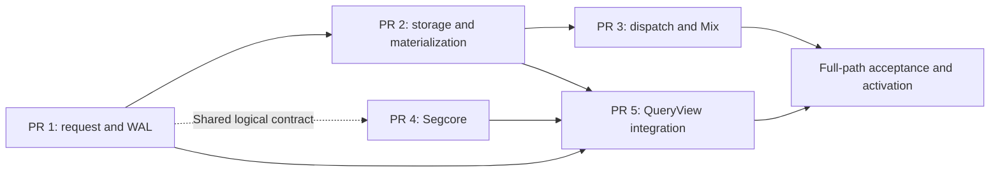

# PK Inplace-update Implementation Plan

This plan implements the [PK inplace-update design](20261109-pk-inplace-update-design.md) in five component PRs. The design owns semantics and data structures; this plan owns change boundaries, dependencies and evidence required for review. New client SDK and public Protobuf changes may require companion PRs in their own repositories; they belong to PR 1's work package, not an additional Milvus component.

## 1. PR boundaries

| PR | Component owner | Deliverable | Required dependencies |
| --- | --- | --- | --- |
| 1 | Proxy / WAL ingress and protocol | A validated, replayable PK-update message | None |
| 2 | Storage / SN materialization | Typed delta codec, legacy readers and L0 production | PR 1 protocol |
| 3 | MixCoord / DN | Complete L0 dispatch and ordered Mix execution | PR 2 codec and progress contract |
| 4 | Segcore | Sparse versions, TempIndex, query readers and GC executor | Shared assignment/type contract from PR 1; can develop in parallel |
| 5 | SN query runtime / QN QueryView | Real update delivery, load, recovery and safe-boundary publication | PRs 1, 2 and 4; full acceptance also needs PR 3 |

- Reuse existing POC components where they satisfy the final design; do not equate a POC hook with production integration.
- Retain existing L0/Mix channel exclusion and standard Mix backlog policy. Failed-materialization cleanup and a finer exclusion granularity are outside these PRs.
- Schema/backfill conflict handling remains the separate compatibility workstream. Record its supported combinations before public activation; do not silently expand this plan into a backfill redesign.
- Every PR includes its own meaningful tests. PR 5 owns combined end-to-end evidence rather than deferring all component testing to the final PR.
- Keep PK-update writes unavailable until the required consumers are compatible and the complete path passes acceptance. Earlier PRs may expose internal contracts for downstream development.

## 2. PR 1: Proxy and WAL protocol

**Outcome:** one client call becomes valid, typed PK-update messages with existing VChannel transaction semantics.

**Included**

- Add public/internal request definitions, UPDATE message registration and generated bindings; provide companion proto/SDK changes as needed.
- Carry collection/schema identity, scope, `schemapb.IDs` and one shared assignment set. Preserve explicit NULL and every agreed Phase 1 logical type.
- Validate permissions, PKs, scope, field identity, restricted fields, values and supported types before append.
- Route by VChannel; split PKs using complete encoded message size; reject an indivisible assignment set that cannot fit with one PK.
- Reuse VChannel transactions and effective commit timestamps. Do not claim cross-VChannel atomicity.
- Add SN append schema-version validation and required ingress/message classification. Extend CDC transport/replication handling for the new message without discarding assignments.

**Boundary and handoff**

- Own WAL/request encoding, not Parquet schema or query apply implementation.
- Publish a typed logical mutation contract for PRs 2, 4 and 5: PK type/list, scope, assignments, field IDs and effective ordering.
- PR 5 owns TransformLog payload construction and query-MVCC classification; PR 2 owns materializer consumption. Shared registrations are coordinated through PR 1.

**Review evidence**

- Round-trip multi-PK assignments, SET NULL, empty values and supported ARRAY values; reject unsupported fields/types and invalid nullability.
- Test full-message size boundaries and verify failure does not leave a partially accepted indivisible operation.
- Trace split-request transaction commit/rollback and schema mismatch through the actual append path.
- Verify CDC carries the complete new payload and preserves transaction ordering; document any replication mode that remains unsupported.

## 3. PR 2: Storage codec and SN materialization

**Outcome:** PK-delete and PK-update are persisted through one versioned typed format, usable by DN and QN.

**Included**

- Implement the common typed Parquet reader/writer through the existing FFI: common mutation columns plus nullable assignment Structs.
- Bind columns to stable field IDs; retain logical types and file collection/channel/scope/schema metadata.
- Preserve no-op, SET NULL and SET value, omit fields unused by the entire file, and keep multiple PKs sharing assignments.
- Support projected field reads together with common columns and PK-delete handling. Normalize legacy L0, V1/V2 and packed V3 delete files through adapters.
- Connect UPDATE to the SN pending/materialization path and new writer; retain existing task serialization and retry behavior.
- Preserve effective-TimeTick groups, success-dependent materialization progress and asynchronous durable M publication. Emit trustworthy timestamp, byte/file and operation-count metadata for PR 3.

**Boundary and handoff**

- Own the codec and producer. PR 3 owns M-gated scheduling and target publication; PR 5 owns QN load lifecycle and population of UpdatesRecord.
- Reader projection must expose ownership clearly so consumers can release whole batches after retaining required values. It is not a lazy query loader.
- A storage-library companion change, if required by the pinned dependency, stays within this work package. Do not add a custom DenseUnion decoder to implement the chosen format.

**Review evidence**

- Native FFI write/read tests cover mixed age-only/name-only updates, all three states, PK-delete and shared assignments in the same file.
- Selected-field tests verify other fields need not be decoded; include legacy/new mixed input and missing-field no-op behavior.
- Repeat the documented wide sparse case and record file size, Arrow allocation and peak load RSS separately. Verify the production reader API used, its row-group behavior and concurrency.
- Inject partial output/registration failure and retry. Registered duplicates must preserve logical timestamps; M must not claim unfinished materialization. No immediate orphan cleanup is claimed.

## 4. PR 3: MixCoord scheduling and DN execution

**Outcome:** storage consumers receive a complete safe prefix and materialize updates in logical order.

**Included**

- Read persisted M and fix M0 per scheduling round; exclude unregistered inputs and inputs beyond M0.
- Collect the complete eligible input set for the claimed coverage. Thresholds may trigger a round but must not truncate its coverage silently.
- If eligible ALL_PARTITIONS input exists, create a task covering all relevant scopes and targets in that collection/VChannel. Otherwise retain partition tasks.
- Keep channel-level L0/Mix exclusion. Persist target results and cursor coverage, including zero-output targets, before task completion and input retirement.
- Make task retry/recovery preserve ownership, completed target results and remaining delivery obligations.
- Extend DN dispatch and Mix readers to the common codec. Per input, merge all deltalog records by effective mutation order and apply PK-delete/update before merging surviving rows.
- Retain normal Mix admission and minimum-input output cursor. Include update files/bytes in backlog signals without inflating delete counts.

**Boundary and handoff**

- Reuse PR 2's codec; do not duplicate an assignments parser inside DN.
- Own persistent coverage and output-cursor correctness. PR 5 owns actual query catchup/apply progress.
- Do not add equal-cursor admission, a global empty-range alignment sweep, shared ALL_PARTITIONS-file retirement across independent tasks, or target-batch unlocking.

**Review evidence**

- Interleave P1, P2 and ALL_PARTITIONS mutations; include a partition with no private L0 and targets with no BF hit.
- Verify inputs beyond durable M remain undispatched even if their objects and metadata already exist.
- Retry after partial target publication and restart before retirement; prove no target loses an applicable update and no input retires prematurely.
- Mix several files containing overlapping timestamps and duplicate literal SETs. Assert timestamp order across files, delete/update interaction, repeated PK behavior and final base values.
- Reload compactTo output and replay its suffix. Include legally different input initialization cursors; compare results before and after compaction.

## 5. PR 4: Segcore versions and query execution

**Outcome:** Growing and sealed query execution read the correct updated values without discarding existing index performance.

**Included**

- Implement sparse field/offset histories and shared version ownership; unchanged rows remain in the native base. Support all agreed Phase 1 assignment types, not only the POC's INT64/VARCHAR fixtures.
- Implement exact PK apply with scope, row-time and liveness checks; update all eligible physical rows and preserve multi-field publication.
- Implement the all-data versioned B-tree TempIndex with shared history references, SoA postings, latest-version fast paths and correct NULL handling.
- Expose timestamp-bound TempIndexReader and ValueReader using existing query reader interfaces where possible.
- Integrate supported TempIndex expressions, original-index bitmap correction and native raw-batch overlays. Preserve candidate masks, batch/all-at-once capability rules and SQL result/validity semantics.
- Connect output fill and other consumers of mutable scalar values to the same timestamp-bound lookup contract.
- Prevent unsafe local index/statistics shortcuts and expression-cache reuse. TempIndex disabled still uses native indexes where available.
- Consume safe GC boundaries from Go; unlink both access paths and release shared histories safely. No Go callback from Segcore.

**Boundary and handoff**

- Own in-memory representation, query evaluation and the native apply/read/GC interfaces.
- PR 5 owns WAL/TransformLog delivery, physical-segment lifecycle, Go snapshot protection and delivery of safe GC bounds.
- Runtime configuration must distinguish TempIndex selection from correctness: disabling the index cannot disable sparse updates or force an indexed predicate into raw scan.

**Review evidence**

- Cover a value changed away and back, repeated updates, SET NULL transitions, multi-field changes and old/current protected snapshots.
- Assert unchanged offsets have no allocated update history; variable-length assignments share payload without retaining irrelevant input batches.
- Verify all three actual expression paths, corrected-offset counts and candidate-mask behavior. Low-selectivity TempIndex equality must not enumerate all non-NULL postings.
- Verify filter and output lookup at the same timestamp, including historical values and logical combinations with NULL.
- Supply controlled safe GC bounds and prove both readers retain the spanning/current versions while expired references are reclaimed safely.

## 6. PR 5: QueryView delivery, load and recovery

**Outcome:** production SN/QN paths drive Segcore from durable and live data, replacing local-file POC injection.

**Included**

- Extend WALSummary/TransformLog payload construction, classification and retention for PK-update. Keep transaction commit timestamps and complete entry boundaries.
- Add GrowingRuntime live apply and bounded recovery replay, then join QueryRuntime live events without a gap or reordered duplicate.
- Add QN sealed TransformLog apply with scope and local BF filtering; retain the existing physical registration, catchup and live-dispatch model.
- Load projected typed persisted deltalogs through PR 2, apply only actual assignments through PR 4 and release temporary Arrow allocations. Keep deletes in the common load path.
- Include PK-update in QueryMVCC/readiness progression and failed-apply handling. Publish progress after actual application, not RPC enqueue.
- Protect updated values from stale SN global segment pruning.
- Own snapshot/lease protection and safe R_G/R_T computation/delivery. Establish that newly admitted or delayed reads cannot require already reclaimed history before enabling GC.
- Connect production configuration, memory accounting and useful progress/path diagnostics; coordinate full-path correctness and regression runs.

**Boundary and handoff**

- Reuse existing QueryView/TransformLog infra. No standalone L0 preload or replacement Delegator forwarding path.
- Consume PR 4's reader/apply/GC APIs; do not reimplement value-version selection in Go.
- GC coverage includes registration/admission races and protected readers, not just a minimum over requests currently executing. If this safety contract is unproven, retain history and report GC as incomplete.

**Review evidence**

- Send real API updates and read them from Growing and sealed segments under the existing consistency/readiness contract.
- Test an unloaded collection, initial load, partial persisted data, restart, catchup/live handoff, release/reload and compaction replacement.
- Fail an apply operation and verify queries cannot read that registration as caught up; retry or invalidation must follow the existing runtime contract.
- Hold a protected older snapshot while applying updates and advancing GC; also exercise delayed/new snapshot admission against the chosen lower bound.
- Verify pruning cannot drop a segment whose updated scalar value matches the query.

## 7. Integration acceptance and performance

- PR 5 coordinates acceptance after PRs 3 and 5 are both available; each component owner resolves failures in its own boundary.
- Use the same deterministic base dataset and ordered updates to compute an independent final-value mirror. Compare PK sets and projected values before accepting latency numbers.
- Compare R1-ON, R1-OFF and R2. R1-OFF preserves old-index plus updates; R2 stores final values in base. Keep expression cache disabled for controlled comparisons.
- Keep the case set small: equality, IN, range, prefix, NULL and representative unsupported/logical combinations. Measure output lookup separately with a common equality case.
- Use separate equally sized instances with matched single-segment layouts. Record update coverage/history depth, actual execution paths, query latency and resident memory; measure build/apply cost outside static query timing.
- Include legacy file compatibility, mixed PK-delete/update, materialization retry, durable-M lag, cross-scope dispatch, Mix/reload and query recovery in correctness acceptance.
- Keep runtime mutation ordering and sparse memory assertions in the test evidence. Correct final values alone do not prove a fast or MVCC-correct path.
- Before enabling writes, verify compatible readers throughout the deployed path, CDC behavior where enabled, and declared schema/backfill compatibility limits. An API-only success is not feature completion.

## 8. Shared contracts to settle before parallel implementation

- PR 1 with PRs 2/4/5: exact supported-type mapping, explicit NULL, scope and effective transaction ordering. Resolve same-timestamp operation order through the existing transaction contract.
- PR 2 with PRs 3/5: common reader output, field projection, metadata/stats meaning and buffer ownership.
- PR 3 with PR 5: persistent replay cursor binds to the published base/deltalogs; query apply progress remains separate.
- PR 4 with PR 5: native update/read/GC interfaces, physical-segment lifetime, query timestamp binding and snapshot-admission proof for safe reclamation.

These are integration contracts within the accepted design. They do not require new transport, publication or query frameworks.
