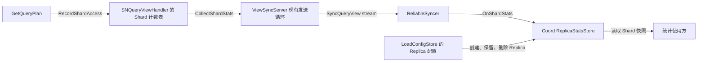

# Shard 访问统计

关联需求：[milvus-io/milvus#55284](https://github.com/milvus-io/milvus/issues/55284)。

状态：2026-11-11 按 ShardID 方案重写实现。本文替代原来的逐 QueryView 统计方案。
代码基线为 master `1b5779cd1a`，以下描述本分支的实现。

## 1. 范围与统计口径

统计单位为现有的 `qviews.ShardID = (ReplicaID, VChannel)`。同一个 Shard 的
所有 QueryView 版本共用计数，不携带 DataVersion、QueryVersion 或 LoadInfoVersion。

每个 Shard 只记录两个值：

| 字段 | 含义 |
| --- | --- |
| `RequestCount` | 当前 SN handler 生命周期内，进入该 Shard 计划构建流程的累计次数 |
| `LastAccess` | 最近一次上述访问的 SN 时间，使用 Unix 纳秒传输 |

采集点仍在 `walAdaptorImpl.GetQueryPlan`：取得实际 View lease、完成 schema 和
collection 校验、解析出实际 ShardID 后，进入 MVCC 等待及计划构建前，调用一次
`SNQueryViewHandler.RecordShardAccess(viewShardID)`。请求携带 UnknownReplicaID
时，使用 lease 已解析出的真实 ReplicaID，不以请求中的未知 ID 建立统计。

Search、Retrieve、Statistics 的一次计划构建各计一次；后续构建失败不回滚，重试
再次计数。它不是成功查询数、去重后的用户请求数或 NQ。Phase 2 执行不重复计数。

本轮只定义采集、同步和读取这两个字段，不实现加载优先级、调度评分或时间窗口。
统计用于描述访问活动，不决定 View 是否 Up，也不影响查询正确性、lease 或资源释放。

## 2. 所有权与数据流



SN 的具体类型名是 `SNQueryViewHandler`，即本方案的顶层 SN handler；它按
PChannel/WAL 实例存在，不是每个 SN 进程只有一个实例。

handler 持有专用的私有 `shardStats` 子结构，由它封装计数表、访问更新和快照采集；
handler 的方法只转发调用。`snShardView`、`snViewEntry`、QueryView lease
以及 SN/Coord 状态机均不增加 stats 字段或统计回调。

Coord 的 `ReplicaStatsStore` 独立于 `ShardViewRegistry`。ReliableSyncer 直接调用
它的接收接口，不经过 Registry、ShardViewManager 或状态机。Replica 的创建、
删除由 load config 驱动；某个 Replica 暂时没有 View，不影响它的统计对象。

不引入独立 Reporter、Source、Session、subscriber 列表或逐 View Contribution。
RPC stream 的发送循环是唯一的采集调度者。

## 3. SN 内聚实现与锁边界

顶层 handler 的 `shardStats` 子结构持有私有并发表，键为 ShardID，值为小型 counter。第一笔访问
按需创建条目；记录访问和收集快照只访问该表，不遍历 `h.shards` 或 `shard.views`。

采用 `sync.Map` 保存 counter 指针，每个 counter 用自己的短临界区同时更新
次数和最后访问时间。读取时只复制这两个标量。一次采集不需要全局一致快照，也不
需要锁住整个表；不同 Shard 可以并发记录。最后访问时间取已记录值和本次时间的
较大值，避免并发访问顺序导致回退。

锁边界必须满足：

- 记录和采集不获取 handler 的 View map 锁、`snShardView.mu` 或状态机锁。
- 不在 counter 锁内分配批次、构建 protobuf、调用回调或执行网络发送。
- 收集遍历按 Shard 数量增长，与 View 版本数、Segment 数量无关。
- 不为 Shard 建 goroutine、ticker 或通知队列。

这消除了 stats collect 对 QueryView 状态机锁的占用。采集仍有遍历和编码的 CPU
成本；单个热点 Shard 的 counter 也存在短锁竞争，应通过并发 benchmark 测量，
不能把解耦描述为完全没有性能成本。

SN counter 生命周期属于 handler：View 换版、Down、Dropped，乃至最后一个
`snShardView` 被移除，都不清理 counter。WAL 关闭或迁移、handler 销毁时一起释放；
恢复时从零计数，不持久化统计。首版不增加远端 Replica 删除通知或 TTL 回收机制。
因此 SN 表的大小取决于本次 handler 存活期间访问过的不同 ShardID；持续 Replica
创建/删除会增加条目，这是明确的内存取舍，不能声称与当前存活 Shard 数严格相等。

## 4. 沿 Syncer 链路上报

### 4.1 连接生命周期

沿用 PChannel 级 `SyncQueryView` stream。这里“保活所有 SN”指对发现的每个逻辑
SN/PChannel 都保持 resumableSyncer，由已有 assignment 路由到实际物理 SN。

基线 master 只在第一次 `SyncViews` 有待发送 View 时创建连接。本分支让
Syncer 订阅 PChannel 发现的初始集合和后续变更，发现即创建 resumableSyncer：

- 没有 pending View、没有统计访问，也要建流并保持接收。
- pending 清空、View 全部移除、长时间没有统计变化，都不关闭连接。
- 断流沿用现有退避重连。PChannel owner 变化沿已有 assignment 路径重新定位，
  不在 stats 中另建 NodeID/WALTerm 来源模型。
- assignment 列表中的暂时缺失不能证明 PChannel 已永久删除，因此已经发现的
  SN syncer 一直保留到 Coordinator 关闭，包括 pending View。暂时不可用继续重试。
  取消发现 watcher 和关闭连接必须可被 runtime shutdown 等待。

QN 的状态同步行为保持原有语义，QN 不生产这份访问统计。

### 4.2 采集与抑制重复发送

在现有 `ViewSyncServer.sendLoop` 中采集：新连接建立后立即读取一次，以后每
5 秒读取一次。所有 `stream.Send` 仍由同一个发送循环执行。

每条连接保存 `ShardID -> 上次发送的两个字段`：首次发送所有已有条目，后续只
发送发生变化的条目。没有变化时不发送 stats 消息，但保持 stream。重连清空发送
缓存并重新发送当前快照，不能因为原连接已经发送过而跳过新 Coord 的第一份数据。

按最多 256 个样本分批发送，并在批次间处理待发送的状态/关闭报告。网络慢时不
排队积累周期快照，下一轮读取最新累计值。发送失败结束本次 stream，交给重连
恢复；成功发送后才更新对应缓存。采集耗时本身也应纳入 benchmark。

统计不进入 `pendingReports` 的 QueryViewKey 去重表，也不走 `OnReport` 状态回调。
这两类数据共用传输，但分别保持自己的身份和更新频率：状态变化及时报告，访问
计数周期合并。

### 4.3 最小协议

复用已有 `viewpb.ShardID`，新增样本及 `SyncResponse` 的 stats 分支：

```proto
message ShardStats {
    ShardID shard_id = 1;
    uint64 request_count = 2;
    int64 last_access_unix_nanos = 3;
}

message ShardStatsReport {
    repeated ShardStats shards = 1;
}
// 在现有 SyncResponse.response oneof 中追加：
// ShardStatsReport stats = 3;
```

样本之间独立，某条消息没有某个 Shard 不表示删除或计数归零。没有完整集合重组、
epoch、sequence 或 sample_elapsed；不再引入 CompactShardID 转换层。
旧 stats 协议未合入 master，本次以 master 的协议为基线；保持已有 views/close
字段及 RPC 不变。旧节点缺少 stats 时按未知处理，不影响状态同步；混合版本行为
在实现阶段验证。

## 5. Coord：Replica 拥有统计生命周期

### 5.1 以当前 LoadConfig 为准

QueryView 路径的 Replica 身份来自 `LoadConfigStore` 中当前配置的
`ReplicaAssignment`，不是 legacy `meta.ReplicaManager`，也不是本地 Up View 目录。

复用已有的 `RegisterLoadConfigListener`。它在注册时回放当前配置，并在后续已
提交配置变化时同步通知；不需要新增一套 Replica watcher。接收者维护：

```text
ReplicaStatsStore
  collection -> ReplicaID 集合
  ReplicaID -> ReplicaStats
                 CollectionID（ResourceGroup 仍从当前 LoadConfig 读取，不复制元数据）
                 ShardID -> 最近收到的 ShardStats
```

配置回调按 ReplicaID 差分：

| 配置变化 | stats 行为 |
| --- | --- |
| 新增 ReplicaID | 创建空 ReplicaStats，尚未访问的 Shard 不预分配 |
| 同一 ReplicaID 保留 | 保留它的全部 Shard 统计 |
| ResourceGroup 变化 | 保留统计；归属读取当前 LoadConfig，不绑定历史 LoadInfoVersion |
| 字段、索引、Partition、配置版本变化 | 保留仍存在的 ReplicaID 及其统计 |
| ReplicaID 被移除 | 删除该 ReplicaStats 及其全部 Shard 条目 |
| collection 的 load intent 被撤销 | 删除该 collection 的全部 ReplicaStats |
| Replica 暂时无 View、无可用节点或被 placement 暂停 | 保留统计对象 |

这里生命周期终点是**当前配置撤销 Replica 身份**。旧 View 可能仍在 drain，
历史 LoadConfig 也可能尚未 GC；这些清理过程不延长 stats 生命周期。这样无需让
统计监听 QueryView 的最终删除。随后到达的旧 Replica 样本直接忽略，不能通过
报告重新创建 Replica。重新 Load 使用新分配的 ReplicaID。

### 5.2 接收与读取

ReliableSyncer 将 stats 消息解码后直接调用 `ReplicaStatsStore.OnShardStats`。
先检查样本来自该 stream 对应的 PChannel，再按 ReplicaID 查找已有对象，并校验
VChannel 的 collection 归属；只更新该 Replica 下的 Shard 快照。

`RequestCount` 保存 SN 报告的累计值，重复快照是覆盖而非相加；SN 重启或 WAL
迁移后允许变小。Coord 不把它包装成跨进程、跨 WAL 生命周期的精确总次数。
`LastAccess` 保留已观察到的最大访问时间。重连期间未收到新样本，保留已有快照；
快照缺失表示未知，不伪造零计数，也不用接收时间作为节点存活信号。

这版不保留旧方案的最近一分钟桶、累计差分基线、可撤销贡献或 RG/collection
聚合缓存。后续使用方如需速率或热度窗口，再明确口径；本次不为未来评分提前
建立额外索引。SN 重启前未送达的访问可能丢失，节点时钟偏差也可能影响最后访问
时间，不为此引入统计专用的持久化或跨节点时序协议。

接收和配置差分用 stats 自己的锁串行化，删除与迟到报告互斥；查询单个 Shard
只复制小型值。LoadConfig listener 在 store 锁内执行，因此仅做内存差分，不做
I/O、不回调 LoadConfigStore、不遍历或驱动状态机。stats 方法不反向获取 load
config 锁。删除 Replica 直接移除其映射，由 Go 回收内部 Shard 表。

### 5.3 启动和停止

Coordinator 启动先恢复 LoadConfigStore，创建 ReplicaStatsStore 并注册 listener，
完成初始 Replica 回放，再把 stats 接收者交给 ReliableSyncer 并启动 SN 发现。
统计接收不依赖 ShardViewRegistry 恢复完成，不需要 statsReady 等待通道。

Coord 重启后 stats 内容为空；保活连接首次全量报告重建当前快照。关闭时先停止
Syncer 的发现和收发，再注销配置 listener、释放 stats。初始化失败也要执行对应
清理。统计不进入 etcd，不增加独立后台任务。

## 6. 接口与实现落点

仅保留实际调用所需的边界，以下为关键接口：

```go
// SNQueryViewHandler 通过专用的 shardStats 子结构管理 counter 表。
func (*SNQueryViewHandler) RecordShardAccess(qviews.ShardID)
func (*SNQueryViewHandler) CollectShardStats() []ShardStats

// 在已有 QueryViewHandler 接口追加 CollectShardStats；QN 返回 nil，
// PChannel wrapper 直接转发，不增加单独的 Source 接口。

// ReliableSyncer 的直接接收者，由 ReplicaStatsStore 实现。
type ShardStatsHandler interface {
    OnShardStats([]ShardStats)
}

func (*ReplicaStatsStore) GetShardStats(qviews.ShardID) (ShardStats, bool)
```

| 位置 | 变更 |
| --- | --- |
| `internal/streamingnode/server/wal/adaptor/query_plan.go` | 在已解析实际 ShardID 的采集点调用 handler |
| `internal/streamingnode/server/wal/snview/` | 顶层 handler 私有计数表、采集方法、PChannel wrapper 转发 |
| `internal/views/worknode/handler/` | 现有发送循环周期采集、变化过滤和分批发送 |
| `internal/streamingnode/client/handler/` | 向 Syncer 暴露已有 assignment discovery 的 PChannel 集合变化 |
| `internal/views/coord/coordview/syncer/` | SN 发现即保活，直接分发 stats |
| `internal/views/coord/` 下的统计模块 | ReplicaStatsStore，接收、配置差分和读取 |
| `internal/querycoordv2/qviews_runtime.go` | 接线及初始化、关闭顺序 |
| `pkg/proto/view.proto` | 追加 Shard stats 消息，按仓库流程生成代码 |

不修改 QueryView 状态转换、lease、资源准备及 Balancer 评分。SN 存储、线协议和
Coord 存储都使用 ShardID，不保留一层逐 View 数据再聚合。

## 7. 验证要求

以下定义验收范围；实际执行结果和未覆盖场景单独记录在工作记录中：

1. 同 Shard 多个 View 版本共用计数；不同 Replica/VChannel 隔离；unknown replica
   使用实际身份；构建失败和重试符合计数口径，Phase 2 不重复计数。
2. View 换版、Down、Dropped 和 shard map 清理不删除 SN/Coord stats；Replica
   移除则清除 Coord 条目，迟到报告不能复活；同 ID 的 RG 变更保留统计。
3. 没有任何 SyncViews 命令仍能建流并收到首次统计；pending 清空、长空闲后
   stream 仍活跃；未变化不发送，新访问恢复发送，重连重发当前快照。
4. SN restart、WAL owner 迁移及 Coord restart 后继续上报；counter reset 不被
   误解释为负增量或累加重复计数；断流不改变 QueryView 状态。
5. 并发 Record/Collect、配置更新/接收、初始化失败/关闭，做 race 检查；大批次
   stats 与状态报告共存时验证关闭可完成、状态报告不被整个批次持续阻塞。
6. 用多 Shard、高版本数及 Replica churn 的 benchmark 分别测记录延迟、采集
   延迟、内存增长和状态机操作延迟；确认采集路径不获取状态机锁。
7. 按仓库 build、cluster、test、feature-verify skills 完成受影响单测、gRPC
   集成和真实部署 E2E，变更生产函数覆盖率至少 90%；不得复用已丢弃实现的结果
   声称新方案通过验证。工作记录和实际证据放在 `docs/plans`。
