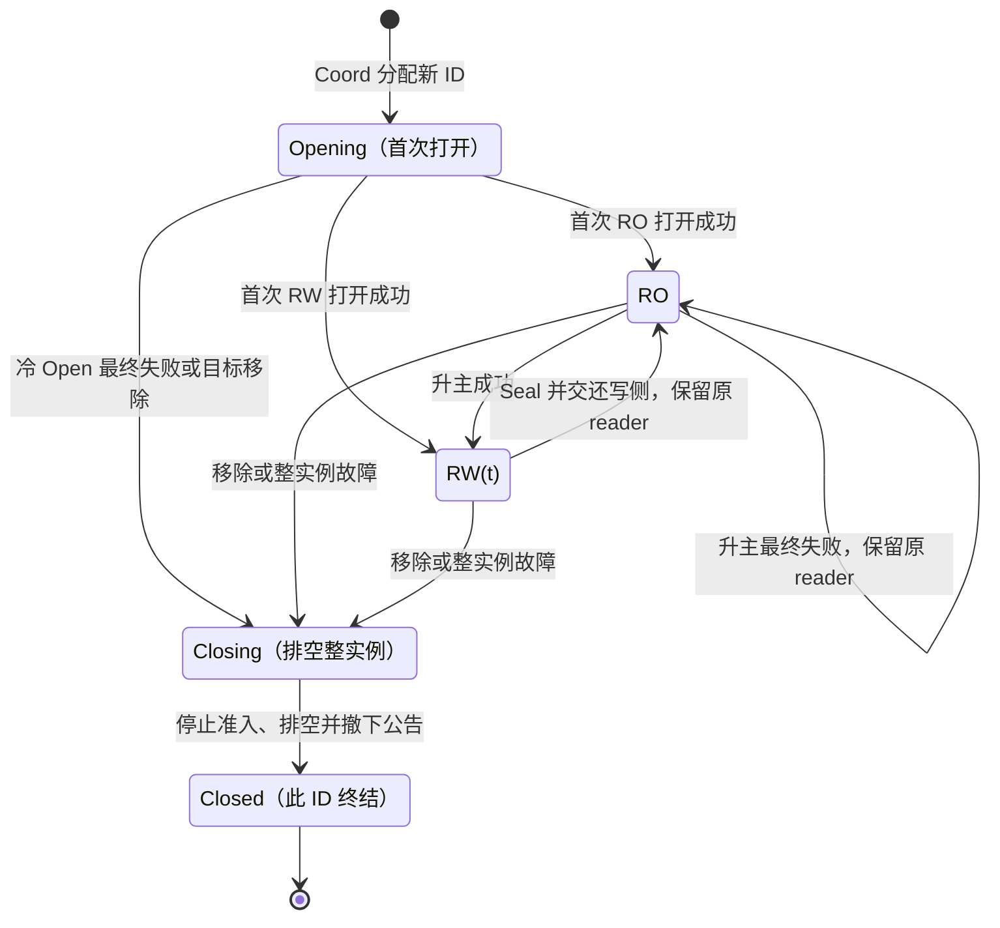
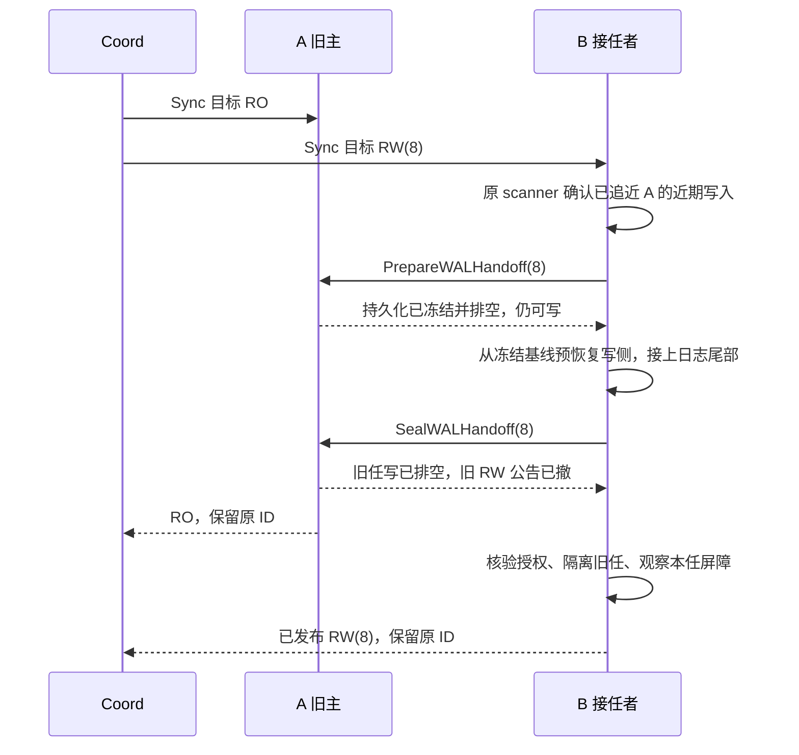

# WAL 副本状态机与 Coord 收敛

一个 WALReplicaID 标识一个 PChannel 在一个 StreamingNode 上的一次生命周期。Coord 创建或移除这个身份，为某个成员授予 writer term。SN 持有实际资源，向 Coord 回报这次操作执行到了哪里。客户端经 SN session 发现已经开放的端点。清单的 `PREPARING` 表示操作尚未结束，`RO`、`RW` 和 `CLOSED` 表示操作完成后的实际状态。只有 `RW` 携带本地生效的 writer term。[生产协议](../../../../pkg/proto/streaming.proto) · [WAL 多副本工作流](wal-replicas.md)

## 一、先看一个 ID 的一生

这张图画一个固定的 `(PChannel, NodeID, WALReplicaID)`。箭头上的操作可以耗时；操作执行中统一报 Preparing。图中的 Opening、Closing 是本地资源阶段。RO、RW(t)、Closed 是可以向 Coord 回报的确定结果。

**每条边的判据是资源归属。** 打开一个新 ID 时，Open 拥有它创建的所有资源；它可以创建临时 reader。一个已经建立的 RO 拥有独立的 scanner、Buffer 和 QueryRuntime，Promote 只拥有本次新建的写侧。因此同是写侧初始化失败，首次冷 Open 清理完整实例后得到 Closed，已有 RO 升主失败则得到原 ID 的 RO。角色切换只给新建的 writer 重放其缺少的日志，已有 QueryRuntime 继续从原 scanner 接收输入。[打开与原地提升](../../../../internal/streamingnode/server/wal/adaptor/opener.go) · [恢复基线与 Buffer](wal-replica-commit.md)

| 操作 | 开始条件和执行顺序 | 完成、重试和边界 |
| --- | --- | --- |
| 首次打开 RO | 当前注册首次获分配此 ID，读取 etcd checkpoint 和持久 View，从安全位置读共享 WAL，建立读侧并发布 RO 公告。 | 读侧可用即报 RO。每个 View 单独恢复。临时读取失败仍在 Opening，最终放弃且清理完毕才报 Closed。 |
| 首次打开 RW(t) | 核对当前授权。有旧主时用临时读侧追近并协作；无旧主时从持久基线恢复。隔离旧 writer，用本任 RecoveryBarrier 完成恢复，开放写准入，发布 RW(t)。 | 成功报 RW(t)。冷 Open 最终放弃，排尽写侧、关闭临时 reader、撤下可能发布的公告后报 Closed。若已先作为独立 RO 完成安装和公告，随后的写授权应走下一行。 |
| RO 升为 RW(t) | 保留已建立的 reader，固定恢复游标，构建写侧 RecoveryStorage，完成交接或故障接管，再开放本任写入。 | 成功报 RW(t)。最终失败时停止本次 writer 的外部副作用、释放临时资源并确认 RO 公告，报 RO。即使 term 已用过，原 reader 仍属于同一 ID。 |
| RW(t) 降为 RO | 接受降级目标后维持旧写服务，等接任者追近。Prepare 关闭持久化准入并排尽在途提交；Seal 关闭 Append 和 Strong、排尽写，更新公告并交还 writer 专属资源。 | 完成报 RO。调用超时、排空尚未完成、公告结果未知都报 Preparing。已关闭的准入只能向前排空。正常交接中旧主与接任者的动作顺序见下节。 |
| 移除或关闭 | 移除某个 ID、关闭整个 PChannel，或独立的本地故障使整个实例无法继续。Closing 获得整实例的清理责任，停止新操作，排空 writer 和查询引用，停止后台任务并撤下公告。 | 执行中清单仍列旧 ID 为 Preparing。清理完成进入 Closed。Coord 再次选择同一 Node 也须创建新 ID。 |
| 沿用目标 | ID、实际角色与 writer term 都匹配。成员集合变化时更新 QueryView 参与者，CChannel 标记变化时更新公告。 | 无须重建 WAL。单纯的公告 I/O 失败只重试发布；更新成功后报告既有角色。 |

有两个独立事件可以打断图上的操作。**整实例故障**发生时，例如共享的本地 scanner 以致命错误退出，生命周期管理器可以从任何打开阶段接管并走 Closing；迟到的 Promote 成功或失败回调都不能覆盖关闭结果。若故障仅损坏 writer，且能证明旧任已隔离、读侧完整可用，则可沿“交还写侧”这条边保留 RO。**进程宕机**时本地状态机随之消失，Coord 依据原注册退出进行故障规划；收不到最终的 Closed 是正常情况。仅有 Sync 或主备订阅断流时，原注册和本地实例仍可存活。

## 二、再把两个 ID 放进同一次交接

设 A 正在服务 RW(7)，B 已是 RO。Coord 持久化新拓扑，指定 B 为 RW(8)，保留 A 为 RO。SN 接受拓扑即可回报 Preparing。在准备阶段，“A 已经接受降级目标”和“A 仍能接受写入”可以同时成立。

图中两个发给 Coord 的终态回报可按任意顺序到达。B 的接管前提是写授权、旧 writer 隔离和恢复屏障；无需等待 Coord 转发 A 的 RO。A 在 Prepare 后仍可 Append 和 Strong，新的持久化与 View 提交已冻结。从 A 启动 Seal 到客户端发现 B/8，会有一个写服务等待窗口。当前客户端的 WAL 查询也经 RW。保留本地 QueryRuntime 能避免角色切换引起的全量重建。[交接 RPC 及恢复屏障](wal-replica-protocol.md#5-协作交接的时序) · [写准入的单向排空](../../../../internal/streamingnode/server/wal/replica/admission.go)

| 交接停在哪里 | A 还拥有什么能力 | B 与 Coord 如何继续 |
| --- | --- | --- |
| Prepare 前 | 完整的 RW(7)。 | B 等待近期物理 TimeTick。失败仍可重试。若 A 注册消失，B 重新核验授权后走故障接管。 |
| Prepare 已开始，尚未 Seal | 持久化入口已关闭，可能仍在排空；Append 仍可用。 | Prepare 的结果未知时直接确认或重试同一个动作。若 B 最终放弃升主则报 RO；Coord 发更高 term 给下一次尝试。A 可服务新授权的接任者或在自己再次当选时本地换任。 |
| Seal 已开始，应答丢失或 RO 公告未确认 | 新写入口已经关闭。在途写及公告更新可能尚未结束。 | A 继续完成已开始的排空与公告更新。B 重试或核实未决的 Seal；此处不得回到“等 A 再写一个 TimeTick”。若新接任者 C 已开始等待追近，应在发现 A 公告变更或等待超时后重新解析写源。过期任期的 RPC 无权重新开放或关闭新任准入。 |
| A 已 Seal，B 的激活尚未发布 | A 只能作为 reader。 | B 继续完成本任恢复。若 writer 已建立、仅 session PUT 结果未知，先读回本注册公告并重试发布，保持 Preparing。若本任 writer 最终放弃，B 清理写侧后报 RO，Coord 才授予更高 term。 |
| A 或 B 中途宕机 | 注册退出的一方不能再报告。存活的 A 保留已到达的排空阶段。 | A 退出时，已获授权的 B 从 etcd、对象存储和共享 WAL 接管。B 退出时，Coord 按当前 RG 放置选择接任者并提高 term。新接任者与仍可写的 A 协作；若 A 已 Seal，则按持久基线恢复。两者均退出时，重新分配新 ID 冷启动。 |

**旧主再次当选。** A 以 ID1 提供 RW(7)。Coord 已持久化目标 B/8，B 在请求 A 执行 Seal 前退出注册。若放置策略重新选中 A，此时持久目标从 B/8 变为 A/9，A 的本地实例却仍可能是 RW(7)。A 使用原 ID 在本机完成旧任的 Prepare、Seal、降为 RO，再升为 RW(9)。如果 A 已在上一轮完成 Seal，就直接从 RO 升主。此例组合了图上已有的降级和升主两条边。稳定的 A 保持目标 writer 时，仅增删 RO、重发 Sync 或提高拓扑 revision 都保持原 writer term。[Coord 对未公告 writer 的改派条件](../../../../internal/streamingcoord/server/balancer/topology/controller.go) · [SN 本地旧任排空](../../../../internal/streamingnode/server/walmanager/replica_sync.go)

一个需要单独验证的活性边界是**接任者在 Seal 途中被替换**。即使 B 已退出，A 已开始的 Seal 也须自行收尾，或由对最新授权的幂等操作驱动至完成。若 A 一直保留旧 RW 公告且等待 B 重来，C 又依赖 A 产生新 TimeTick 才能开始交接，三方会卡住。A 的排空责任属于旧 writer 的生命周期，可以用本地在途工作完成，无需在 etcd 记录 handoff 阶段。注册或存储持续不可用时，协议只能保证旧任不会重新开放写入。[当前的追近与重试入口](../../../../internal/streamingnode/server/walmanager/replica_sync.go) · [Prepare 和 Seal 实现](../../../../internal/streamingnode/server/wal/adaptor/wal_adaptor.go)

## 三、Coord 如何从全量清单做决策

Coord 为每个 PChannel 持久化一份 desired topology。成员、writer 或写任期变化时，分配新的单调 revision，用前一份拓扑做 CAS，成功后广播。SN 取所有 PChannel 的最大 revision 作为本批 `observed_revision`。每个清单项含 PChannel、WALReplicaID 和操作结果；仅 RW 带实际生效的 writer term。NodeID 来自当前注册的控制连接。例如 P 的 revision 为 2、Q 的为 11，节点回报的外层版本为 11，P 上 ID1 尝试的 term 仍从 P 的拓扑读取。[版本与持久化](../../../../internal/streamingcoord/server/balancer/topology/controller.go) · [拓扑 CAS](../../../../internal/metastore/kv/streamingcoord/replica_topology.go)

| 当前目标 | 当前注册、当前控制流、当前全集版本的报告 | Coord 下一步 |
| --- | --- | --- |
| RO 或 RW(t) | Preparing，或期望中的 ID 暂时缺项 | 等待并重发当前目标。首次 RW 正在恢复尚未公告、注册仍有效时暂缓改派。控制流断开清除该流报告，再收全量。 |
| RO 或 RW(t) | 相应的 RO 或 RW(t) | 该成员达到目标。同一报告重复到达无需写 etcd。 |
| RW(t) | RO | 原 reader 仍存活。继续选择它时保留 ID、提高 term 和 revision；若策略改选其他成员，也给新接任者更高 term。确定的 RO 结果可解除首次公告等待。 |
| RO 或 RW(t) | Closed | 该 ID 已终结。仍需部署则分配新 ID 和新 revision。同一节点也适用。替换目标 writer 同时提高 term，仅替换 reader 则保留 writer term。 |
| 移出旧 ID | 同版本的完整清单仍列出旧实例 | 等待它排空。旧 ID 已从清单消失，或确认注册已退出后才完成移除。尚在目标内的 Closed 只保留身份和结果，目标移除后可删除这份内存记录。 |
| 降级或换任 | 收到终态 RW 但角色或 term 与本次目标矛盾 | 核对完整清单、写授权与 session，重新对账；持续矛盾按实现错误处理。等待对端的旧主应报 Preparing，此时仍有旧 writer 公告是合法的。 |

对同一个写目标 `B/ID1, revision=2, term=8`，B 报 RW(8) 时 Coord 保持原拓扑，B 报 RO 时再次选择 B 会产生 `ID1, term=9`，B 报 Closed 时再次选择 B 则产生 `ID2, term=9`。后两者均分配新 revision。Coord 重启从持久目标重新全量 Sync，无须保存上一次报告。

**避免重复执行。** 同一注册内重连、其他 PChannel 推高全集版本、或本 PChannel 只改了别的成员，都不能重启已经结束的同 ID、同 term 的升主。新目标确实取代在途操作时，按当前有效的副本、角色、写授权串行交接本地资源，复核并隔离迟到回调与公告写入。已发生的冻结、Seal 或整实例关闭仍须收尾；Closing 不能回到打开阶段。Closed 记录在期望仍引用该 ID 时必须可重报，因此丢掉第一次 Closed 应答也不会重新 Open 旧 ID。Coord 的 CAS 结果未知时重读最新拓扑，避免重复升任或重复分配。

**服务发现、迁出、成员确认各有一个完成点。** 新 writer 可服务时自行发布带 term 的 session 公告。跨节点搬迁遵循 `A/B → A/B/C → A/C`，替代成员达到目标后，Coord 才移出原成员。全频道显式关闭写入空拓扑，保留已分配的 term 上界，所有存活节点排空该频道。若关闭尚未完成就收到重新开放意图，应先用当前空拓扑的完整清单确认旧实例和在途 Open 均已退出，或确认原注册已消失，再用新 ID、更高 writer term 打开。这样即使快速关开，两次操作也不会合并成一次覆盖旧实例的授权。代价是一个控制流失联但注册仍存活的 SN 会延迟本频道重开。QueryView 的 `confirmed_query_memberships` 仍须覆盖所有存活 SN 的同版本清单，且无仍在排空的非成员。View 自身的 Ready、Up、Down 单独确认。[成员规划](../../../../internal/streamingcoord/server/balancer/topology/topology.go) · [QueryView 确认规则](wal-replica-protocol.md#4-up-和-down-的多副本确认)

## 四、合理性、前提与验证

对单个 ID，打开过程可创建完整实例，升主只增加写侧，降级只移交写侧，关闭才销毁读侧。这使一个终态报告足以指导 Coord 选择保 ID 或换 ID。对整个 PChannel，交接允许暂时没有 writer；任意时刻最多一个任期可成功写入，仍然依赖底层 WAL fence。把 Preparing 作为执行进度，能如实表达“旧主在排空，也仍在服务”，并使中间阶段无需持久化。它也意味着只从一条 Preparing 无法判断预计恢复时间。

| 要验证的反例 | 注入点与应观察到的结果 |
| --- | --- |
| 冷 Open 与 Promote 在同一写侧初始化步骤失败 | 分别用新 ID 和已公告的 RO 执行；前者清理后报 Closed，后者保留同一 scanner、Buffer、QueryRuntime 并报 RO。复发相同目标时 writer 初始化次数不增加。 |
| 目标在首次打开、升主或排空时变化 | 目标仍保留该 ID 时，复用已安装的健康读侧；目标移除时排尽在途 Open。尤其检查已经开始的公告 PUT 和新 ID 的公告，迟到请求不得覆盖新实例。 |
| Prepare、Seal、首次公告三个应答分别丢失 | 分别观察持久化、Append 和客户端发现的生效点。让 B 在 A 的写入口已关闭而公告更新暂时失败时退出，恢复 etcd 后用 C 验证可收敛；A 不需要再生成一个 TimeTick。 |
| writer 或整个 reader 独立失效 | writer 清理且 reader 健康时可报 RO；reader 致命失败则整实例关闭。延迟旧任务完成，使其回调晚于 Closed。已关闭 ID 的实际服务与公告均不能复活。 |
| Closed 回报丢失，Coord 在更改拓扑的 CAS 前后重启 | 同一 SN 注册重报完整清单；CAS 前由旧目标继续推进，CAS 后以新目标过滤旧报告。新的 writer term 和新 ID 各只分配一次有效授权。 |
| 同节点替换、移除后立即重新开放 | 在旧查询保有引用时触发关闭，保持旧 ID 出现在排空清单中。确认旧实例排空或注册消失后，以新 ID 启动。重复 Sync 不得触发二次 Close 或同 ID 重开。 |
| SN 重新注册，同时 Coord 重启 | 普通独立 SN 重启获得新 NodeID，可据此重新放置。若支持不同注册复用同一 NodeID，须验证 Coord 能跨重启识别注册代际；仅靠数字 NodeID 和新进程的空清单无法安全继承旧生命周期。[注册实现](../../../../internal/util/sessionutil/session_util.go) |
| 失败持续或全集版本频繁变化 | 可恢复错误在同一操作中退避；反复终结的尝试需限制重规划速率。仍在续租但永久阻塞的节点、始终变化的全集或长期不可用的存储都会延长收敛。一次超时不足以判定旧 writer 已停止。 |

SN 将已经接受的 Seal 交由本节点生命周期收尾。公告写入暂时失败时，在下一次 Sync 继续收尾。接任者在发出 Seal 前记住源节点和目标 term，丢失响应后可以对同一源直接重发。两端只保留本机在途操作所需的内存状态。进程退出后，存活方按照最新的写授权和 session 恢复。[交接实现](../../../../internal/streamingnode/server/walmanager/replica_handoff.go) · [应答丢失测试](../../../../internal/streamingnode/server/walmanager/replica_handoff_test.go)

Coord 根据当前控制流的完整清单重新规划。稳定的 RO 或 RW 保留副本 ID，Closed 的副本需要新 ID。终态失败的连续重规划受现有 WAL balancer 退避配置限速。等待同一 revision 收敛时，Coord 按 `streaming.walBalancer.backoffMaxInterval` 重发全量 Sync，进度回报不会推迟已经安排的重发。所有角色、任期和移除结果对齐后取消这项重发。空拓扑的重开检查位于规划层，须等存活注册确认排空。[本地状态收敛](../../../../internal/streamingnode/server/walmanager/replica_sync.go) · [Coord 决策](../../../../internal/streamingcoord/server/balancer/topology/controller.go) · [重规划测试](../../../../internal/streamingcoord/server/balancer/topology/controller_test.go)
