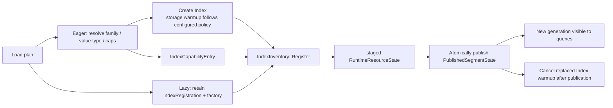
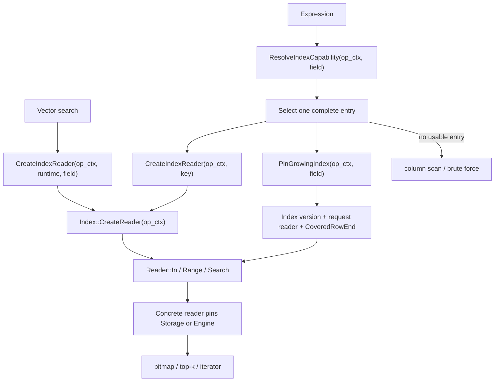

# Segment index architecture

This document covers segment registration, publication, and query selection. For the Index/Reader
contracts, context lifetime, and storage accounting, see
[Index contracts](../../index/contracts/README.md#index-and-request-reader-boundary).

Queries select an index capability, create a request reader, and execute through that reader.
Sealed and growing indexes use different ownership and publication mechanisms:

- sealed indexes are stored in `IndexInventory` and published atomically with `PublishedSegmentState`;
- growing indexes are held long-term by `GrowingIndexSet`, which publishes pinnable reader snapshots.

## Core components

`IndexCapabilityEntry`
: Describes an index's `IndexKey`, family, value type, and `ReaderCaps`. It contains only metadata
  and does not require opening a reader.

`IndexRegistration`
: Holds the stable key, index category, and JSON projection metadata. Lifecycle operations,
  vector-index lookup, and feature accounting read it without initializing a lazy entry.

`FieldIndexCapability`
: The immutable entry list of a field. A consumer must select one complete entry from it and must
  not combine capabilities from different entries.

`IndexInventory`
: The index inventory of a sealed segment, grouped by field and then keyed by `IndexKey`.
  Runtime snapshots share entries through `shared_ptr`. An eager entry holds resolved metadata
  and an `IIndex`. A lazy entry retains a factory that resolves metadata and creates its Index
  on first use. Each concrete Index owns its storage or engine cache.

`IIndexReaderBasePtr`
: The unique pointer owning a request reader. Deferred operations can transfer it to a shared
  lifetime owner in the query result; ordinary queries do not allocate shared ownership state.

`GrowingIndexSet`
: Solely holds one `IGrowingIndex` publisher per field. Writes reach the owner through a separate
  `IAppendable<Batch>` capability.

`GrowingIndexSnapshotPin`
: Retains a published Index version and a request reader, together with the contiguous coverage
  bound `CoveredRowEnd`.

## Loading code ownership

`SealedIndexLoader` and `TextMatchIndexLoader` live in this directory. They prepare
segment metadata and cache policy, then delegate artifact loading to the family
loaders under `index/`. `IndexLoadUtils` supplies their local staging root.
`InterimSealedIndexTranslator` also lives here because it builds an engine from
segment columns rather than reading a particular index-file format.

The JSON stats shared-key loader, `BsonInvertedIndexTranslator`, lives under
`segcore/json_stats/`. The version-independent single-cell cache adapter remains
at `index/SingleCellIndexStorageTranslator.h`. `segcore/storagev1translator/`
contains the field-data `ChunkTranslator` and `DefaultValueChunkTranslator`.

## Sealed: loading and publication

Lazy entry creation requires `queryNode.segcore.tieredStorage.lazyIndexSlotEnabled=true` and
effective index `warmup=disable`. It applies to persisted scalar indexes (including HYBRID and
typed JSON projections), vector indexes, and text indexes. The flag defaults to false and affects
future loads; already registered entries keep their initialization policy.

Storage cache warmup follows the configured policy independently of lazy Index creation.
A vector engine with native lazy loading manages its own data cache. Its non-evictable engine
slot preserves loading admission and resident resource accounting. Engine initialization follows
slot warmup or the first operation that needs it; Reader creation alone does not load it.

During loading, `IndexInventory::Register` installs one entry into a new runtime generation. An
eager entry resolves its family, value type, and capability before registration. A lazy entry
registers its `IndexRegistration` and factory. Queries see the complete entry set only after the
`PublishedSegmentState` is atomically published.

Runtime clones share each `Entry`, including its immutable registration and resolved state:
family, value type, capabilities, and Index. Replacement installs a new entry in the new inventory;
existing snapshots retain their original entry.

Both eager and lazy entries keep their result in `resolved_`. An eager entry is ready at construction.
A lazy entry serializes initialization with a small mutex. Waiters check their own cancellation token
between timed lock attempts, at 10 ms intervals; cancelling a waiter does not cancel the initializer.
Successful initialization releases its factory and captured load metadata, then publishes the result
with a sequentially consistent store to atomic `ready_`. `Resolve()` and `Peek()` use acquire
loads before reading a ready result, which is never modified after publication. `Peek()` returns empty
while initialization is pending, without triggering or waiting for the factory. Factory failures leave
the entry unready and its factory available for retry.

`ResolveCapability(op_ctx, field)` looks up the field's map and assembles a fresh immutable
`FieldIndexCapability` on each call, copying and sorting its entries without caching the list.
It resolves every lazy entry in that field before returning; successfully resolved entries are
reused if another entry fails. Resolution may inspect index artifacts. With disabled warmup,
ordinary storage cells remain cold; native lazy engines may initialize their own backend.
`Entries(field)` copies registrations without resolving them.

`CreateIndexReader(op_ctx, key)` resolves the selected entry and calls `Index::CreateReader(op_ctx)`.
The inventory checks that the reader's `Caps()` exactly match the resolved metadata. Creating the
request reader does not pin storage. Readers retain their Index version, so replacing an inventory
entry does not invalidate an existing request reader.

## Query: selection and execution

Expression consumers resolve a field's capabilities and select one complete entry. Vector search
looks up the unique vector registration directly. Both paths create a request reader with the query
context. Query methods such as `In()`, `Range()`, and `Search()` use that bound context internally.

An absent entry or unsupported query interface can allow raw-data fallback. Initialization,
capability consistency, and storage-load errors propagate instead of masquerading as absence.
A deferred iterator retains its exact engine cell; consumer callbacks also retain the request reader
when they use reader-owned interfaces or views. Releasing a request reader does not evict the Index's
storage, and creating another reader does not duplicate that storage.

## Growing snapshot bounds

`GrowingIndexSet` solely holds the writable `IGrowingIndex`. The owner can keep accepting appends and
publish snapshots with higher coverage; an older pin keeps the record it obtained, including the
reader dependencies, Count, validity/offset mapping, and the coverage bound.

`CoveredRowEnd` denotes contiguous coverage of the Segment row range `[0, end)`:

- it is not the query-visible row count; queries still apply timestamp/visibility rules
  independently;
- it is not the reader's internal element count; for null and nested data, coverage cannot be
  derived from the element count;
- growing vector queries use `min(query-visible row end, CoveredRowEnd)` to obtain the physical
  prefix and apply it before ANN candidates/top-k are generated;
- when the snapshot is empty or the capability is not satisfied, the consumer uses the
  corresponding raw fallback.

A Tantivy/R-Tree snapshot can bind an immutable engine view. A Knowhere snapshot can bind the same
live Add/Search engine, so a pin fixes the reader record, its dependencies, and the queryable
prefix; it does not guarantee that an older pin's ANN hit set stays unchanged.

## Key invariants

1. `IndexKey` contains both `FieldId` and an identity; different fields or different identity kinds
   are never confused.
2. Capability selection works on a single entry; capabilities cannot be combined across entries.
3. A request reader binds one context and retains its Index version. The Index owns persistent resources.
4. Borrowed query interfaces and views must not outlive their request reader or retained storage pin.
5. Sealed indexes are published with a complete runtime generation; a replaced Index is retired only
   after the new state is published. Registration and retirement never resolve a lazy entry.
6. Field capability assembly returns only a complete, immutable list. Lazy resolution failures
   remain retryable; entries already resolved successfully are reused.
7. After a sealed reader is opened, its `Caps()` must exactly match the resolved capability.
8. Array offsets belong to the column runtime state and are not stored by the reader, so that the
   reader does not reference a stale mapping after the column is replaced.
9. Growing coverage is independent of query visibility; the growing index path must not return rows
   outside the coverage.
