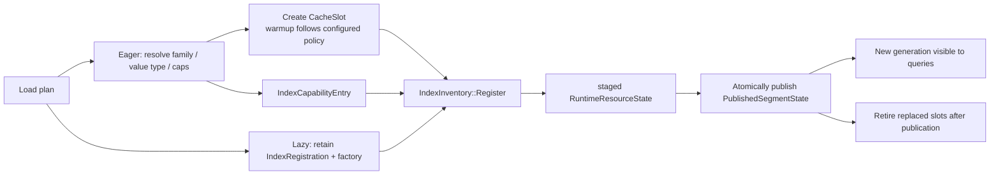
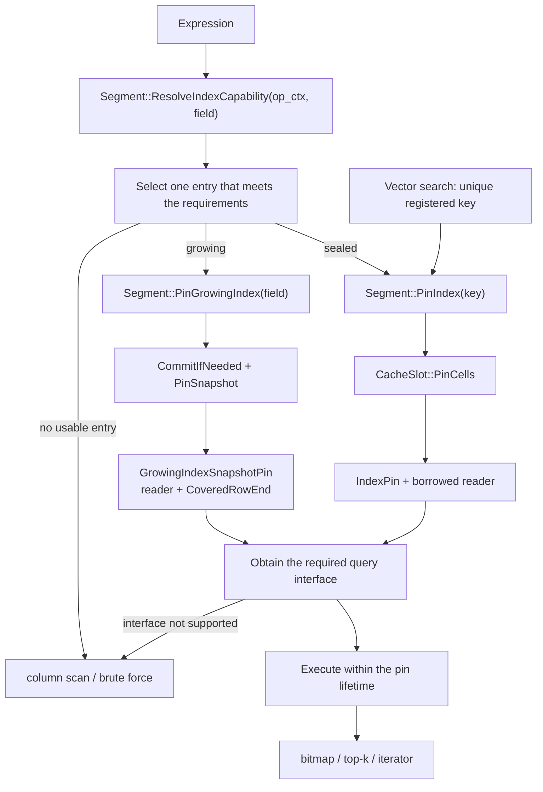

# Segment index architecture

Segcore exposes a single "capability selection + pin + borrowed reader" model, but sealed and
growing indexes use different ownership and publication mechanisms:

- sealed indexes are stored in `IndexInventory` and published atomically with `PublishedSegmentState`;
- growing indexes are held long-term by `GrowingIndexSet`, which publishes pinnable reader snapshots.

## Core components

`IndexCapabilityEntry`
: Describes an index's `IndexKey`, family, value type, and `ReaderCaps`. It contains only metadata
  and does not require opening a reader.

`IndexRegistration`
: Holds the stable key, index category, and JSON projection metadata. Lifecycle operations,
  vector-index lookup, and feature accounting read it without initializing a lazy entry.

`FieldIndexCapability`
: The immutable entry list of a field. A consumer must select one complete entry from it and must
  not combine capabilities from different entries.

`IndexInventory`
: The index inventory of a sealed segment, grouped by field and then keyed by `IndexKey`.
  Runtime snapshots share entries through `shared_ptr`. An eager entry holds resolved metadata
  and a `CacheSlot<IIndexReaderBase>`; warmup may already have loaded its reader. A lazy entry
  retains a factory that resolves metadata and creates its slot on first use.

`IndexPin`
: The move-only lifetime handle for sealed queries. It holds the cache accessor and exposes only the
  borrowed `IIndexReaderBase*` to consumers.

`GrowingIndexSet`
: Solely holds one `IGrowingIndex` publisher per field. Writes reach the owner through a separate
  `IAppendable<Batch>` capability.

`GrowingIndexSnapshotPin`
: Pins one published snapshot record. The record solely owns the reader and also records the
  contiguous coverage bound `CoveredRowEnd`; the pin shares the record's lifetime but not ownership
  of the reader.

## Sealed: loading and publication

Lazy entry creation requires `queryNode.segcore.tieredStorage.lazyIndexSlotEnabled=true` and
effective index `warmup=disable`. It applies to persisted scalar indexes (including HYBRID and
typed JSON projections), vector indexes, and text indexes. The flag defaults to false and affects
future loads; already registered entries keep their initialization policy.

Outer slot warmup follows the configured policy even when the vector engine supports internal
lazy loading. That engine capability still disables eviction of the outer slot. This warmup rule
applies independently of the lazy-slot configuration flag.

During loading, `IndexInventory::Register` installs one entry into a new runtime generation. An
eager entry resolves its family, value type, and capability before registration. A lazy entry
registers its `IndexRegistration` and factory. Queries see the complete entry set only after the
`PublishedSegmentState` is atomically published.

Runtime clones share each `Entry`, including its immutable registration and resolved state:
family, value type, capabilities, and slot. Replacement installs a new entry in the new inventory;
existing snapshots retain their original entry.

Both eager and lazy entries keep their result in `resolved_`. An eager entry is ready at construction.
A lazy entry serializes initialization with a small mutex. Waiters check their own cancellation token
between timed lock attempts, at 10 ms intervals; cancelling a waiter does not cancel the initializer.
Successful initialization releases its factory and captured load metadata, then publishes the result
with a release store to atomic `ready_`. `Resolve()` and `Peek()` use acquire
loads before reading a ready result, which is never modified after publication. `Peek()` returns empty
while initialization is pending, without triggering or waiting for the factory. Factory failures leave
the entry unready and its factory available for retry.

`ResolveCapability(op_ctx, field)` looks up the field's map and assembles a fresh immutable
`FieldIndexCapability` on each call, copying and sorting its entries without caching the list.
It resolves every lazy entry in that field before returning; successfully resolved entries are
reused if another entry fails. Resolution may inspect index artifacts, but disabled warmup leaves
new reader cells unloaded. `Entries(field)` copies registrations without resolving them.

`PinIndex` resolves the selected entry and pins its cell through `CacheSlot::PinCells`, loading the
reader if needed. The inventory checks that the reader's `Caps()` exactly match the resolved metadata.

Slots are held by `shared_ptr`, so the published state, the old state during replacement, and the
cache accessor can jointly keep a slot alive; the slot's cell still solely owns the reader.
Replacing or removing an entry does not invalidate pins that have already been obtained.

## Query: selection, pin, and execution

Expression consumers resolve the field capability, then select one entry according to the query's
requirements. Vector search can identify its unique vector registration directly and resolve that
entry through `PinIndex`. Sealed and growing indexes take their own pin paths, and both provide the
executor with only a borrowed query interface.

When the entry or the required interface does not exist, the consumer may take its own raw fallback.
Cache load errors or capability consistency errors raised after entering the pin propagate directly
and are not treated as "index does not exist". A deferred iterator must keep the sealed accessor
lifetime or the growing snapshot pin until its results have been fully consumed.

## Growing snapshot bounds

`GrowingIndexSet` solely holds the writable `IGrowingIndex`. The owner can keep accepting appends and
publish snapshots with higher coverage; an older pin keeps the record it obtained, including the
reader dependencies, Count, validity/offset mapping, and the coverage bound.

`CoveredRowEnd` denotes contiguous coverage of the Segment row range `[0, end)`:

- it is not the query-visible row count; queries still apply timestamp/visibility rules
  independently;
- it is not the reader's internal element count; for null and nested data, coverage cannot be
  derived from the element count;
- growing vector queries use `min(query-visible row end, CoveredRowEnd)` to obtain the physical
  prefix and apply it before ANN candidates/top-k are generated;
- when the snapshot is empty or the capability is not satisfied, the consumer uses the
  corresponding raw fallback.

A Tantivy/R-Tree snapshot can bind an immutable engine view. A Knowhere snapshot can bind the same
live Add/Search engine, so a pin fixes the reader record, its dependencies, and the queryable
prefix; it does not guarantee that an older pin's ANN hit set stays unchanged.

## Key invariants

1. `IndexKey` contains both `FieldId` and an identity; different fields or different identity kinds
   are never confused.
2. Capability selection works on a single entry; capabilities cannot be combined across entries.
3. A reader is always solely owned by a sealed cache cell or a growing snapshot record; consumers
   only borrow it.
4. A borrowed reader, query interface, and their views must not outlive the corresponding pin.
5. Sealed indexes are published with a complete runtime generation; a replaced slot is retired only
   after the new state is published. Registration and retirement never resolve a lazy entry.
6. Field capability assembly returns only a complete, immutable list. Lazy resolution failures
   remain retryable; entries already resolved successfully are reused.
7. After a sealed reader is opened, its `Caps()` must exactly match the resolved capability.
8. Array offsets belong to the column runtime state and are not stored by the reader, so that the
   reader does not reference a stale mapping after the column is replaced.
9. Growing coverage is independent of query visibility; the growing index path must not return rows
   outside the coverage.
