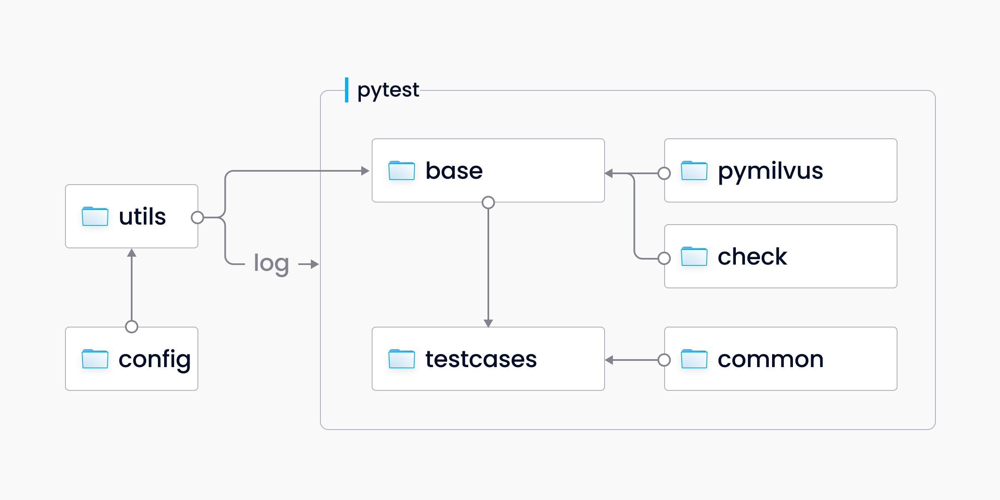
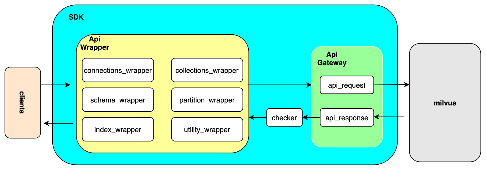

# Guidelines for Test Framework

This document guides you through the Pytest-based PyMilvus test framework.

> You can find the test code on [GitHub](https://github.com/milvus-io/milvus/tree/master/tests/python_client).


## Quick Start

### Deploy Milvus

To accommodate the variety of requirements, Milvus offers as many as four deployment methods. PyMilvus supports Milvus deployed with any of the methods below:

1. [Build from source code](https://github.com/milvus-io/milvus#to-start-developing-milvus)
2. Install with Docker Compose 
   - [standalone](https://milvus.io/docs/install_standalone-docker.md)
   - [cluster](https://milvus.io/docs/v2.0.0/install_cluster-docker.md)

3. Install on Kunernetes 
   - [standalone](https://milvus.io/docs/install_standalone-helm.md)
   - [cluster](https://milvus.io/docs/v2.0.0/install_cluster-helm.md)

4. Install with KinD

> For test purposes, we recommend installing Milvus with KinD. KinD supports the ClickOnce deployment of Milvus and its test client. KinD deployment is tailored for scenarios with small data scale, such as development/debugging test cases and functional verification.

- **Prerequisites**

   - [Docker](https://docs.docker.com/get-docker/) (19.05 or higher)
   - [Docker Compose](https://docs.docker.com/compose/install/) (1.25.5 or higher)
   - [jq](https://stedolan.github.io/jq/download/) (1.3 or higher)
   - [kubectl](https://kubernetes.io/docs/tasks/tools/) (1.14 or higher)
   - [Helm](https://helm.sh/docs/intro/install/) (3.0 or higher)
   - [KinD](https://kind.sigs.k8s.io/docs/user/quick-start/#installation) (0.10.0 or higher)

- **Install KinD with script**

   1. Enter the local directory of the code ***/milvus/tests/scripts/**
   2. Build the KinD environment, and execute CI Regression test cases automatically:

   ```shell
   $ ./e2e-k8s.sh 
   ```

   - By default, KinD environment will be automatically cleaned up after the execution of the test case. If you need to keep the KinD environment:

   ```shell
   $ ./e2e-k8s.sh --skip-cleanup
   ```

   - Skip the automatic test case execution and keep the KinD environment:

   ```shell
   $ ./e2e-k8s.sh --skip-cleanup --skip-test --manual
   ```

> Note: You need to log in to the containers of the test client to proceed manual execution and debugging of the test case.

   - See more script parameters:

   ```shell
$ ./e2e-k8s.sh --help
   ```

   - Export cluster logs:

   ```shell
$ kind export logs .
   ```


### PyMilvus Test Environment Deployment and Case Execution

We recommend using Python 3.12, consistent with the Python client CI runtime.

> Note: Procedures listed below will be completed automatically if you deployed Milvus using KinD.

1. Install the Python package prerequisite for the test, enter ***/milvus/tests/python_client/**, and execute:

   ```bash
   $ pip install -r requirements.txt
   ```

2. The default test log path is **/tmp/ci_logs/** under the **config** directory. You can add environment variables to change the path before booting up test cases:

   ```bash
   $ export CI_LOG_PATH=/tmp/ci_logs/test/
   ```

| **Log Level** | **Log File**      |
| ------------- | ----------------- |
| `debug`       | ci_test_log.debug |
| `info`        | ci_test_log.log   |
| `error`       | ci_test_log.err   |

1. You can configure default parameters in **pytest.ini** under the root path. For instance:

   ```python
   addopts = --host *.*.*.*  --html=/tmp/ci_logs/report.html
   ```

where `host` should be set as the IP address of the Milvus service, and `*.html` is the report generated for the test.

2. Enter **testcases** directory, run following command, which is consistent with the command under the pytest framework, to execute the test case:

   ```bash
   $ python3 -W ignore -m pytest <test_file_name>
   ```

### RLS SDK coverage

`milvus_client/test_milvus_client_rls.py` covers synchronous and asynchronous RLS
policy/tag management, principal binding, sharing/revocation, collection
properties, database overrides, and supported read/write paths. Its schema
matrix checks six vector types with Int64 and VarChar primary keys, including
JSON, string arrays, and nullable scalar values. Each case owns its collections;
the suite uses the configured administrator for setup and complete stored-data
checks. It does not provision RBAC users or change server configuration.

The mixed-segment cases interleave Alice and Bob in **every** segment group:

| Segment path | Alice | Bob | Total |
| --- | ---: | ---: | ---: |
| Sealed with a completed vector index | 1,500 | 1,500 | 3,000 |
| Sealed without a vector index | 250 | 250 | 500 |
| Growing | 250 | 250 | 500 |

Setup inserts and flushes 3,000 rows, inserts and flushes 500 rows, creates the
index and waits for readiness, loads the collection, then inserts 500 rows
without flushing. Both owners alternate within every batch. One shard and
collection-scoped auto-compaction disablement preserve the intended layout.
The test environment must use `500 < indexCoord.segment.minSegmentNumRowsToEnableIndex
<= 3000` (the standard value is `1024`); confirm this when preparing the instance.
Tests use SDK index-readiness and loaded-segment metadata checks, plus exact
row comparisons with and without `ignore_growing`. They do not use the segment
`index_id` as evidence of physical index files. Sealed segment identities are
checked again around writes.
Each mutation API targets distinct original rows belonging to its principal
in all three groups, followed by complete stored-value checks for both owners.
Mixed-segment coverage includes synchronous schema/read/write cases, async
reads/writes, rejected batches, and sharing/revocation. Small fixtures remain
for SDK argument and metadata-management cases where segment shape is irrelevant.
Vectors use the suite's shared `cf.gen_vectors` helper with dimension 128.
Each mixed fixture generates a full batch and checks that all 4,000 vectors
remain distinct after dtype conversion. Full updates and new inserts also use
fresh vectors from the same helper. Expected search scores are computed from
the encoded vectors rather than from primary-key ordinals.
SearchIterator has a separate matrix that exhausts every segment group, using
Alice, Bob, an unbound principal, and administrative bypass, each with and
without `ignore_growing`. It checks exact IDs, every returned scalar field,
duplicates, and EOF. This uses all candidate rows; the small sentinel set in
top-K Search/HybridSearch is not evidence of complete iteration.
The Go and Python matrices use batch size 127 and dimension 128. INT8 vectors
sample the full signed-byte range through each suite's shared generator, with
HNSW `M=16`, `efConstruction=200`, and search `ef=4096`. Fixtures are independently
random, not identical cross-SDK datasets. Other vector types retain their shared
generator defaults. Distinct vectors can still have equal distances; ties do
not relax iterator completeness assertions.
For `BIN_IVF_FLAT`, iterator construction and page retrieval explicitly check
the unsupported-index error when encountered. It is not counted as successful
indexed iteration; supported paths must still exhaust all authorized rows.

`requirements.txt` pins `pymilvus[bulk_writer]==3.1.0rc96` from Test PyPI,
which includes the merged [RLS APIs](https://github.com/milvus-io/pymilvus/pull/3827).
Use a fresh Python 3.12 virtual environment and install this requirements file;
its `--find-links` entry provides the pinned RC package. The RLS tests no longer
require a Git checkout of the SDK.

Negative cases check rejected metadata and request-context changes against the
previous policy, tags, and stored rows. Synthetic tenant/space cases cover
read-only and writable memberships, direct/group/link sharing, revocation,
resource moves, and enabling RLS on existing data. Legacy-schema migration adds
nullable permission fields, leaves some rows unfilled, and verifies partial
backfill before and after enforcement. Schema changes seal existing growing
segments; the migration case checks that transition and NULL values explicitly.

Strict SearchIterator completeness assertions are retained for the known
equal-distance pagination issue [#54188](https://github.com/milvus-io/milvus/issues/54188).
A passing subset does not imply that the complete RLS matrix is green.

From the Milvus repository root, run against an existing development deployment:

```bash
milvus-dev-cli pysdk-e2e local . -b master --deploy <deployment-name> \
  -t tests/python_client/milvus_client/test_milvus_client_rls.py \
  -- -n 6 --timeout 180
```

This is SDK functional coverage. RBAC privilege separation, bulk import, CDC,
fault injection, and the known security issues #54025, #54026, and #54027 are
outside this module's coverage; a passing result is not RLS security sign-off.

## An Introduction to Test Modules

### Module Overview





### Working directories and files

- **base**: stores the encapsulated **PyMilvus** **module** files, and setup & teardown functions for pytest framework.
- **check**: stores the **check module** files for returned results from interface.
- **common**: stores the files of **common methods and parameters** for test cases.
- **config**: stores the **basic configuration file.**
- **testcases**: stores **test case scripts.**
- **utils**: stores **utility programs**, such as utility log and environment detection methods.
- **requirements.txt**: specifies the **python package** required for executing test cases
- **conftest.py**: you can compile fixture functions or local plugins in this file. These functions and plugins implement within the current folder and its subfolder.
- **pytest.ini**: the main configuration file for pytest.

### Critical design ideas

- **base/\*_wrapper.py** encapsulates the tested interface, uniformly processes requests from the interface, abstracts the returned results, and passes the results to **check/func_check.py** module for checking.
- **check/func_check.py** encompasses result checking methods for each interface for invocation from test cases.
- **base/client_base.py** uses pytest framework to process setup/teardown functions correspondingly.
- Test case files in **testcases** folder should be compiled inheriting the **TestcaseBase** module from **base/client_base.py**.  Compile the common methods and parameters used by test cases into the **Common** module for invocation.
- Add global configurations under **config** directory, such as log path, etc.
- Add global implementation methods under **utils** directory, such as utility log module.

### Adding codes

This section specifies references while adding new test cases or framework tools.

#### Notice and best practices

1. Coding style

- Test files: each SDK category corresponds to a test file. So do `load` and `search` methods.

- Test categories: test files fall into two categories

  - `TestObjectParams`:
    - Indicates the parameter test of corresponding interface. For instance, `TestPartitionParams` represents the parameter test for Partition interface.
    - Tests the target category/method under different parameter inputs. The parameter test will cover `default`, `empty`, `none`, `datatype`,  `maxsize`, etc.
  - `TestObjectOperations`:
    - Indicates the function/operation test of corresponding interface. For instance, `TestPartitionOperations` represents the function/operation test for Partition interface.
    - Tests the target category/method with legit parameter inputs and interaction with other interfaces.

- Testcase naming

  - `TestObjectParams`:

    - Name after the parameter input of the test case. For instance, `test_partition_empty_name()` represents test on performance with the empty string as the `name` parameter input.

  - `TestObjectOperations`

    - Name after the operation procedure of the test case. For instance, `test_partition_drop_partition_twice()` represents the test on the performance when dropping partitions twice consecutively.
    - Name after assertions. For instance, `test_partition_maximum_partitions()` represents test on the maximum number of partitions that can be created.

2. Notice

- Do not initialize PyMilvus objects in the test case files.
- Generally, do not add log IDs to test case files.
- Directly call the encapsulated methods or attributes in test cases, as shown below:

> To create multiple partitions objects, call `self.init_partition_wrap()`, which returns the newly created partition objects. Call `self.partition_wrap` instead when you do not need multiple objects.

   ```python
# create partition  -Call the default initialization method
partition_w = self.init_partition_wrap()
assert partition_w.is_empty
   ```

   ```python
# create partition    -Directly call the encapsulated object
self.partition_wrap.init_partition(collection=collection_name, name=partition_name)
assert self.partition_wrap.is_empty
   ```

- To test on the error or exception returned from interfaces:
  - Call `check_task=CheckTasks.err_res`.
  - Input the expected error ID and message.

   ```python
  # create partition with collection is None
  self.partition_wrap.init_partition(collection=None, name=partition_name, check_task=CheckTasks.err_res, check_items={ct.err_code: 1, ct.err_msg: "'NoneType' object has no attribute"})
   ```

- To test on the normal value returned from interfaces:
  - Call `check_task=CheckTasks.check_partition_property`. You can build new test methods in `CheckTasks` for invocation in test cases.
  - Input the expected result for test methods.

   ```python
  # create partition
  partition_w = self.init_partition_wrap(collection_w, partition_name, check_task=CheckTasks.check_partition_property, check_items={"name": partition_name, "description": description, "is_empty": True, "num_entities": 0})
   ```

3. Adding test cases

- Find the encapsulated tested interface with the same name in the ***_wrapper.py** files under **base** directory. Each interface returns a list with two values, among which one is interface returned results of PyMilvus, and the other is the assertion of normal/abnormal results, i.e. `True`/`False`. The returned judgment can be used in the extra result checking of test cases.
- Add the test cases in the corresponding test file of the tested interface in **testcases** folder. You can refer to all test files under this directory to create your own test cases as shown below:

   ```python
   @pytest.mark.tags(CaseLabel.L1)
   @pytest.mark.parametrize("partition_name", [cf.gen_unique_str(prefix)])
   def test_partition_dropped_collection(self, partition_name):
       """
       target: verify create partition against a dropped collection
       method: 1. create collection1
               2. drop collection1
               3. create partition in collection1
       expected: raise exception
       """
       # create collection
       collection_w = self.init_collection_wrap()
       # drop collection
       collection_w.drop()
       # create partition failed
       self.partition_wrap.init_partition(collection_w.collection, partition_name, check_task=CheckTasks.err_res, check_items={ct.err_code: 4, ct.err_msg: "collection not found"})
   ```

- Tips
   - Case comments encompass three parts: object, test method, and expected result. You should specify each part.
   - Initialize the tested category in the setup method of the Base category in the **base/client_base.py** file, as shown below:
   ```python
   self.connection_wrap = ApiConnectionsWrapper()
   self.utility_wrap = ApiUtilityWrapper()
   self.collection_wrap = ApiCollectionWrapper()
   self.partition_wrap = ApiPartitionWrapper()
   self.index_wrap = ApiIndexWrapper()
   self.collection_schema_wrap = ApiCollectionSchemaWrapper()
   self.field_schema_wrap = ApiFieldSchemaWrapper()
   ```
   - Pass the parameters with corresponding encapsulated methods when calling the interface you need to test on. As shown below, align all parameters with those in PyMilvus interfaces except for `check_task` and `check_items`.
   ```python
   def init_partition(self, collection, name, description="", check_task=None, check_items=None, **kwargs)
   ```
   - `check_task` is used to select the corresponding interface test method in the ResponseChecker check category in the **check/func_check.py** file. You can choose methods under the `CheckTasks` category in the **common/common_type.py** file.
   - The specific content of `check_items` passed to the test method is determined by the implemented test method `check_task`.
   - The tested interface can return normal results when `CheckTasks` and `check_items` are not passed.

4. Adding framework functions

- Add global methods or tools under **utils** directory.

- Add corresponding configurations under **config** directory.
